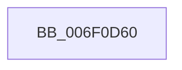

# sub_006F0D60

- RVA: `0x006F0D60`–`0x006F0D75` (길이 `21` bytes)
- VA: `0x00000001406F0D60`
- 실행 섹션: `.text`
- PDB 이름 있음: `아니요`; PDB Function 태그: `아니요`
- unwind 정보 RVA: `0x000A66B4`
- 디코드: `5`개 명령, `21/21` bytes 표시
- 미해석 바이트: `0` (있으면 어셈블리에 `.byte`로 보존)

> 이 문서는 커널 이미지의 기계어와 PDB 기호를 분석해 생성했습니다. 4번과 5번은 함수 원형과 자료형을 바이너리 사용 방식에서 추정한 C 해석이며 원본 소스 복구 결과는 아닙니다.

## 1. Dependencies

- 직접 호출 지점: **0**; 고유 호출 대상: **0**
- 직접 호출자로 확인된 함수: **0**
- RIP 상대 이미지 참조: **0**

### Outgoing calls
- 직접 디코드된 call 명령이 없습니다.

### Direct callers
- 이 함수 시작 RVA로 연결되는 직접 call은 확인되지 않았습니다. 간접 호출은 완전히 역산할 수 없습니다.

### Static image references
- 디코드된 RIP-relative 메모리 참조가 없습니다.

## 2. Other-region calls and transfers

- 다른 실행 섹션으로 향하는 call: **0**
- call이 아닌 외부 분기/꼬리 이동: **1**
  - `0x006F0D70` → [KePrepareToDispatchVirtualProcessor + 0xA1](../44/KePrepareToDispatchVirtualProcessor_function_0044B3C0.md) (`tail-transfer`)

## 3. Assembly (complete function range)

```asm
006F0D60  0F B7 C1                        movzx eax, cx
006F0D63  49 89 06                        mov qword ptr [r14], rax
006F0D66  C6 06 01                        mov byte ptr [rsi], 1
006F0D69  66 89 8B E6 06 00 00            mov word ptr [rbx + 0x6e6], cx
006F0D70  E9 EC A6 D5 FF                  jmp 0x14044b461
```

## 4. C-style interpretation (structured pseudocode)

```c
__int64 __fastcall sub_006F0D60(unsigned __int16 a1)
{
    *(unsigned __int64 *)(v_r14) = a1;
    *(unsigned __int8 *)(v_rsi) = 1;
    *(unsigned __int16 *)(v_rbx + 1766) = a1;
}
```

## 5. (Beta) C Style

```c
int64_t sub_006F0D60(uint16_t Arg1)
{
    *(uint64_t *)(local_r14) = Arg1;
    *(uint8_t *)(local_rsi) = 1;
    *(uint16_t *)(local_rbx + 0x6E6) = Arg1;
}
```

## 6. Execution-region graph

[열기: 2D/3D 그래프와 함수 탐색 컨트롤 패널](../../../control-panel.html?section=text&rva=0x006F0D60&view=graph)

- 2D 그래프는 위에서 아래로 흐르고, 3D 그래프는 빈 공간을 드래그해 회전합니다. Shift+드래그는 이동, 휠은 확대·축소, 함수 노드 선택은 대상 보고서 이동입니다.

### Static fallback


