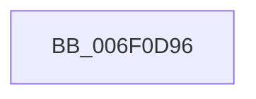

# sub_006F0D96

- RVA: `0x006F0D96`–`0x006F0DC7` (길이 `49` bytes)
- VA: `0x00000001406F0D96`
- 실행 섹션: `.text`
- PDB 이름 있음: `아니요`; PDB Function 태그: `아니요`
- unwind 정보 RVA: `0x000A6770`
- 디코드: `11`개 명령, `49/49` bytes 표시
- 미해석 바이트: `0` (있으면 어셈블리에 `.byte`로 보존)

> 이 문서는 커널 이미지의 기계어와 PDB 기호를 분석해 생성했습니다. 4번과 5번은 함수 원형과 자료형을 바이너리 사용 방식에서 추정한 C 해석이며 원본 소스 복구 결과는 아닙니다.

## 1. Dependencies

- 직접 호출 지점: **2**; 고유 호출 대상: **1**
- 직접 호출자로 확인된 함수: **0**
- RIP 상대 이미지 참조: **0**

### Outgoing calls
- `0x006F0DAD` → [guard_dispatch_icall](../6B/guard_dispatch_icall_function_006BAAD0.md) (function, `0x006BAAD0`)
- `0x006F0DBC` → [guard_dispatch_icall](../6B/guard_dispatch_icall_function_006BAAD0.md) (function, `0x006BAAD0`)

### Direct callers
- 이 함수 시작 RVA로 연결되는 직접 call은 확인되지 않았습니다. 간접 호출은 완전히 역산할 수 없습니다.

### Static image references
- 디코드된 RIP-relative 메모리 참조가 없습니다.

## 2. Other-region calls and transfers

- 다른 실행 섹션으로 향하는 call: **0**
- call이 아닌 외부 분기/꼬리 이동: **1**
  - `0x006F0DC2` → [IoCsqInsertIrpEx + 0x88](../44/IoCsqInsertIrpEx_function_0044B800.md) (`tail-transfer`)

## 3. Assembly (complete function range)

```asm
006F0D96  0F B6 54 24 40                  movzx edx, byte ptr [rsp + 0x40]
006F0D9B  48 8B CB                        mov rcx, rbx
006F0D9E  48 C7 87 90 00 00 00 00 00 00 00  mov qword ptr [rdi + 0x90], 0
006F0DA9  48 8B 43 28                     mov rax, qword ptr [rbx + 0x28]
006F0DAD  E8 1E 9D FC FF                  call 0x1406baad0
006F0DB2  48 8B 43 30                     mov rax, qword ptr [rbx + 0x30]
006F0DB6  48 8B D7                        mov rdx, rdi
006F0DB9  48 8B CB                        mov rcx, rbx
006F0DBC  E8 0F 9D FC FF                  call 0x1406baad0
006F0DC1  90                              nop
006F0DC2  E9 C1 AA D5 FF                  jmp 0x14044b888
```

## 4. C-style interpretation (structured pseudocode)

```c
__int64 __fastcall sub_006F0D96(__int64 a1, __int64 a2, __int64 a3, __int64 a4, __int64 a5, __int64 a6, __int64 a7, unsigned __int8 a8)
{
    __int64 result;

    *(unsigned __int64 *)(v_rdi + 144) = 0;
    result = guard_dispatch_icall(v_rbx, a8, a3, a4);
    result = guard_dispatch_icall(v_rbx, v_rdi, a3, a4);
}
```

## 5. (Beta) C Style

```c
int64_t sub_006F0D96(int64_t Arg1, int64_t Arg2, int64_t Arg3, int64_t Arg4, uint64_t Arg5, uint64_t Arg6, uint64_t Arg7, uint8_t Arg8)
{
    int64_t result;

    *(uint64_t *)(local_rdi + 0x90) = 0;
    result = guard_dispatch_icall(local_rbx, Arg8, Arg3, Arg4);
    result = guard_dispatch_icall(local_rbx, local_rdi, Arg3, Arg4);
}
```

## 6. Execution-region graph

[열기: 2D/3D 그래프와 함수 탐색 컨트롤 패널](../../../control-panel.html?section=text&rva=0x006F0D96&view=graph)

- 2D 그래프는 위에서 아래로 흐르고, 3D 그래프는 빈 공간을 드래그해 회전합니다. Shift+드래그는 이동, 휠은 확대·축소, 함수 노드 선택은 대상 보고서 이동입니다.

### Static fallback


