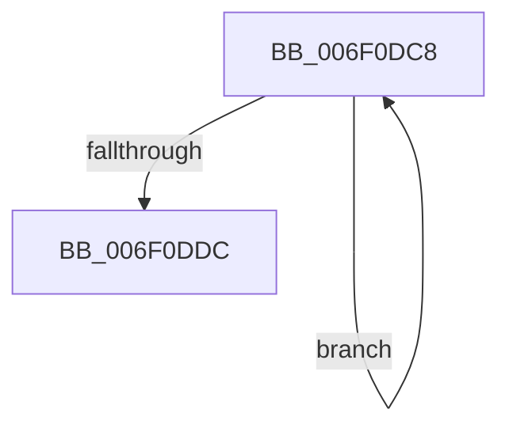

# sub_006F0DC8

- RVA: `0x006F0DC8`–`0x006F0DE4` (길이 `28` bytes)
- VA: `0x00000001406F0DC8`
- 실행 섹션: `.text`
- PDB 이름 있음: `아니요`; PDB Function 태그: `아니요`
- unwind 정보 RVA: `0x000A67C8`
- 디코드: `9`개 명령, `28/28` bytes 표시
- 미해석 바이트: `0` (있으면 어셈블리에 `.byte`로 보존)

> 이 문서는 커널 이미지의 기계어와 PDB 기호를 분석해 생성했습니다. 4번과 5번은 함수 원형과 자료형을 바이너리 사용 방식에서 추정한 C 해석이며 원본 소스 복구 결과는 아닙니다.

## 1. Dependencies

- 직접 호출 지점: **0**; 고유 호출 대상: **0**
- 직접 호출자로 확인된 함수: **0**
- RIP 상대 이미지 참조: **0**

### Outgoing calls
- 직접 디코드된 call 명령이 없습니다.

### Direct callers
- 이 함수 시작 RVA로 연결되는 직접 call은 확인되지 않았습니다. 간접 호출은 완전히 역산할 수 없습니다.

### Static image references
- 디코드된 RIP-relative 메모리 참조가 없습니다.

## 2. Other-region calls and transfers

- 다른 실행 섹션으로 향하는 call: **0**
- call이 아닌 외부 분기/꼬리 이동: **1**
  - `0x006F0DDF` → [MiReduceMdl + 0x4E](../44/MiReduceMdl_function_0044BA80.md) (`tail-transfer`)

## 3. Assembly (complete function range)

```asm
006F0DC8  48 8B 0B                        mov rcx, qword ptr [rbx]
006F0DCB  FF C7                           inc edi
006F0DCD  48 89 0C 1A                     mov qword ptr [rdx + rbx], rcx
006F0DD1  48 8D 5B 08                     lea rbx, [rbx + 8]
006F0DD5  8B CF                           mov ecx, edi
006F0DD7  49 3B CA                        cmp rcx, r10
006F0DDA  72 EC                           jb 0x1406f0dc8
006F0DDC  4C 2B D6                        sub r10, rsi
006F0DDF  E9 EA AC D5 FF                  jmp 0x14044bace
```

## 4. C-style interpretation (structured pseudocode)

```c
void __fastcall sub_006F0DC8(__int64 a1, __int64 a2)
{
    __int64 v_r10;
    __int64 v_rdi;

    v_rdi = (unsigned int)((v_rdi) + 1);
    *(unsigned __int64 *)(a2 + v_rbx * 1) = *(unsigned __int64 *)(v_rbx);
    if (((unsigned int)((unsigned int)(v_rdi))) < v_r10) goto loc_006F0DC8;
    v_r10 = (v_r10) - (v_rsi);
}
```

## 5. (Beta) C Style

```c
void sub_006F0DC8(int64_t Arg1, void *Arg2)
{
    uint8_t *arg2 = (uint8_t *)Arg2;

    int64_t local_r10;
    int64_t local_rdi;

    local_rdi = (uint32_t)((local_rdi) + 1);
    *(uint64_t *)(arg2 + local_rbx * 1) = *(uint64_t *)(local_rbx);
    if (((uint32_t)((uint32_t)(local_rdi))) < local_r10) goto loc_006F0DC8;
    local_r10 = (local_r10) - (local_rsi);
}
```

### 관측된 메모리 오프셋

구조체 형식이 확인되지 않은 접근은 인자 기준의 오프셋으로만 기록했습니다.

| 기준 인자 | 오프셋 표현 | 폭 (bit) | 접근 |
|---|---:|---:|---|
| `Arg2` | `+ 0x0 + rbx*1` | `64` | `W` |

## 6. Execution-region graph

[열기: 2D/3D 그래프와 함수 탐색 컨트롤 패널](../../../control-panel.html?section=text&rva=0x006F0DC8&view=graph)

- 2D 그래프는 위에서 아래로 흐르고, 3D 그래프는 빈 공간을 드래그해 회전합니다. Shift+드래그는 이동, 휠은 확대·축소, 함수 노드 선택은 대상 보고서 이동입니다.

### Static fallback


