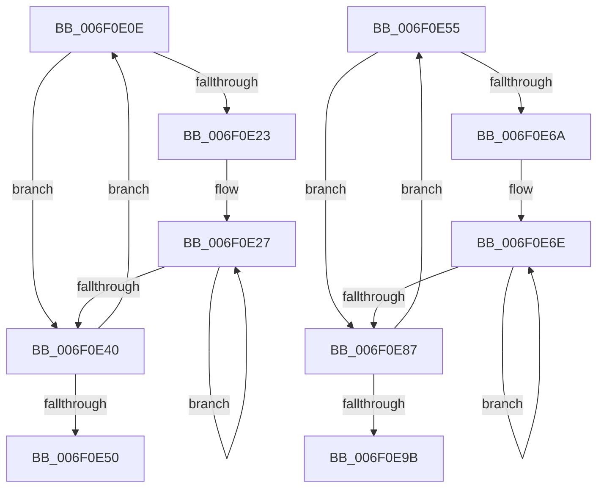

# sub_006F0E0E

- RVA: `0x006F0E0E`–`0x006F0EA0` (길이 `146` bytes)
- VA: `0x00000001406F0E0E`
- 실행 섹션: `.text`
- PDB 이름 있음: `아니요`; PDB Function 태그: `아니요`
- unwind 정보 RVA: `0x000A6870`
- 디코드: `45`개 명령, `146/146` bytes 표시
- 미해석 바이트: `0` (있으면 어셈블리에 `.byte`로 보존)

> 이 문서는 커널 이미지의 기계어와 PDB 기호를 분석해 생성했습니다. 4번과 5번은 함수 원형과 자료형을 바이너리 사용 방식에서 추정한 C 해석이며 원본 소스 복구 결과는 아닙니다.

## 1. Dependencies

- 직접 호출 지점: **2**; 고유 호출 대상: **1**
- 직접 호출자로 확인된 함수: **0**
- RIP 상대 이미지 참조: **0**

### Outgoing calls
- `0x006F0E34` → [KiHaltOnAddress](../4F/KiHaltOnAddress_function_004FBA3C.md) (function, `0x004FBA3C`)
- `0x006F0E7B` → [KiHaltOnAddress](../4F/KiHaltOnAddress_function_004FBA3C.md) (function, `0x004FBA3C`)

### Direct callers
- 이 함수 시작 RVA로 연결되는 직접 call은 확인되지 않았습니다. 간접 호출은 완전히 역산할 수 없습니다.

### Static image references
- 디코드된 RIP-relative 메모리 참조가 없습니다.

## 2. Other-region calls and transfers

- 다른 실행 섹션으로 향하는 call: **0**
- call이 아닌 외부 분기/꼬리 이동: **2**
  - `0x006F0E50` → [MiDemoteSlabEntriesDpc + 0x74](../44/MiDemoteSlabEntriesDpc_function_0044C3C0.md) (`tail-transfer`)
  - `0x006F0E9B` → [MiDemoteSlabEntriesDpc + 0xE1](../44/MiDemoteSlabEntriesDpc_function_0044C3C0.md) (`tail-transfer`)

## 3. Assembly (complete function range)

```asm
006F0E0E  0F BA E9 1E                     bts ecx, 0x1e
006F0E12  8B C2                           mov eax, edx
006F0E14  44 8B F1                        mov r14d, ecx
006F0E17  F0 44 0F B1 33                  lock cmpxchg dword ptr [rbx], r14d
006F0E1C  8B C8                           mov ecx, eax
006F0E1E  41 3B C0                        cmp eax, r8d
006F0E21  75 1D                           jne 0x1406f0e40
006F0E23  44 89 75 48                     mov dword ptr [rbp + 0x48], r14d
006F0E27  41 B8 04 00 00 00               mov r8d, 4
006F0E2D  48 8D 55 48                     lea rdx, [rbp + 0x48]
006F0E31  48 8B CB                        mov rcx, rbx
006F0E34  E8 03 AC E0 FF                  call 0x1404fba3c
006F0E39  8B 0B                           mov ecx, dword ptr [rbx]
006F0E3B  41 3B CE                        cmp ecx, r14d
006F0E3E  74 E7                           je 0x1406f0e27
006F0E40  8B C1                           mov eax, ecx
006F0E42  8B D1                           mov edx, ecx
006F0E44  25 00 00 00 80                  and eax, 0x80000000
006F0E49  44 8B C1                        mov r8d, ecx
006F0E4C  3B C7                           cmp eax, edi
006F0E4E  75 BE                           jne 0x1406f0e0e
006F0E50  E9 DF B5 D5 FF                  jmp 0x14044c434
006F0E55  0F BA E9 1E                     bts ecx, 0x1e
006F0E59  8B C2                           mov eax, edx
006F0E5B  44 8B F1                        mov r14d, ecx
006F0E5E  F0 44 0F B1 33                  lock cmpxchg dword ptr [rbx], r14d
006F0E63  8B C8                           mov ecx, eax
006F0E65  41 3B C0                        cmp eax, r8d
006F0E68  75 1D                           jne 0x1406f0e87
006F0E6A  44 89 75 58                     mov dword ptr [rbp + 0x58], r14d
006F0E6E  41 B8 04 00 00 00               mov r8d, 4
006F0E74  48 8D 55 58                     lea rdx, [rbp + 0x58]
006F0E78  48 8B CB                        mov rcx, rbx
006F0E7B  E8 BC AB E0 FF                  call 0x1404fba3c
006F0E80  8B 0B                           mov ecx, dword ptr [rbx]
006F0E82  41 3B CE                        cmp ecx, r14d
006F0E85  74 E7                           je 0x1406f0e6e
006F0E87  8B C1                           mov eax, ecx
006F0E89  41 BE 00 00 00 80               mov r14d, 0x80000000
006F0E8F  41 23 C6                        and eax, r14d
006F0E92  8B D1                           mov edx, ecx
006F0E94  44 8B C1                        mov r8d, ecx
006F0E97  3B C7                           cmp eax, edi
006F0E99  75 BA                           jne 0x1406f0e55
006F0E9B  E9 01 B6 D5 FF                  jmp 0x14044c4a1
```

## 4. C-style interpretation (structured pseudocode)

```c
__int64 __fastcall sub_006F0E0E(int a1, int a2, int a3)
{
    __int64 result;

    if (((unsigned int)((unsigned int)(a2))) != a3) goto loc_006F0E40;
    *(unsigned int *)(v_rbp + 72) = (unsigned int)((unsigned int)(a1));
loc_006F0E27:
    result = KiHaltOnAddress(v_rbx, v_rbp + 72, 4, a4);
    if (((unsigned int)((unsigned int)(*(unsigned int *)(v_rbx)))) == ((unsigned int)((unsigned int)(a1)))) goto loc_006F0E27;
loc_006F0E40:
    result = (unsigned int)(((unsigned int)((unsigned int)((unsigned int)(*(unsigned int *)(v_rbx))))) & (0x80000000ULL));
    if (((unsigned int)(result)) != ((unsigned int)(v_rdi))) goto loc_006F0E0E;
}
```

## 5. (Beta) C Style

```c
int64_t sub_006F0E0E(int32_t Arg1, int32_t Arg2, int32_t Arg3)
{
    int64_t result;

    if (((uint32_t)((uint32_t)(Arg2))) != Arg3) goto loc_006F0E40;
    *(uint32_t *)(local_rbp + 0x48) = (uint32_t)((uint32_t)(Arg1));
loc_006F0E27:
    result = KiHaltOnAddress(local_rbx, local_rbp + 72, 4, a4);
    if (((uint32_t)((uint32_t)(*(uint32_t *)(local_rbx)))) == ((uint32_t)((uint32_t)(Arg1)))) goto loc_006F0E27;
loc_006F0E40:
    result = (uint32_t)(((uint32_t)((uint32_t)((uint32_t)(*(uint32_t *)(local_rbx))))) & (0x80000000ULL));
    if (((uint32_t)(result)) != ((uint32_t)(local_rdi))) goto loc_006F0E0E;
}
```

## 6. Execution-region graph

[열기: 2D/3D 그래프와 함수 탐색 컨트롤 패널](../../../control-panel.html?section=text&rva=0x006F0E0E&view=graph)

- 2D 그래프는 위에서 아래로 흐르고, 3D 그래프는 빈 공간을 드래그해 회전합니다. Shift+드래그는 이동, 휠은 확대·축소, 함수 노드 선택은 대상 보고서 이동입니다.

### Static fallback


