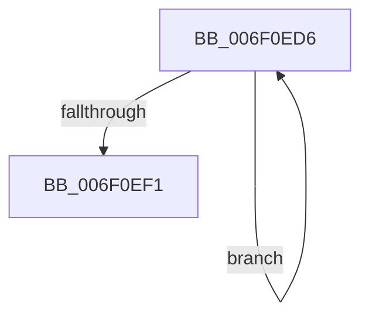

# sub_006F0ED6

- RVA: `0x006F0ED6`–`0x006F0EF6` (길이 `32` bytes)
- VA: `0x00000001406F0ED6`
- 실행 섹션: `.text`
- PDB 이름 있음: `아니요`; PDB Function 태그: `아니요`
- unwind 정보 RVA: `0x000A6940`
- 디코드: `10`개 명령, `32/32` bytes 표시
- 미해석 바이트: `0` (있으면 어셈블리에 `.byte`로 보존)

> 이 문서는 커널 이미지의 기계어와 PDB 기호를 분석해 생성했습니다. 4번과 5번은 함수 원형과 자료형을 바이너리 사용 방식에서 추정한 C 해석이며 원본 소스 복구 결과는 아닙니다.

## 1. Dependencies

- 직접 호출 지점: **0**; 고유 호출 대상: **0**
- 직접 호출자로 확인된 함수: **0**
- RIP 상대 이미지 참조: **0**

### Outgoing calls
- 직접 디코드된 call 명령이 없습니다.

### Direct callers
- 이 함수 시작 RVA로 연결되는 직접 call은 확인되지 않았습니다. 간접 호출은 완전히 역산할 수 없습니다.

### Static image references
- 디코드된 RIP-relative 메모리 참조가 없습니다.

## 2. Other-region calls and transfers

- 다른 실행 섹션으로 향하는 call: **0**
- call이 아닌 외부 분기/꼬리 이동: **1**
  - `0x006F0EF1` → [MiGatherSlabDemoteCandidates + 0x171](../44/MiGatherSlabDemoteCandidates_function_0044D3C0.md) (`tail-transfer`)

## 3. Assembly (complete function range)

```asm
006F0ED6  49 8B 08                        mov rcx, qword ptr [r8]
006F0ED9  49 83 C0 08                     add r8, 8
006F0EDD  8B 51 58                        mov edx, dword ptr [rcx + 0x58]
006F0EE0  03 51 54                        add edx, dword ptr [rcx + 0x54]
006F0EE3  8B CA                           mov ecx, edx
006F0EE5  48 03 C1                        add rax, rcx
006F0EE8  48 89 46 28                     mov qword ptr [rsi + 0x28], rax
006F0EEC  4D 3B C1                        cmp r8, r9
006F0EEF  72 E5                           jb 0x1406f0ed6
006F0EF1  E9 3B C6 D5 FF                  jmp 0x14044d531
```

## 4. C-style interpretation (structured pseudocode)

```c
__int64 __fastcall sub_006F0ED6(__int64 a1, __int64 a2, __int64 a3, __int64 a4)
{
    __int64 result;

    a3 = (a3) + (8);
    a2 = (unsigned int)(((unsigned int)(*(unsigned int *)(*(unsigned __int64 *)(a3) + 88))) + (*(unsigned int *)(*(unsigned __int64 *)(a3) + 84)));
    result = (result) + ((unsigned int)((unsigned int)(a2)));
    *(unsigned __int64 *)(v_rsi + 40) = result;
    if (a3 < a4) goto loc_006F0ED6;
}
```

## 5. (Beta) C Style

```c
int64_t sub_006F0ED6(int64_t Arg1, int64_t Arg2, int64_t Arg3, int64_t Arg4)
{
    int64_t result;

    Arg3 = (Arg3) + (8);
    Arg2 = (uint32_t)(((uint32_t)(*(uint32_t *)(*(uint64_t *)(Arg3) + 0x58))) + (*(uint32_t *)(*(uint64_t *)(Arg3) + 0x54)));
    result = (result) + ((uint32_t)((uint32_t)(Arg2)));
    *(uint64_t *)(local_rsi + 0x28) = result;
    if (Arg3 < Arg4) goto loc_006F0ED6;
}
```

## 6. Execution-region graph

[열기: 2D/3D 그래프와 함수 탐색 컨트롤 패널](../../../control-panel.html?section=text&rva=0x006F0ED6&view=graph)

- 2D 그래프는 위에서 아래로 흐르고, 3D 그래프는 빈 공간을 드래그해 회전합니다. Shift+드래그는 이동, 휠은 확대·축소, 함수 노드 선택은 대상 보고서 이동입니다.

### Static fallback


