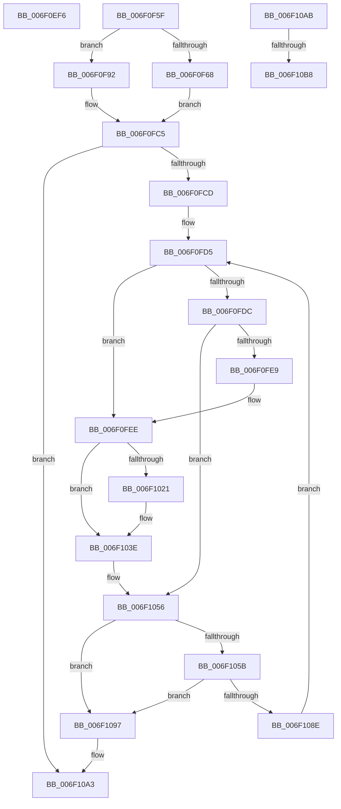

# sub_006F0EF6

- RVA: `0x006F0EF6`–`0x006F10CA` (길이 `468` bytes)
- VA: `0x00000001406F0EF6`
- 실행 섹션: `.text`
- PDB 이름 있음: `아니요`; PDB Function 태그: `아니요`
- unwind 정보 RVA: `0x000A6A30`
- 디코드: `121`개 명령, `468/468` bytes 표시
- 미해석 바이트: `0` (있으면 어셈블리에 `.byte`로 보존)

> 이 문서는 커널 이미지의 기계어와 PDB 기호를 분석해 생성했습니다. 4번과 5번은 함수 원형과 자료형을 바이너리 사용 방식에서 추정한 C 해석이며 원본 소스 복구 결과는 아닙니다.

## 1. Dependencies

- 직접 호출 지점: **5**; 고유 호출 대상: **4**
- 직접 호출자로 확인된 함수: **0**
- RIP 상대 이미지 참조: **0**

### Outgoing calls
- `0x006F0FBC` → [HalpIommuGetNextFlushDevice](../4F/HalpIommuGetNextFlushDevice_function_004FB8E8.md) (function, `0x004FB8E8`)
- `0x006F0FE0` → [ExAcquireRundownProtection](../21/ExAcquireRundownProtection_function_00216620.md) (function, `0x00216620`)
- `0x006F1049` → [HsaIommuSendCommand](../44/HsaIommuSendCommand_function_0044E1DC.md) (function, `0x0044E1DC`)
- `0x006F1085` → [HalpIommuGetNextFlushDevice](../4F/HalpIommuGetNextFlushDevice_function_004FB8E8.md) (function, `0x004FB8E8`)
- `0x006F10BF` → [ExReleaseRundownProtection](../34/ExReleaseRundownProtection_function_00349E80.md) (function, `0x00349E80`)

### Direct callers
- 이 함수 시작 RVA로 연결되는 직접 call은 확인되지 않았습니다. 간접 호출은 완전히 역산할 수 없습니다.

### Static image references
- 디코드된 RIP-relative 메모리 참조가 없습니다.

## 2. Other-region calls and transfers

- 다른 실행 섹션으로 향하는 call: **0**
- call이 아닌 외부 분기/꼬리 이동: **4**
  - `0x006F0F5A` → [HsaFlushTbInternal + 0xD0](../44/HsaFlushTbInternal_function_0044DEE8.md) (`tail-transfer`)
  - `0x006F10A6` → [HsaFlushTbInternal + 0x187](../44/HsaFlushTbInternal_function_0044DEE8.md) (`tail-transfer`)
  - `0x006F10B2` → [HsaFlushTbInternal + 0x1B9](../44/HsaFlushTbInternal_function_0044DEE8.md) (`tail-transfer`)
  - `0x006F10C5` → [HsaFlushTbInternal + 0x1B9](../44/HsaFlushTbInternal_function_0044DEE8.md) (`tail-transfer`)

## 3. Assembly (complete function range)

```asm
006F0EF6  48 83 CB 04                     or rbx, 4
006F0EFA  45 0F B6 C2                     movzx r8d, r10b
006F0EFE  49 C1 E0 08                     shl r8, 8
006F0F02  49 8B C2                        mov rax, r10
006F0F05  25 FF FF 0F 00                  and eax, 0xfffff
006F0F0A  48 89 5D D7                     mov qword ptr [rbp - 0x29], rbx
006F0F0E  48 0B C2                        or rax, rdx
006F0F11  48 89 5D F7                     mov qword ptr [rbp - 9], rbx
006F0F15  49 0B C6                        or rax, r14
006F0F18  49 8B CA                        mov rcx, r10
006F0F1B  48 89 45 EF                     mov qword ptr [rbp - 0x11], rax
006F0F1F  81 E1 00 FF 00 00               and ecx, 0xff00
006F0F25  49 8B C2                        mov rax, r10
006F0F28  48 83 CF 04                     or rdi, 4
006F0F2C  25 00 00 0F 00                  and eax, 0xf0000
006F0F31  48 89 7D 07                     mov qword ptr [rbp + 7], rdi
006F0F35  4C 0B C0                        or r8, rax
006F0F38  48 B8 00 00 00 00 00 00 40 00   movabs rax, 0x40000000000000
006F0F42  49 C1 E0 20                     shl r8, 0x20
006F0F46  4C 0B C1                        or r8, rcx
006F0F49  4C 0B C0                        or r8, rax
006F0F4C  49 C1 E0 08                     shl r8, 8
006F0F50  4C 89 45 0F                     mov qword ptr [rbp + 0xf], r8
006F0F54  41 B8 FE 0F 00 00               mov r8d, 0xffe
006F0F5A  E9 59 D0 D5 FF                  jmp 0x14044dfb8
006F0F5F  48 89 75 E7                     mov qword ptr [rbp - 0x19], rsi
006F0F63  4D 85 ED                        test r13, r13
006F0F66  74 2A                           je 0x1406f0f92
006F0F68  49 8B 45 30                     mov rax, qword ptr [r13 + 0x30]
006F0F6C  4C 8D 65 B9                     lea r12, [rbp - 0x47]
006F0F70  48 89 45 DF                     mov qword ptr [rbp - 0x21], rax
006F0F74  41 8B 45 3C                     mov eax, dword ptr [r13 + 0x3c]
006F0F78  89 45 BB                        mov dword ptr [rbp - 0x45], eax
006F0F7B  49 8D 45 40                     lea rax, [r13 + 0x40]
006F0F7F  48 89 45 CF                     mov qword ptr [rbp - 0x31], rax
006F0F83  49 8B 45 60                     mov rax, qword ptr [r13 + 0x60]
006F0F87  4C 89 65 C7                     mov qword ptr [rbp - 0x39], r12
006F0F8B  8A 40 30                        mov al, byte ptr [rax + 0x30]
006F0F8E  24 01                           and al, 1
006F0F90  EB 33                           jmp 0x1406f0fc5
006F0F92  48 8D 45 C7                     lea rax, [rbp - 0x39]
006F0F96  48 8B CE                        mov rcx, rsi
006F0F99  48 89 44 24 30                  mov qword ptr [rsp + 0x30], rax
006F0F9E  4C 8D 4D BB                     lea r9, [rbp - 0x45]
006F0FA2  48 8D 45 CF                     lea rax, [rbp - 0x31]
006F0FA6  48 89 44 24 28                  mov qword ptr [rsp + 0x28], rax
006F0FAB  4C 8D 45 DF                     lea r8, [rbp - 0x21]
006F0FAF  48 8D 45 B7                     lea rax, [rbp - 0x49]
006F0FB3  48 8D 55 E7                     lea rdx, [rbp - 0x19]
006F0FB7  48 89 44 24 20                  mov qword ptr [rsp + 0x20], rax
006F0FBC  E8 27 A9 E0 FF                  call 0x1404fb8e8
006F0FC1  4C 8B 65 C7                     mov r12, qword ptr [rbp - 0x39]
006F0FC5  84 C0                           test al, al
006F0FC7  0F 84 D6 00 00 00               je 0x1406f10a3
006F0FCD  44 8B 6D BF                     mov r13d, dword ptr [rbp - 0x41]
006F0FD1  48 8B 5D 0F                     mov rbx, qword ptr [rbp + 0xf]
006F0FD5  41 80 3C 24 00                  cmp byte ptr [r12], 0
006F0FDA  75 12                           jne 0x1406f0fee
006F0FDC  48 8B 4D CF                     mov rcx, qword ptr [rbp - 0x31]
006F0FE0  E8 3B 56 B2 FF                  call 0x140216620
006F0FE5  84 C0                           test al, al
006F0FE7  74 6D                           je 0x1406f1056
006F0FE9  41 C6 04 24 01                  mov byte ptr [r12], 1
006F0FEE  8B 45 BB                        mov eax, dword ptr [rbp - 0x45]
006F0FF1  0F B7 55 DF                     movzx edx, word ptr [rbp - 0x21]
006F0FF5  0F B6 C8                        movzx ecx, al
006F0FF8  8B C2                           mov eax, edx
006F0FFA  48 C1 E0 08                     shl rax, 8
006F0FFE  48 0B C8                        or rcx, rax
006F1001  48 B8 00 00 FF 00 00 00 FF FF   movabs rax, 0xffff000000ff0000
006F100B  48 C1 E1 18                     shl rcx, 0x18
006F100F  48 23 D8                        and rbx, rax
006F1012  48 0B CB                        or rcx, rbx
006F1015  48 0B CA                        or rcx, rdx
006F1018  48 89 4D FF                     mov qword ptr [rbp - 1], rcx
006F101C  45 84 F6                        test r14b, r14b
006F101F  74 1D                           je 0x1406f103e
006F1021  41 8B CD                        mov ecx, r13d
006F1024  81 E7 FE 0F 00 00               and edi, 0xffe
006F102A  83 E1 01                        and ecx, 1
006F102D  49 8B C7                        mov rax, r15
006F1030  48 0B CF                        or rcx, rdi
006F1033  48 C1 E0 0C                     shl rax, 0xc
006F1037  48 0B C8                        or rcx, rax
006F103A  48 89 4D 07                     mov qword ptr [rbp + 7], rcx
006F103E  48 8B 4D 47                     mov rcx, qword ptr [rbp + 0x47]
006F1042  48 8D 55 FF                     lea rdx, [rbp - 1]
006F1046  45 33 C0                        xor r8d, r8d
006F1049  E8 8E D1 D5 FF                  call 0x14044e1dc
006F104E  48 8B 7D 07                     mov rdi, qword ptr [rbp + 7]
006F1052  48 8B 5D FF                     mov rbx, qword ptr [rbp - 1]
006F1056  48 85 F6                        test rsi, rsi
006F1059  74 3C                           je 0x1406f1097
006F105B  48 8D 45 C7                     lea rax, [rbp - 0x39]
006F105F  48 8B CE                        mov rcx, rsi
006F1062  48 89 44 24 30                  mov qword ptr [rsp + 0x30], rax
006F1067  4C 8D 4D BB                     lea r9, [rbp - 0x45]
006F106B  48 8D 45 CF                     lea rax, [rbp - 0x31]
006F106F  48 89 44 24 28                  mov qword ptr [rsp + 0x28], rax
006F1074  4C 8D 45 DF                     lea r8, [rbp - 0x21]
006F1078  48 8D 45 B7                     lea rax, [rbp - 0x49]
006F107C  48 8D 55 E7                     lea rdx, [rbp - 0x19]
006F1080  48 89 44 24 20                  mov qword ptr [rsp + 0x20], rax
006F1085  E8 5E A8 E0 FF                  call 0x1404fb8e8
006F108A  84 C0                           test al, al
006F108C  74 09                           je 0x1406f1097
006F108E  4C 8B 65 C7                     mov r12, qword ptr [rbp - 0x39]
006F1092  E9 3E FF FF FF                  jmp 0x1406f0fd5
006F1097  4C 8B 6D 67                     mov r13, qword ptr [rbp + 0x67]
006F109B  48 89 5D 0F                     mov qword ptr [rbp + 0xf], rbx
006F109F  48 8B 5D D7                     mov rbx, qword ptr [rbp - 0x29]
006F10A3  8B 45 C3                        mov eax, dword ptr [rbp - 0x3d]
006F10A6  E9 C4 CF D5 FF                  jmp 0x14044e06f
006F10AB  48 8B 45 C7                     mov rax, qword ptr [rbp - 0x39]
006F10AF  80 38 00                        cmp byte ptr [rax], 0
006F10B2  0F 84 E9 CF D5 FF               je 0x14044e0a1
006F10B8  48 8B 4D CF                     mov rcx, qword ptr [rbp - 0x31]
006F10BC  C6 00 00                        mov byte ptr [rax], 0
006F10BF  E8 BC 8D C5 FF                  call 0x140349e80
006F10C4  90                              nop
006F10C5  E9 D7 CF D5 FF                  jmp 0x14044e0a1
```

## 4. C-style interpretation (structured pseudocode)

```c
__int64 __fastcall sub_006F0EF6(__int64 a1, __int64 a2)
{
    __int64 result;
    __int64 v_rbx;
    __int64 v_rdi;
    unsigned __int64 v_stack_p20;
    unsigned __int64 v_stack_p28;
    unsigned __int64 v_stack_p30;

    v_rbx = (v_rbx) | (4);
    a3 = ((unsigned __int8)(v_r10)) << (8);
    result = (unsigned int)((v_r10) & (0xFFFFFULL));
    *(unsigned __int64 *)(v_rbp - 41) = v_rbx;
    result = (result) | (a2);
    *(unsigned __int64 *)(v_rbp - 9) = v_rbx;
    result = (result) | (v_r14);
    *(unsigned __int64 *)(v_rbp - 17) = result;
    a1 = (unsigned int)((v_r10) & (0xFF00ULL));
    v_rdi = (v_rdi) | (4);
    result = (unsigned int)((v_r10) & (0xF0000ULL));
    *(unsigned __int64 *)(v_rbp + 7) = v_rdi;
    a3 = (a3) | (result);
    a3 = (a3) << (32);
    a3 = (a3) | (a1);
    a3 = (a3) | (result);
    a3 = (a3) << (8);
    *(unsigned __int64 *)(v_rbp + 15) = a3;
}
```

## 5. (Beta) C Style

```c
int64_t sub_006F0EF6(int64_t Arg1, int64_t Arg2)
{
    int64_t result;
    int64_t local_rbx;
    int64_t local_rdi;
    uint64_t v_stack_p20;
    uint64_t v_stack_p28;
    uint64_t v_stack_p30;

    local_rbx = (local_rbx) | (4);
    a3 = ((uint8_t)(local_r10)) << (8);
    result = (uint32_t)((local_r10) & (0xFFFFFULL));
    *(uint64_t *)(local_rbp - 0x29) = local_rbx;
    result = (result) | (Arg2);
    *(uint64_t *)(local_rbp - 0x9) = local_rbx;
    result = (result) | (local_r14);
    *(uint64_t *)(local_rbp - 0x11) = result;
    Arg1 = (uint32_t)((local_r10) & (0xFF00ULL));
    local_rdi = (local_rdi) | (4);
    result = (uint32_t)((local_r10) & (0xF0000ULL));
    *(uint64_t *)(local_rbp + 0x7) = local_rdi;
    a3 = (a3) | (result);
    a3 = (a3) << (32);
    a3 = (a3) | (Arg1);
    a3 = (a3) | (result);
    a3 = (a3) << (8);
    *(uint64_t *)(local_rbp + 0xF) = a3;
}
```

## 6. Execution-region graph

[열기: 2D/3D 그래프와 함수 탐색 컨트롤 패널](../../../control-panel.html?section=text&rva=0x006F0EF6&view=graph)

- 2D 그래프는 위에서 아래로 흐르고, 3D 그래프는 빈 공간을 드래그해 회전합니다. Shift+드래그는 이동, 휠은 확대·축소, 함수 노드 선택은 대상 보고서 이동입니다.

### Static fallback


