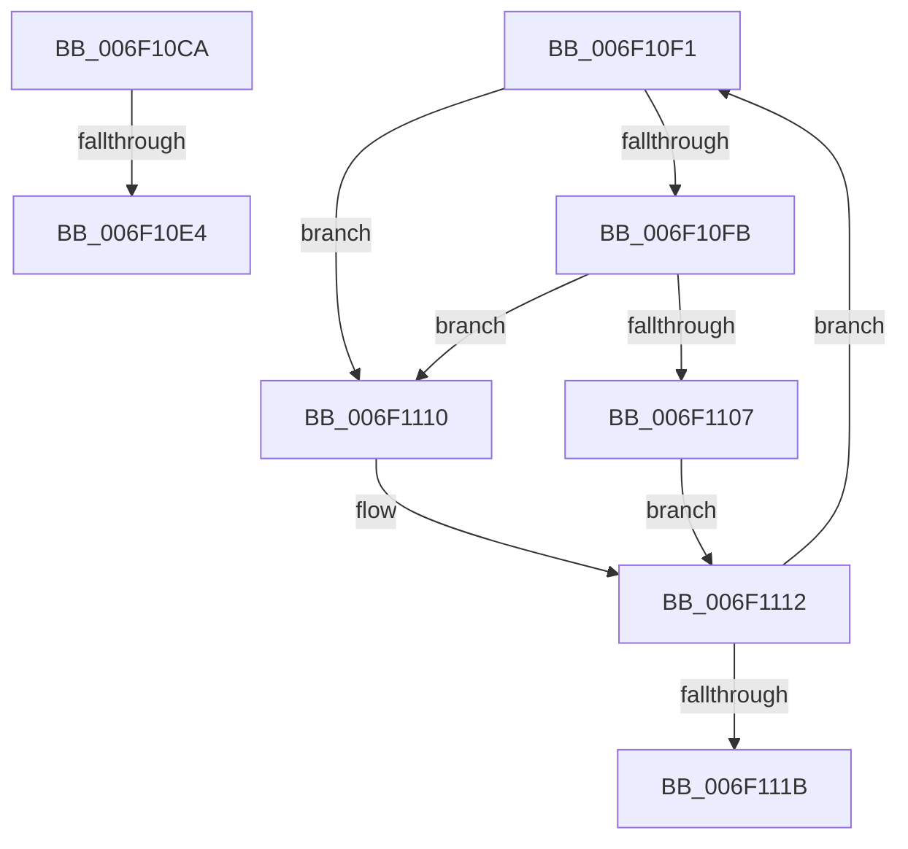

# sub_006F10CA

- RVA: `0x006F10CA`–`0x006F1120` (길이 `86` bytes)
- VA: `0x00000001406F10CA`
- 실행 섹션: `.text`
- PDB 이름 있음: `아니요`; PDB Function 태그: `아니요`
- unwind 정보 RVA: `0x000A6A5C`
- 디코드: `23`개 명령, `86/86` bytes 표시
- 미해석 바이트: `0` (있으면 어셈블리에 `.byte`로 보존)

> 이 문서는 커널 이미지의 기계어와 PDB 기호를 분석해 생성했습니다. 4번과 5번은 함수 원형과 자료형을 바이너리 사용 방식에서 추정한 C 해석이며 원본 소스 복구 결과는 아닙니다.

## 1. Dependencies

- 직접 호출 지점: **1**; 고유 호출 대상: **1**
- 직접 호출자로 확인된 함수: **0**
- RIP 상대 이미지 참조: **2**

### Outgoing calls
- `0x006F1109` → [guard_dispatch_icall](../6B/guard_dispatch_icall_function_006BAAD0.md) (function, `0x006BAAD0`)

### Direct callers
- 이 함수 시작 RVA로 연결되는 직접 call은 확인되지 않았습니다. 간접 호출은 완전히 역산할 수 없습니다.

### Static image references
- `0x006F10F3` → RVA `0x00FC1C7C` (`.data`; reference)
- `0x006F10FB` → RVA `0x00FC1C80` (`.data`; read)

## 2. Other-region calls and transfers

- 다른 실행 섹션으로 향하는 call: **0**
- call이 아닌 외부 분기/꼬리 이동: **3**
  - `0x006F10DE` → [HsaIommuSendCommand + 0x1E0](../44/HsaIommuSendCommand_function_0044E1DC.md) (`tail-transfer`)
  - `0x006F10EC` → [HsaIommuSendCommand + 0xEC](../44/HsaIommuSendCommand_function_0044E1DC.md) (`tail-transfer`)
  - `0x006F111B` → [HsaIommuSendCommand + 0x133](../44/HsaIommuSendCommand_function_0044E1DC.md) (`tail-transfer`)

## 3. Assembly (complete function range)

```asm
006F10CA  F3 90                           pause
006F10CC  90                              nop
006F10CD  49 8B 85 00 20 00 00            mov rax, qword ptr [r13 + 0x2000]
006F10D4  48 C1 E8 04                     shr rax, 4
006F10D8  49 23 C1                        and rax, r9
006F10DB  48 3B C8                        cmp rcx, rax
006F10DE  0F 84 D8 D2 D5 FF               je 0x14044e3bc
006F10E4  4C 8B 84 24 88 00 00 00         mov r8, qword ptr [rsp + 0x88]
006F10EC  E9 D7 D1 D5 FF                  jmp 0x14044e2c8
006F10F1  FF C3                           inc ebx
006F10F3  85 1D 83 0B 8D 00               test dword ptr [rip + 0x8d0b83], ebx
006F10F9  75 15                           jne 0x1406f1110
006F10FB  48 8B 05 7E 0B 8D 00            mov rax, qword ptr [rip + 0x8d0b7e]
006F1102  48 85 C0                        test rax, rax
006F1105  74 09                           je 0x1406f1110
006F1107  8B CB                           mov ecx, ebx
006F1109  E8 C2 99 FC FF                  call 0x1406baad0
006F110E  EB 02                           jmp 0x1406f1112
006F1110  F3 90                           pause
006F1112  48 8B 47 78                     mov rax, qword ptr [rdi + 0x78]
006F1116  48 85 C0                        test rax, rax
006F1119  75 D6                           jne 0x1406f10f1
006F111B  E9 EF D1 D5 FF                  jmp 0x14044e30f
```

## 4. C-style interpretation (structured pseudocode)

```c
__int64 __fastcall sub_006F10CA(__int64 a1, __int64 a2, __int64 a3, __int64 a4, __int64 a5, __int64 a6, __int64 a7, __int64 a8, __int64 a9, __int64 a10, __int64 a11, __int64 a12, __int64 a13, __int64 a14, __int64 a15, __int64 a16, __int64 a17)
{
    __int64 result;

    result = (*(unsigned __int64 *)(v_r13 + 8192)) >> (4);
    result = (result) & (a4);
}
```

## 5. (Beta) C Style

```c
int64_t sub_006F10CA(int64_t Arg1, int64_t Arg2, int64_t Arg3, int64_t Arg4, uint64_t Arg5, uint64_t Arg6, uint64_t Arg7, uint64_t Arg8, uint64_t Arg9, uint64_t Arg10, uint64_t Arg11, uint64_t Arg12, uint64_t Arg13, uint64_t Arg14, uint64_t Arg15, uint64_t Arg16, int64_t Arg17)
{
    int64_t result;

    result = (*(uint64_t *)(local_r13 + 0x2000)) >> (4);
    result = (result) & (Arg4);
}
```

## 6. Execution-region graph

[열기: 2D/3D 그래프와 함수 탐색 컨트롤 패널](../../../control-panel.html?section=text&rva=0x006F10CA&view=graph)

- 2D 그래프는 위에서 아래로 흐르고, 3D 그래프는 빈 공간을 드래그해 회전합니다. Shift+드래그는 이동, 휠은 확대·축소, 함수 노드 선택은 대상 보고서 이동입니다.

### Static fallback


