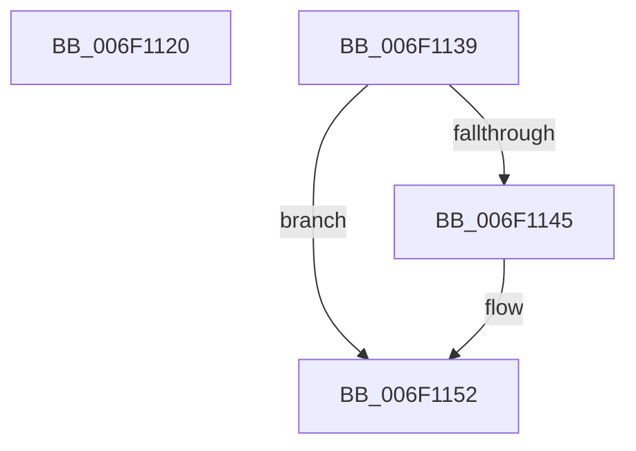

# sub_006F1120

- RVA: `0x006F1120`–`0x006F1165` (길이 `69` bytes)
- VA: `0x00000001406F1120`
- 실행 섹션: `.text`
- PDB 이름 있음: `아니요`; PDB Function 태그: `아니요`
- unwind 정보 RVA: `0x000A6AD0`
- 디코드: `17`개 명령, `69/69` bytes 표시
- 미해석 바이트: `0` (있으면 어셈블리에 `.byte`로 보존)

> 이 문서는 커널 이미지의 기계어와 PDB 기호를 분석해 생성했습니다. 4번과 5번은 함수 원형과 자료형을 바이너리 사용 방식에서 추정한 C 해석이며 원본 소스 복구 결과는 아닙니다.

## 1. Dependencies

- 직접 호출 지점: **0**; 고유 호출 대상: **0**
- 직접 호출자로 확인된 함수: **0**
- RIP 상대 이미지 참조: **0**

### Outgoing calls
- 직접 디코드된 call 명령이 없습니다.

### Direct callers
- 이 함수 시작 RVA로 연결되는 직접 call은 확인되지 않았습니다. 간접 호출은 완전히 역산할 수 없습니다.

### Static image references
- 디코드된 RIP-relative 메모리 참조가 없습니다.

## 2. Other-region calls and transfers

- 다른 실행 섹션으로 향하는 call: **0**
- call이 아닌 외부 분기/꼬리 이동: **2**
  - `0x006F1134` → [SeSetAuditParameter + 0x30](../44/SeSetAuditParameter_function_0044E850.md) (`tail-transfer`)
  - `0x006F1160` → [SeSetAuditParameter + 0x30](../44/SeSetAuditParameter_function_0044E850.md) (`tail-transfer`)

## 3. Assembly (complete function range)

```asm
006F1120  41 BB 08 00 00 00               mov r11d, 8
006F1126  41 8B C0                        mov eax, r8d
006F1129  48 C1 E0 05                     shl rax, 5
006F112D  48 03 C3                        add rax, rbx
006F1130  4C 89 48 30                     mov qword ptr [rax + 0x30], r9
006F1134  E9 47 D7 D5 FF                  jmp 0x14044e880
006F1139  41 BB 10 00 00 00               mov r11d, 0x10
006F113F  66 83 F8 02                     cmp ax, 2
006F1143  74 0D                           je 0x1406f1152
006F1145  66 83 F8 21                     cmp ax, 0x21
006F1149  B9 0E 00 00 00                  mov ecx, 0xe
006F114E  44 0F 44 D9                     cmove r11d, ecx
006F1152  41 8B C0                        mov eax, r8d
006F1155  48 C1 E0 05                     shl rax, 5
006F1159  48 03 C3                        add rax, rbx
006F115C  4C 89 48 30                     mov qword ptr [rax + 0x30], r9
006F1160  E9 1B D7 D5 FF                  jmp 0x14044e880
```

## 4. C-style interpretation (structured pseudocode)

```c
__int64 __fastcall sub_006F1120(__int64 a1, __int64 a2, int a3, __int64 a4)
{
    __int64 result;

    result = ((unsigned int)(a3)) << (5);
    result = (result) + (v_rbx);
    *(unsigned __int64 *)(result + 48) = a4;
}
```

## 5. (Beta) C Style

```c
int64_t sub_006F1120(int64_t Arg1, int64_t Arg2, int32_t Arg3, int64_t Arg4)
{
    int64_t result;

    result = ((uint32_t)(Arg3)) << (5);
    result = (result) + (local_rbx);
    *(uint64_t *)(result + 0x30) = Arg4;
}
```

## 6. Execution-region graph

[열기: 2D/3D 그래프와 함수 탐색 컨트롤 패널](../../../control-panel.html?section=text&rva=0x006F1120&view=graph)

- 2D 그래프는 위에서 아래로 흐르고, 3D 그래프는 빈 공간을 드래그해 회전합니다. Shift+드래그는 이동, 휠은 확대·축소, 함수 노드 선택은 대상 보고서 이동입니다.

### Static fallback


