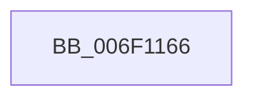

# sub_006F1166

- RVA: `0x006F1166`–`0x006F11D4` (길이 `110` bytes)
- VA: `0x00000001406F1166`
- 실행 섹션: `.text`
- PDB 이름 있음: `아니요`; PDB Function 태그: `아니요`
- unwind 정보 RVA: `0x000A6B04`
- 디코드: `24`개 명령, `110/110` bytes 표시
- 미해석 바이트: `0` (있으면 어셈블리에 `.byte`로 보존)

> 이 문서는 커널 이미지의 기계어와 PDB 기호를 분석해 생성했습니다. 4번과 5번은 함수 원형과 자료형을 바이너리 사용 방식에서 추정한 C 해석이며 원본 소스 복구 결과는 아닙니다.

## 1. Dependencies

- 직접 호출 지점: **0**; 고유 호출 대상: **0**
- 직접 호출자로 확인된 함수: **0**
- RIP 상대 이미지 참조: **0**

### Outgoing calls
- 직접 디코드된 call 명령이 없습니다.

### Direct callers
- 이 함수 시작 RVA로 연결되는 직접 call은 확인되지 않았습니다. 간접 호출은 완전히 역산할 수 없습니다.

### Static image references
- 디코드된 RIP-relative 메모리 참조가 없습니다.

## 2. Other-region calls and transfers

- 다른 실행 섹션으로 향하는 call: **0**
- call이 아닌 외부 분기/꼬리 이동: **1**
  - `0x006F11CF` → [CcSetLogHandleForFileEx + 0x1EE](../44/CcSetLogHandleForFileEx_function_0044EA30.md) (`tail-transfer`)

## 3. Assembly (complete function range)

```asm
006F1166  48 8B 8B 00 02 00 00            mov rcx, qword ptr [rbx + 0x200]
006F116D  48 8D 45 8F                     lea rax, [rbp - 0x71]
006F1171  0F 10 00                        movups xmm0, xmmword ptr [rax]
006F1174  BA 80 00 00 00                  mov edx, 0x80
006F1179  0F 10 48 10                     movups xmm1, xmmword ptr [rax + 0x10]
006F117D  0F 11 41 30                     movups xmmword ptr [rcx + 0x30], xmm0
006F1181  0F 10 40 20                     movups xmm0, xmmword ptr [rax + 0x20]
006F1185  0F 11 49 40                     movups xmmword ptr [rcx + 0x40], xmm1
006F1189  0F 10 48 30                     movups xmm1, xmmword ptr [rax + 0x30]
006F118D  0F 11 41 50                     movups xmmword ptr [rcx + 0x50], xmm0
006F1191  0F 10 40 40                     movups xmm0, xmmword ptr [rax + 0x40]
006F1195  0F 11 49 60                     movups xmmword ptr [rcx + 0x60], xmm1
006F1199  0F 10 48 50                     movups xmm1, xmmword ptr [rax + 0x50]
006F119D  0F 11 41 70                     movups xmmword ptr [rcx + 0x70], xmm0
006F11A1  0F 10 40 60                     movups xmm0, xmmword ptr [rax + 0x60]
006F11A5  0F 11 89 80 00 00 00            movups xmmword ptr [rcx + 0x80], xmm1
006F11AC  0F 10 0C 10                     movups xmm1, xmmword ptr [rax + rdx]
006F11B0  0F 11 81 90 00 00 00            movups xmmword ptr [rcx + 0x90], xmm0
006F11B7  0F 10 40 70                     movups xmm0, xmmword ptr [rax + 0x70]
006F11BB  48 8B 44 10 10                  mov rax, qword ptr [rax + rdx + 0x10]
006F11C0  0F 11 44 11 20                  movups xmmword ptr [rcx + rdx + 0x20], xmm0
006F11C5  0F 11 4C 11 30                  movups xmmword ptr [rcx + rdx + 0x30], xmm1
006F11CA  48 89 44 11 40                  mov qword ptr [rcx + rdx + 0x40], rax
006F11CF  E9 4A DA D5 FF                  jmp 0x14044ec1e
```

## 4. C-style interpretation (structured pseudocode)

```c
__int64 __fastcall sub_006F1166(void)
{
    *(unsigned __int64 *)(*(unsigned __int64 *)(v_rbx + 512) + 48) = v_xmm0;
    *(unsigned __int64 *)(*(unsigned __int64 *)(v_rbx + 512) + 64) = v_xmm1;
    *(unsigned __int64 *)(*(unsigned __int64 *)(v_rbx + 512) + 80) = v_xmm0;
    *(unsigned __int64 *)(*(unsigned __int64 *)(v_rbx + 512) + 96) = v_xmm1;
    *(unsigned __int64 *)(*(unsigned __int64 *)(v_rbx + 512) + 112) = v_xmm0;
    *(unsigned __int64 *)(*(unsigned __int64 *)(v_rbx + 512) + 128) = v_xmm1;
    *(unsigned __int64 *)(*(unsigned __int64 *)(v_rbx + 512) + 144) = v_xmm0;
    *(unsigned __int64 *)(*(unsigned __int64 *)(v_rbx + 512) + 128 * 1 + 32) = v_xmm0;
    *(unsigned __int64 *)(*(unsigned __int64 *)(v_rbx + 512) + 128 * 1 + 48) = v_xmm1;
    *(unsigned __int64 *)(*(unsigned __int64 *)(v_rbx + 512) + 128 * 1 + 64) = *(unsigned __int64 *)(v_rbp - 113 + 128 * 1 + 16);
}
```

## 5. (Beta) C Style

```c
void sub_006F1166(void)
{
    *(uint64_t *)(*(uint64_t *)(local_rbx + 0x200) + 0x30) = v_xmm0;
    *(uint64_t *)(*(uint64_t *)(local_rbx + 0x200) + 0x40) = v_xmm1;
    *(uint64_t *)(*(uint64_t *)(local_rbx + 0x200) + 0x50) = v_xmm0;
    *(uint64_t *)(*(uint64_t *)(local_rbx + 0x200) + 0x60) = v_xmm1;
    *(uint64_t *)(*(uint64_t *)(local_rbx + 0x200) + 0x70) = v_xmm0;
    *(uint64_t *)(*(uint64_t *)(local_rbx + 0x200) + 0x80) = v_xmm1;
    *(uint64_t *)(*(uint64_t *)(local_rbx + 0x200) + 0x90) = v_xmm0;
    *(uint64_t *)(*(uint64_t *)(local_rbx + 0x200) + 0x80 * 1 + 0x20) = v_xmm0;
    *(uint64_t *)(*(uint64_t *)(local_rbx + 0x200) + 0x80 * 1 + 0x30) = v_xmm1;
    *(uint64_t *)(*(uint64_t *)(local_rbx + 0x200) + 0x80 * 1 + 0x40) = *(uint64_t *)(local_rbp - 0x71 + 0x80 * 1 + 0x10);
}
```

## 6. Execution-region graph

[열기: 2D/3D 그래프와 함수 탐색 컨트롤 패널](../../../control-panel.html?section=text&rva=0x006F1166&view=graph)

- 2D 그래프는 위에서 아래로 흐르고, 3D 그래프는 빈 공간을 드래그해 회전합니다. Shift+드래그는 이동, 휠은 확대·축소, 함수 노드 선택은 대상 보고서 이동입니다.

### Static fallback


