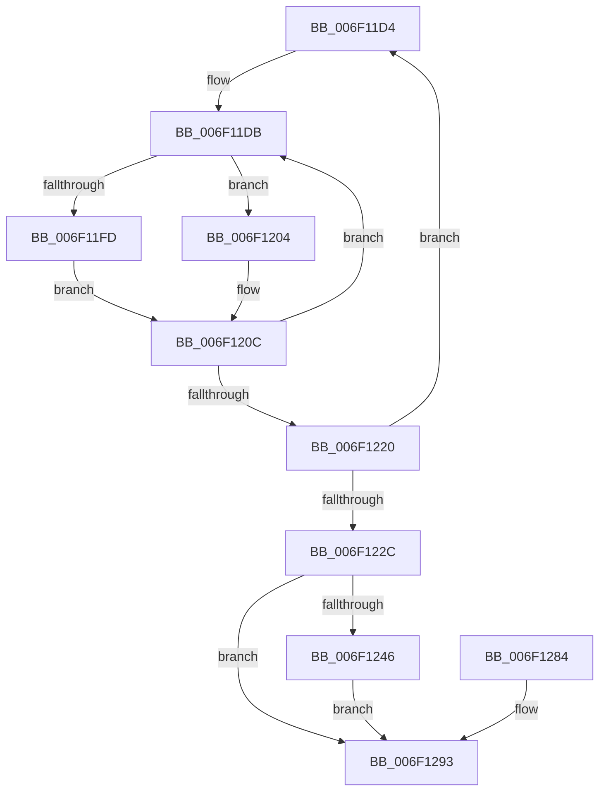

# sub_006F11D4

- RVA: `0x006F11D4`–`0x006F12A0` (길이 `204` bytes)
- VA: `0x00000001406F11D4`
- 실행 섹션: `.text`
- PDB 이름 있음: `아니요`; PDB Function 태그: `아니요`
- unwind 정보 RVA: `0x000A6CA4`
- 디코드: `51`개 명령, `204/204` bytes 표시
- 미해석 바이트: `0` (있으면 어셈블리에 `.byte`로 보존)

> 이 문서는 커널 이미지의 기계어와 PDB 기호를 분석해 생성했습니다. 4번과 5번은 함수 원형과 자료형을 바이너리 사용 방식에서 추정한 C 해석이며 원본 소스 복구 결과는 아닙니다.

## 1. Dependencies

- 직접 호출 지점: **5**; 고유 호출 대상: **4**
- 직접 호출자로 확인된 함수: **0**
- RIP 상대 이미지 참조: **1**

### Outgoing calls
- `0x006F11E5` → [HalpTimerGetInternalData](../20/HalpTimerGetInternalData_function_00209500.md) (function, `0x00209500`)
- `0x006F11FD` → [HalpHpetQueryCounter](../37/HalpHpetQueryCounter_function_00379660.md) (function, `0x00379660`)
- `0x006F1207` → [guard_dispatch_icall](../6B/guard_dispatch_icall_function_006BAAD0.md) (function, `0x006BAAD0`)
- `0x006F1287` → [guard_dispatch_icall](../6B/guard_dispatch_icall_function_006BAAD0.md) (function, `0x006BAAD0`)
- `0x006F1295` → [KeStallWhileFrozen](../5C/KeStallWhileFrozen_function_005C2F20.md) (function, `0x005C2F20`)

### Direct callers
- 이 함수 시작 RVA로 연결되는 직접 call은 확인되지 않았습니다. 간접 호출은 완전히 역산할 수 없습니다.

### Static image references
- `0x006F11EE` → RVA `0x00379660` (`HalpHpetQueryCounter`; read)

## 2. Other-region calls and transfers

- 다른 실행 섹션으로 향하는 call: **0**
- call이 아닌 외부 분기/꼬리 이동: **1**
  - `0x006F129B` → [KeStallExecutionProcessor + 0x20](../44/KeStallExecutionProcessor_function_0044F620.md) (`tail-transfer`)

## 3. Assembly (complete function range)

```asm
006F11D4  48 8B AF D0 00 00 00            mov rbp, qword ptr [rdi + 0xd0]
006F11DB  48 8B 9F C8 00 00 00            mov rbx, qword ptr [rdi + 0xc8]
006F11E2  48 8B CF                        mov rcx, rdi
006F11E5  E8 16 83 B1 FF                  call 0x140209500
006F11EA  48 8B 57 70                     mov rdx, qword ptr [rdi + 0x70]
006F11EE  48 8D 0D 6B 84 C8 FF            lea rcx, [rip - 0x377b95]
006F11F5  48 3B D1                        cmp rdx, rcx
006F11F8  48 8B C8                        mov rcx, rax
006F11FB  75 07                           jne 0x1406f1204
006F11FD  E8 5E 84 C8 FF                  call 0x140379660
006F1202  EB 08                           jmp 0x1406f120c
006F1204  48 8B C2                        mov rax, rdx
006F1207  E8 C4 98 FC FF                  call 0x1406baad0
006F120C  4C 8B D8                        mov r11, rax
006F120F  F0 83 0C 24 00                  lock or dword ptr [rsp], 0
006F1214  48 8B 87 C8 00 00 00            mov rax, qword ptr [rdi + 0xc8]
006F121B  48 3B D8                        cmp rbx, rax
006F121E  75 BB                           jne 0x1406f11db
006F1220  48 8B 8F D0 00 00 00            mov rcx, qword ptr [rdi + 0xd0]
006F1227  48 3B E9                        cmp rbp, rcx
006F122A  75 A8                           jne 0x1406f11d4
006F122C  44 8B 97 DC 00 00 00            mov r10d, dword ptr [rdi + 0xdc]
006F1233  41 8D 4A FF                     lea ecx, [r10 - 1]
006F1237  0F B6 D1                        movzx edx, cl
006F123A  49 8B CB                        mov rcx, r11
006F123D  48 33 CB                        xor rcx, rbx
006F1240  48 0F A3 D1                     bt rcx, rdx
006F1244  73 4D                           jae 0x1406f1293
006F1246  49 83 C8 FF                     or r8, 0xffffffffffffffff
006F124A  41 8B CA                        mov ecx, r10d
006F124D  41 B9 01 00 00 00               mov r9d, 1
006F1253  49 D3 E1                        shl r9, cl
006F1256  41 83 FA 40                     cmp r10d, 0x40
006F125A  49 8D 49 FF                     lea rcx, [r9 - 1]
006F125E  4C 0F 45 C1                     cmovne r8, rcx
006F1262  4C 23 C3                        and r8, rbx
006F1265  49 8B D0                        mov rdx, r8
006F1268  48 33 D3                        xor rdx, rbx
006F126B  49 0B D3                        or rdx, r11
006F126E  4D 3B D8                        cmp r11, r8
006F1271  4A 8D 0C 0A                     lea rcx, [rdx + r9]
006F1275  48 0F 43 CA                     cmovae rcx, rdx
006F1279  F0 48 0F B1 8F C8 00 00 00      lock cmpxchg qword ptr [rdi + 0xc8], rcx
006F1282  EB 0F                           jmp 0x1406f1293
006F1284  48 8B C2                        mov rax, rdx
006F1287  E8 44 98 FC FF                  call 0x1406baad0
006F128C  48 8B 87 D0 00 00 00            mov rax, qword ptr [rdi + 0xd0]
006F1293  8B CE                           mov ecx, esi
006F1295  E8 86 1C ED FF                  call 0x1405c2f20
006F129A  90                              nop
006F129B  E9 A0 E3 D5 FF                  jmp 0x14044f640
```

## 4. C-style interpretation (structured pseudocode)

```c
__int64 __fastcall sub_006F11D4(__int64 a1, __int64 a2, __int64 a3)
{
    __int64 result;
    unsigned int v_stack_p0;

loc_006F11DB:
    result = HalpTimerGetInternalData(v_rdi, a2, a3, a4);
    if ((*(unsigned __int64 *)(v_rdi + 112)) != (v_rip - 3636117)) goto loc_006F1204;
    result = HalpHpetQueryCounter(result, *(unsigned __int64 *)(v_rdi + 112), a3, a4);
    goto loc_006F120C;
loc_006F1204:
    result = guard_dispatch_icall(result, *(unsigned __int64 *)(v_rdi + 112), a3, a4);
loc_006F120C:
    if ((*(unsigned __int64 *)(v_rdi + 200)) != (*(unsigned __int64 *)(v_rdi + 200))) goto loc_006F11DB;
    if ((*(unsigned __int64 *)(v_rdi + 208)) != (*(unsigned __int64 *)(v_rdi + 208))) goto loc_006F11D4;
    a1 = (result) ^ (*(unsigned __int64 *)(v_rdi + 200));
    if (condition_is_above_or_equal) goto loc_006F1293;
    a3 = (a3) | (-1);
    a4 = (1) << ((unsigned __int8)((unsigned int)((unsigned int)((unsigned int)(*(unsigned int *)(v_rdi + 220))))));
    if (((unsigned int)((unsigned int)(*(unsigned int *)(v_rdi + 220)))) != 64) { a3 = a4 - 1; }
    a3 = (a3) & (*(unsigned __int64 *)(v_rdi + 200));
    a2 = (a3) ^ (*(unsigned __int64 *)(v_rdi + 200));
    a2 = (a2) | (result);
    a1 = a2 + a4 * 1;
    if (result >= a3) { a1 = a2; }
    goto loc_006F1293;
loc_006F1293:
    result = KeStallWhileFrozen((unsigned int)((unsigned int)(v_rsi)), a2, a3, a4);
}
```

## 5. (Beta) C Style

```c
int64_t sub_006F11D4(int64_t Arg1, int64_t Arg2, int64_t Arg3)
{
    int64_t result;
    uint32_t v_stack_p0;

loc_006F11DB:
    result = HalpTimerGetInternalData(local_rdi, Arg2, Arg3, a4);
    if ((*(uint64_t *)(local_rdi + 0x70)) != (v_rip - 3636117)) goto loc_006F1204;
    result = HalpHpetQueryCounter(result, *(uint64_t *)(local_rdi + 0x70), Arg3, a4);
    goto loc_006F120C;
loc_006F1204:
    result = guard_dispatch_icall(result, *(uint64_t *)(local_rdi + 0x70), Arg3, a4);
loc_006F120C:
    if ((*(uint64_t *)(local_rdi + 0xC8)) != (*(uint64_t *)(local_rdi + 0xC8))) goto loc_006F11DB;
    if ((*(uint64_t *)(local_rdi + 0xD0)) != (*(uint64_t *)(local_rdi + 0xD0))) goto loc_006F11D4;
    Arg1 = (result) ^ (*(uint64_t *)(local_rdi + 0xC8));
    if (condition_is_above_or_equal) goto loc_006F1293;
    Arg3 = (Arg3) | (-1);
    a4 = (1) << ((uint8_t)((uint32_t)((uint32_t)((uint32_t)(*(uint32_t *)(local_rdi + 0xDC))))));
    if (((uint32_t)((uint32_t)(*(uint32_t *)(local_rdi + 0xDC)))) != 64) { Arg3 = a4 - 1; }
    Arg3 = (Arg3) & (*(uint64_t *)(local_rdi + 0xC8));
    Arg2 = (Arg3) ^ (*(uint64_t *)(local_rdi + 0xC8));
    Arg2 = (Arg2) | (result);
    Arg1 = Arg2 + a4 * 1;
    if (result >= Arg3) { Arg1 = Arg2; }
    goto loc_006F1293;
loc_006F1293:
    result = KeStallWhileFrozen((uint32_t)((uint32_t)(local_rsi)), Arg2, Arg3, a4);
}
```

## 6. Execution-region graph

[열기: 2D/3D 그래프와 함수 탐색 컨트롤 패널](../../../control-panel.html?section=text&rva=0x006F11D4&view=graph)

- 2D 그래프는 위에서 아래로 흐르고, 3D 그래프는 빈 공간을 드래그해 회전합니다. Shift+드래그는 이동, 휠은 확대·축소, 함수 노드 선택은 대상 보고서 이동입니다.

### Static fallback


