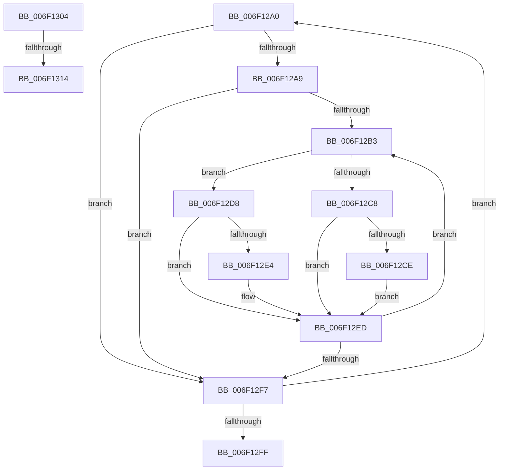

# sub_006F12A0

- RVA: `0x006F12A0`–`0x006F1323` (길이 `131` bytes)
- VA: `0x00000001406F12A0`
- 실행 섹션: `.text`
- PDB 이름 있음: `아니요`; PDB Function 태그: `아니요`
- unwind 정보 RVA: `0x000A6D20`
- 디코드: `34`개 명령, `131/131` bytes 표시
- 미해석 바이트: `0` (있으면 어셈블리에 `.byte`로 보존)

> 이 문서는 커널 이미지의 기계어와 PDB 기호를 분석해 생성했습니다. 4번과 5번은 함수 원형과 자료형을 바이너리 사용 방식에서 추정한 C 해석이며 원본 소스 복구 결과는 아닙니다.

## 1. Dependencies

- 직접 호출 지점: **3**; 고유 호출 대상: **2**
- 직접 호출자로 확인된 함수: **0**
- RIP 상대 이미지 참조: **0**

### Outgoing calls
- `0x006F12D1` → [PpmResetPerfTimes](../44/PpmResetPerfTimes_function_0044F8EC.md) (function, `0x0044F8EC`)
- `0x006F12E8` → [guard_dispatch_icall](../6B/guard_dispatch_icall_function_006BAAD0.md) (function, `0x006BAAD0`)
- `0x006F1318` → [guard_dispatch_icall](../6B/guard_dispatch_icall_function_006BAAD0.md) (function, `0x006BAAD0`)

### Direct callers
- 이 함수 시작 RVA로 연결되는 직접 call은 확인되지 않았습니다. 간접 호출은 완전히 역산할 수 없습니다.

### Static image references
- 디코드된 RIP-relative 메모리 참조가 없습니다.

## 2. Other-region calls and transfers

- 다른 실행 섹션으로 향하는 call: **0**
- call이 아닌 외부 분기/꼬리 이동: **3**
  - `0x006F12FF` → [PpmResetPerfEngineForProcessor + 0x22](../44/PpmResetPerfEngineForProcessor_function_0044F7D0.md) (`tail-transfer`)
  - `0x006F130E` → [PpmResetPerfEngineForProcessor + 0x9C](../44/PpmResetPerfEngineForProcessor_function_0044F7D0.md) (`tail-transfer`)
  - `0x006F131E` → [PpmResetPerfEngineForProcessor + 0x9C](../44/PpmResetPerfEngineForProcessor_function_0044F7D0.md) (`tail-transfer`)

## 3. Assembly (complete function range)

```asm
006F12A0  83 BB 30 01 00 00 00            cmp dword ptr [rbx + 0x130], 0
006F12A7  74 4E                           je 0x1406f12f7
006F12A9  33 FF                           xor edi, edi
006F12AB  39 BB 28 01 00 00               cmp dword ptr [rbx + 0x128], edi
006F12B1  76 44                           jbe 0x1406f12f7
006F12B3  8B C7                           mov eax, edi
006F12B5  48 69 C8 A8 04 00 00            imul rcx, rax, 0x4a8
006F12BC  48 03 8B 38 01 00 00            add rcx, qword ptr [rbx + 0x138]
006F12C3  40 84 ED                        test bpl, bpl
006F12C6  74 10                           je 0x1406f12d8
006F12C8  83 79 10 01                     cmp dword ptr [rcx + 0x10], 1
006F12CC  75 1F                           jne 0x1406f12ed
006F12CE  48 8B 09                        mov rcx, qword ptr [rcx]
006F12D1  E8 16 E6 D5 FF                  call 0x14044f8ec
006F12D6  EB 15                           jmp 0x1406f12ed
006F12D8  48 8B 83 70 01 00 00            mov rax, qword ptr [rbx + 0x170]
006F12DF  48 85 C0                        test rax, rax
006F12E2  74 09                           je 0x1406f12ed
006F12E4  48 8B 49 08                     mov rcx, qword ptr [rcx + 8]
006F12E8  E8 E3 97 FC FF                  call 0x1406baad0
006F12ED  FF C7                           inc edi
006F12EF  3B BB 28 01 00 00               cmp edi, dword ptr [rbx + 0x128]
006F12F5  72 BC                           jb 0x1406f12b3
006F12F7  48 8B 1B                        mov rbx, qword ptr [rbx]
006F12FA  49 3B DF                        cmp rbx, r15
006F12FD  75 A1                           jne 0x1406f12a0
006F12FF  E9 EE E4 D5 FF                  jmp 0x14044f7f2
006F1304  48 8B 83 70 01 00 00            mov rax, qword ptr [rbx + 0x170]
006F130B  48 85 C0                        test rax, rax
006F130E  0F 84 58 E5 D5 FF               je 0x14044f86c
006F1314  48 8B 49 08                     mov rcx, qword ptr [rcx + 8]
006F1318  E8 B3 97 FC FF                  call 0x1406baad0
006F131D  90                              nop
006F131E  E9 49 E5 D5 FF                  jmp 0x14044f86c
```

## 4. C-style interpretation (structured pseudocode)

```c
__int64 __fastcall sub_006F12A0(void)
{
    __int64 result;
    __int64 v_rdi;

    if ((*(unsigned int *)(v_rbx + 304)) == 0) goto loc_006F12F7;
    v_rdi = 0;
    if ((*(unsigned int *)(v_rbx + 296)) <= 0) goto loc_006F12F7;
loc_006F12B3:
    a1 = (a1) * (0);
    a1 = (a1) + (*(unsigned __int64 *)(v_rbx + 312));
    if ((unsigned __int8)(v_rbp) == 0) goto loc_006F12D8;
    if ((*(unsigned int *)(a1 + 16)) != 1) goto loc_006F12ED;
    result = PpmResetPerfTimes(*(unsigned __int64 *)(a1), a2, a3, a4);
    goto loc_006F12ED;
loc_006F12D8:
    result = *(unsigned __int64 *)(v_rbx + 368);
    if (*(unsigned __int64 *)(v_rbx + 368) != 0) {
        a1 = *(unsigned __int64 *)(*(unsigned __int64 *)(a1) + 8);
        result = guard_dispatch_icall(a1, a2, a3, a4);
    }
    v_rdi = (unsigned int)((v_rdi) + 1);
    if (((unsigned int)(v_rdi)) < (*(unsigned int *)(v_rbx + 296))) goto loc_006F12B3;
loc_006F12F7:
    if ((*(unsigned __int64 *)(v_rbx)) != v_r15) goto loc_006F12A0;
}
```

## 5. (Beta) C Style

```c
void sub_006F12A0(void)
{
    int64_t result;
    int64_t local_rdi;

    if ((*(uint32_t *)(local_rbx + 0x130)) == 0) goto loc_006F12F7;
    local_rdi = 0;
    if ((*(uint32_t *)(local_rbx + 0x128)) <= 0) goto loc_006F12F7;
loc_006F12B3:
    a1 = (a1) * (0);
    a1 = (a1) + (*(uint64_t *)(local_rbx + 0x138));
    if ((uint8_t)(local_rbp) == 0) goto loc_006F12D8;
    if ((*(uint32_t *)(a1 + 0x10)) != 1) goto loc_006F12ED;
    result = PpmResetPerfTimes(*(uint64_t *)(a1), a2, a3, a4);
    goto loc_006F12ED;
loc_006F12D8:
    result = *(uint64_t *)(local_rbx + 0x170);
    if (*(uint64_t *)(local_rbx + 0x170) != 0) {
        a1 = *(uint64_t *)(*(uint64_t *)(a1) + 0x8);
        result = guard_dispatch_icall(a1, a2, a3, a4);
    }
    local_rdi = (uint32_t)((local_rdi) + 1);
    if (((uint32_t)(local_rdi)) < (*(uint32_t *)(local_rbx + 0x128))) goto loc_006F12B3;
loc_006F12F7:
    if ((*(uint64_t *)(local_rbx)) != local_r15) goto loc_006F12A0;
}
```

## 6. Execution-region graph

[열기: 2D/3D 그래프와 함수 탐색 컨트롤 패널](../../../control-panel.html?section=text&rva=0x006F12A0&view=graph)

- 2D 그래프는 위에서 아래로 흐르고, 3D 그래프는 빈 공간을 드래그해 회전합니다. Shift+드래그는 이동, 휠은 확대·축소, 함수 노드 선택은 대상 보고서 이동입니다.

### Static fallback


