# sub_006F13AA

- RVA: `0x006F13AA`–`0x006F15CE` (길이 `548` bytes)
- VA: `0x00000001406F13AA`
- 실행 섹션: `.text`
- PDB 이름 있음: `아니요`; PDB Function 태그: `아니요`
- unwind 정보 RVA: `0x000A73E8`
- 디코드: `130`개 명령, `548/548` bytes 표시
- 미해석 바이트: `0` (있으면 어셈블리에 `.byte`로 보존)

> 이 문서는 커널 이미지의 기계어와 PDB 기호를 분석해 생성했습니다. 4번과 5번은 함수 원형과 자료형을 바이너리 사용 방식에서 추정한 C 해석이며 원본 소스 복구 결과는 아닙니다.

## 1. Dependencies

- 직접 호출 지점: **11**; 고유 호출 대상: **4**
- 직접 호출자로 확인된 함수: **0**
- RIP 상대 이미지 참조: **2**

### Outgoing calls
- `0x006F13AF` → [KeQueryCurrentStackInformationEx](../2F/KeQueryCurrentStackInformationEx_function_002F7CD0.md) (function, `0x002F7CD0`)
- `0x006F143D` → [KeBugCheckEx](../4F/KeBugCheckEx_function_004FD660.md) (function, `0x004FD660`)
- `0x006F1461` → [KeBugCheckEx](../4F/KeBugCheckEx_function_004FD660.md) (function, `0x004FD660`)
- `0x006F1486` → [KeBugCheckEx](../4F/KeBugCheckEx_function_004FD660.md) (function, `0x004FD660`)
- `0x006F14AF` → [memset](../6C/memset_function_006C6C40.md) (function, `0x006C6C40`)
- `0x006F14C1` → [KeGetCurrentStackPointer](../6B/KeGetCurrentStackPointer_function_006B1070.md) (function, `0x006B1070`)
- `0x006F14DE` → [KeQueryCurrentStackInformationEx](../2F/KeQueryCurrentStackInformationEx_function_002F7CD0.md) (function, `0x002F7CD0`)
- `0x006F1531` → [KeBugCheckEx](../4F/KeBugCheckEx_function_004FD660.md) (function, `0x004FD660`)
- `0x006F1555` → [KeBugCheckEx](../4F/KeBugCheckEx_function_004FD660.md) (function, `0x004FD660`)
- `0x006F157A` → [KeBugCheckEx](../4F/KeBugCheckEx_function_004FD660.md) (function, `0x004FD660`)
- `0x006F15A3` → [memset](../6C/memset_function_006C6C40.md) (function, `0x006C6C40`)

### Direct callers
- 이 함수 시작 RVA로 연결되는 직접 call은 확인되지 않았습니다. 간접 호출은 완전히 역산할 수 없습니다.

### Static image references
- `0x006F1415` → RVA `0x00FCEC68` (`ALMOSTRO`; read)
- `0x006F1497` → RVA `0x00FC6ED8` (`ALMOSTRO`; read)

## 2. Other-region calls and transfers

- 다른 실행 섹션으로 향하는 call: **0**
- call이 아닌 외부 분기/꼬리 이동: **1**
  - `0x006F15C9` → [KasanWrapperRtlRestoreContext + 0x26](../45/KasanWrapperRtlRestoreContext_function_00450EA0.md) (`tail-transfer`)

## 3. Assembly (complete function range)

```asm
006F13AA  48 89 7C 24 50                  mov qword ptr [rsp + 0x50], rdi
006F13AF  E8 1C 69 C0 FF                  call 0x1402f7cd0
006F13B4  49 BE 00 00 00 00 00 80 FF FF   movabs r14, 0xffff800000000000
006F13BE  49 BF 00 00 00 00 00 80 00 00   movabs r15, 0x800000000000
006F13C8  3C 01                           cmp al, 1
006F13CA  0F 85 F1 00 00 00               jne 0x1406f14c1
006F13D0  8B 8C 24 80 00 00 00            mov ecx, dword ptr [rsp + 0x80]
006F13D7  85 C9                           test ecx, ecx
006F13D9  0F 84 E2 00 00 00               je 0x1406f14c1
006F13DF  83 E9 05                        sub ecx, 5
006F13E2  0F 84 D9 00 00 00               je 0x1406f14c1
006F13E8  83 E9 02                        sub ecx, 2
006F13EB  0F 84 D0 00 00 00               je 0x1406f14c1
006F13F1  83 E9 01                        sub ecx, 1
006F13F4  0F 84 C7 00 00 00               je 0x1406f14c1
006F13FA  83 F9 01                        cmp ecx, 1
006F13FD  0F 84 BE 00 00 00               je 0x1406f14c1
006F1403  48 8B 9B 98 00 00 00            mov rbx, qword ptr [rbx + 0x98]
006F140A  48 8B 8C 24 88 00 00 00         mov rcx, qword ptr [rsp + 0x88]
006F1412  48 2B D9                        sub rbx, rcx
006F1415  40 38 2D 4C D8 8D 00            cmp byte ptr [rip + 0x8dd84c], bpl
006F141C  0F 84 9F 00 00 00               je 0x1406f14c1
006F1422  49 3B CE                        cmp rcx, r14
006F1425  73 1C                           jae 0x1406f1443
006F1427  BA 02 00 00 00                  mov edx, 2
006F142C  48 89 6C 24 20                  mov qword ptr [rsp + 0x20], rbp
006F1431  4C 8B C9                        mov r9, rcx
006F1434  B9 F1 01 00 00                  mov ecx, 0x1f1
006F1439  44 8D 42 FF                     lea r8d, [rdx - 1]
006F143D  E8 1E C2 E0 FF                  call 0x1404fd660
006F1442  CC                              int3
006F1443  F6 C1 07                        test cl, 7
006F1446  74 1F                           je 0x1406f1467
006F1448  BA 02 00 00 00                  mov edx, 2
006F144D  48 C7 44 24 20 08 00 00 00      mov qword ptr [rsp + 0x20], 8
006F1456  4C 8B C9                        mov r9, rcx
006F1459  44 8B C2                        mov r8d, edx
006F145C  B9 F1 01 00 00                  mov ecx, 0x1f1
006F1461  E8 FA C1 E0 FF                  call 0x1404fd660
006F1466  CC                              int3
006F1467  48 8D 04 0B                     lea rax, [rbx + rcx]
006F146B  48 3B C1                        cmp rax, rcx
006F146E  73 1C                           jae 0x1406f148c
006F1470  BA 02 00 00 00                  mov edx, 2
006F1475  48 89 5C 24 20                  mov qword ptr [rsp + 0x20], rbx
006F147A  4C 8B C9                        mov r9, rcx
006F147D  B9 F1 01 00 00                  mov ecx, 0x1f1
006F1482  44 8D 42 01                     lea r8d, [rdx + 1]
006F1486  E8 D5 C1 E0 FF                  call 0x1404fd660
006F148B  CC                              int3
006F148C  4A 8D 3C 39                     lea rdi, [rcx + r15]
006F1490  48 8B F3                        mov rsi, rbx
006F1493  48 C1 EF 03                     shr rdi, 3
006F1497  48 03 3D 3A 5A 8D 00            add rdi, qword ptr [rip + 0x8d5a3a]
006F149E  48 C1 EE 03                     shr rsi, 3
006F14A2  48 85 F6                        test rsi, rsi
006F14A5  74 10                           je 0x1406f14b7
006F14A7  4C 8B C6                        mov r8, rsi
006F14AA  33 D2                           xor edx, edx
006F14AC  48 8B CF                        mov rcx, rdi
006F14AF  E8 8C 57 FD FF                  call 0x1406c6c40
006F14B4  48 03 FE                        add rdi, rsi
006F14B7  F6 C3 07                        test bl, 7
006F14BA  74 05                           je 0x1406f14c1
006F14BC  80 E3 07                        and bl, 7
006F14BF  88 1F                           mov byte ptr [rdi], bl
006F14C1  E8 AA FB FB FF                  call 0x1406b1070
006F14C6  48 8B C8                        mov rcx, rax
006F14C9  4C 8D 4C 24 30                  lea r9, [rsp + 0x30]
006F14CE  4C 8D 84 24 88 00 00 00         lea r8, [rsp + 0x88]
006F14D6  48 8D 94 24 80 00 00 00         lea rdx, [rsp + 0x80]
006F14DE  E8 ED 67 C0 FF                  call 0x1402f7cd0
006F14E3  3C 01                           cmp al, 1
006F14E5  0F 85 CA 00 00 00               jne 0x1406f15b5
006F14EB  83 BC 24 80 00 00 00 0A         cmp dword ptr [rsp + 0x80], 0xa
006F14F3  0F 85 BC 00 00 00               jne 0x1406f15b5
006F14F9  48 8B 5C 24 30                  mov rbx, qword ptr [rsp + 0x30]
006F14FE  48 8B 8C 24 88 00 00 00         mov rcx, qword ptr [rsp + 0x88]
006F1506  48 2B D9                        sub rbx, rcx
006F1509  40 38 2D 58 D7 8D 00            cmp byte ptr [rip + 0x8dd758], bpl
006F1510  0F 84 9F 00 00 00               je 0x1406f15b5
006F1516  49 3B CE                        cmp rcx, r14
006F1519  73 1C                           jae 0x1406f1537
006F151B  BA 02 00 00 00                  mov edx, 2
006F1520  48 89 6C 24 20                  mov qword ptr [rsp + 0x20], rbp
006F1525  4C 8B C9                        mov r9, rcx
006F1528  B9 F1 01 00 00                  mov ecx, 0x1f1
006F152D  44 8D 42 FF                     lea r8d, [rdx - 1]
006F1531  E8 2A C1 E0 FF                  call 0x1404fd660
006F1536  CC                              int3
006F1537  F6 C1 07                        test cl, 7
006F153A  74 1F                           je 0x1406f155b
006F153C  BA 02 00 00 00                  mov edx, 2
006F1541  48 C7 44 24 20 08 00 00 00      mov qword ptr [rsp + 0x20], 8
006F154A  4C 8B C9                        mov r9, rcx
006F154D  44 8B C2                        mov r8d, edx
006F1550  B9 F1 01 00 00                  mov ecx, 0x1f1
006F1555  E8 06 C1 E0 FF                  call 0x1404fd660
006F155A  CC                              int3
006F155B  48 8D 04 0B                     lea rax, [rbx + rcx]
006F155F  48 3B C1                        cmp rax, rcx
006F1562  73 1C                           jae 0x1406f1580
006F1564  BA 02 00 00 00                  mov edx, 2
006F1569  48 89 5C 24 20                  mov qword ptr [rsp + 0x20], rbx
006F156E  4C 8B C9                        mov r9, rcx
006F1571  B9 F1 01 00 00                  mov ecx, 0x1f1
006F1576  44 8D 42 01                     lea r8d, [rdx + 1]
006F157A  E8 E1 C0 E0 FF                  call 0x1404fd660
006F157F  CC                              int3
006F1580  4A 8D 3C 39                     lea rdi, [rcx + r15]
006F1584  48 8B F3                        mov rsi, rbx
006F1587  48 C1 EF 03                     shr rdi, 3
006F158B  48 03 3D 46 59 8D 00            add rdi, qword ptr [rip + 0x8d5946]
006F1592  48 C1 EE 03                     shr rsi, 3
006F1596  48 85 F6                        test rsi, rsi
006F1599  74 10                           je 0x1406f15ab
006F159B  4C 8B C6                        mov r8, rsi
006F159E  33 D2                           xor edx, edx
006F15A0  48 8B CF                        mov rcx, rdi
006F15A3  E8 98 56 FD FF                  call 0x1406c6c40
006F15A8  48 03 FE                        add rdi, rsi
006F15AB  F6 C3 07                        test bl, 7
006F15AE  74 05                           je 0x1406f15b5
006F15B0  80 E3 07                        and bl, 7
006F15B3  88 1F                           mov byte ptr [rdi], bl
006F15B5  48 8B 7C 24 50                  mov rdi, qword ptr [rsp + 0x50]
006F15BA  48 8B 74 24 70                  mov rsi, qword ptr [rsp + 0x70]
006F15BF  4C 8B 74 24 48                  mov r14, qword ptr [rsp + 0x48]
006F15C4  4C 8B 7C 24 40                  mov r15, qword ptr [rsp + 0x40]
006F15C9  E9 F8 F8 D5 FF                  jmp 0x140450ec6
```

## 4. C-style interpretation (structured pseudocode)

```c
__int64 __fastcall sub_006F13AA(__int64 a1, __int64 a2, __int64 a3, __int64 a4, __int64 a5, __int64 a6, __int64 a7, __int64 a8, __int64 a9, __int64 a10, __int64 a11, __int64 a12, __int64 a13, __int64 a14, __int64 a15, unsigned int a16, __int64 a17)
{
    __int64 result;
    __int64 v_rbx;
    __int64 v_rdi;
    __int64 v_rsi;
    unsigned __int64 v_stack_p20;
    unsigned __int64 v_stack_p50;

    v_stack_p50 = v_rdi;
    result = KeQueryCurrentStackInformationEx(a1, a2, a3, a4);
    if (((unsigned __int8)(result)) != 1) goto loc_006F14C1;
    if ((unsigned int)((unsigned int)(a16)) == 0) goto loc_006F14C1;
    a1 = (unsigned int)(((unsigned int)(a16)) - (5));
    if (condition_is_equal) goto loc_006F14C1;
    a1 = (unsigned int)((a1) - (2));
    if (condition_is_equal) goto loc_006F14C1;
    a1 = (unsigned int)((a1) - (1));
    if (condition_is_equal) goto loc_006F14C1;
    if (((unsigned int)(a1)) == 1) goto loc_006F14C1;
    v_rbx = (*(unsigned __int64 *)(v_rbx + 152)) - (a17);
    if ((*(unsigned __int8 *)(v_rip + 9295948)) == ((unsigned __int8)(v_rbp))) goto loc_006F14C1;
    if (a17 < v_r14) {
        a2 = 2;
        v_stack_p20 = v_rbp;
        a4 = a17;
        a1 = 497;
        a3 = a2 - 1;
        result = KeBugCheckEx(a1, a2, a3, a4);
    }
    if ((((unsigned __int8)(a1)) & (7)) != 0) {
        a2 = 2;
        v_stack_p20 = 8;
        a4 = a1;
        a3 = (unsigned int)(a2);
        a1 = 497;
        result = KeBugCheckEx(a1, a2, a3, a4);
    }
    result = v_rbx + a1 * 1;
    if ((v_rbx + a1 * 1) < a1) {
        a2 = 2;
        v_stack_p20 = v_rbx;
        a4 = a1;
        a1 = 497;
        a3 = a2 + 1;
        result = KeBugCheckEx(a1, a2, a3, a4);
    }
    v_rdi = (a1 + v_r15 * 1) >> (3);
    v_rdi = (v_rdi) + (*(unsigned __int64 *)(v_rip + 9263674));
    v_rsi = (v_rbx) >> (3);
    if (v_rsi != 0) {
        a3 = v_rsi;
        a2 = 0;
        a1 = v_rdi;
        result = memset(a1, a2, a3, a4);
        v_rdi = (v_rdi) + (v_rsi);
    }
    if ((((unsigned __int8)(v_rbx)) & (7)) != 0) {
        v_rbx = (unsigned __int8)((v_rbx) & (7));
        *(unsigned __int8 *)(v_rdi) = (unsigned __int8)(v_rbx);
    }
    result = KeGetCurrentStackPointer(a1, a2, a3, a4);
    result = KeQueryCurrentStackInformationEx(result, a16, a17, a6);
    if (((unsigned __int8)(result)) != 1) goto loc_006F15B5;
    if (a16 != 10) goto loc_006F15B5;
    v_rbx = (a6) - (a17);
    if ((*(unsigned __int8 *)(v_rip + 9295704)) == ((unsigned __int8)(v_rbp))) goto loc_006F15B5;
    if (a17 < v_r14) {
        a2 = 2;
        v_stack_p20 = v_rbp;
        a4 = a17;
        a1 = 497;
        a3 = a2 - 1;
        result = KeBugCheckEx(a1, a2, a3, a4);
    }
    if ((((unsigned __int8)(a1)) & (7)) != 0) {
        a2 = 2;
        v_stack_p20 = 8;
        a4 = a1;
        a3 = (unsigned int)(a2);
        a1 = 497;
        result = KeBugCheckEx(a1, a2, a3, a4);
    }
    result = v_rbx + a1 * 1;
    if ((v_rbx + a1 * 1) < a1) {
        a2 = 2;
        v_stack_p20 = v_rbx;
        a4 = a1;
        a1 = 497;
        a3 = a2 + 1;
        result = KeBugCheckEx(a1, a2, a3, a4);
    }
    v_rdi = (a1 + v_r15 * 1) >> (3);
    v_rdi = (v_rdi) + (*(unsigned __int64 *)(v_rip + 9263430));
    v_rsi = (v_rbx) >> (3);
    if (v_rsi != 0) {
        a3 = v_rsi;
        a2 = 0;
        a1 = v_rdi;
        result = memset(a1, a2, a3, a4);
        v_rdi = (v_rdi) + (v_rsi);
    }
    if ((((unsigned __int8)(v_rbx)) & (7)) != 0) {
        v_rbx = (unsigned __int8)((v_rbx) & (7));
        *(unsigned __int8 *)(v_rdi) = (unsigned __int8)(v_rbx);
    }
}
```

## 5. (Beta) C Style

```c
int64_t sub_006F13AA(int64_t Arg1, int64_t Arg2, int64_t Arg3, int64_t Arg4, uint64_t Arg5, void *Arg6, uint64_t Arg7, int64_t Arg8, int64_t Arg9, int64_t Arg10, uint64_t Arg11, uint64_t Arg12, uint64_t Arg13, int64_t Arg14, uint64_t Arg15, uint32_t Arg16, int64_t Arg17)
{
    uint8_t *arg6 = (uint8_t *)Arg6;

    int64_t result;
    int64_t local_rbx;
    int64_t local_rdi;
    int64_t local_rsi;
    uint64_t v_stack_p20;
    uint64_t v_stack_p50;

    v_stack_p50 = local_rdi;
    result = KeQueryCurrentStackInformationEx(Arg1, Arg2, Arg3, Arg4);
    if (((uint8_t)(result)) != 1) goto loc_006F14C1;
    if ((uint32_t)((uint32_t)(Arg16)) == 0) goto loc_006F14C1;
    Arg1 = (uint32_t)(((uint32_t)(Arg16)) - (5));
    if (condition_is_equal) goto loc_006F14C1;
    Arg1 = (uint32_t)((Arg1) - (2));
    if (condition_is_equal) goto loc_006F14C1;
    Arg1 = (uint32_t)((Arg1) - (1));
    if (condition_is_equal) goto loc_006F14C1;
    if (((uint32_t)(Arg1)) == 1) goto loc_006F14C1;
    local_rbx = (*(uint64_t *)(local_rbx + 0x98)) - (Arg17);
    if ((*(uint8_t *)(v_rip + 0x8DD84C)) == ((uint8_t)(local_rbp))) goto loc_006F14C1;
    if (Arg17 < local_r14) {
        Arg2 = 2;
        v_stack_p20 = local_rbp;
        Arg4 = Arg17;
        Arg1 = 497;
        Arg3 = Arg2 - 1;
        result = KeBugCheckEx(Arg1, Arg2, Arg3, Arg4);
    }
    if ((((uint8_t)(Arg1)) & (7)) != 0) {
        Arg2 = 2;
        v_stack_p20 = 8;
        Arg4 = Arg1;
        Arg3 = (uint32_t)(Arg2);
        Arg1 = 497;
        result = KeBugCheckEx(Arg1, Arg2, Arg3, Arg4);
    }
    result = local_rbx + Arg1 * 1;
    if ((local_rbx + Arg1 * 1) < Arg1) {
        Arg2 = 2;
        v_stack_p20 = local_rbx;
        Arg4 = Arg1;
        Arg1 = 497;
        Arg3 = Arg2 + 1;
        result = KeBugCheckEx(Arg1, Arg2, Arg3, Arg4);
    }
    local_rdi = (Arg1 + local_r15 * 1) >> (3);
    local_rdi = (local_rdi) + (*(uint64_t *)(v_rip + 0x8D5A3A));
    local_rsi = (local_rbx) >> (3);
    if (local_rsi != 0) {
        Arg3 = local_rsi;
        Arg2 = 0;
        Arg1 = local_rdi;
        result = memset(Arg1, Arg2, Arg3, Arg4);
        local_rdi = (local_rdi) + (local_rsi);
    }
    if ((((uint8_t)(local_rbx)) & (7)) != 0) {
        local_rbx = (uint8_t)((local_rbx) & (7));
        *(uint8_t *)(local_rdi) = (uint8_t)(local_rbx);
    }
    result = KeGetCurrentStackPointer(Arg1, Arg2, Arg3, Arg4);
    result = KeQueryCurrentStackInformationEx(result, Arg16, Arg17, Arg6);
    if (((uint8_t)(result)) != 1) goto loc_006F15B5;
    if (Arg16 != 10) goto loc_006F15B5;
    local_rbx = (Arg6) - (Arg17);
    if ((*(uint8_t *)(v_rip + 0x8DD758)) == ((uint8_t)(local_rbp))) goto loc_006F15B5;
    if (Arg17 < local_r14) {
        Arg2 = 2;
        v_stack_p20 = local_rbp;
        Arg4 = Arg17;
        Arg1 = 497;
        Arg3 = Arg2 - 1;
        result = KeBugCheckEx(Arg1, Arg2, Arg3, Arg4);
    }
    if ((((uint8_t)(Arg1)) & (7)) != 0) {
        Arg2 = 2;
        v_stack_p20 = 8;
        Arg4 = Arg1;
        Arg3 = (uint32_t)(Arg2);
        Arg1 = 497;
        result = KeBugCheckEx(Arg1, Arg2, Arg3, Arg4);
    }
    result = local_rbx + Arg1 * 1;
    if ((local_rbx + Arg1 * 1) < Arg1) {
        Arg2 = 2;
        v_stack_p20 = local_rbx;
        Arg4 = Arg1;
        Arg1 = 497;
        Arg3 = Arg2 + 1;
        result = KeBugCheckEx(Arg1, Arg2, Arg3, Arg4);
    }
    local_rdi = (Arg1 + local_r15 * 1) >> (3);
    local_rdi = (local_rdi) + (*(uint64_t *)(v_rip + 0x8D5946));
    local_rsi = (local_rbx) >> (3);
    if (local_rsi != 0) {
        Arg3 = local_rsi;
        Arg2 = 0;
        Arg1 = local_rdi;
        result = memset(Arg1, Arg2, Arg3, Arg4);
        local_rdi = (local_rdi) + (local_rsi);
    }
    if ((((uint8_t)(local_rbx)) & (7)) != 0) {
        local_rbx = (uint8_t)((local_rbx) & (7));
        *(uint8_t *)(local_rdi) = (uint8_t)(local_rbx);
    }
}
```

### 관측된 메모리 오프셋

구조체 형식이 확인되지 않은 접근은 인자 기준의 오프셋으로만 기록했습니다.

| 기준 인자 | 오프셋 표현 | 폭 (bit) | 접근 |
|---|---:|---:|---|
| `Arg6` | `+ 0x0 + rcx*1` | `64` | `R` |

## 6. Execution-region graph

[열기: 2D/3D 그래프와 함수 탐색 컨트롤 패널](../../../control-panel.html?section=text&rva=0x006F13AA&view=graph)

- 2D 그래프는 위에서 아래로 흐르고, 3D 그래프는 빈 공간을 드래그해 회전합니다. Shift+드래그는 이동, 휠은 확대·축소, 함수 노드 선택은 대상 보고서 이동입니다.

### Static fallback

```mermaid
flowchart TD
  bb_006F13AA[BB_006F13AA]
  bb_006F13D0[BB_006F13D0]
  bb_006F13DF[BB_006F13DF]
  bb_006F13E8[BB_006F13E8]
  bb_006F13F1[BB_006F13F1]
  bb_006F13FA[BB_006F13FA]
  bb_006F1403[BB_006F1403]
  bb_006F1422[BB_006F1422]
  bb_006F1427[BB_006F1427]
  bb_006F1443[BB_006F1443]
  bb_006F1448[BB_006F1448]
  bb_006F1467[BB_006F1467]
  bb_006F1470[BB_006F1470]
  bb_006F148C[BB_006F148C]
  bb_006F14A7[BB_006F14A7]
  bb_006F14B7[BB_006F14B7]
  bb_006F14BC[BB_006F14BC]
  bb_006F14C1[BB_006F14C1]
  bb_006F14EB[BB_006F14EB]
  bb_006F14F9[BB_006F14F9]
  bb_006F1516[BB_006F1516]
  bb_006F151B[BB_006F151B]
  bb_006F1537[BB_006F1537]
  bb_006F153C[BB_006F153C]
  bb_006F155B[BB_006F155B]
  bb_006F1564[BB_006F1564]
  bb_006F1580[BB_006F1580]
  bb_006F159B[BB_006F159B]
  bb_006F15AB[BB_006F15AB]
  bb_006F15B0[BB_006F15B0]
  bb_006F15B5[BB_006F15B5]
  bb_006F13AA -->|branch| bb_006F14C1
  bb_006F13AA -->|fallthrough| bb_006F13D0
  bb_006F13D0 -->|branch| bb_006F14C1
  bb_006F13D0 -->|fallthrough| bb_006F13DF
  bb_006F13DF -->|branch| bb_006F14C1
  bb_006F13DF -->|fallthrough| bb_006F13E8
  bb_006F13E8 -->|branch| bb_006F14C1
  bb_006F13E8 -->|fallthrough| bb_006F13F1
  bb_006F13F1 -->|branch| bb_006F14C1
  bb_006F13F1 -->|fallthrough| bb_006F13FA
  bb_006F13FA -->|branch| bb_006F14C1
  bb_006F13FA -->|fallthrough| bb_006F1403
  bb_006F1403 -->|branch| bb_006F14C1
  bb_006F1403 -->|fallthrough| bb_006F1422
  bb_006F1422 -->|branch| bb_006F1443
  bb_006F1422 -->|fallthrough| bb_006F1427
  bb_006F1427 -->|flow| bb_006F1443
  bb_006F1443 -->|branch| bb_006F1467
  bb_006F1443 -->|fallthrough| bb_006F1448
  bb_006F1448 -->|flow| bb_006F1467
  bb_006F1467 -->|branch| bb_006F148C
  bb_006F1467 -->|fallthrough| bb_006F1470
  bb_006F1470 -->|flow| bb_006F148C
  bb_006F148C -->|branch| bb_006F14B7
  bb_006F148C -->|fallthrough| bb_006F14A7
  bb_006F14A7 -->|flow| bb_006F14B7
  bb_006F14B7 -->|branch| bb_006F14C1
  bb_006F14B7 -->|fallthrough| bb_006F14BC
  bb_006F14BC -->|flow| bb_006F14C1
  bb_006F14C1 -->|branch| bb_006F15B5
  bb_006F14C1 -->|fallthrough| bb_006F14EB
  bb_006F14EB -->|branch| bb_006F15B5
  bb_006F14EB -->|fallthrough| bb_006F14F9
  bb_006F14F9 -->|branch| bb_006F15B5
  bb_006F14F9 -->|fallthrough| bb_006F1516
  bb_006F1516 -->|branch| bb_006F1537
  bb_006F1516 -->|fallthrough| bb_006F151B
  bb_006F151B -->|flow| bb_006F1537
  bb_006F1537 -->|branch| bb_006F155B
  bb_006F1537 -->|fallthrough| bb_006F153C
  bb_006F153C -->|flow| bb_006F155B
  bb_006F155B -->|branch| bb_006F1580
  bb_006F155B -->|fallthrough| bb_006F1564
  bb_006F1564 -->|flow| bb_006F1580
  bb_006F1580 -->|branch| bb_006F15AB
  bb_006F1580 -->|fallthrough| bb_006F159B
  bb_006F159B -->|flow| bb_006F15AB
  bb_006F15AB -->|branch| bb_006F15B5
  bb_006F15AB -->|fallthrough| bb_006F15B0
  bb_006F15B0 -->|flow| bb_006F15B5
```


