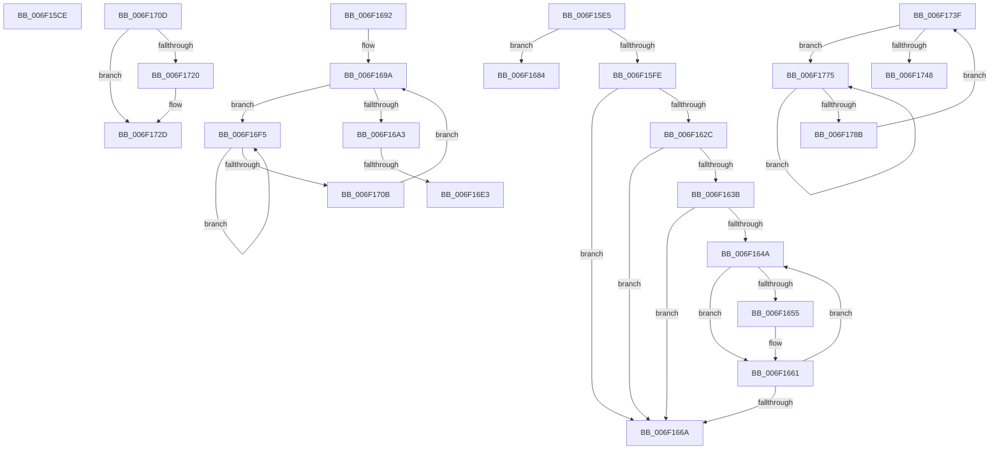

# sub_006F15CE

- RVA: `0x006F15CE`–`0x006F178D` (길이 `447` bytes)
- VA: `0x00000001406F15CE`
- 실행 섹션: `.text`
- PDB 이름 있음: `아니요`; PDB Function 태그: `아니요`
- unwind 정보 RVA: `0x000A750C`
- 디코드: `105`개 명령, `447/447` bytes 표시
- 미해석 바이트: `0` (있으면 어셈블리에 `.byte`로 보존)

> 이 문서는 커널 이미지의 기계어와 PDB 기호를 분석해 생성했습니다. 4번과 5번은 함수 원형과 자료형을 바이너리 사용 방식에서 추정한 C 해석이며 원본 소스 복구 결과는 아닙니다.

## 1. Dependencies

- 직접 호출 지점: **13**; 고유 호출 대상: **12**
- 직접 호출자로 확인된 함수: **0**
- RIP 상대 이미지 참조: **3**

### Outgoing calls
- `0x006F15DA` → [MiFillPhysicalPages](../33/MiFillPhysicalPages_function_00332910.md) (function, `0x00332910`)
- `0x006F1606` → [MiMapPageInHyperSpaceWorker](../33/MiMapPageInHyperSpaceWorker_function_00332B10.md) (function, `0x00332B10`)
- `0x006F161A` → [MiCopyPtes](../46/MiCopyPtes_function_0046C84C.md) (function, `0x0046C84C`)
- `0x006F165C` → [MiWriteValidPteNewProtection](../28/MiWriteValidPteNewProtection_function_00281810.md) (function, `0x00281810`)
- `0x006F1675` → [MiUnmapPageInHyperSpaceWorker](../43/MiUnmapPageInHyperSpaceWorker_function_00432800.md) (function, `0x00432800`)
- `0x006F1687` → [MxCopyPage](../../init/C6/MxCopyPage_function_00C631F4.md) (function, `0x00C631F4`)
- `0x006F16C6` → [MiInitializeUsedPtesCount](../44/MiInitializeUsedPtesCount_function_00443AB0.md) (function, `0x00443AB0`)
- `0x006F16EA` → [MiUnlockPageTable](../21/MiUnlockPageTable_function_00216EC0.md) (function, `0x00216EC0`)
- `0x006F16FD` → [KeYieldProcessorEx](../3F/KeYieldProcessorEx_function_003FBD00.md) (function, `0x003FBD00`)
- `0x006F1715` → [MiInsertRecursiveTbFlushEntries](../2C/MiInsertRecursiveTbFlushEntries_function_002C1F38.md) (function, `0x002C1F38`)
- `0x006F1728` → [MiReplicatePteChange](../4F/MiReplicatePteChange_function_004F8A24.md) (function, `0x004F8A24`)
- `0x006F1734` → [ExReleaseSpinLockExclusiveFromDpcLevel](../24/ExReleaseSpinLockExclusiveFromDpcLevel_function_002497E0.md) (function, `0x002497E0`)
- `0x006F177D` → [KeYieldProcessorEx](../3F/KeYieldProcessorEx_function_003FBD00.md) (function, `0x003FBD00`)

### Direct callers
- 이 함수 시작 RVA로 연결되는 직접 call은 확인되지 않았습니다. 간접 호출은 완전히 역산할 수 없습니다.

### Static image references
- `0x006F161F` → RVA `0x00FC6A88` (`ALMOSTRO`; read)
- `0x006F1633` → RVA `0x00E2DBC9` (`.data`; reference)
- `0x006F172D` → RVA `0x00E374C0` (`.data`; read)

## 2. Other-region calls and transfers

- 다른 실행 섹션으로 향하는 call: **1**
  - `0x006F1687` → [MxCopyPage](../../init/C6/MxCopyPage_function_00C631F4.md) (`.text` → `INIT`)
- call이 아닌 외부 분기/꼬리 이동: **7**
  - `0x006F15E0` → [MiInitializeSystemPageTable + 0xBA](../45/MiInitializeSystemPageTable_function_00451C88.md) (`tail-transfer`)
  - `0x006F167F` → [MiInitializeSystemPageTable + 0xBA](../45/MiInitializeSystemPageTable_function_00451C88.md) (`tail-transfer`)
  - `0x006F168D` → [MiInitializeSystemPageTable + 0xBA](../45/MiInitializeSystemPageTable_function_00451C88.md) (`tail-transfer`)
  - `0x006F16DD` → [MiInitializeSystemPageTable + 0x19A](../45/MiInitializeSystemPageTable_function_00451C88.md) (`tail-transfer`)
  - `0x006F16F0` → [MiInitializeSystemPageTable + 0x19A](../45/MiInitializeSystemPageTable_function_00451C88.md) (`tail-transfer`)
  - `0x006F173A` → [MiInitializeSystemPageTable + 0x1CF](../45/MiInitializeSystemPageTable_function_00451C88.md) (`tail-transfer`)
  - `0x006F1770` → [MiInitializeSystemPageTable + 0x1CF](../45/MiInitializeSystemPageTable_function_00451C88.md) (`tail-transfer`)

## 3. Assembly (complete function range)

```asm
006F15CE  4C 8B 89 A8 00 00 00            mov r9, qword ptr [rcx + 0xa8]
006F15D5  49 8B D5                        mov rdx, r13
006F15D8  33 C9                           xor ecx, ecx
006F15DA  E8 31 13 C4 FF                  call 0x140332910
006F15DF  90                              nop
006F15E0  E9 5D 07 D6 FF                  jmp 0x140451d42
006F15E5  65 48 8B 04 25 20 00 00 00      mov rax, qword ptr gs:[0x20]
006F15EE  49 8B CD                        mov rcx, r13
006F15F1  48 39 B0 38 88 00 00            cmp qword ptr [rax + 0x8838], rsi
006F15F8  0F 84 86 00 00 00               je 0x1406f1684
006F15FE  33 D2                           xor edx, edx
006F1600  41 B8 00 00 00 80               mov r8d, 0x80000000
006F1606  E8 05 15 C4 FF                  call 0x140332b10
006F160B  41 B8 00 02 00 00               mov r8d, 0x200
006F1611  48 8B D7                        mov rdx, rdi
006F1614  48 8B C8                        mov rcx, rax
006F1617  4C 8B E8                        mov r13, rax
006F161A  E8 2D B2 D7 FF                  call 0x14046c84c
006F161F  48 F7 05 5E 54 8D 00 00 00 00 02  test qword ptr [rip + 0x8d545e], 0x2000000
006F162A  75 3E                           jne 0x1406f166a
006F162C  8B CD                           mov ecx, ebp
006F162E  41 8B D4                        mov edx, r12d
006F1631  D3 E2                           shl edx, cl
006F1633  84 15 90 C5 73 00               test byte ptr [rip + 0x73c590], dl
006F1639  74 2F                           je 0x1406f166a
006F163B  49 8D BD 00 10 00 00            lea rdi, [r13 + 0x1000]
006F1642  49 8B DD                        mov rbx, r13
006F1645  4C 3B EF                        cmp r13, rdi
006F1648  73 20                           jae 0x1406f166a
006F164A  48 8B 13                        mov rdx, qword ptr [rbx]
006F164D  8A C2                           mov al, dl
006F164F  24 21                           and al, 0x21
006F1651  3C 21                           cmp al, 0x21
006F1653  75 0C                           jne 0x1406f1661
006F1655  48 83 E2 DF                     and rdx, 0xffffffffffffffdf
006F1659  48 8B CB                        mov rcx, rbx
006F165C  E8 AF 01 B9 FF                  call 0x140281810
006F1661  48 83 C3 08                     add rbx, 8
006F1665  48 3B DF                        cmp rbx, rdi
006F1668  72 E0                           jb 0x1406f164a
006F166A  41 B8 00 00 00 80               mov r8d, 0x80000000
006F1670  B2 11                           mov dl, 0x11
006F1672  49 8B CD                        mov rcx, r13
006F1675  E8 86 11 D4 FF                  call 0x140432800
006F167A  4C 8B 6C 24 38                  mov r13, qword ptr [rsp + 0x38]
006F167F  E9 BE 06 D6 FF                  jmp 0x140451d42
006F1684  48 8B D7                        mov rdx, rdi
006F1687  E8 68 1B 57 00                  call 0x140c631f4
006F168C  90                              nop
006F168D  E9 B0 06 D6 FF                  jmp 0x140451d42
006F1692  83 A4 24 A0 00 00 00 00         and dword ptr [rsp + 0xa0], 0
006F169A  F0 49 0F BA 6F 18 3F            lock bts qword ptr [r15 + 0x18], 0x3f
006F16A1  72 52                           jb 0x1406f16f5
006F16A3  49 8B 47 18                     mov rax, qword ptr [r15 + 0x18]
006F16A7  48 B9 01 02 00 00 00 00 00 C0   movabs rcx, 0xc000000000000201
006F16B1  48 23 C1                        and rax, rcx
006F16B4  BA 00 02 00 00                  mov edx, 0x200
006F16B9  48 0D 01 02 00 00               or rax, 0x201
006F16BF  49 8B CF                        mov rcx, r15
006F16C2  49 89 47 18                     mov qword ptr [r15 + 0x18], rax
006F16C6  E8 E5 23 D5 FF                  call 0x140443ab0
006F16CB  F0 4D 21 67 18                  lock and qword ptr [r15 + 0x18], r12
006F16D0  4C 8B 8C 24 90 00 00 00         mov r9, qword ptr [rsp + 0x90]
006F16D8  41 8B 01                        mov eax, dword ptr [r9]
006F16DB  A8 04                           test al, 4
006F16DD  0F 84 3F 07 D6 FF               je 0x140451e22
006F16E3  49 8B 49 20                     mov rcx, qword ptr [r9 + 0x20]
006F16E7  49 8B D6                        mov rdx, r14
006F16EA  E8 D1 57 B2 FF                  call 0x140216ec0
006F16EF  90                              nop
006F16F0  E9 2D 07 D6 FF                  jmp 0x140451e22
006F16F5  48 8D 8C 24 A0 00 00 00         lea rcx, [rsp + 0xa0]
006F16FD  E8 FE A5 D0 FF                  call 0x1403fbd00
006F1702  49 8B 47 18                     mov rax, qword ptr [r15 + 0x18]
006F1706  48 85 C0                        test rax, rax
006F1709  78 EA                           js 0x1406f16f5
006F170B  EB 8D                           jmp 0x1406f169a
006F170D  4D 8B C6                        mov r8, r14
006F1710  BA 03 00 00 00                  mov edx, 3
006F1715  E8 1E 08 BD FF                  call 0x1402c1f38
006F171A  83 7B 78 01                     cmp dword ptr [rbx + 0x78], 1
006F171E  74 0D                           je 0x1406f172d
006F1720  BA 01 00 00 00                  mov edx, 1
006F1725  49 8B CE                        mov rcx, r14
006F1728  E8 F7 72 E0 FF                  call 0x1404f8a24
006F172D  48 8D 0D 8C 5D 74 00            lea rcx, [rip + 0x745d8c]
006F1734  E8 A7 80 B5 FF                  call 0x1402497e0
006F1739  90                              nop
006F173A  E9 18 07 D6 FF                  jmp 0x140451e57
006F173F  F0 49 0F BA 6F 18 3F            lock bts qword ptr [r15 + 0x18], 0x3f
006F1746  72 2D                           jb 0x1406f1775
006F1748  41 8B 47 20                     mov eax, dword ptr [r15 + 0x20]
006F174C  89 84 24 98 00 00 00            mov dword ptr [rsp + 0x98], eax
006F1753  B8 02 00 00 00                  mov eax, 2
006F1758  66 89 84 24 98 00 00 00         mov word ptr [rsp + 0x98], ax
006F1760  8B 84 24 98 00 00 00            mov eax, dword ptr [rsp + 0x98]
006F1767  41 89 47 20                     mov dword ptr [r15 + 0x20], eax
006F176B  F0 4D 21 67 18                  lock and qword ptr [r15 + 0x18], r12
006F1770  E9 E2 06 D6 FF                  jmp 0x140451e57
006F1775  48 8D 8C 24 A8 00 00 00         lea rcx, [rsp + 0xa8]
006F177D  E8 7E A5 D0 FF                  call 0x1403fbd00
006F1782  49 8B 47 18                     mov rax, qword ptr [r15 + 0x18]
006F1786  48 85 C0                        test rax, rax
006F1789  78 EA                           js 0x1406f1775
006F178B  EB B2                           jmp 0x1406f173f
```

## 4. C-style interpretation (structured pseudocode)

```c
__int64 __fastcall sub_006F15CE(__int64 a1)
{
    __int64 result;
    unsigned __int64 v_stack_p38;
    unsigned __int64 v_stack_p90;
    unsigned int v_stack_p98;
    unsigned int v_stack_pA0;
    unsigned __int64 v_stack_pA8;

    a1 = 0;
    result = MiFillPhysicalPages(a1, v_r13, a3, *(unsigned __int64 *)(a1 + 168));
}
```

## 5. (Beta) C Style

```c
int64_t sub_006F15CE(void *Arg1)
{
    uint8_t *arg1 = (uint8_t *)Arg1;

    int64_t result;
    uint64_t v_stack_p38;
    uint64_t v_stack_p90;
    uint32_t v_stack_p98;
    uint32_t v_stack_pA0;
    uint64_t v_stack_pA8;

    Arg1 = 0;
    result = MiFillPhysicalPages(Arg1, local_r13, a3, *(uint64_t *)(arg1 + 0xA8));
}
```

### 관측된 메모리 오프셋

구조체 형식이 확인되지 않은 접근은 인자 기준의 오프셋으로만 기록했습니다.

| 기준 인자 | 오프셋 표현 | 폭 (bit) | 접근 |
|---|---:|---:|---|
| `Arg1` | `+ 0xA8` | `64` | `R` |

## 6. Execution-region graph

[열기: 2D/3D 그래프와 함수 탐색 컨트롤 패널](../../../control-panel.html?section=text&rva=0x006F15CE&view=graph)

- 2D 그래프는 위에서 아래로 흐르고, 3D 그래프는 빈 공간을 드래그해 회전합니다. Shift+드래그는 이동, 휠은 확대·축소, 함수 노드 선택은 대상 보고서 이동입니다.

### Static fallback


