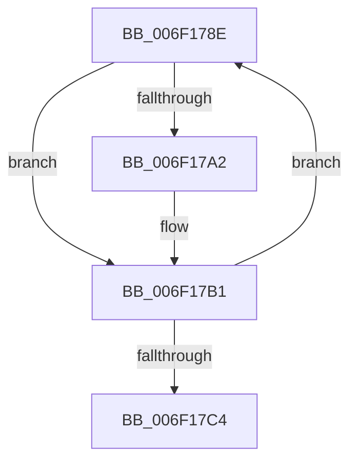

# sub_006F178E

- RVA: `0x006F178E`–`0x006F17C9` (길이 `59` bytes)
- VA: `0x00000001406F178E`
- 실행 섹션: `.text`
- PDB 이름 있음: `아니요`; PDB Function 태그: `아니요`
- unwind 정보 RVA: `0x000A77C0`
- 디코드: `14`개 명령, `59/59` bytes 표시
- 미해석 바이트: `0` (있으면 어셈블리에 `.byte`로 보존)

> 이 문서는 커널 이미지의 기계어와 PDB 기호를 분석해 생성했습니다. 4번과 5번은 함수 원형과 자료형을 바이너리 사용 방식에서 추정한 C 해석이며 원본 소스 복구 결과는 아닙니다.

## 1. Dependencies

- 직접 호출 지점: **2**; 고유 호출 대상: **2**
- 직접 호출자로 확인된 함수: **0**
- RIP 상대 이미지 참조: **2**

### Outgoing calls
- `0x006F17AC` → [KiHvEnlightenedGuestPriorityKick](../44/KiHvEnlightenedGuestPriorityKick_function_00443880.md) (function, `0x00443880`)
- `0x006F17BB` → [KeEnumerateNextProcessor](../41/KeEnumerateNextProcessor_function_00415480.md) (function, `0x00415480`)

### Direct callers
- 이 함수 시작 RVA로 연결되는 직접 call은 확인되지 않았습니다. 간접 호출은 완전히 역산할 수 없습니다.

### Static image references
- `0x006F1792` → RVA `0x00FC8C40` (`ALMOSTRO`; read)
- `0x006F17A2` → RVA `0x00FC504C` (`ALMOSTRO`; read)

## 2. Other-region calls and transfers

- 다른 실행 섹션으로 향하는 call: **0**
- call이 아닌 외부 분기/꼬리 이동: **1**
  - `0x006F17C4` → [KiIpiEnlightenedGuestPriorityKick + 0x31](../45/KiIpiEnlightenedGuestPriorityKick_function_004536B0.md) (`tail-transfer`)

## 3. Assembly (complete function range)

```asm
006F178E  8B 44 24 58                     mov eax, dword ptr [rsp + 0x58]
006F1792  48 8D 15 A7 74 8D 00            lea rdx, [rip + 0x8d74a7]
006F1799  48 8B 14 C2                     mov rdx, qword ptr [rdx + rax*8]
006F179D  48 3B D3                        cmp rdx, rbx
006F17A0  74 0F                           je 0x1406f17b1
006F17A2  44 8B 05 A3 38 8D 00            mov r8d, dword ptr [rip + 0x8d38a3]
006F17A9  48 8B CB                        mov rcx, rbx
006F17AC  E8 CF 20 D5 FF                  call 0x140443880
006F17B1  48 8D 54 24 20                  lea rdx, [rsp + 0x20]
006F17B6  48 8D 4C 24 58                  lea rcx, [rsp + 0x58]
006F17BB  E8 C0 3C D2 FF                  call 0x140415480
006F17C0  85 C0                           test eax, eax
006F17C2  74 CA                           je 0x1406f178e
006F17C4  E9 18 1F D6 FF                  jmp 0x1404536e1
```

## 4. C-style interpretation (structured pseudocode)

```c
__int64 __fastcall sub_006F178E(__int64 a1, __int64 a2, __int64 a3, __int64 a4, __int64 a5, __int64 a6, __int64 a7, __int64 a8, __int64 a9, __int64 a10, unsigned int a11)
{
    __int64 result;
    unsigned __int64 v_stack_p20;

    result = (unsigned int)(a11);
    if ((*(unsigned __int64 *)(v_rip + 9270439 + (unsigned int)(a11) * 8)) != v_rbx) {
        a3 = *(unsigned int *)(v_rip + 9255075);
        a1 = v_rbx;
        result = KiHvEnlightenedGuestPriorityKick(a1, *(unsigned __int64 *)(v_rip + 9270439 + (unsigned int)(a11) * 8), a3, a4);
    }
    result = KeEnumerateNextProcessor(a11, v_stack_p20, a3, a4);
    if ((unsigned int)(result) == 0) goto loc_006F178E;
}
```

## 5. (Beta) C Style

```c
int64_t sub_006F178E(int64_t Arg1, int64_t Arg2, int64_t Arg3, int64_t Arg4, uint64_t Arg5, uint64_t Arg6, uint64_t Arg7, uint64_t Arg8, uint64_t Arg9, uint64_t Arg10, uint32_t Arg11)
{
    int64_t result;
    uint64_t v_stack_p20;

    result = (uint32_t)(Arg11);
    if ((*(uint64_t *)(v_rip + 0x8D74A7 + (uint32_t)(Arg11) * 8)) != local_rbx) {
        Arg3 = *(uint32_t *)(v_rip + 0x8D38A3);
        Arg1 = local_rbx;
        result = KiHvEnlightenedGuestPriorityKick(Arg1, *(uint64_t *)(v_rip + 0x8D74A7 + (uint32_t)(Arg11) * 8), Arg3, Arg4);
    }
    result = KeEnumerateNextProcessor(Arg11, v_stack_p20, Arg3, Arg4);
    if ((uint32_t)(result) == 0) goto loc_006F178E;
}
```

## 6. Execution-region graph

[열기: 2D/3D 그래프와 함수 탐색 컨트롤 패널](../../../control-panel.html?section=text&rva=0x006F178E&view=graph)

- 2D 그래프는 위에서 아래로 흐르고, 3D 그래프는 빈 공간을 드래그해 회전합니다. Shift+드래그는 이동, 휠은 확대·축소, 함수 노드 선택은 대상 보고서 이동입니다.

### Static fallback


