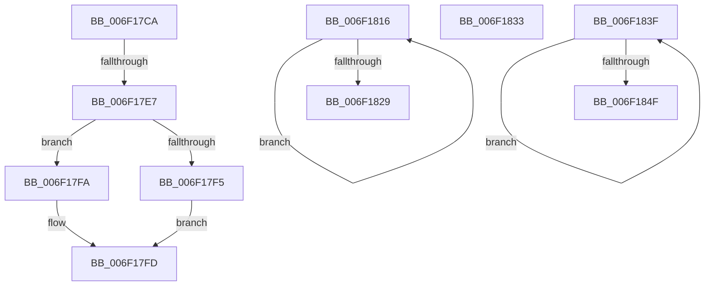

# sub_006F17CA

- RVA: `0x006F17CA`–`0x006F1854` (길이 `138` bytes)
- VA: `0x00000001406F17CA`
- 실행 섹션: `.text`
- PDB 이름 있음: `아니요`; PDB Function 태그: `아니요`
- unwind 정보 RVA: `0x000A79C0`
- 디코드: `37`개 명령, `138/138` bytes 표시
- 미해석 바이트: `0` (있으면 어셈블리에 `.byte`로 보존)

> 이 문서는 커널 이미지의 기계어와 PDB 기호를 분석해 생성했습니다. 4번과 5번은 함수 원형과 자료형을 바이너리 사용 방식에서 추정한 C 해석이며 원본 소스 복구 결과는 아닙니다.

## 1. Dependencies

- 직접 호출 지점: **2**; 고유 호출 대상: **2**
- 직접 호출자로 확인된 함수: **0**
- RIP 상대 이미지 참조: **0**

### Outgoing calls
- `0x006F17D9` → [IoAllocateMdl](../29/IoAllocateMdl_function_0029EBF0.md) (function, `0x0029EBF0`)
- `0x006F181C` → [IoFreeMdl](../29/IoFreeMdl_function_0029EA80.md) (function, `0x0029EA80`)

### Direct callers
- 이 함수 시작 RVA로 연결되는 직접 call은 확인되지 않았습니다. 간접 호출은 완전히 역산할 수 없습니다.

### Static image references
- 디코드된 RIP-relative 메모리 참조가 없습니다.

## 2. Other-region calls and transfers

- 다른 실행 섹션으로 향하는 call: **0**
- call이 아닌 외부 분기/꼬리 이동: **5**
  - `0x006F17E1` → [HalBuildMdlFromScatterGatherListV2 + 0x1B4](../45/HalBuildMdlFromScatterGatherListV2_function_00454670.md) (`tail-transfer`)
  - `0x006F1811` → [HalBuildMdlFromScatterGatherListV2 + 0x16E](../45/HalBuildMdlFromScatterGatherListV2_function_00454670.md) (`tail-transfer`)
  - `0x006F182E` → [HalBuildMdlFromScatterGatherListV2 + 0x3E](../45/HalBuildMdlFromScatterGatherListV2_function_00454670.md) (`tail-transfer`)
  - `0x006F183A` → [HalBuildMdlFromScatterGatherListV2 + 0xF5](../45/HalBuildMdlFromScatterGatherListV2_function_00454670.md) (`tail-transfer`)
  - `0x006F184F` → [HalBuildMdlFromScatterGatherListV2 + 0x119](../45/HalBuildMdlFromScatterGatherListV2_function_00454670.md) (`tail-transfer`)

## 3. Assembly (complete function range)

```asm
006F17CA  48 83 64 24 20 00               and qword ptr [rsp + 0x20], 0
006F17D0  45 33 C9                        xor r9d, r9d
006F17D3  41 8B C8                        mov ecx, r8d
006F17D6  41 B0 01                        mov r8b, 1
006F17D9  E8 12 D4 BA FF                  call 0x14029ebf0
006F17DE  48 85 C0                        test rax, rax
006F17E1  0F 84 3D 30 D6 FF               je 0x140454824
006F17E7  B9 02 28 00 00                  mov ecx, 0x2802
006F17EC  66 09 48 0A                     or word ptr [rax + 0xa], cx
006F17F0  48 85 FF                        test rdi, rdi
006F17F3  75 05                           jne 0x1406f17fa
006F17F5  48 8B F8                        mov rdi, rax
006F17F8  EB 03                           jmp 0x1406f17fd
006F17FA  49 89 06                        mov qword ptr [r14], rax
006F17FD  44 8B 8C 24 80 00 00 00         mov r9d, dword ptr [rsp + 0x80]
006F1805  33 D2                           xor edx, edx
006F1807  4C 8B 54 24 38                  mov r10, qword ptr [rsp + 0x38]
006F180C  32 C9                           xor cl, cl
006F180E  4C 8B F0                        mov r14, rax
006F1811  E9 C8 2F D6 FF                  jmp 0x1404547de
006F1816  48 8B 1F                        mov rbx, qword ptr [rdi]
006F1819  48 8B CF                        mov rcx, rdi
006F181C  E8 5F D2 BA FF                  call 0x14029ea80
006F1821  48 8B FB                        mov rdi, rbx
006F1824  48 85 DB                        test rbx, rbx
006F1827  75 ED                           jne 0x1406f1816
006F1829  B8 9A 00 00 C0                  mov eax, 0xc000009a
006F182E  E9 7B 2E D6 FF                  jmp 0x1404546ae
006F1833  4D 8B 36                        mov r14, qword ptr [r14]
006F1836  4D 8D 46 30                     lea r8, [r14 + 0x30]
006F183A  E9 26 2F D6 FF                  jmp 0x140454765
006F183F  49 89 10                        mov qword ptr [r8], rdx
006F1842  49 83 C0 08                     add r8, 8
006F1846  48 FF C2                        inc rdx
006F1849  48 83 E8 01                     sub rax, 1
006F184D  75 F0                           jne 0x1406f183f
006F184F  E9 35 2F D6 FF                  jmp 0x140454789
```

## 4. C-style interpretation (structured pseudocode)

```c
__int64 __fastcall sub_006F17CA(__int64 a1, int a2, int a3, int a4, __int64 a5, __int64 a6, __int64 a7, __int64 a8, __int64 a9, __int64 a10, __int64 a11, __int64 a12, __int64 a13, __int64 a14, __int64 a15, unsigned int a16)
{
    __int64 result;
    unsigned __int64 v_stack_p20;

    a4 = 0;
    result = IoAllocateMdl((unsigned int)(a3), a2, 1, a4);
    if (v_rdi != 0) goto loc_006F17FA;
    goto loc_006F17FD;
loc_006F17FA:
    *(unsigned __int64 *)(v_r14) = result;
loc_006F17FD:
    a2 = 0;
    a1 = 0;
}
```

## 5. (Beta) C Style

```c
int64_t sub_006F17CA(int64_t Arg1, int32_t Arg2, int32_t Arg3, int32_t Arg4, uint64_t Arg5, uint64_t Arg6, int64_t Arg7, uint64_t Arg8, uint64_t Arg9, uint64_t Arg10, uint64_t Arg11, uint64_t Arg12, uint64_t Arg13, uint64_t Arg14, uint64_t Arg15, uint32_t Arg16)
{
    int64_t result;
    uint64_t v_stack_p20;

    Arg4 = 0;
    result = IoAllocateMdl((uint32_t)(Arg3), Arg2, 1, Arg4);
    if (local_rdi != 0) goto loc_006F17FA;
    goto loc_006F17FD;
loc_006F17FA:
    *(uint64_t *)(local_r14) = result;
loc_006F17FD:
    Arg2 = 0;
    Arg1 = 0;
}
```

## 6. Execution-region graph

[열기: 2D/3D 그래프와 함수 탐색 컨트롤 패널](../../../control-panel.html?section=text&rva=0x006F17CA&view=graph)

- 2D 그래프는 위에서 아래로 흐르고, 3D 그래프는 빈 공간을 드래그해 회전합니다. Shift+드래그는 이동, 휠은 확대·축소, 함수 노드 선택은 대상 보고서 이동입니다.

### Static fallback


