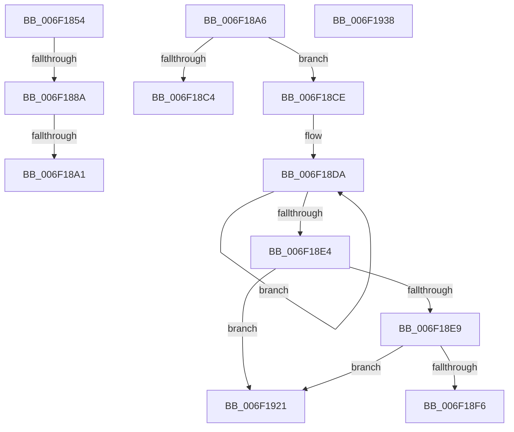

# sub_006F1854

- RVA: `0x006F1854`–`0x006F1946` (길이 `242` bytes)
- VA: `0x00000001406F1854`
- 실행 섹션: `.text`
- PDB 이름 있음: `아니요`; PDB Function 태그: `아니요`
- unwind 정보 RVA: `0x000A7A74`
- 디코드: `54`개 명령, `242/242` bytes 표시
- 미해석 바이트: `0` (있으면 어셈블리에 `.byte`로 보존)

> 이 문서는 커널 이미지의 기계어와 PDB 기호를 분석해 생성했습니다. 4번과 5번은 함수 원형과 자료형을 바이너리 사용 방식에서 추정한 C 해석이며 원본 소스 복구 결과는 아닙니다.

## 1. Dependencies

- 직접 호출 지점: **3**; 고유 호출 대상: **3**
- 직접 호출자로 확인된 함수: **0**
- RIP 상대 이미지 참조: **0**

### Outgoing calls
- `0x006F1878` → [LdrpFindMessageInAlternateModule](../47/LdrpFindMessageInAlternateModule_function_0047CB1C.md) (function, `0x0047CB1C`)
- `0x006F18B8` → [DownLevelLangIDToLanguageName](../4B/DownLevelLangIDToLanguageName_function_004BBAA8.md) (function, `0x004BBAA8`)
- `0x006F190A` → [memcpy](../6C/memcpy_function_006C6840.md) (function, `0x006C6840`)

### Direct callers
- 이 함수 시작 RVA로 연결되는 직접 call은 확인되지 않았습니다. 간접 호출은 완전히 역산할 수 없습니다.

### Static image references
- 디코드된 RIP-relative 메모리 참조가 없습니다.

## 2. Other-region calls and transfers

- 다른 실행 섹션으로 향하는 call: **0**
- call이 아닌 외부 분기/꼬리 이동: **7**
  - `0x006F1884` → [LdrpResSearchResourceMappedFile + 0x3BF](../45/LdrpResSearchResourceMappedFile_function_00454C98.md) (`tail-transfer`)
  - `0x006F189B` → [LdrpResSearchResourceMappedFile + 0x3D4](../45/LdrpResSearchResourceMappedFile_function_00454C98.md) (`tail-transfer`)
  - `0x006F18A1` → [LdrpResSearchResourceMappedFile + 0x3BF](../45/LdrpResSearchResourceMappedFile_function_00454C98.md) (`tail-transfer`)
  - `0x006F18C9` → [LdrpResSearchResourceMappedFile + 0x3D4](../45/LdrpResSearchResourceMappedFile_function_00454C98.md) (`tail-transfer`)
  - `0x006F191C` → [LdrpResSearchResourceMappedFile + 0x3D4](../45/LdrpResSearchResourceMappedFile_function_00454C98.md) (`tail-transfer`)
  - `0x006F1933` → [LdrpResSearchResourceMappedFile + 0x3D4](../45/LdrpResSearchResourceMappedFile_function_00454C98.md) (`tail-transfer`)
  - `0x006F1941` → [LdrpResSearchResourceMappedFile + 0x3D4](../45/LdrpResSearchResourceMappedFile_function_00454C98.md) (`tail-transfer`)

## 3. Assembly (complete function range)

```asm
006F1854  4C 8B 84 24 B0 00 00 00         mov r8, qword ptr [rsp + 0xb0]
006F185C  44 88 7C 24 20                  mov byte ptr [rsp + 0x20], r15b
006F1861  48 8B 84 24 98 00 00 00         mov rax, qword ptr [rsp + 0x98]
006F1869  44 8B 48 18                     mov r9d, dword ptr [rax + 0x18]
006F186D  48 8B 11                        mov rdx, qword ptr [rcx]
006F1870  48 8B 8C 24 90 00 00 00         mov rcx, qword ptr [rsp + 0x90]
006F1878  E8 9F B2 D8 FF                  call 0x14047cb1c
006F187D  8B F8                           mov edi, eax
006F187F  45 33 C9                        xor r9d, r9d
006F1882  85 C0                           test eax, eax
006F1884  0F 89 CD 37 D6 FF               jns 0x140455057
006F188A  48 8B 84 24 B8 00 00 00         mov rax, qword ptr [rsp + 0xb8]
006F1892  4C 89 08                        mov qword ptr [rax], r9
006F1895  81 FF 7B 00 00 C0               cmp edi, 0xc000007b
006F189B  0F 84 CB 37 D6 FF               je 0x14045506c
006F18A1  E9 B1 37 D6 FF                  jmp 0x140455057
006F18A6  41 B9 02 00 00 00               mov r9d, 2
006F18AC  45 8D 41 54                     lea r8d, [r9 + 0x54]
006F18B0  48 8D 94 24 10 03 00 00         lea rdx, [rsp + 0x310]
006F18B8  E8 EB A1 DC FF                  call 0x1404bbaa8
006F18BD  45 33 C9                        xor r9d, r9d
006F18C0  85 C0                           test eax, eax
006F18C2  75 0A                           jne 0x1406f18ce
006F18C4  BF 01 00 00 C0                  mov edi, 0xc0000001
006F18C9  E9 9E 37 D6 FF                  jmp 0x14045506c
006F18CE  48 8D 84 24 10 03 00 00         lea rax, [rsp + 0x310]
006F18D6  48 83 CE FF                     or rsi, 0xffffffffffffffff
006F18DA  48 FF C6                        inc rsi
006F18DD  66 44 39 0C 70                  cmp word ptr [rax + rsi*2], r9w
006F18E2  75 F6                           jne 0x1406f18da
006F18E4  41 3B 36                        cmp esi, dword ptr [r14]
006F18E7  73 38                           jae 0x1406f1921
006F18E9  4C 8B BC 24 F0 00 00 00         mov r15, qword ptr [rsp + 0xf0]
006F18F1  4D 85 FF                        test r15, r15
006F18F4  74 2B                           je 0x1406f1921
006F18F6  8B C6                           mov eax, esi
006F18F8  48 8D 1C 00                     lea rbx, [rax + rax]
006F18FC  4C 8B C3                        mov r8, rbx
006F18FF  48 8D 94 24 10 03 00 00         lea rdx, [rsp + 0x310]
006F1907  49 8B CF                        mov rcx, r15
006F190A  E8 31 4F FD FF                  call 0x1406c6840
006F190F  8D 46 01                        lea eax, [rsi + 1]
006F1912  41 89 06                        mov dword ptr [r14], eax
006F1915  33 C0                           xor eax, eax
006F1917  66 42 89 04 3B                  mov word ptr [rbx + r15], ax
006F191C  E9 4B 37 D6 FF                  jmp 0x14045506c
006F1921  8D 46 01                        lea eax, [rsi + 1]
006F1924  41 89 06                        mov dword ptr [r14], eax
006F1927  BF 23 00 00 C0                  mov edi, 0xc0000023
006F192C  89 BC 24 A4 00 00 00            mov dword ptr [rsp + 0xa4], edi
006F1933  E9 34 37 D6 FF                  jmp 0x14045506c
006F1938  8B F8                           mov edi, eax
006F193A  89 84 24 A4 00 00 00            mov dword ptr [rsp + 0xa4], eax
006F1941  E9 26 37 D6 FF                  jmp 0x14045506c
```

## 4. C-style interpretation (structured pseudocode)

```c
__int64 __fastcall sub_006F1854(__int64 a1, __int64 a2, __int64 a3, __int64 a4, __int64 a5, __int64 a6, __int64 a7, __int64 a8, __int64 a9, __int64 a10, __int64 a11, __int64 a12, __int64 a13, __int64 a14, __int64 a15, __int64 a16, __int64 a17, __int64 a18, __int64 a19, __int64 a20, __int64 a21, __int64 a22, __int64 a23)
{
    __int64 result;
    unsigned __int8 v_stack_p20;
    unsigned __int64 v_stack_p310;
    unsigned int v_stack_pA4;
    unsigned __int64 v_stack_pF0;

    v_stack_p20 = (unsigned __int8)(v_r15);
    result = LdrpFindMessageInAlternateModule(a18, *(unsigned __int64 *)(a1), a22, (unsigned int)(*(unsigned int *)(a19 + 24)));
    a4 = 0;
    *(unsigned __int64 *)(a23) = 0;
}
```

## 5. (Beta) C Style

```c
int64_t sub_006F1854(void *Arg1, int64_t Arg2, int64_t Arg3, int64_t Arg4, uint64_t Arg5, uint64_t Arg6, uint64_t Arg7, uint64_t Arg8, uint64_t Arg9, uint64_t Arg10, uint64_t Arg11, uint64_t Arg12, uint64_t Arg13, uint64_t Arg14, uint64_t Arg15, uint64_t Arg16, uint64_t Arg17, int64_t Arg18, void *Arg19, uint64_t Arg20, uint64_t Arg21, int64_t Arg22, void *Arg23)
{
    uint8_t *arg1 = (uint8_t *)Arg1;
    uint8_t *arg19 = (uint8_t *)Arg19;
    uint8_t *arg23 = (uint8_t *)Arg23;

    int64_t result;
    uint8_t v_stack_p20;
    uint64_t v_stack_p310;
    uint32_t v_stack_pA4;
    uint64_t v_stack_pF0;

    v_stack_p20 = (uint8_t)(local_r15);
    result = LdrpFindMessageInAlternateModule(Arg18, *(uint64_t *)(arg1), Arg22, (uint32_t)(*(uint32_t *)(arg19 + 0x18)));
    Arg4 = 0;
    *(uint64_t *)(arg23) = 0;
}
```

### 관측된 메모리 오프셋

구조체 형식이 확인되지 않은 접근은 인자 기준의 오프셋으로만 기록했습니다.

| 기준 인자 | 오프셋 표현 | 폭 (bit) | 접근 |
|---|---:|---:|---|
| `Arg1` | `+ 0x0` | `64` | `R` |
| `Arg19` | `+ 0x18` | `32` | `R` |
| `Arg23` | `+ 0x0` | `64` | `W` |

## 6. Execution-region graph

[열기: 2D/3D 그래프와 함수 탐색 컨트롤 패널](../../../control-panel.html?section=text&rva=0x006F1854&view=graph)

- 2D 그래프는 위에서 아래로 흐르고, 3D 그래프는 빈 공간을 드래그해 회전합니다. Shift+드래그는 이동, 휠은 확대·축소, 함수 노드 선택은 대상 보고서 이동입니다.

### Static fallback


