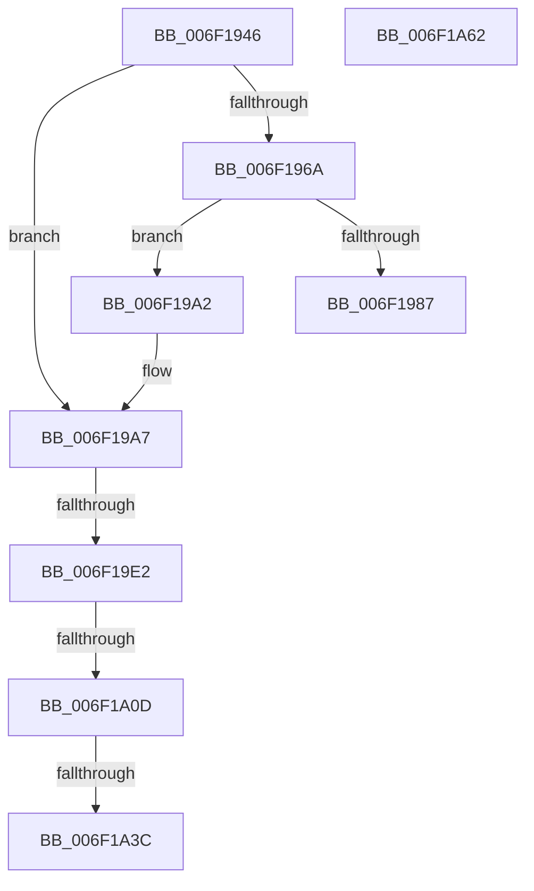

# sub_006F1946

- RVA: `0x006F1946`–`0x006F1A69` (길이 `291` bytes)
- VA: `0x00000001406F1946`
- 실행 섹션: `.text`
- PDB 이름 있음: `아니요`; PDB Function 태그: `아니요`
- unwind 정보 RVA: `0x000A7B50`
- 디코드: `64`개 명령, `291/291` bytes 표시
- 미해석 바이트: `0` (있으면 어셈블리에 `.byte`로 보존)

> 이 문서는 커널 이미지의 기계어와 PDB 기호를 분석해 생성했습니다. 4번과 5번은 함수 원형과 자료형을 바이너리 사용 방식에서 추정한 C 해석이며 원본 소스 복구 결과는 아닙니다.

## 1. Dependencies

- 직접 호출 지점: **7**; 고유 호출 대상: **7**
- 직접 호출자로 확인된 함수: **0**
- RIP 상대 이미지 참조: **3**

### Outgoing calls
- `0x006F197E` → [DownLevelLangIDToLanguageName](../4B/DownLevelLangIDToLanguageName_function_004BBAA8.md) (function, `0x004BBAA8`)
- `0x006F1997` → [DbgPrintEx](../35/DbgPrintEx_function_00359290.md) (function, `0x00359290`)
- `0x006F19D3` → [LdrpGetResourceFileName](../5E/LdrpGetResourceFileName_function_005E5B28.md) (function, `0x005E5B28`)
- `0x006F19FE` → [LdrpMapResourceFile](../5E/LdrpMapResourceFile_function_005E5CBC.md) (function, `0x005E5CBC`)
- `0x006F1A2F` → [LdrpVerifyAlternateResourceModuleEx](../5E/LdrpVerifyAlternateResourceModuleEx_function_005E5F24.md) (function, `0x005E5F24`)
- `0x006F1A41` → [MmUnmapViewInSessionSpace](../../page/A5/MmUnmapViewInSessionSpace_function_00A5FE60.md) (function, `0x00A5FE60`)
- `0x006F1A4B` → [ZwClose](../6A/ZwClose_function_006AD2B0.md) (function, `0x006AD2B0`)

### Direct callers
- 이 함수 시작 RVA로 연결되는 직접 call은 확인되지 않았습니다. 간접 호출은 완전히 역산할 수 없습니다.

### Static image references
- `0x006F198A` → RVA `0x006CC5A0` (` ?? ::FNODOBFM::`string'`; read)
- `0x006F19A7` → RVA `0x006CC580` (` ?? ::FNODOBFM::`string'`; read)
- `0x006F19AE` → RVA `0x006CC590` (` ?? ::FNODOBFM::`string'`; read)

## 2. Other-region calls and transfers

- 다른 실행 섹션으로 향하는 call: **1**
  - `0x006F1A41` → [MmUnmapViewInSessionSpace](../../page/A5/MmUnmapViewInSessionSpace_function_00A5FE60.md) (`.text` → `PAGE`)
- call이 아닌 외부 분기/꼬리 이동: **6**
  - `0x006F199D` → [LdrLoadAlternateResourceModuleEx + 0xFF](../45/LdrLoadAlternateResourceModuleEx_function_004557CC.md) (`tail-transfer`)
  - `0x006F19DC` → [LdrLoadAlternateResourceModuleEx + 0x104](../45/LdrLoadAlternateResourceModuleEx_function_004557CC.md) (`tail-transfer`)
  - `0x006F1A07` → [LdrLoadAlternateResourceModuleEx + 0x104](../45/LdrLoadAlternateResourceModuleEx_function_004557CC.md) (`tail-transfer`)
  - `0x006F1A36` → [LdrLoadAlternateResourceModuleEx + 0x104](../45/LdrLoadAlternateResourceModuleEx_function_004557CC.md) (`tail-transfer`)
  - `0x006F1A5D` → [LdrLoadAlternateResourceModuleEx + 0x104](../45/LdrLoadAlternateResourceModuleEx_function_004557CC.md) (`tail-transfer`)
  - `0x006F1A64` → [LdrLoadAlternateResourceModuleEx + 0x156](../45/LdrLoadAlternateResourceModuleEx_function_004557CC.md) (`tail-transfer`)

## 3. Assembly (complete function range)

```asm
006F1946  48 8D 8C 24 30 01 00 00         lea rcx, [rsp + 0x130]
006F194E  48 89 4C 24 68                  mov qword ptr [rsp + 0x68], rcx
006F1953  C7 44 24 60 00 00 08 02         mov dword ptr [rsp + 0x60], 0x2080000
006F195B  8B BC 24 B0 03 00 00            mov edi, dword ptr [rsp + 0x3b0]
006F1962  81 E7 00 00 00 01               and edi, 0x1000000
006F1968  75 3D                           jne 0x1406f19a7
006F196A  44 8D 4F 02                     lea r9d, [rdi + 2]
006F196E  44 8D 47 55                     lea r8d, [rdi + 0x55]
006F1972  48 8D 94 24 80 00 00 00         lea rdx, [rsp + 0x80]
006F197A  41 0F B7 CD                     movzx ecx, r13w
006F197E  E8 25 A1 DC FF                  call 0x1404bbaa8
006F1983  85 C0                           test eax, eax
006F1985  75 1B                           jne 0x1406f19a2
006F1987  45 8B CD                        mov r9d, r13d
006F198A  4C 8D 05 0F AC FD FF            lea r8, [rip - 0x253f1]
006F1991  8D 57 01                        lea edx, [rdi + 1]
006F1994  8D 4F 55                        lea ecx, [rdi + 0x55]
006F1997  E8 F4 78 C6 FF                  call 0x140359290
006F199C  90                              nop
006F199D  E9 29 3F D6 FF                  jmp 0x1404558cb
006F19A2  48 8B 44 24 78                  mov rax, qword ptr [rsp + 0x78]
006F19A7  48 8D 0D D2 AB FD FF            lea rcx, [rip - 0x2542e]
006F19AE  4C 8D 05 DB AB FD FF            lea r8, [rip - 0x25425]
006F19B5  85 FF                           test edi, edi
006F19B7  4C 0F 44 C1                     cmove r8, rcx
006F19BB  0F 95 C2                        setne dl
006F19BE  48 8D 4C 24 60                  lea rcx, [rsp + 0x60]
006F19C3  48 89 4C 24 20                  mov qword ptr [rsp + 0x20], rcx
006F19C8  4C 8D 8C 24 80 00 00 00         lea r9, [rsp + 0x80]
006F19D0  48 8B C8                        mov rcx, rax
006F19D3  E8 50 41 EF FF                  call 0x1405e5b28
006F19D8  8B F8                           mov edi, eax
006F19DA  85 C0                           test eax, eax
006F19DC  0F 88 EE 3E D6 FF               js 0x1404558d0
006F19E2  48 8D 44 24 48                  lea rax, [rsp + 0x48]
006F19E7  48 89 44 24 20                  mov qword ptr [rsp + 0x20], rax
006F19EC  4C 8D 4C 24 40                  lea r9, [rsp + 0x40]
006F19F1  4C 8D 44 24 50                  lea r8, [rsp + 0x50]
006F19F6  48 8D 54 24 60                  lea rdx, [rsp + 0x60]
006F19FB  49 8B CC                        mov rcx, r12
006F19FE  E8 B9 42 EF FF                  call 0x1405e5cbc
006F1A03  8B F8                           mov edi, eax
006F1A05  85 C0                           test eax, eax
006F1A07  0F 88 C3 3E D6 FF               js 0x1404558d0
006F1A0D  48 8B 74 24 40                  mov rsi, qword ptr [rsp + 0x40]
006F1A12  48 83 CE 01                     or rsi, 1
006F1A16  8B 84 24 B0 03 00 00            mov eax, dword ptr [rsp + 0x3b0]
006F1A1D  89 44 24 20                     mov dword ptr [rsp + 0x20], eax
006F1A21  4C 8D 8C 24 80 00 00 00         lea r9, [rsp + 0x80]
006F1A29  48 8B D6                        mov rdx, rsi
006F1A2C  49 8B CC                        mov rcx, r12
006F1A2F  E8 F0 44 EF FF                  call 0x1405e5f24
006F1A34  84 C0                           test al, al
006F1A36  0F 85 94 3E D6 FF               jne 0x1404558d0
006F1A3C  48 8B 4C 24 40                  mov rcx, qword ptr [rsp + 0x40]
006F1A41  E8 1A E4 36 00                  call 0x140a5fe60
006F1A46  48 8B 4C 24 50                  mov rcx, qword ptr [rsp + 0x50]
006F1A4B  E8 60 B8 FB FF                  call 0x1406ad2b0
006F1A50  48 89 5C 24 50                  mov qword ptr [rsp + 0x50], rbx
006F1A55  48 8B F3                        mov rsi, rbx
006F1A58  BF 02 00 0B C0                  mov edi, 0xc00b0002
006F1A5D  E9 6E 3E D6 FF                  jmp 0x1404558d0
006F1A62  8B FB                           mov edi, ebx
006F1A64  E9 B9 3E D6 FF                  jmp 0x140455922
```

## 4. C-style interpretation (structured pseudocode)

```c
__int64 __fastcall sub_006F1946(__int64 a1, __int64 a2, __int64 a3, __int64 a4, __int64 a5, __int64 a6, __int64 a7, __int64 a8, __int64 a9, __int64 a10, __int64 a11, __int64 a12, __int64 a13, __int64 a14, __int64 a15, __int64 a16, __int64 a17, __int64 a18, __int64 a19, __int64 a20, __int64 a21, __int64 a22, __int64 a23, __int64 a24, __int64 a25, __int64 a26, __int64 a27, __int64 a28, __int64 a29, __int64 a30, __int64 a31, __int64 a32, __int64 a33, __int64 a34, __int64 a35, __int64 a36, __int64 a37, __int64 a38, __int64 a39, __int64 a40, __int64 a41, __int64 a42, __int64 a43, __int64 a44, __int64 a45, __int64 a46, __int64 a47, __int64 a48, __int64 a49, __int64 a50, __int64 a51, __int64 a52, __int64 a53, __int64 a54, __int64 a55, __int64 a56, __int64 a57, __int64 a58, __int64 a59, __int64 a60, __int64 a61, __int64 a62, __int64 a63, __int64 a64, __int64 a65, __int64 a66, __int64 a67, __int64 a68, __int64 a69, __int64 a70, __int64 a71, __int64 a72, __int64 a73, __int64 a74, __int64 a75, __int64 a76, __int64 a77, __int64 a78, __int64 a79, __int64 a80, __int64 a81, __int64 a82, __int64 a83, __int64 a84, __int64 a85, __int64 a86, __int64 a87, __int64 a88, __int64 a89, __int64 a90, __int64 a91, __int64 a92, __int64 a93, __int64 a94, __int64 a95, __int64 a96, __int64 a97, __int64 a98, __int64 a99, __int64 a100, __int64 a101, __int64 a102, __int64 a103, __int64 a104, __int64 a105, __int64 a106, __int64 a107, __int64 a108, __int64 a109, __int64 a110, __int64 a111, __int64 a112, __int64 a113, __int64 a114, __int64 a115, __int64 a116, __int64 a117, unsigned int a118)
{
    __int64 result;
    __int64 v_rdi;
    __int64 v_rsi;
    unsigned __int64 v_stack_p20;
    unsigned __int64 v_stack_p50;
    unsigned int v_stack_p60;
    unsigned __int64 v_stack_p68;

    v_stack_p68 = a38;
    v_stack_p60 = 0x2080000ULL;
    v_rdi = (unsigned int)(((unsigned int)(a118)) & (0x1000000ULL));
    if (condition_is_not_equal) goto loc_006F19A7;
    result = DownLevelLangIDToLanguageName((unsigned __int16)(v_r13), a16, v_rdi + 85, v_rdi + 2);
    if ((unsigned int)(result) != 0) goto loc_006F19A2;
    result = DbgPrintEx(v_rdi + 85, v_rdi + 1, v_rip - 152561, (unsigned int)((unsigned int)(v_r13)));
loc_006F19A2:
loc_006F19A7:
    a3 = v_rip - 152613;
    if ((unsigned int)(v_rdi) == 0) { a3 = v_rip - 152622; }
    a2 = ((unsigned int)(v_rdi) != 0) ? 1 : 0;
    v_stack_p20 = a12;
    result = LdrpGetResourceFileName(a15, a2, a3, a16);
    v_stack_p20 = a9;
    result = LdrpMapResourceFile(v_r12, a12, a10, a8);
    v_rsi = (a8) | (1);
    v_stack_p20 = (unsigned int)((unsigned int)(a118));
    result = LdrpVerifyAlternateResourceModuleEx(v_r12, v_rsi, a10, a16);
    result = MmUnmapViewInSessionSpace(a8, v_rsi, a10, a16);
    result = ZwClose(a10, v_rsi, a10, a16);
    v_stack_p50 = v_rbx;
}
```

## 5. (Beta) C Style

```c
int64_t sub_006F1946(int64_t Arg1, int64_t Arg2, int64_t Arg3, int64_t Arg4, uint64_t Arg5, uint64_t Arg6, uint64_t Arg7, int64_t Arg8, int64_t Arg9, int64_t Arg10, uint64_t Arg11, int64_t Arg12, uint64_t Arg13, uint64_t Arg14, int64_t Arg15, int64_t Arg16, uint64_t Arg17, uint64_t Arg18, uint64_t Arg19, uint64_t Arg20, uint64_t Arg21, uint64_t Arg22, uint64_t Arg23, uint64_t Arg24, uint64_t Arg25, uint64_t Arg26, uint64_t Arg27, uint64_t Arg28, uint64_t Arg29, uint64_t Arg30, uint64_t Arg31, uint64_t Arg32, uint64_t Arg33, uint64_t Arg34, uint64_t Arg35, uint64_t Arg36, uint64_t Arg37, int64_t Arg38, uint64_t Arg39, uint64_t Arg40, uint64_t Arg41, uint64_t Arg42, uint64_t Arg43, uint64_t Arg44, uint64_t Arg45, uint64_t Arg46, uint64_t Arg47, uint64_t Arg48, uint64_t Arg49, uint64_t Arg50, uint64_t Arg51, uint64_t Arg52, uint64_t Arg53, uint64_t Arg54, uint64_t Arg55, uint64_t Arg56, uint64_t Arg57, uint64_t Arg58, uint64_t Arg59, uint64_t Arg60, uint64_t Arg61, uint64_t Arg62, uint64_t Arg63, uint64_t Arg64, uint64_t Arg65, uint64_t Arg66, uint64_t Arg67, uint64_t Arg68, uint64_t Arg69, uint64_t Arg70, uint64_t Arg71, uint64_t Arg72, uint64_t Arg73, uint64_t Arg74, uint64_t Arg75, uint64_t Arg76, uint64_t Arg77, uint64_t Arg78, uint64_t Arg79, uint64_t Arg80, uint64_t Arg81, uint64_t Arg82, uint64_t Arg83, uint64_t Arg84, uint64_t Arg85, uint64_t Arg86, uint64_t Arg87, uint64_t Arg88, uint64_t Arg89, uint64_t Arg90, uint64_t Arg91, uint64_t Arg92, uint64_t Arg93, uint64_t Arg94, uint64_t Arg95, uint64_t Arg96, uint64_t Arg97, uint64_t Arg98, uint64_t Arg99, uint64_t Arg100, uint64_t Arg101, uint64_t Arg102, uint64_t Arg103, uint64_t Arg104, uint64_t Arg105, uint64_t Arg106, uint64_t Arg107, uint64_t Arg108, uint64_t Arg109, uint64_t Arg110, uint64_t Arg111, uint64_t Arg112, uint64_t Arg113, uint64_t Arg114, uint64_t Arg115, uint64_t Arg116, uint64_t Arg117, void *Arg118)
{
    uint8_t *arg118 = (uint8_t *)Arg118;

    int64_t result;
    int64_t local_rdi;
    int64_t local_rsi;
    uint64_t v_stack_p20;
    uint64_t v_stack_p50;
    uint32_t v_stack_p60;
    uint64_t v_stack_p68;

    v_stack_p68 = Arg38;
    v_stack_p60 = 0x2080000ULL;
    local_rdi = (uint32_t)(((uint32_t)(Arg118)) & (0x1000000ULL));
    if (condition_is_not_equal) goto loc_006F19A7;
    result = DownLevelLangIDToLanguageName((uint16_t)(local_r13), Arg16, local_rdi + 85, local_rdi + 2);
    if ((uint32_t)(result) != 0) goto loc_006F19A2;
    result = DbgPrintEx(local_rdi + 85, local_rdi + 1, v_rip - 152561, (uint32_t)((uint32_t)(local_r13)));
loc_006F19A2:
loc_006F19A7:
    Arg3 = v_rip - 152613;
    if ((uint32_t)(local_rdi) == 0) { Arg3 = v_rip - 152622; }
    Arg2 = ((uint32_t)(local_rdi) != 0) ? 1 : 0;
    v_stack_p20 = Arg12;
    result = LdrpGetResourceFileName(Arg15, Arg2, Arg3, Arg16);
    v_stack_p20 = Arg9;
    result = LdrpMapResourceFile(local_r12, Arg12, Arg10, Arg8);
    local_rsi = (Arg8) | (1);
    v_stack_p20 = (uint32_t)((uint32_t)(Arg118));
    result = LdrpVerifyAlternateResourceModuleEx(local_r12, local_rsi, Arg10, Arg16);
    result = MmUnmapViewInSessionSpace(Arg8, local_rsi, Arg10, Arg16);
    result = ZwClose(Arg10, local_rsi, Arg10, Arg16);
    v_stack_p50 = local_rbx;
}
```

### 관측된 메모리 오프셋

구조체 형식이 확인되지 않은 접근은 인자 기준의 오프셋으로만 기록했습니다.

| 기준 인자 | 오프셋 표현 | 폭 (bit) | 접근 |
|---|---:|---:|---|
| `Arg118` | `+ 0x1` | `32` | `R` |
| `Arg118` | `+ 0x2` | `32` | `R` |
| `Arg118` | `+ 0x55` | `32` | `R` |

## 6. Execution-region graph

[열기: 2D/3D 그래프와 함수 탐색 컨트롤 패널](../../../control-panel.html?section=text&rva=0x006F1946&view=graph)

- 2D 그래프는 위에서 아래로 흐르고, 3D 그래프는 빈 공간을 드래그해 회전합니다. Shift+드래그는 이동, 휠은 확대·축소, 함수 노드 선택은 대상 보고서 이동입니다.

### Static fallback


