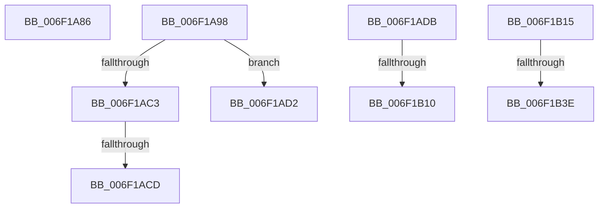

# sub_006F1A86

- RVA: `0x006F1A86`–`0x006F1B43` (길이 `189` bytes)
- VA: `0x00000001406F1A86`
- 실행 섹션: `.text`
- PDB 이름 있음: `아니요`; PDB Function 태그: `아니요`
- unwind 정보 RVA: `0x000A81F8`
- 디코드: `45`개 명령, `189/189` bytes 표시
- 미해석 바이트: `0` (있으면 어셈블리에 `.byte`로 보존)

> 이 문서는 커널 이미지의 기계어와 PDB 기호를 분석해 생성했습니다. 4번과 5번은 함수 원형과 자료형을 바이너리 사용 방식에서 추정한 C 해석이며 원본 소스 복구 결과는 아닙니다.

## 1. Dependencies

- 직접 호출 지점: **7**; 고유 호출 대상: **2**
- 직접 호출자로 확인된 함수: **0**
- RIP 상대 이미지 참조: **0**

### Outgoing calls
- `0x006F1A8C` → [RtlpVerGetConditionMask](../45/RtlpVerGetConditionMask_function_00457B38.md) (function, `0x00457B38`)
- `0x006F1A9B` → [RtlpVerGetConditionMask](../45/RtlpVerGetConditionMask_function_00457B38.md) (function, `0x00457B38`)
- `0x006F1ABA` → [RtlpVerCompare](../45/RtlpVerCompare_function_00457A5C.md) (function, `0x00457A5C`)
- `0x006F1AE3` → [RtlpVerGetConditionMask](../45/RtlpVerGetConditionMask_function_00457B38.md) (function, `0x00457B38`)
- `0x006F1B03` → [RtlpVerCompare](../45/RtlpVerCompare_function_00457A5C.md) (function, `0x00457A5C`)
- `0x006F1B18` → [RtlpVerGetConditionMask](../45/RtlpVerGetConditionMask_function_00457B38.md) (function, `0x00457B38`)
- `0x006F1B31` → [RtlpVerCompare](../45/RtlpVerCompare_function_00457A5C.md) (function, `0x00457A5C`)

### Direct callers
- 이 함수 시작 RVA로 연결되는 직접 call은 확인되지 않았습니다. 간접 호출은 완전히 역산할 수 없습니다.

### Static image references
- 디코드된 RIP-relative 메모리 참조가 없습니다.

## 2. Other-region calls and transfers

- 다른 실행 섹션으로 향하는 call: **0**
- call이 아닌 외부 분기/꼬리 이동: **8**
  - `0x006F1A93` → [RtlVerifyVersionInfo + 0x30F](../45/RtlVerifyVersionInfo_function_00457670.md) (`tail-transfer`)
  - `0x006F1AC7` → [RtlVerifyVersionInfo + 0x134](../45/RtlVerifyVersionInfo_function_00457670.md) (`tail-transfer`)
  - `0x006F1ACD` → [RtlVerifyVersionInfo + 0x19B](../45/RtlVerifyVersionInfo_function_00457670.md) (`tail-transfer`)
  - `0x006F1AD6` → [RtlVerifyVersionInfo + 0x193](../45/RtlVerifyVersionInfo_function_00457670.md) (`tail-transfer`)
  - `0x006F1B0A` → [RtlVerifyVersionInfo + 0x134](../45/RtlVerifyVersionInfo_function_00457670.md) (`tail-transfer`)
  - `0x006F1B10` → [RtlVerifyVersionInfo + 0xE4](../45/RtlVerifyVersionInfo_function_00457670.md) (`tail-transfer`)
  - `0x006F1B38` → [RtlVerifyVersionInfo + 0x134](../45/RtlVerifyVersionInfo_function_00457670.md) (`tail-transfer`)
  - `0x006F1B3E` → [RtlVerifyVersionInfo + 0x100](../45/RtlVerifyVersionInfo_function_00457670.md) (`tail-transfer`)

## 3. Assembly (complete function range)

```asm
006F1A86  41 8B D4                        mov edx, r12d
006F1A89  48 8B CF                        mov rcx, rdi
006F1A8C  E8 A7 60 D6 FF                  call 0x140457b38
006F1A91  8B F0                           mov esi, eax
006F1A93  E9 E7 5E D6 FF                  jmp 0x14045797f
006F1A98  48 8B CF                        mov rcx, rdi
006F1A9B  E8 98 60 D6 FF                  call 0x140457b38
006F1AA0  8B F0                           mov esi, eax
006F1AA2  44 0F B7 45 54                  movzx r8d, word ptr [rbp + 0x54]
006F1AA7  4C 8D 4C 24 30                  lea r9, [rsp + 0x30]
006F1AAC  41 0F B7 97 14 01 00 00         movzx edx, word ptr [r15 + 0x114]
006F1AB4  8B CE                           mov ecx, esi
006F1AB6  89 5C 24 20                     mov dword ptr [rsp + 0x20], ebx
006F1ABA  E8 9D 5F D6 FF                  call 0x140457a5c
006F1ABF  84 C0                           test al, al
006F1AC1  75 0F                           jne 0x1406f1ad2
006F1AC3  38 5C 24 30                     cmp byte ptr [rsp + 0x30], bl
006F1AC7  0F 84 D7 5C D6 FF               je 0x1404577a4
006F1ACD  E9 39 5D D6 FF                  jmp 0x14045780b
006F1AD2  8A 4C 24 30                     mov cl, byte ptr [rsp + 0x30]
006F1AD6  E9 28 5D D6 FF                  jmp 0x140457803
006F1ADB  BA 10 00 00 00                  mov edx, 0x10
006F1AE0  48 8B CF                        mov rcx, rdi
006F1AE3  E8 50 60 D6 FF                  call 0x140457b38
006F1AE8  8B F0                           mov esi, eax
006F1AEA  44 0F B7 45 56                  movzx r8d, word ptr [rbp + 0x56]
006F1AEF  4C 8D 4C 24 30                  lea r9, [rsp + 0x30]
006F1AF4  41 0F B7 97 16 01 00 00         movzx edx, word ptr [r15 + 0x116]
006F1AFC  8B CE                           mov ecx, esi
006F1AFE  44 89 64 24 20                  mov dword ptr [rsp + 0x20], r12d
006F1B03  E8 54 5F D6 FF                  call 0x140457a5c
006F1B08  84 C0                           test al, al
006F1B0A  0F 84 94 5C D6 FF               je 0x1404577a4
006F1B10  E9 3F 5C D6 FF                  jmp 0x140457754
006F1B15  48 8B CF                        mov rcx, rdi
006F1B18  E8 1B 60 D6 FF                  call 0x140457b38
006F1B1D  44 8B 44 24 50                  mov r8d, dword ptr [rsp + 0x50]
006F1B22  4C 8D 4C 24 30                  lea r9, [rsp + 0x30]
006F1B27  41 8B 57 10                     mov edx, dword ptr [r15 + 0x10]
006F1B2B  8B C8                           mov ecx, eax
006F1B2D  89 5C 24 20                     mov dword ptr [rsp + 0x20], ebx
006F1B31  E8 26 5F D6 FF                  call 0x140457a5c
006F1B36  84 C0                           test al, al
006F1B38  0F 84 66 5C D6 FF               je 0x1404577a4
006F1B3E  E9 2D 5C D6 FF                  jmp 0x140457770
```

## 4. C-style interpretation (structured pseudocode)

```c
__int64 __fastcall sub_006F1A86(void)
{
    __int64 result;
    unsigned int v_stack_p20;
    unsigned __int64 v_stack_p30;
    unsigned int v_stack_p50;

    result = RtlpVerGetConditionMask(v_rdi, (unsigned int)((unsigned int)(v_r12)), a3, a4);
}
```

## 5. (Beta) C Style

```c
void sub_006F1A86(void)
{
    int64_t result;
    uint32_t v_stack_p20;
    uint64_t v_stack_p30;
    uint32_t v_stack_p50;

    result = RtlpVerGetConditionMask(local_rdi, (uint32_t)((uint32_t)(local_r12)), a3, a4);
}
```

## 6. Execution-region graph

[열기: 2D/3D 그래프와 함수 탐색 컨트롤 패널](../../../control-panel.html?section=text&rva=0x006F1A86&view=graph)

- 2D 그래프는 위에서 아래로 흐르고, 3D 그래프는 빈 공간을 드래그해 회전합니다. Shift+드래그는 이동, 휠은 확대·축소, 함수 노드 선택은 대상 보고서 이동입니다.

### Static fallback


