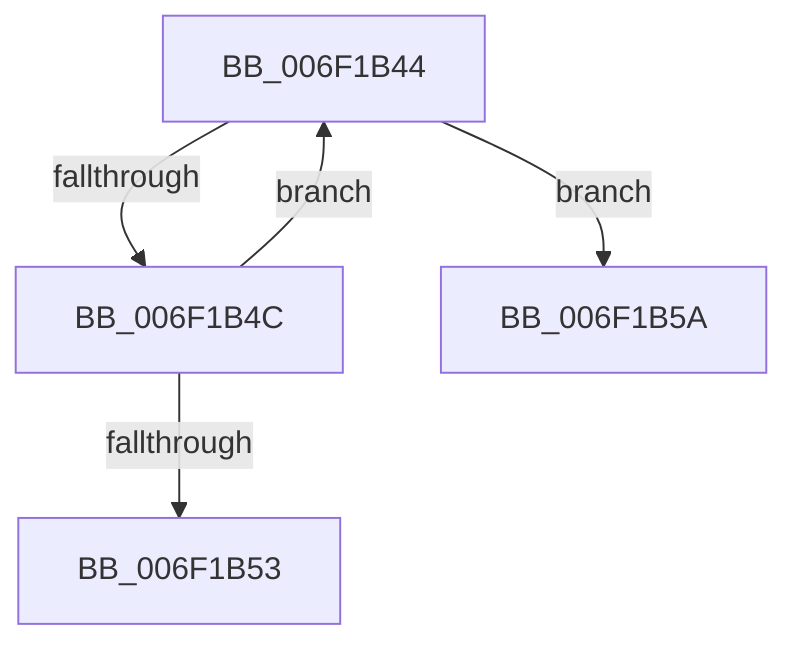

# sub_006F1B44

- RVA: `0x006F1B44`–`0x006F1B64` (길이 `32` bytes)
- VA: `0x00000001406F1B44`
- 실행 섹션: `.text`
- PDB 이름 있음: `아니요`; PDB Function 태그: `아니요`
- unwind 정보 RVA: `0x000A8220`
- 디코드: `11`개 명령, `32/32` bytes 표시
- 미해석 바이트: `0` (있으면 어셈블리에 `.byte`로 보존)

> 이 문서는 커널 이미지의 기계어와 PDB 기호를 분석해 생성했습니다. 4번과 5번은 함수 원형과 자료형을 바이너리 사용 방식에서 추정한 C 해석이며 원본 소스 복구 결과는 아닙니다.

## 1. Dependencies

- 직접 호출 지점: **0**; 고유 호출 대상: **0**
- 직접 호출자로 확인된 함수: **0**
- RIP 상대 이미지 참조: **0**

### Outgoing calls
- 직접 디코드된 call 명령이 없습니다.

### Direct callers
- 이 함수 시작 RVA로 연결되는 직접 call은 확인되지 않았습니다. 간접 호출은 완전히 역산할 수 없습니다.

### Static image references
- 디코드된 RIP-relative 메모리 참조가 없습니다.

## 2. Other-region calls and transfers

- 다른 실행 섹션으로 향하는 call: **0**
- call이 아닌 외부 분기/꼬리 이동: **2**
  - `0x006F1B55` → [RtlpVerCompare + 0x29](../45/RtlpVerCompare_function_00457A5C.md) (`tail-transfer`)
  - `0x006F1B5F` → [RtlpVerCompare + 0x29](../45/RtlpVerCompare_function_00457A5C.md) (`tail-transfer`)

## 3. Assembly (complete function range)

```asm
006F1B44  8A 08                           mov cl, byte ptr [rax]
006F1B46  42 3A 0C 00                     cmp cl, byte ptr [rax + r8]
006F1B4A  75 0E                           jne 0x1406f1b5a
006F1B4C  48 FF C0                        inc rax
006F1B4F  84 C9                           test cl, cl
006F1B51  75 F1                           jne 0x1406f1b44
006F1B53  8B FA                           mov edi, edx
006F1B55  E9 2B 5F D6 FF                  jmp 0x140457a85
006F1B5A  1B FF                           sbb edi, edi
006F1B5C  83 CF 01                        or edi, 1
006F1B5F  E9 21 5F D6 FF                  jmp 0x140457a85
```

## 4. C-style interpretation (structured pseudocode)

```c
__int64 __fastcall sub_006F1B44(__int64 a1, int a2, __int64 a3)
{
    __int64 result;
    __int64 v_rdi;

    if (((unsigned __int8)(*(unsigned __int8 *)(result))) != (*(unsigned __int8 *)(result + a3 * 1))) goto loc_006F1B5A;
    result = (result) + 1;
    if ((unsigned __int8)(*(unsigned __int8 *)(result)) != 0) goto loc_006F1B44;
loc_006F1B5A:
    v_rdi = (unsigned int)(((unsigned int)(a2)) | (1));
}
```

## 5. (Beta) C Style

```c
int64_t sub_006F1B44(int64_t Arg1, int32_t Arg2, int64_t Arg3)
{
    int64_t result;
    int64_t local_rdi;

    if (((uint8_t)(*(uint8_t *)(result))) != (*(uint8_t *)(result + Arg3 * 1))) goto loc_006F1B5A;
    result = (result) + 1;
    if ((uint8_t)(*(uint8_t *)(result)) != 0) goto loc_006F1B44;
loc_006F1B5A:
    local_rdi = (uint32_t)(((uint32_t)(Arg2)) | (1));
}
```

## 6. Execution-region graph

[열기: 2D/3D 그래프와 함수 탐색 컨트롤 패널](../../../control-panel.html?section=text&rva=0x006F1B44&view=graph)

- 2D 그래프는 위에서 아래로 흐르고, 3D 그래프는 빈 공간을 드래그해 회전합니다. Shift+드래그는 이동, 휠은 확대·축소, 함수 노드 선택은 대상 보고서 이동입니다.

### Static fallback


