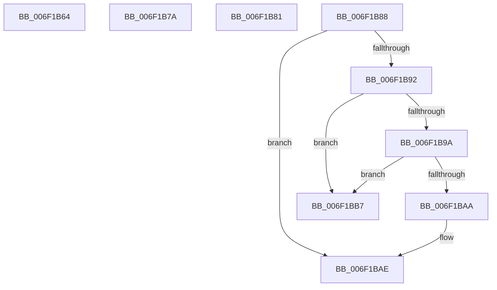

# sub_006F1B64

- RVA: `0x006F1B64`–`0x006F1BC0` (길이 `92` bytes)
- VA: `0x00000001406F1B64`
- 실행 섹션: `.text`
- PDB 이름 있음: `아니요`; PDB Function 태그: `아니요`
- unwind 정보 RVA: `0x000A8260`
- 디코드: `25`개 명령, `92/92` bytes 표시
- 미해석 바이트: `0` (있으면 어셈블리에 `.byte`로 보존)

> 이 문서는 커널 이미지의 기계어와 PDB 기호를 분석해 생성했습니다. 4번과 5번은 함수 원형과 자료형을 바이너리 사용 방식에서 추정한 C 해석이며 원본 소스 복구 결과는 아닙니다.

## 1. Dependencies

- 직접 호출 지점: **0**; 고유 호출 대상: **0**
- 직접 호출자로 확인된 함수: **0**
- RIP 상대 이미지 참조: **0**

### Outgoing calls
- 직접 디코드된 call 명령이 없습니다.

### Direct callers
- 이 함수 시작 RVA로 연결되는 직접 call은 확인되지 않았습니다. 간접 호출은 완전히 역산할 수 없습니다.

### Static image references
- 디코드된 RIP-relative 메모리 참조가 없습니다.

## 2. Other-region calls and transfers

- 다른 실행 섹션으로 향하는 call: **0**
- call이 아닌 외부 분기/꼬리 이동: **5**
  - `0x006F1B75` → [CountUnicodeToUTF8 + 0x52](../45/CountUnicodeToUTF8_function_00457C1C.md) (`tail-transfer`)
  - `0x006F1B7C` → [CountUnicodeToUTF8 + 0x96](../45/CountUnicodeToUTF8_function_00457C1C.md) (`tail-transfer`)
  - `0x006F1B83` → [CountUnicodeToUTF8 + 0x9C](../45/CountUnicodeToUTF8_function_00457C1C.md) (`tail-transfer`)
  - `0x006F1BB2` → [CountUnicodeToUTF8 + 0x80](../45/CountUnicodeToUTF8_function_00457C1C.md) (`tail-transfer`)
  - `0x006F1BBB` → [CountUnicodeToUTF8 + 0x24](../45/CountUnicodeToUTF8_function_00457C1C.md) (`tail-transfer`)

## 3. Assembly (complete function range)

```asm
006F1B64  45 33 C0                        xor r8d, r8d
006F1B67  49 8D 41 02                     lea rax, [r9 + 2]
006F1B6B  45 84 C0                        test r8b, r8b
006F1B6E  49 0F 44 C1                     cmove rax, r9
006F1B72  4C 8B C8                        mov r9, rax
006F1B75  E9 F4 60 D6 FF                  jmp 0x140457c6e
006F1B7A  FF C2                           inc edx
006F1B7C  E9 31 61 D6 FF                  jmp 0x140457cb2
006F1B81  FF C2                           inc edx
006F1B83  E9 30 61 D6 FF                  jmp 0x140457cb8
006F1B88  8D 81 00 28 FF FF               lea eax, [rcx - 0xd800]
006F1B8E  3B C5                           cmp eax, ebp
006F1B90  77 1C                           ja 0x1406f1bae
006F1B92  81 F9 FF DB 00 00               cmp ecx, 0xdbff
006F1B98  77 1D                           ja 0x1406f1bb7
006F1B9A  41 0F B7 01                     movzx eax, word ptr [r9]
006F1B9E  2D 00 DC 00 00                  sub eax, 0xdc00
006F1BA3  3D FF 03 00 00                  cmp eax, 0x3ff
006F1BA8  77 0D                           ja 0x1406f1bb7
006F1BAA  49 83 C1 02                     add r9, 2
006F1BAE  FF C2                           inc edx
006F1BB0  FF C2                           inc edx
006F1BB2  E9 E5 60 D6 FF                  jmp 0x140457c9c
006F1BB7  49 83 E9 02                     sub r9, 2
006F1BBB  E9 80 60 D6 FF                  jmp 0x140457c40
```

## 4. C-style interpretation (structured pseudocode)

```c
__int64 __fastcall sub_006F1B64(__int64 a1, int a2, int a3, __int64 a4)
{
    __int64 result;

    a3 = 0;
    result = a4 + 2;
    if (0 == 0) { result = a4; }
}
```

## 5. (Beta) C Style

```c
int64_t sub_006F1B64(int64_t Arg1, int32_t Arg2, int32_t Arg3, void *Arg4)
{
    uint8_t *arg4 = (uint8_t *)Arg4;

    int64_t result;

    Arg3 = 0;
    result = Arg4 + 2;
    if (0 == 0) { result = Arg4; }
}
```

### 관측된 메모리 오프셋

구조체 형식이 확인되지 않은 접근은 인자 기준의 오프셋으로만 기록했습니다.

| 기준 인자 | 오프셋 표현 | 폭 (bit) | 접근 |
|---|---:|---:|---|
| `Arg4` | `+ 0x2` | `64` | `R` |

## 6. Execution-region graph

[열기: 2D/3D 그래프와 함수 탐색 컨트롤 패널](../../../control-panel.html?section=text&rva=0x006F1B64&view=graph)

- 2D 그래프는 위에서 아래로 흐르고, 3D 그래프는 빈 공간을 드래그해 회전합니다. Shift+드래그는 이동, 휠은 확대·축소, 함수 노드 선택은 대상 보고서 이동입니다.

### Static fallback


