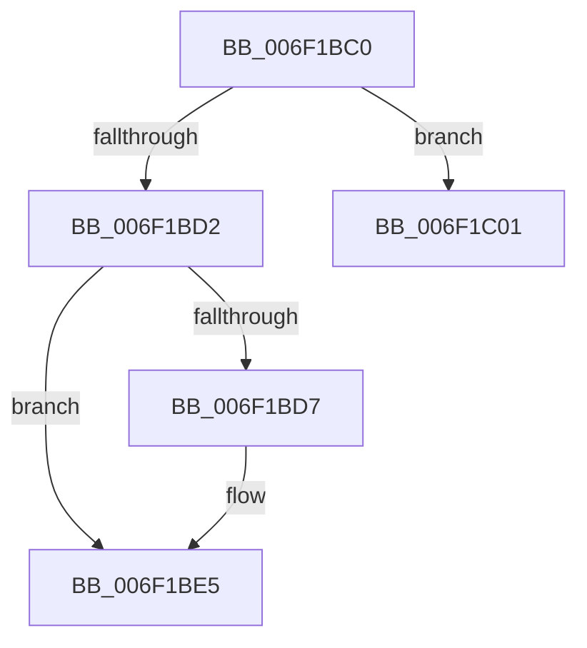

# sub_006F1BC0

- RVA: `0x006F1BC0`–`0x006F1C08` (길이 `72` bytes)
- VA: `0x00000001406F1BC0`
- 실행 섹션: `.text`
- PDB 이름 있음: `아니요`; PDB Function 태그: `아니요`
- unwind 정보 RVA: `0x000A8CCC`
- 디코드: `22`개 명령, `72/72` bytes 표시
- 미해석 바이트: `0` (있으면 어셈블리에 `.byte`로 보존)

> 이 문서는 커널 이미지의 기계어와 PDB 기호를 분석해 생성했습니다. 4번과 5번은 함수 원형과 자료형을 바이너리 사용 방식에서 추정한 C 해석이며 원본 소스 복구 결과는 아닙니다.

## 1. Dependencies

- 직접 호출 지점: **3**; 고유 호출 대상: **3**
- 직접 호출자로 확인된 함수: **0**
- RIP 상대 이미지 참조: **0**

### Outgoing calls
- `0x006F1BC9` → [MiChargeResident](../28/MiChargeResident_function_0028A0F0.md) (function, `0x0028A0F0`)
- `0x006F1BE0` → [MiReturnCommit](../24/MiReturnCommit_function_00248410.md) (function, `0x00248410`)
- `0x006F1BF5` → [MiReturnCrossPartitionCharges](../28/MiReturnCrossPartitionCharges_function_002867D0.md) (function, `0x002867D0`)

### Direct callers
- 이 함수 시작 RVA로 연결되는 직접 call은 확인되지 않았습니다. 간접 호출은 완전히 역산할 수 없습니다.

### Static image references
- 디코드된 RIP-relative 메모리 참조가 없습니다.

## 2. Other-region calls and transfers

- 다른 실행 섹션으로 향하는 call: **0**
- call이 아닌 외부 분기/꼬리 이동: **2**
  - `0x006F1BFC` → [MiGetSubsectionCharges + 0x50](../45/MiGetSubsectionCharges_function_00458A04.md) (`tail-transfer`)
  - `0x006F1C03` → [MiGetSubsectionCharges + 0x50](../45/MiGetSubsectionCharges_function_00458A04.md) (`tail-transfer`)

## 3. Assembly (complete function range)

```asm
006F1BC0  45 33 C0                        xor r8d, r8d
006F1BC3  48 8B D3                        mov rdx, rbx
006F1BC6  48 8B CF                        mov rcx, rdi
006F1BC9  E8 22 85 B9 FF                  call 0x14028a0f0
006F1BCE  85 C0                           test eax, eax
006F1BD0  75 2F                           jne 0x1406f1c01
006F1BD2  48 85 F6                        test rsi, rsi
006F1BD5  74 0E                           je 0x1406f1be5
006F1BD7  45 33 C0                        xor r8d, r8d
006F1BDA  48 8B D3                        mov rdx, rbx
006F1BDD  48 8B CF                        mov rcx, rdi
006F1BE0  E8 2B 68 B5 FF                  call 0x140248410
006F1BE5  BE 17 00 00 C0                  mov esi, 0xc0000017
006F1BEA  4C 8B CB                        mov r9, rbx
006F1BED  44 8B C5                        mov r8d, ebp
006F1BF0  33 D2                           xor edx, edx
006F1BF2  48 8B CF                        mov rcx, rdi
006F1BF5  E8 D6 4B B9 FF                  call 0x1402867d0
006F1BFA  8B C6                           mov eax, esi
006F1BFC  E9 53 6E D6 FF                  jmp 0x140458a54
006F1C01  33 C0                           xor eax, eax
006F1C03  E9 4C 6E D6 FF                  jmp 0x140458a54
```

## 4. C-style interpretation (structured pseudocode)

```c
__int64 __fastcall sub_006F1BC0(__int64 a1, __int64 a2, int a3)
{
    __int64 result;

    a3 = 0;
    result = MiChargeResident(v_rdi, v_rbx, a3, a4);
    if ((unsigned int)(result) != 0) goto loc_006F1C01;
    if (v_rsi != 0) {
        a3 = 0;
        a2 = v_rbx;
        a1 = v_rdi;
        result = MiReturnCommit(a1, a2, a3, a4);
    }
    a2 = 0;
    result = MiReturnCrossPartitionCharges(v_rdi, a2, (unsigned int)((unsigned int)(v_rbp)), v_rbx);
loc_006F1C01:
    result = 0;
}
```

## 5. (Beta) C Style

```c
int64_t sub_006F1BC0(int64_t Arg1, int64_t Arg2, int32_t Arg3)
{
    int64_t result;

    Arg3 = 0;
    result = MiChargeResident(local_rdi, local_rbx, Arg3, a4);
    if ((uint32_t)(result) != 0) goto loc_006F1C01;
    if (local_rsi != 0) {
        Arg3 = 0;
        Arg2 = local_rbx;
        Arg1 = local_rdi;
        result = MiReturnCommit(Arg1, Arg2, Arg3, a4);
    }
    Arg2 = 0;
    result = MiReturnCrossPartitionCharges(local_rdi, Arg2, (uint32_t)((uint32_t)(local_rbp)), local_rbx);
loc_006F1C01:
    result = 0;
}
```

## 6. Execution-region graph

[열기: 2D/3D 그래프와 함수 탐색 컨트롤 패널](../../../control-panel.html?section=text&rva=0x006F1BC0&view=graph)

- 2D 그래프는 위에서 아래로 흐르고, 3D 그래프는 빈 공간을 드래그해 회전합니다. Shift+드래그는 이동, 휠은 확대·축소, 함수 노드 선택은 대상 보고서 이동입니다.

### Static fallback


