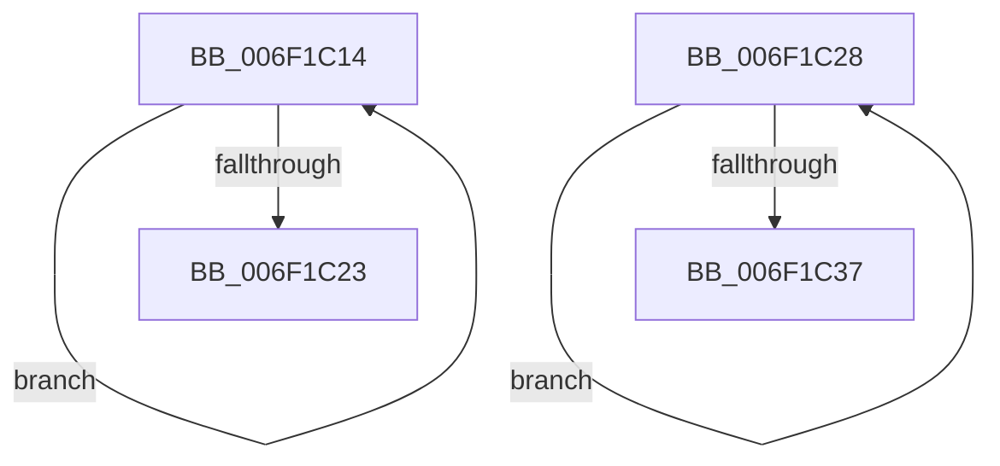

# sub_006F1C14

- RVA: `0x006F1C14`–`0x006F1C3C` (길이 `40` bytes)
- VA: `0x00000001406F1C14`
- 실행 섹션: `.text`
- PDB 이름 있음: `아니요`; PDB Function 태그: `아니요`
- unwind 정보 RVA: `0x000A8F08`
- 디코드: `12`개 명령, `40/40` bytes 표시
- 미해석 바이트: `0` (있으면 어셈블리에 `.byte`로 보존)

> 이 문서는 커널 이미지의 기계어와 PDB 기호를 분석해 생성했습니다. 4번과 5번은 함수 원형과 자료형을 바이너리 사용 방식에서 추정한 C 해석이며 원본 소스 복구 결과는 아닙니다.

## 1. Dependencies

- 직접 호출 지점: **0**; 고유 호출 대상: **0**
- 직접 호출자로 확인된 함수: **0**
- RIP 상대 이미지 참조: **0**

### Outgoing calls
- 직접 디코드된 call 명령이 없습니다.

### Direct callers
- 이 함수 시작 RVA로 연결되는 직접 call은 확인되지 않았습니다. 간접 호출은 완전히 역산할 수 없습니다.

### Static image references
- 디코드된 RIP-relative 메모리 참조가 없습니다.

## 2. Other-region calls and transfers

- 다른 실행 섹션으로 향하는 call: **0**
- call이 아닌 외부 분기/꼬리 이동: **2**
  - `0x006F1C23` → [AdtpNormalizeAuditInfoHelper + 0x80](../45/AdtpNormalizeAuditInfoHelper_function_00459834.md) (`tail-transfer`)
  - `0x006F1C37` → [AdtpNormalizeAuditInfoHelper + 0x80](../45/AdtpNormalizeAuditInfoHelper_function_00459834.md) (`tail-transfer`)

## 3. Assembly (complete function range)

```asm
006F1C14  4C 01 11                        add qword ptr [rcx], r10
006F1C17  41 FF C1                        inc r9d
006F1C1A  48 8D 49 10                     lea rcx, [rcx + 0x10]
006F1C1E  44 3B 08                        cmp r9d, dword ptr [rax]
006F1C21  72 F1                           jb 0x1406f1c14
006F1C23  E9 8C 7C D6 FF                  jmp 0x1404598b4
006F1C28  48 01 11                        add qword ptr [rcx], rdx
006F1C2B  41 FF C1                        inc r9d
006F1C2E  48 8D 49 18                     lea rcx, [rcx + 0x18]
006F1C32  44 3B 08                        cmp r9d, dword ptr [rax]
006F1C35  72 F1                           jb 0x1406f1c28
006F1C37  E9 78 7C D6 FF                  jmp 0x1404598b4
```

## 4. C-style interpretation (structured pseudocode)

```c
void __fastcall sub_006F1C14(__int64 a1, __int64 a2, __int64 a3, int a4)
{
    a4 = (unsigned int)((a4) + 1);
    if (a4 < (*(unsigned int *)(result))) goto loc_006F1C14;
}
```

## 5. (Beta) C Style

```c
void sub_006F1C14(void *Arg1, int64_t Arg2, int64_t Arg3, int32_t Arg4)
{
    uint8_t *arg1 = (uint8_t *)Arg1;

    Arg4 = (uint32_t)((Arg4) + 1);
    if (Arg4 < (*(uint32_t *)(result))) goto loc_006F1C14;
}
```

### 관측된 메모리 오프셋

구조체 형식이 확인되지 않은 접근은 인자 기준의 오프셋으로만 기록했습니다.

| 기준 인자 | 오프셋 표현 | 폭 (bit) | 접근 |
|---|---:|---:|---|
| `Arg1` | `+ 0x0` | `64` | `R/W` |
| `Arg1` | `+ 0x10` | `64` | `R` |

## 6. Execution-region graph

[열기: 2D/3D 그래프와 함수 탐색 컨트롤 패널](../../../control-panel.html?section=text&rva=0x006F1C14&view=graph)

- 2D 그래프는 위에서 아래로 흐르고, 3D 그래프는 빈 공간을 드래그해 회전합니다. Shift+드래그는 이동, 휠은 확대·축소, 함수 노드 선택은 대상 보고서 이동입니다.

### Static fallback


