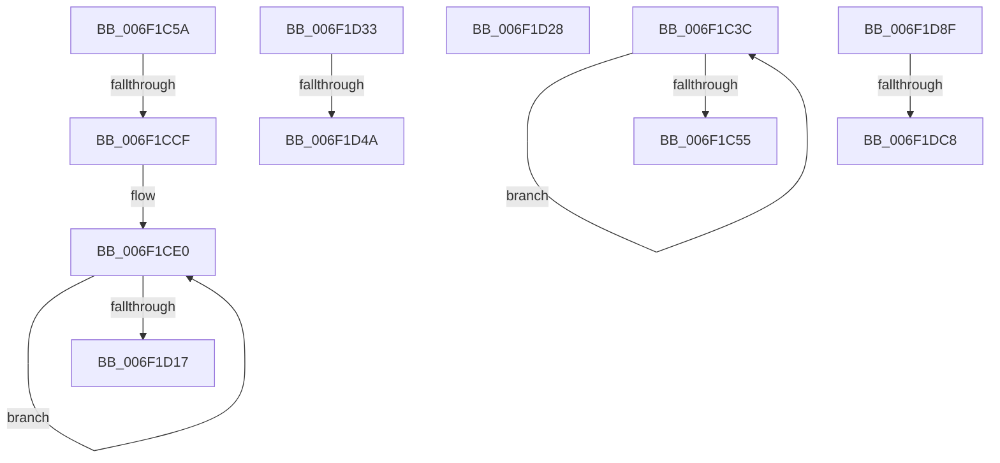

# sub_006F1C3C

- RVA: `0x006F1C3C`–`0x006F1DFD` (길이 `449` bytes)
- VA: `0x00000001406F1C3C`
- 실행 섹션: `.text`
- PDB 이름 있음: `아니요`; PDB Function 태그: `아니요`
- unwind 정보 RVA: `0x000A8F34`
- 디코드: `112`개 명령, `449/449` bytes 표시
- 미해석 바이트: `0` (있으면 어셈블리에 `.byte`로 보존)

> 이 문서는 커널 이미지의 기계어와 PDB 기호를 분석해 생성했습니다. 4번과 5번은 함수 원형과 자료형을 바이너리 사용 방식에서 추정한 C 해석이며 원본 소스 복구 결과는 아닙니다.

## 1. Dependencies

- 직접 호출 지점: **4**; 고유 호출 대상: **4**
- 직접 호출자로 확인된 함수: **0**
- RIP 상대 이미지 참조: **0**

### Outgoing calls
- `0x006F1C47` → [AdtpEtwBuildDashString](../../page/AA/AdtpEtwBuildDashString_function_00AAB7B0.md) (function, `0x00AAB7B0`)
- `0x006F1CBD` → [AdtpBuildUserAccountControlString](../../page/82/AdtpBuildUserAccountControlString_function_00822920.md) (function, `0x00822920`)
- `0x006F1D84` → [AdtpBuildAccessReasonAuditString](../40/AdtpBuildAccessReasonAuditString_function_0040EE04.md) (function, `0x0040EE04`)
- `0x006F1DB6` → [AdtpBuildSockAddrString](../../page/A2/AdtpBuildSockAddrString_function_00A2B53C.md) (function, `0x00A2B53C`)

### Direct callers
- 이 함수 시작 RVA로 연결되는 직접 call은 확인되지 않았습니다. 간접 호출은 완전히 역산할 수 없습니다.

### Static image references
- 디코드된 RIP-relative 메모리 참조가 없습니다.

## 2. Other-region calls and transfers

- 다른 실행 섹션으로 향하는 call: **3**
  - `0x006F1C47` → [AdtpEtwBuildDashString](../../page/AA/AdtpEtwBuildDashString_function_00AAB7B0.md) (`.text` → `PAGE`)
  - `0x006F1CBD` → [AdtpBuildUserAccountControlString](../../page/82/AdtpBuildUserAccountControlString_function_00822920.md) (`.text` → `PAGE`)
  - `0x006F1DB6` → [AdtpBuildSockAddrString](../../page/A2/AdtpBuildSockAddrString_function_00A2B53C.md) (`.text` → `PAGE`)
- call이 아닌 외부 분기/꼬리 이동: **8**
  - `0x006F1C55` → [AdtpPackageParameters + 0x6B7](../45/AdtpPackageParameters_function_00459964.md) (`tail-transfer`)
  - `0x006F1CC9` → [AdtpPackageParameters + 0x357](../45/AdtpPackageParameters_function_00459964.md) (`tail-transfer`)
  - `0x006F1D23` → [AdtpPackageParameters + 0x296](../45/AdtpPackageParameters_function_00459964.md) (`tail-transfer`)
  - `0x006F1D2E` → [AdtpPackageParameters + 0x467](../45/AdtpPackageParameters_function_00459964.md) (`tail-transfer`)
  - `0x006F1D44` → [AdtpPackageParameters + 0x352](../45/AdtpPackageParameters_function_00459964.md) (`tail-transfer`)
  - `0x006F1D8A` → [AdtpPackageParameters + 0x114](../45/AdtpPackageParameters_function_00459964.md) (`tail-transfer`)
  - `0x006F1DC2` → [AdtpPackageParameters + 0x357](../45/AdtpPackageParameters_function_00459964.md) (`tail-transfer`)
  - `0x006F1DF8` → [AdtpPackageParameters + 0x296](../45/AdtpPackageParameters_function_00459964.md) (`tail-transfer`)

## 3. Assembly (complete function range)

```asm
006F1C3C  41 0F B7 CE                     movzx ecx, r14w
006F1C40  48 C1 E1 04                     shl rcx, 4
006F1C44  49 03 CD                        add rcx, r13
006F1C47  E8 64 9B 3B 00                  call 0x140aab7b0
006F1C4C  66 45 03 F0                     add r14w, r8w
006F1C50  49 2B D0                        sub rdx, r8
006F1C53  75 E7                           jne 0x1406f1c3c
006F1C55  E9 C1 83 D6 FF                  jmp 0x14045a01b
006F1C5A  48 8B 7D 78                     mov rdi, qword ptr [rbp + 0x78]
006F1C5E  48 8B 75 60                     mov rsi, qword ptr [rbp + 0x60]
006F1C62  44 0F B7 45 E2                  movzx r8d, word ptr [rbp - 0x1e]
006F1C67  41 0F B7 D3                     movzx edx, r11w
006F1C6B  41 0F B7 CE                     movzx ecx, r14w
006F1C6F  49 C1 E0 04                     shl r8, 4
006F1C73  45 0F B7 CE                     movzx r9d, r14w
006F1C77  4C 03 C6                        add r8, rsi
006F1C7A  44 8D 5A 02                     lea r11d, [rdx + 2]
006F1C7E  4C 03 CF                        add r9, rdi
006F1C81  8D 59 02                        lea ebx, [rcx + 2]
006F1C84  49 C1 E3 04                     shl r11, 4
006F1C88  44 8D 51 01                     lea r10d, [rcx + 1]
006F1C8C  4C 03 DE                        add r11, rsi
006F1C8F  8D 4A 01                        lea ecx, [rdx + 1]
006F1C92  4C 03 D7                        add r10, rdi
006F1C95  43 8B 54 3C 10                  mov edx, dword ptr [r12 + r15 + 0x10]
006F1C9A  48 03 DF                        add rbx, rdi
006F1C9D  48 C1 E1 04                     shl rcx, 4
006F1CA1  48 89 5C 24 38                  mov qword ptr [rsp + 0x38], rbx
006F1CA6  48 03 CE                        add rcx, rsi
006F1CA9  4C 89 5C 24 30                  mov qword ptr [rsp + 0x30], r11
006F1CAE  4C 89 54 24 28                  mov qword ptr [rsp + 0x28], r10
006F1CB3  48 89 4C 24 20                  mov qword ptr [rsp + 0x20], rcx
006F1CB8  43 8B 4C 3C 08                  mov ecx, dword ptr [r12 + r15 + 8]
006F1CBD  E8 5E 0C 13 00                  call 0x140822920
006F1CC2  45 33 C9                        xor r9d, r9d
006F1CC5  8B F0                           mov esi, eax
006F1CC7  85 C0                           test eax, eax
006F1CC9  0F 88 EC 7F D6 FF               js 0x140459cbb
006F1CCF  44 0F B7 5D E2                  movzx r11d, word ptr [rbp - 0x1e]
006F1CD4  45 8D 41 03                     lea r8d, [r9 + 3]
006F1CD8  4C 8B 55 60                     mov r10, qword ptr [rbp + 0x60]
006F1CDC  45 8D 79 01                     lea r15d, [r9 + 1]
006F1CE0  41 0F B7 C3                     movzx eax, r11w
006F1CE4  66 45 03 DF                     add r11w, r15w
006F1CE8  48 03 C0                        add rax, rax
006F1CEB  41 0F B7 CE                     movzx ecx, r14w
006F1CEF  48 03 C9                        add rcx, rcx
006F1CF2  66 45 03 F7                     add r14w, r15w
006F1CF6  41 0F B7 14 C2                  movzx edx, word ptr [r10 + rax*8]
006F1CFB  49 8B 44 C2 08                  mov rax, qword ptr [r10 + rax*8 + 8]
006F1D00  83 C2 02                        add edx, 2
006F1D03  49 89 44 CD 00                  mov qword ptr [r13 + rcx*8], rax
006F1D08  41 89 54 CD 08                  mov dword ptr [r13 + rcx*8 + 8], edx
006F1D0D  45 89 4C CD 0C                  mov dword ptr [r13 + rcx*8 + 0xc], r9d
006F1D12  4D 2B C7                        sub r8, r15
006F1D15  75 C9                           jne 0x1406f1ce0
006F1D17  4C 8B 7D F0                     mov r15, qword ptr [rbp - 0x10]
006F1D1B  41 8D 50 02                     lea edx, [r8 + 2]
006F1D1F  44 8D 42 FF                     lea r8d, [rdx - 1]
006F1D23  E9 D2 7E D6 FF                  jmp 0x140459bfa
006F1D28  41 BA 01 00 00 00               mov r10d, 1
006F1D2E  E9 98 80 D6 FF                  jmp 0x140459dcb
006F1D33  48 8B D0                        mov rdx, rax
006F1D36  41 BA 01 00 00 00               mov r10d, 1
006F1D3C  48 C1 E2 05                     shl rdx, 5
006F1D40  46 39 14 3A                     cmp dword ptr [rdx + r15], r10d
006F1D44  0F 85 6C 7F D6 FF               jne 0x140459cb6
006F1D4A  48 8B 45 78                     mov rax, qword ptr [rbp + 0x78]
006F1D4E  4A 8B 54 3A 18                  mov rdx, qword ptr [rdx + r15 + 0x18]
006F1D53  41 0F B7 CE                     movzx ecx, r14w
006F1D57  48 03 C1                        add rax, rcx
006F1D5A  48 C1 E1 04                     shl rcx, 4
006F1D5E  48 89 44 24 40                  mov qword ptr [rsp + 0x40], rax
006F1D63  49 03 CD                        add rcx, r13
006F1D66  48 8D 45 E4                     lea rax, [rbp - 0x1c]
006F1D6A  83 FB 1E                        cmp ebx, 0x1e
006F1D6D  48 89 44 24 38                  mov qword ptr [rsp + 0x38], rax
006F1D72  48 89 7C 24 30                  mov qword ptr [rsp + 0x30], rdi
006F1D77  41 0F 94 C1                     sete r9b
006F1D7B  48 89 4C 24 28                  mov qword ptr [rsp + 0x28], rcx
006F1D80  49 8B 4F 38                     mov rcx, qword ptr [r15 + 0x38]
006F1D84  E8 7B D0 D1 FF                  call 0x14040ee04
006F1D89  90                              nop
006F1D8A  E9 E9 7C D6 FF                  jmp 0x140459a78
006F1D8F  4C 8B 45 78                     mov r8, qword ptr [rbp + 0x78]
006F1D93  4B 8B 4C 3C 18                  mov rcx, qword ptr [r12 + r15 + 0x18]
006F1D98  41 0F B7 FB                     movzx edi, r11w
006F1D9C  4C 89 4C 24 20                  mov qword ptr [rsp + 0x20], r9
006F1DA1  45 33 C9                        xor r9d, r9d
006F1DA4  48 C1 E7 04                     shl rdi, 4
006F1DA8  48 03 7D 60                     add rdi, qword ptr [rbp + 0x60]
006F1DAC  41 0F B7 DE                     movzx ebx, r14w
006F1DB0  48 8B D7                        mov rdx, rdi
006F1DB3  4C 03 C3                        add r8, rbx
006F1DB6  E8 81 97 33 00                  call 0x140a2b53c
006F1DBB  45 33 C9                        xor r9d, r9d
006F1DBE  8B F0                           mov esi, eax
006F1DC0  85 C0                           test eax, eax
006F1DC2  0F 88 F3 7E D6 FF               js 0x140459cbb
006F1DC8  0F B7 0F                        movzx ecx, word ptr [rdi]
006F1DCB  45 8D 41 01                     lea r8d, [r9 + 1]
006F1DCF  48 8B 47 08                     mov rax, qword ptr [rdi + 8]
006F1DD3  41 8D 51 02                     lea edx, [r9 + 2]
006F1DD7  44 0F B7 5D E2                  movzx r11d, word ptr [rbp - 0x1e]
006F1DDC  48 03 DB                        add rbx, rbx
006F1DDF  03 CA                           add ecx, edx
006F1DE1  66 45 03 F0                     add r14w, r8w
006F1DE5  66 45 03 D8                     add r11w, r8w
006F1DE9  49 89 44 DD 00                  mov qword ptr [r13 + rbx*8], rax
006F1DEE  41 89 4C DD 08                  mov dword ptr [r13 + rbx*8 + 8], ecx
006F1DF3  45 89 4C DD 0C                  mov dword ptr [r13 + rbx*8 + 0xc], r9d
006F1DF8  E9 FD 7D D6 FF                  jmp 0x140459bfa
```

## 4. C-style interpretation (structured pseudocode)

```c
__int64 __fastcall sub_006F1C3C(__int64 a1, __int64 a2, __int64 a3)
{
    __int64 result;
    __int64 v_r14;
    unsigned __int64 v_stack_p20;
    unsigned __int64 v_stack_p28;
    unsigned __int64 v_stack_p30;
    unsigned __int64 v_stack_p38;
    unsigned __int64 v_stack_p40;

    a1 = ((unsigned __int16)(v_r14)) << (4);
    a1 = (a1) + (v_r13);
    result = AdtpEtwBuildDashString(a1, a2, a3, a4);
    v_r14 = (unsigned __int16)((v_r14) + ((unsigned __int16)(a3)));
    a2 = (a2) - (a3);
    if (condition_is_not_equal) goto loc_006F1C3C;
}
```

## 5. (Beta) C Style

```c
int64_t sub_006F1C3C(int64_t Arg1, int64_t Arg2, int64_t Arg3)
{
    int64_t result;
    int64_t local_r14;
    uint64_t v_stack_p20;
    uint64_t v_stack_p28;
    uint64_t v_stack_p30;
    uint64_t v_stack_p38;
    uint64_t v_stack_p40;

    Arg1 = ((uint16_t)(local_r14)) << (4);
    Arg1 = (Arg1) + (local_r13);
    result = AdtpEtwBuildDashString(Arg1, Arg2, Arg3, a4);
    local_r14 = (uint16_t)((local_r14) + ((uint16_t)(Arg3)));
    Arg2 = (Arg2) - (Arg3);
    if (condition_is_not_equal) goto loc_006F1C3C;
}
```

## 6. Execution-region graph

[열기: 2D/3D 그래프와 함수 탐색 컨트롤 패널](../../../control-panel.html?section=text&rva=0x006F1C3C&view=graph)

- 2D 그래프는 위에서 아래로 흐르고, 3D 그래프는 빈 공간을 드래그해 회전합니다. Shift+드래그는 이동, 휠은 확대·축소, 함수 노드 선택은 대상 보고서 이동입니다.

### Static fallback


