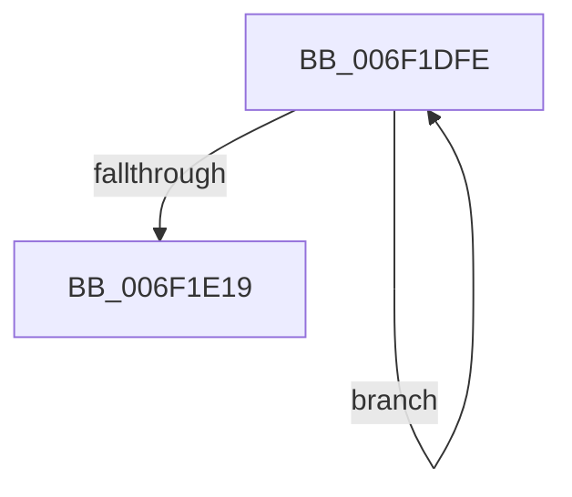

# sub_006F1DFE

- RVA: `0x006F1DFE`–`0x006F1E1E` (길이 `32` bytes)
- VA: `0x00000001406F1DFE`
- 실행 섹션: `.text`
- PDB 이름 있음: `아니요`; PDB Function 태그: `아니요`
- unwind 정보 RVA: `0x000A9054`
- 디코드: `9`개 명령, `32/32` bytes 표시
- 미해석 바이트: `0` (있으면 어셈블리에 `.byte`로 보존)

> 이 문서는 커널 이미지의 기계어와 PDB 기호를 분석해 생성했습니다. 4번과 5번은 함수 원형과 자료형을 바이너리 사용 방식에서 추정한 C 해석이며 원본 소스 복구 결과는 아닙니다.

## 1. Dependencies

- 직접 호출 지점: **0**; 고유 호출 대상: **0**
- 직접 호출자로 확인된 함수: **0**
- RIP 상대 이미지 참조: **0**

### Outgoing calls
- 직접 디코드된 call 명령이 없습니다.

### Direct callers
- 이 함수 시작 RVA로 연결되는 직접 call은 확인되지 않았습니다. 간접 호출은 완전히 역산할 수 없습니다.

### Static image references
- 디코드된 RIP-relative 메모리 참조가 없습니다.

## 2. Other-region calls and transfers

- 다른 실행 섹션으로 향하는 call: **0**
- call이 아닌 외부 분기/꼬리 이동: **1**
  - `0x006F1E19` → [sub_0045AC71 + 0xF](../45/Unknown_function_0045AC71.md) (`tail-transfer`)

## 3. Assembly (complete function range)

```asm
006F1DFE  41 0F B6 0C 31                  movzx ecx, byte ptr [r9 + rsi]
006F1E03  49 FF C1                        inc r9
006F1E06  48 33 C8                        xor rcx, rax
006F1E09  48 C1 E8 08                     shr rax, 8
006F1E0D  0F B6 D1                        movzx edx, cl
006F1E10  49 33 04 D2                     xor rax, qword ptr [r10 + rdx*8]
006F1E14  4D 3B C8                        cmp r9, r8
006F1E17  72 E5                           jb 0x1406f1dfe
006F1E19  E9 62 8E D6 FF                  jmp 0x14045ac80
```

## 4. C-style interpretation (structured pseudocode)

```c
__int64 __fastcall sub_006F1DFE(__int64 a1, __int64 a2, __int64 a3, __int64 a4)
{
    __int64 result;

    a4 = (a4) + 1;
    a1 = (*(unsigned __int8 *)(a4 + v_rsi * 1)) ^ (result);
    result = (result) >> (8);
    result = (result) ^ (*(unsigned __int64 *)(v_r10 + (unsigned __int8)(a1) * 8));
    if (a4 < a3) goto loc_006F1DFE;
}
```

## 5. (Beta) C Style

```c
int64_t sub_006F1DFE(int64_t Arg1, int64_t Arg2, int64_t Arg3, int64_t Arg4)
{
    int64_t result;

    Arg4 = (Arg4) + 1;
    Arg1 = (*(uint8_t *)(Arg4 + local_rsi * 1)) ^ (result);
    result = (result) >> (8);
    result = (result) ^ (*(uint64_t *)(local_r10 + (uint8_t)(Arg1) * 8));
    if (Arg4 < Arg3) goto loc_006F1DFE;
}
```

## 6. Execution-region graph

[열기: 2D/3D 그래프와 함수 탐색 컨트롤 패널](../../../control-panel.html?section=text&rva=0x006F1DFE&view=graph)

- 2D 그래프는 위에서 아래로 흐르고, 3D 그래프는 빈 공간을 드래그해 회전합니다. Shift+드래그는 이동, 휠은 확대·축소, 함수 노드 선택은 대상 보고서 이동입니다.

### Static fallback


