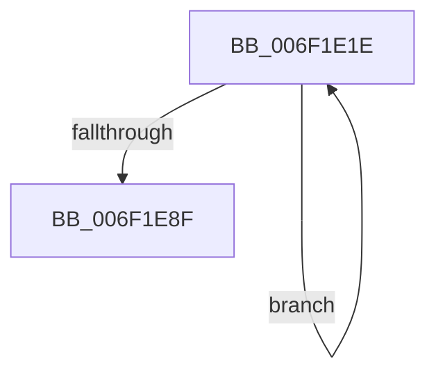

# sub_006F1E1E

- RVA: `0x006F1E1E`–`0x006F1EA8` (길이 `138` bytes)
- VA: `0x00000001406F1E1E`
- 실행 섹션: `.text`
- PDB 이름 있음: `아니요`; PDB Function 태그: `아니요`
- unwind 정보 RVA: `0x000A9090`
- 디코드: `32`개 명령, `138/138` bytes 표시
- 미해석 바이트: `0` (있으면 어셈블리에 `.byte`로 보존)

> 이 문서는 커널 이미지의 기계어와 PDB 기호를 분석해 생성했습니다. 4번과 5번은 함수 원형과 자료형을 바이너리 사용 방식에서 추정한 C 해석이며 원본 소스 복구 결과는 아닙니다.

## 1. Dependencies

- 직접 호출 지점: **0**; 고유 호출 대상: **0**
- 직접 호출자로 확인된 함수: **0**
- RIP 상대 이미지 참조: **0**

### Outgoing calls
- 직접 디코드된 call 명령이 없습니다.

### Direct callers
- 이 함수 시작 RVA로 연결되는 직접 call은 확인되지 않았습니다. 간접 호출은 완전히 역산할 수 없습니다.

### Static image references
- 디코드된 RIP-relative 메모리 참조가 없습니다.

## 2. Other-region calls and transfers

- 다른 실행 섹션으로 향하는 call: **0**
- call이 아닌 외부 분기/꼬리 이동: **1**
  - `0x006F1EA3` → [RtlpCrc32c + 0x18](../45/RtlpCrc32c_function_0045ACA0.md) (`tail-transfer`)

## 3. Assembly (complete function range)

```asm
006F1E1E  49 8B 0E                        mov rcx, qword ptr [r14]
006F1E21  49 8B 56 08                     mov rdx, qword ptr [r14 + 8]
006F1E25  4D 8B 4E 10                     mov r9, qword ptr [r14 + 0x10]
006F1E29  4D 8B 56 18                     mov r10, qword ptr [r14 + 0x18]
006F1E2D  4D 8B 5E 20                     mov r11, qword ptr [r14 + 0x20]
006F1E31  49 8B 5E 28                     mov rbx, qword ptr [r14 + 0x28]
006F1E35  49 8B 7E 30                     mov rdi, qword ptr [r14 + 0x30]
006F1E39  49 8B 76 38                     mov rsi, qword ptr [r14 + 0x38]
006F1E3D  49 83 C6 40                     add r14, 0x40
006F1E41  45 8B C0                        mov r8d, r8d
006F1E44  F2 4C 0F 38 F1 C1               crc32 r8, rcx
006F1E4A  45 8B C0                        mov r8d, r8d
006F1E4D  F2 4C 0F 38 F1 C2               crc32 r8, rdx
006F1E53  45 8B C0                        mov r8d, r8d
006F1E56  F2 4D 0F 38 F1 C1               crc32 r8, r9
006F1E5C  45 8B C0                        mov r8d, r8d
006F1E5F  F2 4D 0F 38 F1 C2               crc32 r8, r10
006F1E65  45 8B C0                        mov r8d, r8d
006F1E68  F2 4D 0F 38 F1 C3               crc32 r8, r11
006F1E6E  45 8B C0                        mov r8d, r8d
006F1E71  F2 4C 0F 38 F1 C3               crc32 r8, rbx
006F1E77  45 8B C0                        mov r8d, r8d
006F1E7A  F2 4C 0F 38 F1 C7               crc32 r8, rdi
006F1E80  45 8B C0                        mov r8d, r8d
006F1E83  F2 4C 0F 38 F1 C6               crc32 r8, rsi
006F1E89  49 83 EF 01                     sub r15, 1
006F1E8D  75 8F                           jne 0x1406f1e1e
006F1E8F  4C 8B 7C 24 30                  mov r15, qword ptr [rsp + 0x30]
006F1E94  48 8B 7C 24 28                  mov rdi, qword ptr [rsp + 0x28]
006F1E99  48 8B 74 24 20                  mov rsi, qword ptr [rsp + 0x20]
006F1E9E  48 8B 5C 24 18                  mov rbx, qword ptr [rsp + 0x18]
006F1EA3  E9 10 8E D6 FF                  jmp 0x14045acb8
```

## 4. C-style interpretation (structured pseudocode)

```c
void __fastcall sub_006F1E1E(__int64 a1, __int64 a2, int a3, __int64 a4, __int64 a5, __int64 a6)
{
    __int64 v_r14;
    __int64 v_r15;
    unsigned __int64 v_stack_p18;
    unsigned __int64 v_stack_p20;

    v_r14 = (v_r14) + (64);
    v_r15 = (v_r15) - (1);
    if (condition_is_not_equal) goto loc_006F1E1E;
}
```

## 5. (Beta) C Style

```c
void sub_006F1E1E(int64_t Arg1, int64_t Arg2, int32_t Arg3, int64_t Arg4, int64_t Arg5, int64_t Arg6)
{
    int64_t local_r14;
    int64_t local_r15;
    uint64_t v_stack_p18;
    uint64_t v_stack_p20;

    local_r14 = (local_r14) + (64);
    local_r15 = (local_r15) - (1);
    if (condition_is_not_equal) goto loc_006F1E1E;
}
```

## 6. Execution-region graph

[열기: 2D/3D 그래프와 함수 탐색 컨트롤 패널](../../../control-panel.html?section=text&rva=0x006F1E1E&view=graph)

- 2D 그래프는 위에서 아래로 흐르고, 3D 그래프는 빈 공간을 드래그해 회전합니다. Shift+드래그는 이동, 휠은 확대·축소, 함수 노드 선택은 대상 보고서 이동입니다.

### Static fallback


