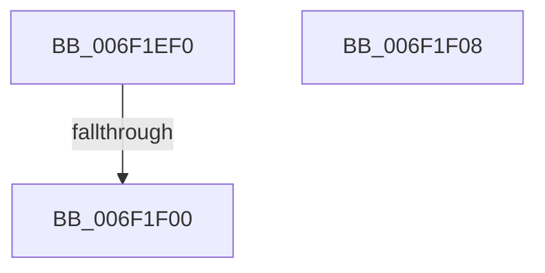

# sub_006F1EF0

- RVA: `0x006F1EF0`–`0x006F1F11` (길이 `33` bytes)
- VA: `0x00000001406F1EF0`
- 실행 섹션: `.text`
- PDB 이름 있음: `아니요`; PDB Function 태그: `아니요`
- unwind 정보 RVA: `0x000A9420`
- 디코드: `8`개 명령, `33/33` bytes 표시
- 미해석 바이트: `0` (있으면 어셈블리에 `.byte`로 보존)

> 이 문서는 커널 이미지의 기계어와 PDB 기호를 분석해 생성했습니다. 4번과 5번은 함수 원형과 자료형을 바이너리 사용 방식에서 추정한 C 해석이며 원본 소스 복구 결과는 아닙니다.

## 1. Dependencies

- 직접 호출 지점: **1**; 고유 호출 대상: **1**
- 직접 호출자로 확인된 함수: **0**
- RIP 상대 이미지 참조: **0**

### Outgoing calls
- `0x006F1EF3` → [VmCheckLargePageInswap](../../page/7A/VmCheckLargePageInswap_function_007ACD18.md) (function, `0x007ACD18`)

### Direct callers
- 이 함수 시작 RVA로 연결되는 직접 call은 확인되지 않았습니다. 간접 호출은 완전히 역산할 수 없습니다.

### Static image references
- 디코드된 RIP-relative 메모리 참조가 없습니다.

## 2. Other-region calls and transfers

- 다른 실행 섹션으로 향하는 call: **1**
  - `0x006F1EF3` → [VmCheckLargePageInswap](../../page/7A/VmCheckLargePageInswap_function_007ACD18.md) (`.text` → `PAGE`)
- call이 아닌 외부 분기/꼬리 이동: **3**
  - `0x006F1EFA` → [MmInSwapWorkingSet + 0xE8](../45/MmInSwapWorkingSet_function_0045B6C4.md) (`tail-transfer`)
  - `0x006F1F03` → [MmInSwapWorkingSet + 0xE8](../45/MmInSwapWorkingSet_function_0045B6C4.md) (`tail-transfer`)
  - `0x006F1F0C` → [MmInSwapWorkingSet + 0x144](../45/MmInSwapWorkingSet_function_0045B6C4.md) (`tail-transfer`)

## 3. Assembly (complete function range)

```asm
006F1EF0  49 8B CE                        mov rcx, r14
006F1EF3  E8 20 AE 0B 00                  call 0x1407acd18
006F1EF8  85 C0                           test eax, eax
006F1EFA  0F 84 AC 98 D6 FF               je 0x14045b7ac
006F1F00  83 CB 04                        or ebx, 4
006F1F03  E9 A4 98 D6 FF                  jmp 0x14045b7ac
006F1F08  49 83 27 00                     and qword ptr [r15], 0
006F1F0C  E9 F7 98 D6 FF                  jmp 0x14045b808
```

## 4. C-style interpretation (structured pseudocode)

```c
__int64 __fastcall sub_006F1EF0(void)
{
    __int64 result;
    __int64 v_rbx;

    result = VmCheckLargePageInswap(v_r14, a2, a3, a4);
    v_rbx = (unsigned int)((v_rbx) | (4));
}
```

## 5. (Beta) C Style

```c
void sub_006F1EF0(void)
{
    int64_t result;
    int64_t local_rbx;

    result = VmCheckLargePageInswap(local_r14, a2, a3, a4);
    local_rbx = (uint32_t)((local_rbx) | (4));
}
```

## 6. Execution-region graph

[열기: 2D/3D 그래프와 함수 탐색 컨트롤 패널](../../../control-panel.html?section=text&rva=0x006F1EF0&view=graph)

- 2D 그래프는 위에서 아래로 흐르고, 3D 그래프는 빈 공간을 드래그해 회전합니다. Shift+드래그는 이동, 휠은 확대·축소, 함수 노드 선택은 대상 보고서 이동입니다.

### Static fallback


