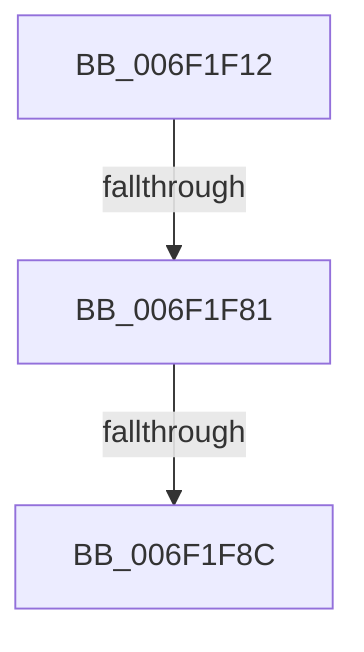

# sub_006F1F12

- RVA: `0x006F1F12`–`0x006F1FE7` (길이 `213` bytes)
- VA: `0x00000001406F1F12`
- 실행 섹션: `.text`
- PDB 이름 있음: `아니요`; PDB Function 태그: `아니요`
- unwind 정보 RVA: `0x000A94D0`
- 디코드: `44`개 명령, `213/213` bytes 표시
- 미해석 바이트: `0` (있으면 어셈블리에 `.byte`로 보존)

> 이 문서는 커널 이미지의 기계어와 PDB 기호를 분석해 생성했습니다. 4번과 5번은 함수 원형과 자료형을 바이너리 사용 방식에서 추정한 C 해석이며 원본 소스 복구 결과는 아닙니다.

## 1. Dependencies

- 직접 호출 지점: **3**; 고유 호출 대상: **3**
- 직접 호출자로 확인된 함수: **0**
- RIP 상대 이미지 참조: **0**

### Outgoing calls
- `0x006F1F39` → [PsReferenceEffectiveToken](../../page/9A/PsReferenceEffectiveToken_function_009A2B40.md) (function, `0x009A2B40`)
- `0x006F1F6F` → [RtlQueryPackageClaims](../45/RtlQueryPackageClaims_function_0045C3F0.md) (function, `0x0045C3F0`)
- `0x006F1FD4` → [RtlCompareUnicodeString](../../page/93/RtlCompareUnicodeString_function_00937F90.md) (function, `0x00937F90`)

### Direct callers
- 이 함수 시작 RVA로 연결되는 직접 call은 확인되지 않았습니다. 간접 호출은 완전히 역산할 수 없습니다.

### Static image references
- 디코드된 RIP-relative 메모리 참조가 없습니다.

## 2. Other-region calls and transfers

- 다른 실행 섹션으로 향하는 call: **2**
  - `0x006F1F39` → [PsReferenceEffectiveToken](../../page/9A/PsReferenceEffectiveToken_function_009A2B40.md) (`.text` → `PAGE`)
  - `0x006F1FD4` → [RtlCompareUnicodeString](../../page/93/RtlCompareUnicodeString_function_00937F90.md) (`.text` → `PAGE`)
- call이 아닌 외부 분기/꼬리 이동: **3**
  - `0x006F1F7B` → [SepVerifyDesktopAppPolicyOverrideCaller + 0xE5](../45/SepVerifyDesktopAppPolicyOverrideCaller_function_0045C1F0.md) (`tail-transfer`)
  - `0x006F1F86` → [SepVerifyDesktopAppPolicyOverrideCaller + 0xE5](../45/SepVerifyDesktopAppPolicyOverrideCaller_function_0045C1F0.md) (`tail-transfer`)
  - `0x006F1FE2` → [SepVerifyDesktopAppPolicyOverrideCaller + 0xE5](../45/SepVerifyDesktopAppPolicyOverrideCaller_function_0045C1F0.md) (`tail-transfer`)

## 3. Assembly (complete function range)

```asm
006F1F12  65 48 8B 0C 25 88 01 00 00      mov rcx, qword ptr gs:[0x188]
006F1F1B  48 8D 45 80                     lea rax, [rbp - 0x80]
006F1F1F  48 83 64 24 28 00               and qword ptr [rsp + 0x28], 0
006F1F25  4C 8D 4C 24 40                  lea r9, [rsp + 0x40]
006F1F2A  4C 8D 44 24 44                  lea r8, [rsp + 0x44]
006F1F2F  48 89 44 24 20                  mov qword ptr [rsp + 0x20], rax
006F1F34  BA 53 68 72 74                  mov edx, 0x74726853
006F1F39  E8 02 0C 2B 00                  call 0x1409a2b40
006F1F3E  48 83 64 24 38 00               and qword ptr [rsp + 0x38], 0
006F1F44  4C 8D 44 24 58                  lea r8, [rsp + 0x58]
006F1F49  48 8B F0                        mov rsi, rax
006F1F4C  48 8D 95 90 00 00 00            lea rdx, [rbp + 0x90]
006F1F53  48 8D 44 24 48                  lea rax, [rsp + 0x48]
006F1F58  45 33 C9                        xor r9d, r9d
006F1F5B  48 89 44 24 30                  mov qword ptr [rsp + 0x30], rax
006F1F60  48 8B CE                        mov rcx, rsi
006F1F63  48 83 64 24 28 00               and qword ptr [rsp + 0x28], 0
006F1F69  48 83 64 24 20 00               and qword ptr [rsp + 0x20], 0
006F1F6F  E8 7C A4 D6 FF                  call 0x14045c3f0
006F1F74  BB 01 00 00 00                  mov ebx, 1
006F1F79  85 C0                           test eax, eax
006F1F7B  0F 88 54 A3 D6 FF               js 0x14045c2d5
006F1F81  F6 44 24 48 04                  test byte ptr [rsp + 0x48], 4
006F1F86  0F 84 49 A3 D6 FF               je 0x14045c2d5
006F1F8C  0F B7 44 24 50                  movzx eax, word ptr [rsp + 0x50]
006F1F91  48 8D 54 24 60                  lea rdx, [rsp + 0x60]
006F1F96  66 83 E8 02                     sub ax, 2
006F1F9A  48 8D 4C 24 70                  lea rcx, [rsp + 0x70]
006F1F9F  66 89 44 24 70                  mov word ptr [rsp + 0x70], ax
006F1FA4  45 33 C0                        xor r8d, r8d
006F1FA7  66 89 44 24 72                  mov word ptr [rsp + 0x72], ax
006F1FAC  48 8D 45 90                     lea rax, [rbp - 0x70]
006F1FB0  48 89 44 24 78                  mov qword ptr [rsp + 0x78], rax
006F1FB5  0F B7 44 24 58                  movzx eax, word ptr [rsp + 0x58]
006F1FBA  66 83 E8 02                     sub ax, 2
006F1FBE  66 89 44 24 60                  mov word ptr [rsp + 0x60], ax
006F1FC3  66 89 44 24 62                  mov word ptr [rsp + 0x62], ax
006F1FC8  48 8D 85 90 00 00 00            lea rax, [rbp + 0x90]
006F1FCF  48 89 44 24 68                  mov qword ptr [rsp + 0x68], rax
006F1FD4  E8 B7 5F 24 00                  call 0x140937f90
006F1FD9  85 C0                           test eax, eax
006F1FDB  40 0F B6 FF                     movzx edi, dil
006F1FDF  0F 44 FB                        cmove edi, ebx
006F1FE2  E9 EE A2 D6 FF                  jmp 0x14045c2d5
```

## 4. C-style interpretation (structured pseudocode)

```c
__int64 __fastcall sub_006F1F12(__int64 a1, __int64 a2, __int64 a3, __int64 a4, __int64 a5, __int64 a6, __int64 a7, __int64 a8, unsigned __int8 a9, unsigned __int16 a10, unsigned __int16 a11, __int64 a12, __int64 a13, __int64 a14)
{
    __int64 result;
    __int64 v_rdi;
    unsigned __int64 v_stack_p20;
    unsigned __int64 v_stack_p30;
    unsigned __int64 v_stack_p44;
    unsigned __int16 v_stack_p60;
    unsigned __int16 v_stack_p62;
    unsigned __int64 v_stack_p68;
    unsigned __int16 v_stack_p70;
    unsigned __int16 v_stack_p72;
    unsigned __int64 v_stack_p78;

    v_stack_p20 = v_rbp - 128;
    result = PsReferenceEffectiveToken(*(unsigned __int64 *)(gs_base + (0 + 392)), (unsigned int)(0x74726853ULL), v_stack_p44, a8);
    a4 = 0;
    v_stack_p30 = a9;
    result = RtlQueryPackageClaims(result, v_rbp + 144, a11, a4);
    result = (unsigned __int16)((a10) - (2));
    v_stack_p70 = (unsigned __int16)(result);
    a3 = 0;
    v_stack_p72 = (unsigned __int16)(result);
    v_stack_p78 = v_rbp - 112;
    result = (unsigned __int16)((a11) - (2));
    v_stack_p60 = (unsigned __int16)(result);
    v_stack_p62 = (unsigned __int16)(result);
    v_stack_p68 = v_rbp + 144;
    result = RtlCompareUnicodeString(a14, a12, a3, a4);
    v_rdi = (unsigned __int8)(v_rdi);
    if ((unsigned int)(result) == 0) { v_rdi = 1; }
}
```

## 5. (Beta) C Style

```c
int64_t sub_006F1F12(int64_t Arg1, int64_t Arg2, int64_t Arg3, int64_t Arg4, int64_t Arg5, uint64_t Arg6, int64_t Arg7, int64_t Arg8, uint8_t Arg9, uint16_t Arg10, uint16_t Arg11, int64_t Arg12, uint64_t Arg13, int64_t Arg14)
{
    int64_t result;
    int64_t local_rdi;
    uint64_t v_stack_p20;
    uint64_t v_stack_p30;
    uint64_t v_stack_p44;
    uint16_t v_stack_p60;
    uint16_t v_stack_p62;
    uint64_t v_stack_p68;
    uint16_t v_stack_p70;
    uint16_t v_stack_p72;
    uint64_t v_stack_p78;

    v_stack_p20 = local_rbp - 128;
    result = PsReferenceEffectiveToken(*(uint64_t *)(gs_base + (0 + 0x188)), (uint32_t)(0x74726853ULL), v_stack_p44, Arg8);
    Arg4 = 0;
    v_stack_p30 = Arg9;
    result = RtlQueryPackageClaims(result, local_rbp + 144, Arg11, Arg4);
    result = (uint16_t)((Arg10) - (2));
    v_stack_p70 = (uint16_t)(result);
    Arg3 = 0;
    v_stack_p72 = (uint16_t)(result);
    v_stack_p78 = local_rbp - 112;
    result = (uint16_t)((Arg11) - (2));
    v_stack_p60 = (uint16_t)(result);
    v_stack_p62 = (uint16_t)(result);
    v_stack_p68 = local_rbp + 144;
    result = RtlCompareUnicodeString(Arg14, Arg12, Arg3, Arg4);
    local_rdi = (uint8_t)(local_rdi);
    if ((uint32_t)(result) == 0) { local_rdi = 1; }
}
```

## 6. Execution-region graph

[열기: 2D/3D 그래프와 함수 탐색 컨트롤 패널](../../../control-panel.html?section=text&rva=0x006F1F12&view=graph)

- 2D 그래프는 위에서 아래로 흐르고, 3D 그래프는 빈 공간을 드래그해 회전합니다. Shift+드래그는 이동, 휠은 확대·축소, 함수 노드 선택은 대상 보고서 이동입니다.

### Static fallback


