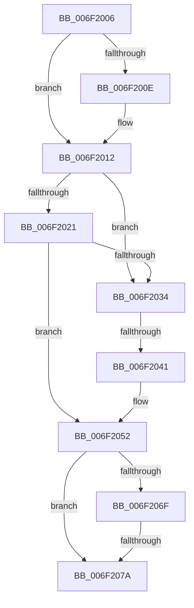

# sub_006F2006

- RVA: `0x006F2006`–`0x006F2088` (길이 `130` bytes)
- VA: `0x00000001406F2006`
- 실행 섹션: `.text`
- PDB 이름 있음: `아니요`; PDB Function 태그: `아니요`
- unwind 정보 RVA: `0x000A9670`
- 디코드: `35`개 명령, `130/130` bytes 표시
- 미해석 바이트: `0` (있으면 어셈블리에 `.byte`로 보존)

> 이 문서는 커널 이미지의 기계어와 PDB 기호를 분석해 생성했습니다. 4번과 5번은 함수 원형과 자료형을 바이너리 사용 방식에서 추정한 C 해석이며 원본 소스 복구 결과는 아닙니다.

## 1. Dependencies

- 직접 호출 지점: **1**; 고유 호출 대상: **1**
- 직접 호출자로 확인된 함수: **0**
- RIP 상대 이미지 참조: **1**

### Outgoing calls
- `0x006F207D` → [ExfReleasePushLock](../26/ExfReleasePushLock_function_002638D0.md) (function, `0x002638D0`)

### Direct callers
- 이 함수 시작 RVA로 연결되는 직접 call은 확인되지 않았습니다. 간접 호출은 완전히 역산할 수 없습니다.

### Static image references
- `0x006F2028` → RVA `0x00E65B74` (`.data`; read)

## 2. Other-region calls and transfers

- 다른 실행 섹션으로 향하는 call: **0**
- call이 아닌 외부 분기/꼬리 이동: **3**
  - `0x006F203B` → [CcPostWorkQueueAsyncRead + 0xB1](../45/CcPostWorkQueueAsyncRead_function_0045D624.md) (`tail-transfer`)
  - `0x006F2074` → [CcPostWorkQueueAsyncRead + 0x314](../45/CcPostWorkQueueAsyncRead_function_0045D624.md) (`tail-transfer`)
  - `0x006F2083` → [CcPostWorkQueueAsyncRead + 0x314](../45/CcPostWorkQueueAsyncRead_function_0045D624.md) (`tail-transfer`)

## 3. Assembly (complete function range)

```asm
006F2006  45 33 C9                        xor r9d, r9d
006F2009  48 85 ED                        test rbp, rbp
006F200C  74 04                           je 0x1406f2012
006F200E  C6 45 0A 01                     mov byte ptr [rbp + 0xa], 1
006F2012  4C 8B 86 08 01 00 00            mov r8, qword ptr [rsi + 0x108]
006F2019  4D 03 C6                        add r8, r14
006F201C  4D 39 00                        cmp qword ptr [r8], r8
006F201F  75 13                           jne 0x1406f2034
006F2021  48 8B 8E F8 00 00 00            mov rcx, qword ptr [rsi + 0xf8]
006F2028  8B 05 46 3B 77 00               mov eax, dword ptr [rip + 0x773b46]
006F202E  42 39 04 A9                     cmp dword ptr [rcx + r13*4], eax
006F2032  72 1E                           jb 0x1406f2052
006F2034  49 8B 40 08                     mov rax, qword ptr [r8 + 8]
006F2038  4C 39 00                        cmp qword ptr [rax], r8
006F203B  0F 85 94 B6 D6 FF               jne 0x14045d6d5
006F2041  4C 89 07                        mov qword ptr [rdi], r8
006F2044  41 B4 01                        mov r12b, 1
006F2047  48 89 47 08                     mov qword ptr [rdi + 8], rax
006F204B  48 89 38                        mov qword ptr [rax], rdi
006F204E  49 89 78 08                     mov qword ptr [r8 + 8], rdi
006F2052  0F 0D 0B                        prefetchw byte ptr [rbx]
006F2055  48 8B 03                        mov rax, qword ptr [rbx]
006F2058  48 8B C8                        mov rcx, rax
006F205B  48 83 E1 F0                     and rcx, 0xfffffffffffffff0
006F205F  48 83 F9 10                     cmp rcx, 0x10
006F2063  48 8D 50 F0                     lea rdx, [rax - 0x10]
006F2067  49 0F 46 D1                     cmovbe rdx, r9
006F206B  A8 02                           test al, 2
006F206D  75 0B                           jne 0x1406f207a
006F206F  F0 48 0F B1 13                  lock cmpxchg qword ptr [rbx], rdx
006F2074  0F 84 BE B8 D6 FF               je 0x14045d938
006F207A  48 8B CB                        mov rcx, rbx
006F207D  E8 4E 18 B7 FF                  call 0x1402638d0
006F2082  90                              nop
006F2083  E9 B0 B8 D6 FF                  jmp 0x14045d938
```

## 4. C-style interpretation (structured pseudocode)

```c
__int64 __fastcall sub_006F2006(__int64 a1, __int64 a2, __int64 a3, int a4)
{
    __int64 result;

    a4 = 0;
    if (v_rbp != 0) {
        *(unsigned __int8 *)(v_rbp + 10) = 1;
    }
    a3 = (*(unsigned __int64 *)(v_rsi + 264)) + (v_r14);
    if ((*(unsigned __int64 *)(a3)) != a3) goto loc_006F2034;
    if ((*(unsigned int *)(*(unsigned __int64 *)(v_rsi + 248) + v_r13 * 4)) < ((unsigned int)((unsigned int)(*(unsigned int *)(v_rip + 7813958))))) goto loc_006F2052;
loc_006F2034:
    *(unsigned __int64 *)(v_rdi) = a3;
    *(unsigned __int64 *)(v_rdi + 8) = *(unsigned __int64 *)(a3 + 8);
    *(unsigned __int64 *)(*(unsigned __int64 *)(a3 + 8)) = v_rdi;
    *(unsigned __int64 *)(a3 + 8) = v_rdi;
loc_006F2052:
    a1 = (*(unsigned __int64 *)(v_rbx)) & (-16);
    a2 = *(unsigned __int64 *)(v_rbx) - 16;
    if (a1 <= 16) { a2 = 0; }
    if ((((unsigned __int8)(*(unsigned __int64 *)(v_rbx))) & (2)) != 0) goto loc_006F207A;
loc_006F207A:
    result = ExfReleasePushLock(v_rbx, a2, a3, a4);
}
```

## 5. (Beta) C Style

```c
int64_t sub_006F2006(int64_t Arg1, int64_t Arg2, int64_t Arg3, int32_t Arg4)
{
    int64_t result;

    Arg4 = 0;
    if (local_rbp != 0) {
        *(uint8_t *)(local_rbp + 0xA) = 1;
    }
    Arg3 = (*(uint64_t *)(local_rsi + 0x108)) + (local_r14);
    if ((*(uint64_t *)(Arg3)) != Arg3) goto loc_006F2034;
    if ((*(uint32_t *)(*(uint64_t *)(local_rsi + 0xF8) + local_r13 * 4)) < ((uint32_t)((uint32_t)(*(uint32_t *)(v_rip + 0x773B46))))) goto loc_006F2052;
loc_006F2034:
    *(uint64_t *)(local_rdi) = Arg3;
    *(uint64_t *)(local_rdi + 0x8) = *(uint64_t *)(Arg3 + 0x8);
    *(uint64_t *)(*(uint64_t *)(Arg3 + 0x8)) = local_rdi;
    *(uint64_t *)(Arg3 + 0x8) = local_rdi;
loc_006F2052:
    Arg1 = (*(uint64_t *)(local_rbx)) & (-16);
    Arg2 = *(uint64_t *)(local_rbx) - 16;
    if (Arg1 <= 16) { Arg2 = 0; }
    if ((((uint8_t)(*(uint64_t *)(local_rbx))) & (2)) != 0) goto loc_006F207A;
loc_006F207A:
    result = ExfReleasePushLock(local_rbx, Arg2, Arg3, Arg4);
}
```

## 6. Execution-region graph

[열기: 2D/3D 그래프와 함수 탐색 컨트롤 패널](../../../control-panel.html?section=text&rva=0x006F2006&view=graph)

- 2D 그래프는 위에서 아래로 흐르고, 3D 그래프는 빈 공간을 드래그해 회전합니다. Shift+드래그는 이동, 휠은 확대·축소, 함수 노드 선택은 대상 보고서 이동입니다.

### Static fallback


