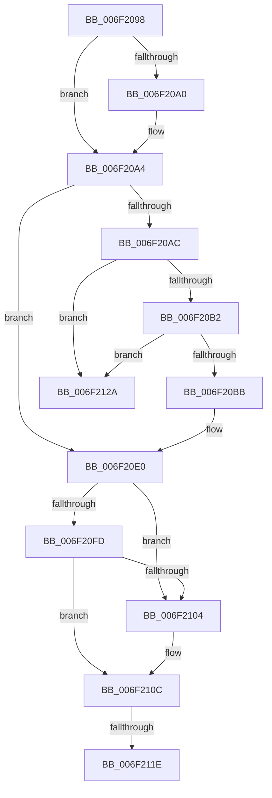

# sub_006F2098

- RVA: `0x006F2098`–`0x006F2131` (길이 `153` bytes)
- VA: `0x00000001406F2098`
- 실행 섹션: `.text`
- PDB 이름 있음: `아니요`; PDB Function 태그: `아니요`
- unwind 정보 RVA: `0x000A97E4`
- 디코드: `42`개 명령, `153/153` bytes 표시
- 미해석 바이트: `0` (있으면 어셈블리에 `.byte`로 보존)

> 이 문서는 커널 이미지의 기계어와 PDB 기호를 분석해 생성했습니다. 4번과 5번은 함수 원형과 자료형을 바이너리 사용 방식에서 추정한 C 해석이며 원본 소스 복구 결과는 아닙니다.

## 1. Dependencies

- 직접 호출 지점: **3**; 고유 호출 대상: **3**
- 직접 호출자로 확인된 함수: **0**
- RIP 상대 이미지 참조: **1**

### Outgoing calls
- `0x006F20DB` → [CcReferencePartitionAndPrivateVolumeCacheMap](../38/CcReferencePartitionAndPrivateVolumeCacheMap_function_0038B9E0.md) (function, `0x0038B9E0`)
- `0x006F2107` → [ExfReleasePushLock](../26/ExfReleasePushLock_function_002638D0.md) (function, `0x002638D0`)
- `0x006F210F` → [KeAbPostRelease](../2E/KeAbPostRelease_function_002E1600.md) (function, `0x002E1600`)

### Direct callers
- 이 함수 시작 RVA로 연결되는 직접 call은 확인되지 않았습니다. 간접 호출은 완전히 역산할 수 없습니다.

### Static image references
- `0x006F211E` → RVA `0x00E65BC0` (`.data`; read/write)

## 2. Other-region calls and transfers

- 다른 실행 섹션으로 향하는 call: **0**
- call이 아닌 외부 분기/꼬리 이동: **2**
  - `0x006F2118` → [CcShouldSpinAsyncReadWorkerThread + 0x8B](../45/CcShouldSpinAsyncReadWorkerThread_function_0045EB28.md) (`tail-transfer`)
  - `0x006F2125` → [CcShouldSpinAsyncReadWorkerThread + 0x8B](../45/CcShouldSpinAsyncReadWorkerThread_function_0045EB28.md) (`tail-transfer`)

## 3. Assembly (complete function range)

```asm
006F2098  45 33 C9                        xor r9d, r9d
006F209B  48 85 ED                        test rbp, rbp
006F209E  74 04                           je 0x1406f20a4
006F20A0  40 88 7D 0A                     mov byte ptr [rbp + 0xa], dil
006F20A4  48 8B 06                        mov rax, qword ptr [rsi]
006F20A7  48 3B C6                        cmp rax, rsi
006F20AA  74 34                           je 0x1406f20e0
006F20AC  48 39 70 08                     cmp qword ptr [rax + 8], rsi
006F20B0  75 78                           jne 0x1406f212a
006F20B2  48 8B 08                        mov rcx, qword ptr [rax]
006F20B5  48 39 41 08                     cmp qword ptr [rcx + 8], rax
006F20B9  75 6F                           jne 0x1406f212a
006F20BB  48 89 0E                        mov qword ptr [rsi], rcx
006F20BE  49 8B D4                        mov rdx, r12
006F20C1  48 89 71 08                     mov qword ptr [rcx + 8], rsi
006F20C5  49 8B CD                        mov rcx, r13
006F20C8  49 89 06                        mov qword ptr [r14], rax
006F20CB  48 8B 44 24 58                  mov rax, qword ptr [rsp + 0x58]
006F20D0  48 8B 80 F0 00 00 00            mov rax, qword ptr [rax + 0xf0]
006F20D7  42 01 3C B8                     add dword ptr [rax + r15*4], edi
006F20DB  E8 00 99 C9 FF                  call 0x14038b9e0
006F20E0  0F 0D 0B                        prefetchw byte ptr [rbx]
006F20E3  48 8B 03                        mov rax, qword ptr [rbx]
006F20E6  48 8B C8                        mov rcx, rax
006F20E9  48 83 E1 F0                     and rcx, 0xfffffffffffffff0
006F20ED  48 83 F9 10                     cmp rcx, 0x10
006F20F1  48 8D 50 F0                     lea rdx, [rax - 0x10]
006F20F5  49 0F 46 D1                     cmovbe rdx, r9
006F20F9  A8 02                           test al, 2
006F20FB  75 07                           jne 0x1406f2104
006F20FD  F0 48 0F B1 13                  lock cmpxchg qword ptr [rbx], rdx
006F2102  74 08                           je 0x1406f210c
006F2104  48 8B CB                        mov rcx, rbx
006F2107  E8 C4 17 B7 FF                  call 0x1402638d0
006F210C  48 8B CB                        mov rcx, rbx
006F210F  E8 EC F4 BE FF                  call 0x1402e1600
006F2114  49 83 3E 00                     cmp qword ptr [r14], 0
006F2118  0F 85 95 CA D6 FF               jne 0x14045ebb3
006F211E  F0 01 3D 9B 3A 77 00            lock add dword ptr [rip + 0x773a9b], edi
006F2125  E9 89 CA D6 FF                  jmp 0x14045ebb3
006F212A  B9 03 00 00 00                  mov ecx, 3
006F212F  CD 29                           int 0x29
```

## 4. C-style interpretation (structured pseudocode)

```c
__int64 __fastcall sub_006F2098(__int64 a1, __int64 a2, __int64 a3, int a4, __int64 a5, __int64 a6, __int64 a7, __int64 a8, __int64 a9, __int64 a10, __int64 a11)
{
    __int64 result;

    a4 = 0;
    if (v_rbp != 0) {
        *(unsigned __int8 *)(v_rbp + 10) = (unsigned __int8)(v_rdi);
    }
    if ((*(unsigned __int64 *)(v_rsi)) == v_rsi) goto loc_006F20E0;
    if ((*(unsigned __int64 *)(*(unsigned __int64 *)(v_rsi) + 8)) != v_rsi) goto loc_006F212A;
    if ((*(unsigned __int64 *)(*(unsigned __int64 *)(*(unsigned __int64 *)(v_rsi)) + 8)) != (*(unsigned __int64 *)(v_rsi))) goto loc_006F212A;
    *(unsigned __int64 *)(v_rsi) = *(unsigned __int64 *)(*(unsigned __int64 *)(v_rsi));
    *(unsigned __int64 *)(*(unsigned __int64 *)(*(unsigned __int64 *)(v_rsi)) + 8) = v_rsi;
    *(unsigned __int64 *)(v_r14) = *(unsigned __int64 *)(v_rsi);
    result = CcReferencePartitionAndPrivateVolumeCacheMap(v_r13, v_r12, a3, a4);
loc_006F20E0:
    a1 = (*(unsigned __int64 *)(v_rbx)) & (-16);
    a2 = *(unsigned __int64 *)(v_rbx) - 16;
    if (a1 <= 16) { a2 = 0; }
    if ((((unsigned __int8)(*(unsigned __int64 *)(v_rbx))) & (2)) != 0) goto loc_006F2104;
    result = *(unsigned __int64 *)(v_rbx);
    if ((((unsigned __int8)(*(unsigned __int64 *)(v_rbx))) & (2)) != 0) {
        a1 = v_rbx;
        result = ExfReleasePushLock(a1, a2, a3, a4);
    }
    result = KeAbPostRelease(v_rbx, a2, a3, a4);
loc_006F212A:
    return result;
}
```

## 5. (Beta) C Style

```c
int64_t sub_006F2098(int64_t Arg1, int64_t Arg2, int64_t Arg3, int32_t Arg4, uint64_t Arg5, uint64_t Arg6, uint64_t Arg7, uint64_t Arg8, uint64_t Arg9, uint64_t Arg10, void *Arg11)
{
    uint8_t *arg11 = (uint8_t *)Arg11;

    int64_t result;

    Arg4 = 0;
    if (local_rbp != 0) {
        *(uint8_t *)(local_rbp + 0xA) = (uint8_t)(local_rdi);
    }
    if ((*(uint64_t *)(local_rsi)) == local_rsi) goto loc_006F20E0;
    if ((*(uint64_t *)(*(uint64_t *)(local_rsi) + 0x8)) != local_rsi) goto loc_006F212A;
    if ((*(uint64_t *)(*(uint64_t *)(*(uint64_t *)(local_rsi)) + 0x8)) != (*(uint64_t *)(local_rsi))) goto loc_006F212A;
    *(uint64_t *)(local_rsi) = *(uint64_t *)(*(uint64_t *)(local_rsi));
    *(uint64_t *)(*(uint64_t *)(*(uint64_t *)(local_rsi)) + 0x8) = local_rsi;
    *(uint64_t *)(local_r14) = *(uint64_t *)(local_rsi);
    result = CcReferencePartitionAndPrivateVolumeCacheMap(local_r13, local_r12, Arg3, Arg4);
loc_006F20E0:
    Arg1 = (*(uint64_t *)(local_rbx)) & (-16);
    Arg2 = *(uint64_t *)(local_rbx) - 16;
    if (Arg1 <= 16) { Arg2 = 0; }
    if ((((uint8_t)(*(uint64_t *)(local_rbx))) & (2)) != 0) goto loc_006F2104;
    result = *(uint64_t *)(local_rbx);
    if ((((uint8_t)(*(uint64_t *)(local_rbx))) & (2)) != 0) {
        Arg1 = local_rbx;
        result = ExfReleasePushLock(Arg1, Arg2, Arg3, Arg4);
    }
    result = KeAbPostRelease(local_rbx, Arg2, Arg3, Arg4);
loc_006F212A:
    return result;
}
```

### 관측된 메모리 오프셋

구조체 형식이 확인되지 않은 접근은 인자 기준의 오프셋으로만 기록했습니다.

| 기준 인자 | 오프셋 표현 | 폭 (bit) | 접근 |
|---|---:|---:|---|
| `Arg11` | `+ 0xF0` | `64` | `R` |

## 6. Execution-region graph

[열기: 2D/3D 그래프와 함수 탐색 컨트롤 패널](../../../control-panel.html?section=text&rva=0x006F2098&view=graph)

- 2D 그래프는 위에서 아래로 흐르고, 3D 그래프는 빈 공간을 드래그해 회전합니다. Shift+드래그는 이동, 휠은 확대·축소, 함수 노드 선택은 대상 보고서 이동입니다.

### Static fallback


