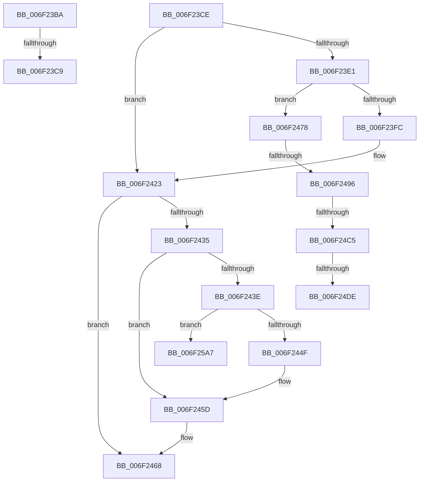

# sub_006F23BA

- RVA: `0x006F23BA`–`0x006F25AE` (길이 `500` bytes)
- VA: `0x00000001406F23BA`
- 실행 섹션: `.text`
- PDB 이름 있음: `아니요`; PDB Function 태그: `아니요`
- unwind 정보 RVA: `0x000A9CA0`
- 디코드: `114`개 명령, `500/500` bytes 표시
- 미해석 바이트: `0` (있으면 어셈블리에 `.byte`로 보존)

> 이 문서는 커널 이미지의 기계어와 PDB 기호를 분석해 생성했습니다. 4번과 5번은 함수 원형과 자료형을 바이너리 사용 방식에서 추정한 C 해석이며 원본 소스 복구 결과는 아닙니다.

## 1. Dependencies

- 직접 호출 지점: **9**; 고유 호출 대상: **8**
- 직접 호출자로 확인된 함수: **0**
- RIP 상대 이미지 참조: **3**

### Outgoing calls
- `0x006F23BA` → [EtwpCoverageEnsureContext](../../page/70/EtwpCoverageEnsureContext_function_007028E4.md) (function, `0x007028E4`)
- `0x006F23D4` → [KeReleaseSpinLock](../39/KeReleaseSpinLock_function_00392BA0.md) (function, `0x00392BA0`)
- `0x006F23EF` → [ExAllocatePool2](../../poolcode/B8/ExAllocatePool2_function_00B820F0.md) (function, `0x00B820F0`)
- `0x006F2407` → [memset](../6C/memset_function_006C6C40.md) (function, `0x006C6C40`)
- `0x006F2426` → [KeAcquireSpinLockRaiseToDpc](../20/KeAcquireSpinLockRaiseToDpc_function_00208470.md) (function, `0x00208470`)
- `0x006F246D` → [KeReleaseSpinLock](../39/KeReleaseSpinLock_function_00392BA0.md) (function, `0x00392BA0`)
- `0x006F24D1` → [tlgKeywordOn](../42/tlgKeywordOn_function_0042EAA0.md) (function, `0x0042EAA0`)
- `0x006F2572` → [tlgCreate1Sz_char](../42/tlgCreate1Sz_char_function_00427304.md) (function, `0x00427304`)
- `0x006F259C` → [tlgWriteTransfer_EtwWriteTransfer](../42/tlgWriteTransfer_EtwWriteTransfer_function_004260E0.md) (function, `0x004260E0`)

### Direct callers
- 이 함수 시작 RVA로 연결되는 직접 call은 확인되지 않았습니다. 간접 호출은 완전히 역산할 수 없습니다.

### Static image references
- `0x006F2489` → RVA `0x00E684F8` (`.data`; read)
- `0x006F24B8` → RVA `0x00E091D8` (`.data`; read)
- `0x006F2583` → RVA `0x00054B32` (`.rdata`; read)

## 2. Other-region calls and transfers

- 다른 실행 섹션으로 향하는 call: **2**
  - `0x006F23BA` → [EtwpCoverageEnsureContext](../../page/70/EtwpCoverageEnsureContext_function_007028E4.md) (`.text` → `PAGE`)
  - `0x006F23EF` → [ExAllocatePool2](../../poolcode/B8/ExAllocatePool2_function_00B820F0.md) (`.text` → `POOLCODE`)
- call이 아닌 외부 분기/꼬리 이동: **7**
  - `0x006F23C3` → [EtwTelemetryCoverageReport + 0x113](../46/EtwTelemetryCoverageReport_function_00460430.md) (`tail-transfer`)
  - `0x006F23C9` → [EtwTelemetryCoverageReport + 0x5E](../46/EtwTelemetryCoverageReport_function_00460430.md) (`tail-transfer`)
  - `0x006F2473` → [EtwTelemetryCoverageReport + 0xAA](../46/EtwTelemetryCoverageReport_function_00460430.md) (`tail-transfer`)
  - `0x006F2490` → [EtwTelemetryCoverageReport + 0x113](../46/EtwTelemetryCoverageReport_function_00460430.md) (`tail-transfer`)
  - `0x006F24BF` → [EtwTelemetryCoverageReport + 0x113](../46/EtwTelemetryCoverageReport_function_00460430.md) (`tail-transfer`)
  - `0x006F24D8` → [EtwTelemetryCoverageReport + 0x113](../46/EtwTelemetryCoverageReport_function_00460430.md) (`tail-transfer`)
  - `0x006F25A2` → [EtwTelemetryCoverageReport + 0x113](../46/EtwTelemetryCoverageReport_function_00460430.md) (`tail-transfer`)

## 3. Assembly (complete function range)

```asm
006F23BA  E8 25 05 01 00                  call 0x1407028e4
006F23BF  8B D8                           mov ebx, eax
006F23C1  85 C0                           test eax, eax
006F23C3  0F 88 7A E1 D6 FF               js 0x140460543
006F23C9  E9 C0 E0 D6 FF                  jmp 0x14046048e
006F23CE  41 8A D6                        mov dl, r14b
006F23D1  48 8B CB                        mov rcx, rbx
006F23D4  E8 C7 07 CA FF                  call 0x140392ba0
006F23D9  45 33 F6                        xor r14d, r14d
006F23DC  48 85 FF                        test rdi, rdi
006F23DF  75 42                           jne 0x1406f2423
006F23E1  BA 00 04 00 00                  mov edx, 0x400
006F23E6  8D 4F 40                        lea ecx, [rdi + 0x40]
006F23E9  41 B8 45 74 77 56               mov r8d, 0x56777445
006F23EF  E8 FC FC 48 00                  call 0x140b820f0
006F23F4  48 8B F8                        mov rdi, rax
006F23F7  48 85 C0                        test rax, rax
006F23FA  74 7C                           je 0x1406f2478
006F23FC  33 D2                           xor edx, edx
006F23FE  41 B8 00 04 00 00               mov r8d, 0x400
006F2404  48 8B C8                        mov rcx, rax
006F2407  E8 34 48 FD FF                  call 0x1406c6c40
006F240C  48 8D 8F 00 04 00 00            lea rcx, [rdi + 0x400]
006F2413  48 89 4F 10                     mov qword ptr [rdi + 0x10], rcx
006F2417  48 8D 4F 28                     lea rcx, [rdi + 0x28]
006F241B  48 89 4F 18                     mov qword ptr [rdi + 0x18], rcx
006F241F  48 89 4F 20                     mov qword ptr [rdi + 0x20], rcx
006F2423  48 8B CB                        mov rcx, rbx
006F2426  E8 45 60 B1 FF                  call 0x140208470
006F242B  48 8B 4D 8F                     mov rcx, qword ptr [rbp - 0x71]
006F242F  48 3B 4B 40                     cmp rcx, qword ptr [rbx + 0x40]
006F2433  75 33                           jne 0x1406f2468
006F2435  48 8B 4B 08                     mov rcx, qword ptr [rbx + 8]
006F2439  48 85 C9                        test rcx, rcx
006F243C  74 1F                           je 0x1406f245d
006F243E  48 8D 53 10                     lea rdx, [rbx + 0x10]
006F2442  4C 8B 42 08                     mov r8, qword ptr [rdx + 8]
006F2446  49 39 10                        cmp qword ptr [r8], rdx
006F2449  0F 85 58 01 00 00               jne 0x1406f25a7
006F244F  48 89 11                        mov qword ptr [rcx], rdx
006F2452  4C 89 41 08                     mov qword ptr [rcx + 8], r8
006F2456  49 89 08                        mov qword ptr [r8], rcx
006F2459  48 89 4A 08                     mov qword ptr [rdx + 8], rcx
006F245D  48 FF 43 40                     inc qword ptr [rbx + 0x40]
006F2461  48 89 7B 08                     mov qword ptr [rbx + 8], rdi
006F2465  49 8B FE                        mov rdi, r14
006F2468  8A D0                           mov dl, al
006F246A  48 8B CB                        mov rcx, rbx
006F246D  E8 2E 07 CA FF                  call 0x140392ba0
006F2472  90                              nop
006F2473  E9 62 E0 D6 FF                  jmp 0x1404604da
006F2478  44 89 66 0C                     mov dword ptr [rsi + 0xc], r12d
006F247C  F0 41 FF 47 04                  lock inc dword ptr [r15 + 4]
006F2481  BB 9A 00 00 C0                  mov ebx, 0xc000009a
006F2486  45 8B E6                        mov r12d, r14d
006F2489  44 39 35 68 60 77 00            cmp dword ptr [rip + 0x776068], r14d
006F2490  0F 84 AD E0 D6 FF               je 0x140460543
006F2496  48 B8 20 03 00 00 80 F7 FF FF   movabs rax, 0xfffff78000000320
006F24A0  48 B9 04 00 00 00 80 F7 FF FF   movabs rcx, 0xfffff78000000004
006F24AA  48 8B 00                        mov rax, qword ptr [rax]
006F24AD  44 8B 01                        mov r8d, dword ptr [rcx]
006F24B0  4C 0F AF C0                     imul r8, rax
006F24B4  49 C1 E8 18                     shr r8, 0x18
006F24B8  83 3D 19 6D 71 00 05            cmp dword ptr [rip + 0x716d19], 5
006F24BF  0F 86 7E E0 D6 FF               jbe 0x140460543
006F24C5  BA 01 00 00 00                  mov edx, 1
006F24CA  48 8D 0D 07 6D 71 00            lea rcx, [rip + 0x716d07]
006F24D1  E8 CA C5 D3 FF                  call 0x14042eaa0
006F24D6  84 C0                           test al, al
006F24D8  0F 84 65 E0 D6 FF               je 0x140460543
006F24DE  41 8B 07                        mov eax, dword ptr [r15]
006F24E1  48 8D 4D 17                     lea rcx, [rbp + 0x17]
006F24E5  48 8B 16                        mov rdx, qword ptr [rsi]
006F24E8  89 44 24 34                     mov dword ptr [rsp + 0x34], eax
006F24EC  48 8D 44 24 34                  lea rax, [rsp + 0x34]
006F24F1  48 89 45 B7                     mov qword ptr [rbp - 0x49], rax
006F24F5  41 8B 47 04                     mov eax, dword ptr [r15 + 4]
006F24F9  89 44 24 30                     mov dword ptr [rsp + 0x30], eax
006F24FD  48 8D 44 24 30                  lea rax, [rsp + 0x30]
006F2502  48 89 45 C7                     mov qword ptr [rbp - 0x39], rax
006F2506  41 8B C0                        mov eax, r8d
006F2509  41 2B 47 10                     sub eax, dword ptr [r15 + 0x10]
006F250D  45 2B 47 14                     sub r8d, dword ptr [r15 + 0x14]
006F2511  89 44 24 38                     mov dword ptr [rsp + 0x38], eax
006F2515  48 8D 44 24 38                  lea rax, [rsp + 0x38]
006F251A  48 89 45 D7                     mov qword ptr [rbp - 0x29], rax
006F251E  48 8D 45 83                     lea rax, [rbp - 0x7d]
006F2522  48 89 45 E7                     mov qword ptr [rbp - 0x19], rax
006F2526  48 8D 45 87                     lea rax, [rbp - 0x79]
006F252A  48 89 45 F7                     mov qword ptr [rbp - 9], rax
006F252E  48 8D 45 8F                     lea rax, [rbp - 0x71]
006F2532  48 89 45 07                     mov qword ptr [rbp + 7], rax
006F2536  48 C7 45 BF 04 00 00 00         mov qword ptr [rbp - 0x41], 4
006F253E  48 C7 45 CF 04 00 00 00         mov qword ptr [rbp - 0x31], 4
006F2546  48 C7 45 DF 04 00 00 00         mov qword ptr [rbp - 0x21], 4
006F254E  44 89 45 83                     mov dword ptr [rbp - 0x7d], r8d
006F2552  48 C7 45 EF 04 00 00 00         mov qword ptr [rbp - 0x11], 4
006F255A  44 89 6D 87                     mov dword ptr [rbp - 0x79], r13d
006F255E  48 C7 45 FF 04 00 00 00         mov qword ptr [rbp - 1], 4
006F2566  44 89 65 8F                     mov dword ptr [rbp - 0x71], r12d
006F256A  48 C7 45 0F 04 00 00 00         mov qword ptr [rbp + 0xf], 4
006F2572  E8 8D 4D D3 FF                  call 0x140427304
006F2577  4C 8D 45 97                     lea r8, [rbp - 0x69]
006F257B  45 33 C9                        xor r9d, r9d
006F257E  4C 89 44 24 28                  mov qword ptr [rsp + 0x28], r8
006F2583  48 8D 15 A8 25 96 FF            lea rdx, [rip - 0x69da58]
006F258A  45 33 C0                        xor r8d, r8d
006F258D  C7 44 24 20 09 00 00 00         mov dword ptr [rsp + 0x20], 9
006F2595  48 8D 0D 3C 6C 71 00            lea rcx, [rip + 0x716c3c]
006F259C  E8 3F 3B D3 FF                  call 0x1404260e0
006F25A1  90                              nop
006F25A2  E9 9C DF D6 FF                  jmp 0x140460543
006F25A7  B9 03 00 00 00                  mov ecx, 3
006F25AC  CD 29                           int 0x29
```

## 4. C-style interpretation (structured pseudocode)

```c
__int64 __fastcall sub_006F23BA(__int64 a1, __int64 a2, __int64 a3, int a4)
{
    __int64 result;
    unsigned int v_stack_p20;
    unsigned __int64 v_stack_p28;
    unsigned int v_stack_p30;
    unsigned int v_stack_p34;
    unsigned int v_stack_p38;

    result = EtwpCoverageEnsureContext(a1, a2, a3, a4);
}
```

## 5. (Beta) C Style

```c
int64_t sub_006F23BA(int64_t Arg1, int64_t Arg2, int64_t Arg3, int32_t Arg4)
{
    int64_t result;
    uint32_t v_stack_p20;
    uint64_t v_stack_p28;
    uint32_t v_stack_p30;
    uint32_t v_stack_p34;
    uint32_t v_stack_p38;

    result = EtwpCoverageEnsureContext(Arg1, Arg2, Arg3, Arg4);
}
```

## 6. Execution-region graph

[열기: 2D/3D 그래프와 함수 탐색 컨트롤 패널](../../../control-panel.html?section=text&rva=0x006F23BA&view=graph)

- 2D 그래프는 위에서 아래로 흐르고, 3D 그래프는 빈 공간을 드래그해 회전합니다. Shift+드래그는 이동, 휠은 확대·축소, 함수 노드 선택은 대상 보고서 이동입니다.

### Static fallback


