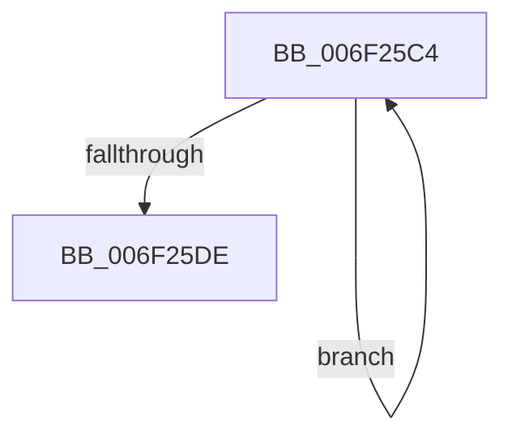

# sub_006F25C4

- RVA: `0x006F25C4`–`0x006F25EC` (길이 `40` bytes)
- VA: `0x00000001406F25C4`
- 실행 섹션: `.text`
- PDB 이름 있음: `아니요`; PDB Function 태그: `아니요`
- unwind 정보 RVA: `0x000A9E64`
- 디코드: `12`개 명령, `40/40` bytes 표시
- 미해석 바이트: `0` (있으면 어셈블리에 `.byte`로 보존)

> 이 문서는 커널 이미지의 기계어와 PDB 기호를 분석해 생성했습니다. 4번과 5번은 함수 원형과 자료형을 바이너리 사용 방식에서 추정한 C 해석이며 원본 소스 복구 결과는 아닙니다.

## 1. Dependencies

- 직접 호출 지점: **2**; 고유 호출 대상: **2**
- 직접 호출자로 확인된 함수: **0**
- RIP 상대 이미지 참조: **1**

### Outgoing calls
- `0x006F25D0` → [guard_dispatch_icall](../6B/guard_dispatch_icall_function_006BAAD0.md) (function, `0x006BAAD0`)
- `0x006F25DE` → [HalpReleaseCmosSpinLock](../42/HalpReleaseCmosSpinLock_function_0042DE04.md) (function, `0x0042DE04`)

### Direct callers
- 이 함수 시작 RVA로 연결되는 직접 call은 확인되지 않았습니다. 간접 호출은 완전히 역산할 수 없습니다.

### Static image references
- `0x006F25C4` → RVA `0x00E003E0` (`.data`; read)

## 2. Other-region calls and transfers

- 다른 실행 섹션으로 향하는 call: **0**
- call이 아닌 외부 분기/꼬리 이동: **1**
  - `0x006F25E7` → [HalSetBusDataByOffset + 0x6F](../46/HalSetBusDataByOffset_function_004614A0.md) (`tail-transfer`)

## 3. Assembly (complete function range)

```asm
006F25C4  48 8B 05 15 DE 70 00            mov rax, qword ptr [rip + 0x70de15]
006F25CB  8B CB                           mov ecx, ebx
006F25CD  41 8A 16                        mov dl, byte ptr [r14]
006F25D0  E8 FB 84 FC FF                  call 0x1406baad0
006F25D5  FF C3                           inc ebx
006F25D7  49 FF C6                        inc r14
006F25DA  3B DE                           cmp ebx, esi
006F25DC  76 E6                           jbe 0x1406f25c4
006F25DE  E8 21 B8 D3 FF                  call 0x14042de04
006F25E3  2B DF                           sub ebx, edi
006F25E5  8B C3                           mov eax, ebx
006F25E7  E9 23 EF D6 FF                  jmp 0x14046150f
```

## 4. C-style interpretation (structured pseudocode)

```c
__int64 __fastcall sub_006F25C4(void)
{
    __int64 result;
    __int64 v_r14;
    __int64 v_rbx;

    result = guard_dispatch_icall((unsigned int)((unsigned int)(v_rbx)), *(unsigned __int8 *)(v_r14), a3, a4);
    v_rbx = (unsigned int)((v_rbx) + 1);
    v_r14 = (v_r14) + 1;
    if (((unsigned int)(v_rbx)) <= ((unsigned int)(v_rsi))) goto loc_006F25C4;
    result = HalpReleaseCmosSpinLock((unsigned int)((unsigned int)(v_rbx)), *(unsigned __int8 *)(v_r14), a3, a4);
    v_rbx = (unsigned int)((v_rbx) - ((unsigned int)(v_rdi)));
}
```

## 5. (Beta) C Style

```c
void sub_006F25C4(void)
{
    int64_t result;
    int64_t local_r14;
    int64_t local_rbx;

    result = guard_dispatch_icall((uint32_t)((uint32_t)(local_rbx)), *(uint8_t *)(local_r14), a3, a4);
    local_rbx = (uint32_t)((local_rbx) + 1);
    local_r14 = (local_r14) + 1;
    if (((uint32_t)(local_rbx)) <= ((uint32_t)(local_rsi))) goto loc_006F25C4;
    result = HalpReleaseCmosSpinLock((uint32_t)((uint32_t)(local_rbx)), *(uint8_t *)(local_r14), a3, a4);
    local_rbx = (uint32_t)((local_rbx) - ((uint32_t)(local_rdi)));
}
```

## 6. Execution-region graph

[열기: 2D/3D 그래프와 함수 탐색 컨트롤 패널](../../../control-panel.html?section=text&rva=0x006F25C4&view=graph)

- 2D 그래프는 위에서 아래로 흐르고, 3D 그래프는 빈 공간을 드래그해 회전합니다. Shift+드래그는 이동, 휠은 확대·축소, 함수 노드 선택은 대상 보고서 이동입니다.

### Static fallback


