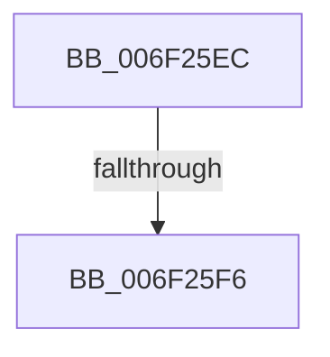

# sub_006F25EC

- RVA: `0x006F25EC`–`0x006F2675` (길이 `137` bytes)
- VA: `0x00000001406F25EC`
- 실행 섹션: `.text`
- PDB 이름 있음: `아니요`; PDB Function 태그: `아니요`
- unwind 정보 RVA: `0x000A9E98`
- 디코드: `34`개 명령, `137/137` bytes 표시
- 미해석 바이트: `0` (있으면 어셈블리에 `.byte`로 보존)

> 이 문서는 커널 이미지의 기계어와 PDB 기호를 분석해 생성했습니다. 4번과 5번은 함수 원형과 자료형을 바이너리 사용 방식에서 추정한 C 해석이며 원본 소스 복구 결과는 아닙니다.

## 1. Dependencies

- 직접 호출 지점: **2**; 고유 호출 대상: **2**
- 직접 호출자로 확인된 함수: **0**
- RIP 상대 이미지 참조: **0**

### Outgoing calls
- `0x006F263C` → [memcpy](../6C/memcpy_function_006C6840.md) (function, `0x006C6840`)
- `0x006F265D` → [HalpWritePCIConfig](../46/HalpWritePCIConfig_function_004616AC.md) (function, `0x004616AC`)

### Direct callers
- 이 함수 시작 RVA로 연결되는 직접 call은 확인되지 않았습니다. 간접 호출은 완전히 역산할 수 없습니다.

### Static image references
- 디코드된 RIP-relative 메모리 참조가 없습니다.

## 2. Other-region calls and transfers

- 다른 실행 섹션으로 향하는 call: **0**
- call이 아닌 외부 분기/꼬리 이동: **2**
  - `0x006F25F0` → [HalpSetPCIData + 0xCF](../46/HalpSetPCIData_function_004615B4.md) (`tail-transfer`)
  - `0x006F2670` → [HalpSetPCIData + 0x7E](../46/HalpSetPCIData_function_004615B4.md) (`tail-transfer`)

## 3. Assembly (complete function range)

```asm
006F25EC  F6 45 85 7F                     test byte ptr [rbp - 0x7b], 0x7f
006F25F0  0F 85 8D F0 D6 FF               jne 0x140461683
006F25F6  0F 28 44 24 40                  movaps xmm0, xmmword ptr [rsp + 0x40]
006F25FB  48 8D 7D B7                     lea rdi, [rbp - 0x49]
006F25FF  0F 28 4D 87                     movaps xmm1, xmmword ptr [rbp - 0x79]
006F2603  41 BF 40 00 00 00               mov r15d, 0x40
006F2609  48 8B 54 24 38                  mov rdx, qword ptr [rsp + 0x38]
006F260E  45 2B FC                        sub r15d, r12d
006F2611  0F 29 45 B7                     movaps xmmword ptr [rbp - 0x49], xmm0
006F2615  45 3B FE                        cmp r15d, r14d
006F2618  0F 28 45 97                     movaps xmm0, xmmword ptr [rbp - 0x69]
006F261C  45 0F 47 FE                     cmova r15d, r14d
006F2620  0F 29 4D C7                     movaps xmmword ptr [rbp - 0x39], xmm1
006F2624  0F 28 4D A7                     movaps xmm1, xmmword ptr [rbp - 0x59]
006F2628  49 03 FC                        add rdi, r12
006F262B  48 8B CF                        mov rcx, rdi
006F262E  45 8B C7                        mov r8d, r15d
006F2631  0F 29 45 D7                     movaps xmmword ptr [rbp - 0x29], xmm0
006F2635  0F 29 4D E7                     movaps xmmword ptr [rbp - 0x19], xmm1
006F2639  41 8B F7                        mov esi, r15d
006F263C  E8 FF 41 FD FF                  call 0x1406c6840
006F2641  4C 8B CF                        mov r9, rdi
006F2644  44 89 7C 24 28                  mov dword ptr [rsp + 0x28], r15d
006F2649  40 8A 7C 24 30                  mov dil, byte ptr [rsp + 0x30]
006F264E  44 8B C3                        mov r8d, ebx
006F2651  40 8A D7                        mov dl, dil
006F2654  44 89 64 24 20                  mov dword ptr [rsp + 0x20], r12d
006F2659  41 0F B7 CD                     movzx ecx, r13w
006F265D  E8 4A F0 D6 FF                  call 0x1404616ac
006F2662  48 8B 44 24 38                  mov rax, qword ptr [rsp + 0x38]
006F2667  45 03 E7                        add r12d, r15d
006F266A  48 03 C6                        add rax, rsi
006F266D  45 2B F7                        sub r14d, r15d
006F2670  E9 BD EF D6 FF                  jmp 0x140461632
```

## 4. C-style interpretation (structured pseudocode)

```c
__int64 __fastcall sub_006F25EC(__int64 a1, __int64 a2, __int64 a3, __int64 a4, __int64 a5, unsigned __int8 a6, __int64 a7, __int64 a8)
{
    __int64 result;
    __int64 v_r12;
    __int64 v_r14;
    __int64 v_r15;
    __int64 v_rdi;
    unsigned int v_stack_p20;
    unsigned int v_stack_p28;

    v_r15 = (unsigned int)((64) - ((unsigned int)(v_r12)));
    *(unsigned __int64 *)(v_rbp - 73) = v_xmm0;
    if (((unsigned int)(v_r15)) > ((unsigned int)(v_r14))) { v_r15 = (unsigned int)(v_r14); }
    *(unsigned __int64 *)(v_rbp - 57) = v_xmm1;
    v_rdi = (v_rbp - 73) + (v_r12);
    *(unsigned __int64 *)(v_rbp - 41) = v_xmm0;
    *(unsigned __int64 *)(v_rbp - 25) = v_xmm1;
    result = memcpy(v_rdi, a7, (unsigned int)((unsigned int)(v_r15)), a4);
    v_stack_p28 = (unsigned int)(v_r15);
    v_stack_p20 = (unsigned int)(v_r12);
    result = HalpWritePCIConfig((unsigned __int16)(v_r13), a6, (unsigned int)((unsigned int)(v_rbx)), v_rdi);
    v_r12 = (unsigned int)((v_r12) + ((unsigned int)(v_r15)));
    result = (a7) + ((unsigned int)((unsigned int)(v_r15)));
    v_r14 = (unsigned int)((v_r14) - ((unsigned int)(v_r15)));
}
```

## 5. (Beta) C Style

```c
int64_t sub_006F25EC(int64_t Arg1, int64_t Arg2, int64_t Arg3, int64_t Arg4, uint64_t Arg5, uint8_t Arg6, int64_t Arg7, int64_t Arg8)
{
    int64_t result;
    int64_t local_r12;
    int64_t local_r14;
    int64_t local_r15;
    int64_t local_rdi;
    uint32_t v_stack_p20;
    uint32_t v_stack_p28;

    local_r15 = (uint32_t)((64) - ((uint32_t)(local_r12)));
    *(uint64_t *)(local_rbp - 0x49) = v_xmm0;
    if (((uint32_t)(local_r15)) > ((uint32_t)(local_r14))) { local_r15 = (uint32_t)(local_r14); }
    *(uint64_t *)(local_rbp - 0x39) = v_xmm1;
    local_rdi = (local_rbp - 73) + (local_r12);
    *(uint64_t *)(local_rbp - 0x29) = v_xmm0;
    *(uint64_t *)(local_rbp - 0x19) = v_xmm1;
    result = memcpy(local_rdi, Arg7, (uint32_t)((uint32_t)(local_r15)), Arg4);
    v_stack_p28 = (uint32_t)(local_r15);
    v_stack_p20 = (uint32_t)(local_r12);
    result = HalpWritePCIConfig((uint16_t)(local_r13), Arg6, (uint32_t)((uint32_t)(local_rbx)), local_rdi);
    local_r12 = (uint32_t)((local_r12) + ((uint32_t)(local_r15)));
    result = (Arg7) + ((uint32_t)((uint32_t)(local_r15)));
    local_r14 = (uint32_t)((local_r14) - ((uint32_t)(local_r15)));
}
```

## 6. Execution-region graph

[열기: 2D/3D 그래프와 함수 탐색 컨트롤 패널](../../../control-panel.html?section=text&rva=0x006F25EC&view=graph)

- 2D 그래프는 위에서 아래로 흐르고, 3D 그래프는 빈 공간을 드래그해 회전합니다. Shift+드래그는 이동, 휠은 확대·축소, 함수 노드 선택은 대상 보고서 이동입니다.

### Static fallback


