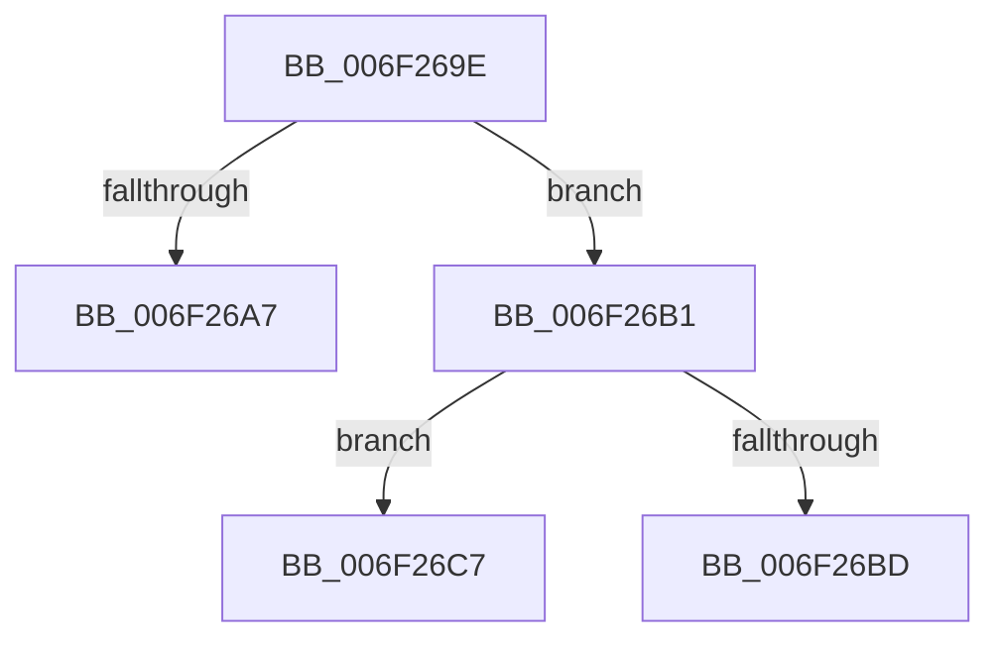

# sub_006F269E

- RVA: `0x006F269E`–`0x006F270F` (길이 `113` bytes)
- VA: `0x00000001406F269E`
- 실행 섹션: `.text`
- PDB 이름 있음: `아니요`; PDB Function 태그: `아니요`
- unwind 정보 RVA: `0x000AA1FC`
- 디코드: `25`개 명령, `113/113` bytes 표시
- 미해석 바이트: `0` (있으면 어셈블리에 `.byte`로 보존)

> 이 문서는 커널 이미지의 기계어와 PDB 기호를 분석해 생성했습니다. 4번과 5번은 함수 원형과 자료형을 바이너리 사용 방식에서 추정한 C 해석이며 원본 소스 복구 결과는 아닙니다.

## 1. Dependencies

- 직접 호출 지점: **1**; 고유 호출 대상: **1**
- 직접 호출자로 확인된 함수: **0**
- RIP 상대 이미지 참조: **2**

### Outgoing calls
- `0x006F2704` → [MmKasanCommitRegion](../67/MmKasanCommitRegion_function_0067FCF4.md) (function, `0x0067FCF4`)

### Direct callers
- 이 함수 시작 RVA로 연결되는 직접 call은 확인되지 않았습니다. 간접 호출은 완전히 역산할 수 없습니다.

### Static image references
- `0x006F26B1` → RVA `0x00FC5000` (`ALMOSTRO`; read)
- `0x006F26E2` → RVA `0x00FC6ED8` (`ALMOSTRO`; read)

## 2. Other-region calls and transfers

- 다른 실행 섹션으로 향하는 call: **0**
- call이 아닌 외부 분기/꼬리 이동: **3**
  - `0x006F26AC` → [KasanTrackAddress + 0x17](../46/KasanTrackAddress_function_00462520.md) (`tail-transfer`)
  - `0x006F26C2` → [KasanTrackAddress + 0x17](../46/KasanTrackAddress_function_00462520.md) (`tail-transfer`)
  - `0x006F270A` → [KasanTrackAddress + 0x17](../46/KasanTrackAddress_function_00462520.md) (`tail-transfer`)

## 3. Assembly (complete function range)

```asm
006F269E  48 8D 04 11                     lea rax, [rcx + rdx]
006F26A2  49 3B C1                        cmp rax, r9
006F26A5  73 0A                           jae 0x1406f26b1
006F26A7  B8 95 00 00 C0                  mov eax, 0xc0000095
006F26AC  E9 86 FE D6 FF                  jmp 0x140462537
006F26B1  0F B7 05 48 29 8D 00            movzx eax, word ptr [rip + 0x8d2948]
006F26B8  44 3B C0                        cmp r8d, eax
006F26BB  76 0A                           jbe 0x1406f26c7
006F26BD  B8 F1 00 00 C0                  mov eax, 0xc00000f1
006F26C2  E9 70 FE D6 FF                  jmp 0x140462537
006F26C7  48 8D 42 FF                     lea rax, [rdx - 1]
006F26CB  48 B9 00 00 00 00 00 80 00 00   movabs rcx, 0x800000000000
006F26D5  83 E0 07                        and eax, 7
006F26D8  49 03 C9                        add rcx, r9
006F26DB  4C 2B C8                        sub r9, rax
006F26DE  48 C1 E9 03                     shr rcx, 3
006F26E2  48 03 0D EF 47 8D 00            add rcx, qword ptr [rip + 0x8d47ef]
006F26E9  48 B8 06 00 00 00 00 80 00 00   movabs rax, 0x800000000006
006F26F3  49 03 C1                        add rax, r9
006F26F6  48 03 D0                        add rdx, rax
006F26F9  48 C1 EA 03                     shr rdx, 3
006F26FD  48 03 15 D4 47 8D 00            add rdx, qword ptr [rip + 0x8d47d4]
006F2704  E8 EB D5 F8 FF                  call 0x14067fcf4
006F2709  90                              nop
006F270A  E9 28 FE D6 FF                  jmp 0x140462537
```

## 4. C-style interpretation (structured pseudocode)

```c
__int64 __fastcall sub_006F269E(__int64 a1, __int64 a2, int a3, __int64 a4)
{
    __int64 result;

    if ((a1 + a2 * 1) >= a4) goto loc_006F26B1;
loc_006F26B1:
    if (a3 <= ((unsigned int)(*(unsigned __int16 *)(v_rip + 9251144)))) goto loc_006F26C7;
loc_006F26C7:
    result = (unsigned int)((a2 - 1) & (7));
    a1 = (a1) + (a4);
    a4 = (a4) - (result);
    a1 = (a1) >> (3);
    a1 = (a1) + (*(unsigned __int64 *)(v_rip + 9258991));
    result = (result) + (a4);
    a2 = (a2) + (result);
    a2 = (a2) >> (3);
    a2 = (a2) + (*(unsigned __int64 *)(v_rip + 9258964));
    result = MmKasanCommitRegion(a1, a2, a3, a4);
}
```

## 5. (Beta) C Style

```c
int64_t sub_006F269E(void *Arg1, void *Arg2, int32_t Arg3, int64_t Arg4)
{
    uint8_t *arg1 = (uint8_t *)Arg1;
    uint8_t *arg2 = (uint8_t *)Arg2;

    int64_t result;

    if ((Arg1 + Arg2 * 1) >= Arg4) goto loc_006F26B1;
loc_006F26B1:
    if (Arg3 <= ((uint32_t)(*(uint16_t *)(v_rip + 0x8D2948)))) goto loc_006F26C7;
loc_006F26C7:
    result = (uint32_t)((Arg2 - 1) & (7));
    Arg1 = (Arg1) + (Arg4);
    Arg4 = (Arg4) - (result);
    Arg1 = (Arg1) >> (3);
    Arg1 = (Arg1) + (*(uint64_t *)(v_rip + 0x8D47EF));
    result = (result) + (Arg4);
    Arg2 = (Arg2) + (result);
    Arg2 = (Arg2) >> (3);
    Arg2 = (Arg2) + (*(uint64_t *)(v_rip + 0x8D47D4));
    result = MmKasanCommitRegion(Arg1, Arg2, Arg3, Arg4);
}
```

### 관측된 메모리 오프셋

구조체 형식이 확인되지 않은 접근은 인자 기준의 오프셋으로만 기록했습니다.

| 기준 인자 | 오프셋 표현 | 폭 (bit) | 접근 |
|---|---:|---:|---|
| `Arg1` | `+ 0x0 + rdx*1` | `64` | `R` |
| `Arg2` | `- 0x1` | `64` | `R` |

## 6. Execution-region graph

[열기: 2D/3D 그래프와 함수 탐색 컨트롤 패널](../../../control-panel.html?section=text&rva=0x006F269E&view=graph)

- 2D 그래프는 위에서 아래로 흐르고, 3D 그래프는 빈 공간을 드래그해 회전합니다. Shift+드래그는 이동, 휠은 확대·축소, 함수 노드 선택은 대상 보고서 이동입니다.

### Static fallback


