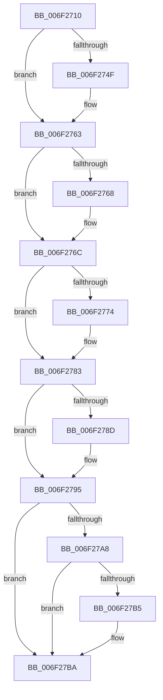

# sub_006F2710

- RVA: `0x006F2710`–`0x006F27C2` (길이 `178` bytes)
- VA: `0x00000001406F2710`
- 실행 섹션: `.text`
- PDB 이름 있음: `아니요`; PDB Function 태그: `아니요`
- unwind 정보 RVA: `0x000AA290`
- 디코드: `48`개 명령, `178/178` bytes 표시
- 미해석 바이트: `0` (있으면 어셈블리에 `.byte`로 보존)

> 이 문서는 커널 이미지의 기계어와 PDB 기호를 분석해 생성했습니다. 4번과 5번은 함수 원형과 자료형을 바이너리 사용 방식에서 추정한 C 해석이며 원본 소스 복구 결과는 아닙니다.

## 1. Dependencies

- 직접 호출 지점: **5**; 고유 호출 대상: **5**
- 직접 호출자로 확인된 함수: **0**
- RIP 상대 이미지 참조: **0**

### Outgoing calls
- `0x006F273A` → [KeAbPreAcquire](../21/KeAbPreAcquire_function_00210230.md) (function, `0x00210230`)
- `0x006F275A` → [ExfAcquirePushLockSharedEx](../21/ExfAcquirePushLockSharedEx_function_0021044C.md) (function, `0x0021044C`)
- `0x006F2790` → [ExfReleasePushLockShared](../26/ExfReleasePushLockShared_function_00263440.md) (function, `0x00263440`)
- `0x006F2798` → [KeAbPostRelease](../2E/KeAbPostRelease_function_002E1600.md) (function, `0x002E1600`)
- `0x006F27B5` → [KiCheckForKernelApcDelivery](../2E/KiCheckForKernelApcDelivery_function_002E2C80.md) (function, `0x002E2C80`)

### Direct callers
- 이 함수 시작 RVA로 연결되는 직접 call은 확인되지 않았습니다. 간접 호출은 완전히 역산할 수 없습니다.

### Static image references
- 디코드된 RIP-relative 메모리 참조가 없습니다.

## 2. Other-region calls and transfers

- 다른 실행 섹션으로 향하는 call: **0**
- call이 아닌 외부 분기/꼬리 이동: **1**
  - `0x006F27BD` → [MiGetSpecialPurposeMemoryPartitionForCaching + 0x3F](../46/MiGetSpecialPurposeMemoryPartitionForCaching_function_004625D0.md) (`tail-transfer`)

## 3. Assembly (complete function range)

```asm
006F2710  65 48 8B 2C 25 88 01 00 00      mov rbp, qword ptr gs:[0x188]
006F2719  48 8D 99 08 45 00 00            lea rbx, [rcx + 0x4508]
006F2720  41 BD 01 00 00 00               mov r13d, 1
006F2726  45 33 C0                        xor r8d, r8d
006F2729  33 D2                           xor edx, edx
006F272B  48 8B CB                        mov rcx, rbx
006F272E  4D 8B F4                        mov r14, r12
006F2731  66 44 29 AD E6 01 00 00         sub word ptr [rbp + 0x1e6], r13w
006F2739  90                              nop
006F273A  E8 F1 DA B1 FF                  call 0x140210230
006F273F  4C 8B F8                        mov r15, rax
006F2742  41 8D 4D 10                     lea ecx, [r13 + 0x10]
006F2746  33 C0                           xor eax, eax
006F2748  F0 48 0F B1 0B                  lock cmpxchg qword ptr [rbx], rcx
006F274D  74 14                           je 0x1406f2763
006F274F  4C 8B CB                        mov r9, rbx
006F2752  4D 8B C7                        mov r8, r15
006F2755  33 D2                           xor edx, edx
006F2757  48 8B CB                        mov rcx, rbx
006F275A  E8 ED DC B1 FF                  call 0x14021044c
006F275F  41 8D 4D 10                     lea ecx, [r13 + 0x10]
006F2763  4D 85 FF                        test r15, r15
006F2766  74 04                           je 0x1406f276c
006F2768  45 88 6F 0A                     mov byte ptr [r15 + 0xa], r13b
006F276C  48 8B 06                        mov rax, qword ptr [rsi]
006F276F  48 3B C6                        cmp rax, rsi
006F2772  74 0F                           je 0x1406f2783
006F2774  48 83 C0 B8                     add rax, -0x48
006F2778  4C 01 68 58                     add qword ptr [rax + 0x58], r13
006F277C  48 89 07                        mov qword ptr [rdi], rax
006F277F  4C 8B 70 40                     mov r14, qword ptr [rax + 0x40]
006F2783  48 8B C1                        mov rax, rcx
006F2786  F0 4C 0F B1 23                  lock cmpxchg qword ptr [rbx], r12
006F278B  74 08                           je 0x1406f2795
006F278D  48 8B CB                        mov rcx, rbx
006F2790  E8 AB 0C B7 FF                  call 0x140263440
006F2795  48 8B CB                        mov rcx, rbx
006F2798  E8 63 EE BE FF                  call 0x1402e1600
006F279D  90                              nop
006F279E  66 44 01 AD E6 01 00 00         add word ptr [rbp + 0x1e6], r13w
006F27A6  75 12                           jne 0x1406f27ba
006F27A8  48 8D 8D 98 00 00 00            lea rcx, [rbp + 0x98]
006F27AF  90                              nop
006F27B0  48 39 09                        cmp qword ptr [rcx], rcx
006F27B3  74 05                           je 0x1406f27ba
006F27B5  E8 C6 04 BF FF                  call 0x1402e2c80
006F27BA  49 8B C6                        mov rax, r14
006F27BD  E9 4D FE D6 FF                  jmp 0x14046260f
```

## 4. C-style interpretation (structured pseudocode)

```c
__int64 __fastcall sub_006F2710(__int64 a1, int a2, int a3)
{
    __int64 result;
    __int64 v_r14;

    a3 = 0;
    a2 = 0;
    result = KeAbPreAcquire(a1 + 17672, a2, a3, a4);
    result = 0;
    if (!(condition_is_equal)) {
        a4 = a1 + 17672;
        a3 = 0;
        a2 = 0;
        a1 = a1 + 17672;
        result = ExfAcquirePushLockSharedEx(a1, a2, a3, a4);
        a1 = 1 + 16;
    }
    if (result != 0) {
        *(unsigned __int8 *)(result + 10) = 1;
    }
    result = *(unsigned __int64 *)(v_rsi);
    v_r14 = v_r12;
    if ((*(unsigned __int64 *)(v_rsi)) != v_rsi) {
        result = (*(unsigned __int64 *)(v_rsi)) + (-72);
        *(unsigned __int64 *)(v_rdi) = result;
        v_r14 = *(unsigned __int64 *)(result + 64);
    }
    result = a1;
    if (!(condition_is_equal)) {
        a1 = a1 + 17672;
        result = ExfReleasePushLockShared(a1, a2, a3, a4);
    }
    result = KeAbPostRelease(a1 + 17672, a2, a3, a4);
    if (condition_is_not_equal) goto loc_006F27BA;
    if ((*(unsigned __int64 *)(*(unsigned __int64 *)(gs_base + (0 + 392)) + 152)) != (*(unsigned __int64 *)(gs_base + (0 + 392)) + 152)) {
        result = KiCheckForKernelApcDelivery(*(unsigned __int64 *)(gs_base + (0 + 392)) + 152, a2, a3, a4);
    }
}
```

## 5. (Beta) C Style

```c
int64_t sub_006F2710(void *Arg1, int32_t Arg2, int32_t Arg3)
{
    uint8_t *arg1 = (uint8_t *)Arg1;

    int64_t result;
    int64_t local_r14;

    Arg3 = 0;
    Arg2 = 0;
    result = KeAbPreAcquire(Arg1 + 17672, Arg2, Arg3, a4);
    result = 0;
    if (!(condition_is_equal)) {
        a4 = Arg1 + 17672;
        Arg3 = 0;
        Arg2 = 0;
        Arg1 = Arg1 + 17672;
        result = ExfAcquirePushLockSharedEx(Arg1, Arg2, Arg3, a4);
        Arg1 = 1 + 16;
    }
    if (result != 0) {
        *(uint8_t *)(result + 0xA) = 1;
    }
    result = *(uint64_t *)(local_rsi);
    local_r14 = local_r12;
    if ((*(uint64_t *)(local_rsi)) != local_rsi) {
        result = (*(uint64_t *)(local_rsi)) + (-72);
        *(uint64_t *)(local_rdi) = result;
        local_r14 = *(uint64_t *)(result + 0x40);
    }
    result = Arg1;
    if (!(condition_is_equal)) {
        Arg1 = Arg1 + 17672;
        result = ExfReleasePushLockShared(Arg1, Arg2, Arg3, a4);
    }
    result = KeAbPostRelease(Arg1 + 17672, Arg2, Arg3, a4);
    if (condition_is_not_equal) goto loc_006F27BA;
    if ((*(uint64_t *)(*(uint64_t *)(gs_base + (0 + 0x188)) + 0x98)) != (*(uint64_t *)(gs_base + (0 + 0x188)) + 152)) {
        result = KiCheckForKernelApcDelivery(*(uint64_t *)(gs_base + (0 + 0x188)) + 152, Arg2, Arg3, a4);
    }
}
```

### 관측된 메모리 오프셋

구조체 형식이 확인되지 않은 접근은 인자 기준의 오프셋으로만 기록했습니다.

| 기준 인자 | 오프셋 표현 | 폭 (bit) | 접근 |
|---|---:|---:|---|
| `Arg1` | `+ 0x0` | `64` | `R` |
| `Arg1` | `+ 0x4508` | `64` | `R` |

## 6. Execution-region graph

[열기: 2D/3D 그래프와 함수 탐색 컨트롤 패널](../../../control-panel.html?section=text&rva=0x006F2710&view=graph)

- 2D 그래프는 위에서 아래로 흐르고, 3D 그래프는 빈 공간을 드래그해 회전합니다. Shift+드래그는 이동, 휠은 확대·축소, 함수 노드 선택은 대상 보고서 이동입니다.

### Static fallback


