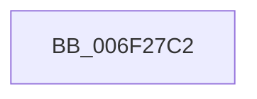

# sub_006F27C2

- RVA: `0x006F27C2`–`0x006F280B` (길이 `73` bytes)
- VA: `0x00000001406F27C2`
- 실행 섹션: `.text`
- PDB 이름 있음: `아니요`; PDB Function 태그: `아니요`
- unwind 정보 RVA: `0x000AA2D0`
- 디코드: `16`개 명령, `73/73` bytes 표시
- 미해석 바이트: `0` (있으면 어셈블리에 `.byte`로 보존)

> 이 문서는 커널 이미지의 기계어와 PDB 기호를 분석해 생성했습니다. 4번과 5번은 함수 원형과 자료형을 바이너리 사용 방식에서 추정한 C 해석이며 원본 소스 복구 결과는 아닙니다.

## 1. Dependencies

- 직접 호출 지점: **1**; 고유 호출 대상: **1**
- 직접 호출자로 확인된 함수: **0**
- RIP 상대 이미지 참조: **0**

### Outgoing calls
- `0x006F2800` → [EtwTraceKernelEvent](../23/EtwTraceKernelEvent_function_00235350.md) (function, `0x00235350`)

### Direct callers
- 이 함수 시작 RVA로 연결되는 직접 call은 확인되지 않았습니다. 간접 호출은 완전히 역산할 수 없습니다.

### Static image references
- 디코드된 RIP-relative 메모리 참조가 없습니다.

## 2. Other-region calls and transfers

- 다른 실행 섹션으로 향하는 call: **0**
- call이 아닌 외부 분기/꼬리 이동: **1**
  - `0x006F2806` → [KiEventClockStateChange + 0x23](../46/KiEventClockStateChange_function_0046279C.md) (`tail-transfer`)

## 3. Assembly (complete function range)

```asm
006F27C2  49 8B 00                        mov rax, qword ptr [r8]
006F27C5  48 89 45 D8                     mov qword ptr [rbp - 0x28], rax
006F27C9  49 8B 01                        mov rax, qword ptr [r9]
006F27CC  48 89 45 E0                     mov qword ptr [rbp - 0x20], rax
006F27D0  83 65 F4 00                     and dword ptr [rbp - 0xc], 0
006F27D4  48 8D 45 D0                     lea rax, [rbp - 0x30]
006F27D8  41 B9 57 0F 00 00               mov r9d, 0xf57
006F27DE  48 89 45 E8                     mov qword ptr [rbp - 0x18], rax
006F27E2  BA 01 00 00 00                  mov edx, 1
006F27E7  C7 45 F0 18 00 00 00            mov dword ptr [rbp - 0x10], 0x18
006F27EE  41 B8 00 00 10 40               mov r8d, 0x40100000
006F27F4  C7 44 24 20 02 06 00 00         mov dword ptr [rsp + 0x20], 0x602
006F27FC  48 8D 4D E8                     lea rcx, [rbp - 0x18]
006F2800  E8 4B 2B B4 FF                  call 0x140235350
006F2805  90                              nop
006F2806  E9 B4 FF D6 FF                  jmp 0x1404627bf
```

## 4. C-style interpretation (structured pseudocode)

```c
__int64 __fastcall sub_006F27C2(__int64 a1, __int64 a2, __int64 a3, __int64 a4)
{
    __int64 result;
    unsigned int v_stack_p20;

    *(unsigned __int64 *)(v_rbp - 40) = *(unsigned __int64 *)(a3);
    *(unsigned __int64 *)(v_rbp - 32) = *(unsigned __int64 *)(a4);
    *(unsigned __int64 *)(v_rbp - 24) = v_rbp - 48;
    *(unsigned int *)(v_rbp - 16) = 24;
    v_stack_p20 = 0x602ULL;
    result = EtwTraceKernelEvent(v_rbp - 24, 1, (unsigned int)(0x40100000ULL), (unsigned int)(0xF57ULL));
}
```

## 5. (Beta) C Style

```c
int64_t sub_006F27C2(int64_t Arg1, int64_t Arg2, void *Arg3, void *Arg4)
{
    uint8_t *arg3 = (uint8_t *)Arg3;
    uint8_t *arg4 = (uint8_t *)Arg4;

    int64_t result;
    uint32_t v_stack_p20;

    *(uint64_t *)(local_rbp - 0x28) = *(uint64_t *)(arg3);
    *(uint64_t *)(local_rbp - 0x20) = *(uint64_t *)(arg4);
    *(uint64_t *)(local_rbp - 0x18) = local_rbp - 48;
    *(uint32_t *)(local_rbp - 0x10) = 24;
    v_stack_p20 = 0x602ULL;
    result = EtwTraceKernelEvent(local_rbp - 24, 1, (uint32_t)(0x40100000ULL), (uint32_t)(0xF57ULL));
}
```

### 관측된 메모리 오프셋

구조체 형식이 확인되지 않은 접근은 인자 기준의 오프셋으로만 기록했습니다.

| 기준 인자 | 오프셋 표현 | 폭 (bit) | 접근 |
|---|---:|---:|---|
| `Arg3` | `+ 0x0` | `64` | `R` |
| `Arg4` | `+ 0x0` | `64` | `R` |

## 6. Execution-region graph

[열기: 2D/3D 그래프와 함수 탐색 컨트롤 패널](../../../control-panel.html?section=text&rva=0x006F27C2&view=graph)

- 2D 그래프는 위에서 아래로 흐르고, 3D 그래프는 빈 공간을 드래그해 회전합니다. Shift+드래그는 이동, 휠은 확대·축소, 함수 노드 선택은 대상 보고서 이동입니다.

### Static fallback


