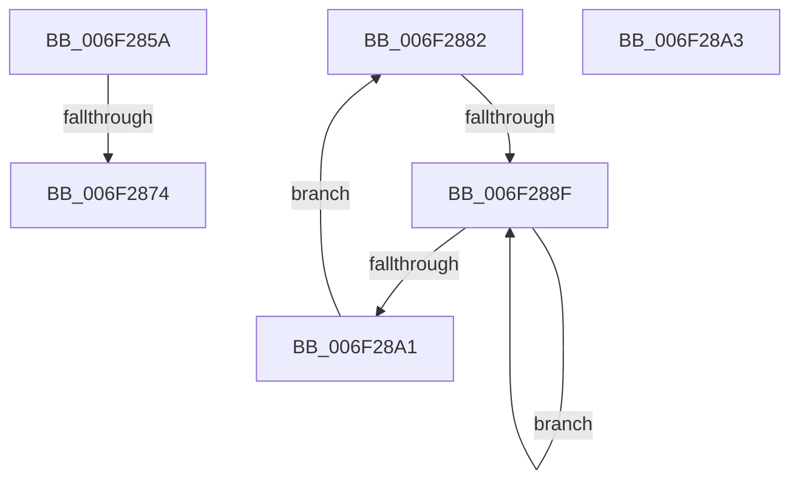

# sub_006F285A

- RVA: `0x006F285A`–`0x006F28B0` (길이 `86` bytes)
- VA: `0x00000001406F285A`
- 실행 섹션: `.text`
- PDB 이름 있음: `아니요`; PDB Function 태그: `아니요`
- unwind 정보 RVA: `0x000AA3E4`
- 디코드: `20`개 명령, `86/86` bytes 표시
- 미해석 바이트: `0` (있으면 어셈블리에 `.byte`로 보존)

> 이 문서는 커널 이미지의 기계어와 PDB 기호를 분석해 생성했습니다. 4번과 5번은 함수 원형과 자료형을 바이너리 사용 방식에서 추정한 C 해석이며 원본 소스 복구 결과는 아닙니다.

## 1. Dependencies

- 직접 호출 지점: **2**; 고유 호출 대상: **2**
- 직접 호출자로 확인된 함수: **0**
- RIP 상대 이미지 참조: **1**

### Outgoing calls
- `0x006F2877` → [KiRaiseIrqlProcessIrqlFlags](../4F/KiRaiseIrqlProcessIrqlFlags_function_004F56FC.md) (function, `0x004F56FC`)
- `0x006F2893` → [KeYieldProcessorEx](../3F/KeYieldProcessorEx_function_003FBD00.md) (function, `0x003FBD00`)

### Direct callers
- 이 함수 시작 RVA로 연결되는 직접 call은 확인되지 않았습니다. 간접 호출은 완전히 역산할 수 없습니다.

### Static image references
- `0x006F2867` → RVA `0x00FC6D20` (`ALMOSTRO`; read)

## 2. Other-region calls and transfers

- 다른 실행 섹션으로 향하는 call: **0**
- call이 아닌 외부 분기/꼬리 이동: **4**
  - `0x006F286E` → [MiInitializeAllResidentPageBasePfns + 0xDC](../46/MiInitializeAllResidentPageBasePfns_function_00462AF8.md) (`tail-transfer`)
  - `0x006F287D` → [MiInitializeAllResidentPageBasePfns + 0xDC](../46/MiInitializeAllResidentPageBasePfns_function_00462AF8.md) (`tail-transfer`)
  - `0x006F2889` → [MiInitializeAllResidentPageBasePfns + 0x143](../46/MiInitializeAllResidentPageBasePfns_function_00462AF8.md) (`tail-transfer`)
  - `0x006F28AB` → [MiInitializeAllResidentPageBasePfns + 0x193](../46/MiInitializeAllResidentPageBasePfns_function_00462AF8.md) (`tail-transfer`)

## 3. Assembly (complete function range)

```asm
006F285A  44 0F 20 C7                     mov rdi, cr8
006F285E  BA 02 00 00 00                  mov edx, 2
006F2863  44 0F 22 C2                     mov cr8, rdx
006F2867  83 3D B2 44 8D 00 00            cmp dword ptr [rip + 0x8d44b2], 0
006F286E  0F 84 60 03 D7 FF               je 0x140462bd4
006F2874  40 8A CF                        mov cl, dil
006F2877  E8 80 2E E0 FF                  call 0x1404f56fc
006F287C  90                              nop
006F287D  E9 52 03 D7 FF                  jmp 0x140462bd4
006F2882  F0 48 0F BA 6B 18 3F            lock bts qword ptr [rbx + 0x18], 0x3f
006F2889  0F 83 AC 03 D7 FF               jae 0x140462c3b
006F288F  48 8D 4D 50                     lea rcx, [rbp + 0x50]
006F2893  E8 68 94 D0 FF                  call 0x1403fbd00
006F2898  48 8B 43 18                     mov rax, qword ptr [rbx + 0x18]
006F289C  48 85 C0                        test rax, rax
006F289F  78 EE                           js 0x1406f288f
006F28A1  EB DF                           jmp 0x1406f2882
006F28A3  40 0F B6 C7                     movzx eax, dil
006F28A7  44 0F 22 C0                     mov cr8, rax
006F28AB  E9 DB 03 D7 FF                  jmp 0x140462c8b
```

## 4. C-style interpretation (structured pseudocode)

```c
__int64 __fastcall sub_006F285A(void)
{
    __int64 result;

    result = KiRaiseIrqlProcessIrqlFlags((unsigned __int8)(v_cr8), 2, a3, a4);
}
```

## 5. (Beta) C Style

```c
void sub_006F285A(void)
{
    int64_t result;

    result = KiRaiseIrqlProcessIrqlFlags((uint8_t)(v_cr8), 2, a3, a4);
}
```

## 6. Execution-region graph

[열기: 2D/3D 그래프와 함수 탐색 컨트롤 패널](../../../control-panel.html?section=text&rva=0x006F285A&view=graph)

- 2D 그래프는 위에서 아래로 흐르고, 3D 그래프는 빈 공간을 드래그해 회전합니다. Shift+드래그는 이동, 휠은 확대·축소, 함수 노드 선택은 대상 보고서 이동입니다.

### Static fallback


