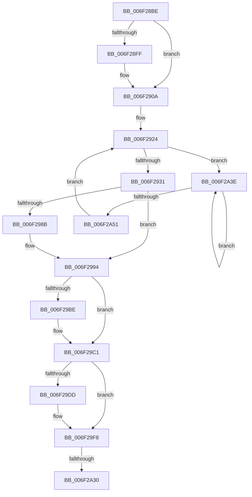

# sub_006F28BE

- RVA: `0x006F28BE`–`0x006F2A56` (길이 `408` bytes)
- VA: `0x00000001406F28BE`
- 실행 섹션: `.text`
- PDB 이름 있음: `아니요`; PDB Function 태그: `아니요`
- unwind 정보 RVA: `0x000AA678`
- 디코드: `85`개 명령, `408/408` bytes 표시
- 미해석 바이트: `0` (있으면 어셈블리에 `.byte`로 보존)

> 이 문서는 커널 이미지의 기계어와 PDB 기호를 분석해 생성했습니다. 4번과 5번은 함수 원형과 자료형을 바이너리 사용 방식에서 추정한 C 해석이며 원본 소스 복구 결과는 아닙니다.

## 1. Dependencies

- 직접 호출 지점: **10**; 고유 호출 대상: **10**
- 직접 호출자로 확인된 함수: **0**
- RIP 상대 이미지 참조: **4**

### Outgoing calls
- `0x006F28CF` → [MiMakeOutswappedPageResident](../43/MiMakeOutswappedPageResident_function_00431AD0.md) (function, `0x00431AD0`)
- `0x006F2905` → [KiRaiseIrqlProcessIrqlFlags](../4F/KiRaiseIrqlProcessIrqlFlags_function_004F56FC.md) (function, `0x004F56FC`)
- `0x006F2959` → [MiSetPfnContainingFrame](../36/MiSetPfnContainingFrame_function_00363FC0.md) (function, `0x00363FC0`)
- `0x006F296D` → [MiSetPageTablePfnBuddy](../4A/MiSetPageTablePfnBuddy_function_004A3394.md) (function, `0x004A3394`)
- `0x006F29CC` → [ExAcquireSpinLockExclusiveAtDpcLevel](../24/ExAcquireSpinLockExclusiveAtDpcLevel_function_00248E80.md) (function, `0x00248E80`)
- `0x006F29F3` → [MiCopyTopLevelMappings](../46/MiCopyTopLevelMappings_function_0046C54C.md) (function, `0x0046C54C`)
- `0x006F2A01` → [MiReturnWsToExpansionList](../35/MiReturnWsToExpansionList_function_003504E0.md) (function, `0x003504E0`)
- `0x006F2A1B` → [MiReleaseSpinLockExclusive](../24/MiReleaseSpinLockExclusive_function_002482C0.md) (function, `0x002482C0`)
- `0x006F2A33` → [EtwTraceInswapProcess](../64/EtwTraceInswapProcess_function_0064FA78.md) (function, `0x0064FA78`)
- `0x006F2A43` → [KeYieldProcessorEx](../3F/KeYieldProcessorEx_function_003FBD00.md) (function, `0x003FBD00`)

### Direct callers
- 이 함수 시작 RVA로 연결되는 직접 call은 확인되지 않았습니다. 간접 호출은 완전히 역산할 수 없습니다.

### Static image references
- `0x006F28F6` → RVA `0x00FC6D20` (`ALMOSTRO`; read)
- `0x006F29A7` → RVA `0x00FC6A87` (`ALMOSTRO`; read)
- `0x006F29C1` → RVA `0x00E374C0` (`.data`; read)
- `0x006F2A20` → RVA `0x00FC6B04` (`ALMOSTRO`; read)

## 2. Other-region calls and transfers

- 다른 실행 섹션으로 향하는 call: **0**
- call이 아닌 외부 분기/꼬리 이동: **2**
  - `0x006F2A2A` → [MmInSwapProcess + 0x2D](../46/MmInSwapProcess_function_00463308.md) (`tail-transfer`)
  - `0x006F2A39` → [MmInSwapProcess + 0x2D](../46/MmInSwapProcess_function_00463308.md) (`tail-transfer`)

## 3. Assembly (complete function range)

```asm
006F28BE  48 B8 68 DF BE 7D FB F6 FF FF   movabs rax, 0xfffff6fb7dbedf68
006F28C8  48 8B D0                        mov rdx, rax
006F28CB  49 83 C8 FF                     or r8, 0xffffffffffffffff
006F28CF  E8 FC F1 D3 FF                  call 0x140431ad0
006F28D4  48 8B F8                        mov rdi, rax
006F28D7  48 B8 FF FF FF FF FF 00 00 00   movabs rax, 0xffffffffff
006F28E1  48 C1 EF 0C                     shr rdi, 0xc
006F28E5  48 23 F8                        and rdi, rax
006F28E8  45 0F 20 C6                     mov r14, cr8
006F28EC  41 BD 02 00 00 00               mov r13d, 2
006F28F2  45 0F 22 C5                     mov cr8, r13
006F28F6  83 3D 23 44 8D 00 00            cmp dword ptr [rip + 0x8d4423], 0
006F28FD  74 0B                           je 0x1406f290a
006F28FF  41 8A D5                        mov dl, r13b
006F2902  41 8A CE                        mov cl, r14b
006F2905  E8 F2 2D E0 FF                  call 0x1404f56fc
006F290A  48 8D 34 7F                     lea rsi, [rdi + rdi*2]
006F290E  48 C1 E6 04                     shl rsi, 4
006F2912  48 B8 00 00 00 00 00 DE FF FF   movabs rax, 0xffffde0000000000
006F291C  48 03 F0                        add rsi, rax
006F291F  83 64 24 50 00                  and dword ptr [rsp + 0x50], 0
006F2924  F0 48 0F BA 6E 18 3F            lock bts qword ptr [rsi + 0x18], 0x3f
006F292B  0F 82 0D 01 00 00               jb 0x1406f2a3e
006F2931  48 8B 46 18                     mov rax, qword ptr [rsi + 0x18]
006F2935  48 8D 48 01                     lea rcx, [rax + 1]
006F2939  48 8B D1                        mov rdx, rcx
006F293C  48 33 D0                        xor rdx, rax
006F293F  48 B8 00 00 00 00 00 00 00 C0   movabs rax, 0xc000000000000000
006F2949  48 23 D0                        and rdx, rax
006F294C  48 33 D1                        xor rdx, rcx
006F294F  48 8B CE                        mov rcx, rsi
006F2952  48 89 56 18                     mov qword ptr [rsi + 0x18], rdx
006F2956  48 8B D7                        mov rdx, rdi
006F2959  E8 62 16 C7 FF                  call 0x140363fc0
006F295E  41 BF 01 00 00 00               mov r15d, 1
006F2964  48 8B D3                        mov rdx, rbx
006F2967  45 8B C7                        mov r8d, r15d
006F296A  48 8B CE                        mov rcx, rsi
006F296D  E8 22 0A DB FF                  call 0x1404a3394
006F2972  48 B9 68 DF BE 7D FB F6 FF FF   movabs rcx, 0xfffff6fb7dbedf68
006F297C  48 8B C1                        mov rax, rcx
006F297F  48 89 46 08                     mov qword ptr [rsi + 8], rax
006F2983  48 8B 06                        mov rax, qword ptr [rsi]
006F2986  41 84 C7                        test r15b, al
006F2989  75 09                           jne 0x1406f2994
006F298B  48 8B 06                        mov rax, qword ptr [rsi]
006F298E  49 0B C7                        or rax, r15
006F2991  48 89 06                        mov qword ptr [rsi], rax
006F2994  48 B8 FF FF FF FF FF FF FF 7F   movabs rax, 0x7fffffffffffffff
006F299E  F0 48 21 46 18                  lock and qword ptr [rsi + 0x18], rax
006F29A3  48 C1 E7 0C                     shl rdi, 0xc
006F29A7  80 3D D9 40 8D 00 00            cmp byte ptr [rip + 0x8d40d9], 0
006F29AE  4C 89 BB 90 04 00 00            mov qword ptr [rbx + 0x490], r15
006F29B5  4C 89 BB 98 04 00 00            mov qword ptr [rbx + 0x498], r15
006F29BC  74 03                           je 0x1406f29c1
006F29BE  49 0B FD                        or rdi, r13
006F29C1  48 8D 0D F8 4A 74 00            lea rcx, [rip + 0x744af8]
006F29C8  48 89 7B 28                     mov qword ptr [rbx + 0x28], rdi
006F29CC  E8 AF 64 B5 FF                  call 0x140248e80
006F29D1  F7 83 F4 01 00 00 00 00 80 00   test dword ptr [rbx + 0x1f4], 0x800000
006F29DB  74 1B                           je 0x1406f29f8
006F29DD  F0 81 A3 F4 01 00 00 FF FF 7F FF  lock and dword ptr [rbx + 0x1f4], 0xff7fffff
006F29E8  48 8B 53 28                     mov rdx, qword ptr [rbx + 0x28]
006F29EC  48 8B CB                        mov rcx, rbx
006F29EF  48 C1 EA 0C                     shr rdx, 0xc
006F29F3  E8 54 9B D7 FF                  call 0x14046c54c
006F29F8  33 D2                           xor edx, edx
006F29FA  48 8D 8B 00 04 00 00            lea rcx, [rbx + 0x400]
006F2A01  E8 DA DA C5 FF                  call 0x1403504e0
006F2A06  F0 81 A3 F4 01 00 00 7F FF FF FF  lock and dword ptr [rbx + 0x1f4], 0xffffff7f
006F2A11  41 8A D6                        mov dl, r14b
006F2A14  48 8D 0D A5 4A 74 00            lea rcx, [rip + 0x744aa5]
006F2A1B  E8 A0 58 B5 FF                  call 0x1402482c0
006F2A20  F7 05 DA 40 8D 00 00 08 00 00   test dword ptr [rip + 0x8d40da], 0x800
006F2A2A  0F 84 05 09 D7 FF               je 0x140463335
006F2A30  48 8B CB                        mov rcx, rbx
006F2A33  E8 40 D0 F5 FF                  call 0x14064fa78
006F2A38  90                              nop
006F2A39  E9 F7 08 D7 FF                  jmp 0x140463335
006F2A3E  48 8D 4C 24 50                  lea rcx, [rsp + 0x50]
006F2A43  E8 B8 92 D0 FF                  call 0x1403fbd00
006F2A48  48 8B 46 18                     mov rax, qword ptr [rsi + 0x18]
006F2A4C  48 85 C0                        test rax, rax
006F2A4F  78 ED                           js 0x1406f2a3e
006F2A51  E9 CE FE FF FF                  jmp 0x1406f2924
```

## 4. C-style interpretation (structured pseudocode)

```c
__int64 __fastcall sub_006F28BE(__int64 a1, __int64 a2, __int64 a3, __int64 a4, __int64 a5, __int64 a6, __int64 a7, __int64 a8, __int64 a9, unsigned int a10)
{
    __int64 result;
    __int64 v_rdi;
    __int64 v_rsi;

    a3 = (a3) | (-1);
    result = MiMakeOutswappedPageResident(a1, result, a3, a4);
    v_rdi = (result) >> (12);
    v_rdi = (v_rdi) & (result);
    if ((*(unsigned int *)(v_rip + 9258019)) != 0) {
        a2 = 2;
        a1 = (unsigned __int8)(v_cr8);
        result = KiRaiseIrqlProcessIrqlFlags(a1, a2, a3, a4);
    }
    v_rsi = (v_rdi + v_rdi * 2) << (4);
    v_rsi = (v_rsi) + (result);
loc_006F2924:
    if (condition_is_below) goto loc_006F2A3E;
    a2 = (*(unsigned __int64 *)(v_rsi + 24) + 1) ^ (*(unsigned __int64 *)(v_rsi + 24));
    a2 = (a2) & (*(unsigned __int64 *)(v_rsi + 24));
    a2 = (a2) ^ (*(unsigned __int64 *)(v_rsi + 24) + 1);
    *(unsigned __int64 *)(v_rsi + 24) = a2;
    result = MiSetPfnContainingFrame(v_rsi, v_rdi, a3, a4);
    result = MiSetPageTablePfnBuddy(v_rsi, v_rbx, 1, a4);
    *(unsigned __int64 *)(v_rsi + 8) = v_rsi;
    result = *(unsigned __int64 *)(v_rsi);
    if (((1) & ((unsigned __int8)(*(unsigned __int64 *)(v_rsi)))) == 0) {
        result = *(unsigned __int64 *)(v_rsi);
        result = (result) | (1);
        *(unsigned __int64 *)(v_rsi) = result;
    }
    v_rdi = (v_rdi) << (12);
    *(unsigned __int64 *)(v_rbx + 1168) = 1;
    *(unsigned __int64 *)(v_rbx + 1176) = 1;
    if ((*(unsigned __int8 *)(v_rip + 9257177)) != 0) {
        v_rdi = (v_rdi) | (2);
    }
    *(unsigned __int64 *)(v_rbx + 40) = v_rdi;
    result = ExAcquireSpinLockExclusiveAtDpcLevel(v_rip + 7621368, v_rbx, 1, a4);
    if (((*(unsigned int *)(v_rbx + 500)) & (0x800000ULL)) != 0) {
        a2 = *(unsigned __int64 *)(v_rbx + 40);
        a1 = v_rbx;
        a2 = (a2) >> (12);
        result = MiCopyTopLevelMappings(a1, a2, 1, a4);
    }
    a2 = 0;
    result = MiReturnWsToExpansionList(v_rbx + 1024, a2, 1, a4);
    result = MiReleaseSpinLockExclusive(v_rip + 7621285, (unsigned __int8)(v_cr8), 1, a4);
    result = EtwTraceInswapProcess(v_rbx, (unsigned __int8)(v_cr8), 1, a4);
loc_006F2A3E:
    result = KeYieldProcessorEx(a10, (unsigned __int8)(v_cr8), 1, a4);
    if (sign_flag) goto loc_006F2A3E;
    goto loc_006F2924;
}
```

## 5. (Beta) C Style

```c
int64_t sub_006F28BE(int64_t Arg1, int64_t Arg2, int64_t Arg3, int64_t Arg4, uint64_t Arg5, uint64_t Arg6, uint64_t Arg7, uint64_t Arg8, uint64_t Arg9, uint32_t Arg10)
{
    int64_t result;
    int64_t local_rdi;
    int64_t local_rsi;

    Arg3 = (Arg3) | (-1);
    result = MiMakeOutswappedPageResident(Arg1, result, Arg3, Arg4);
    local_rdi = (result) >> (12);
    local_rdi = (local_rdi) & (result);
    if ((*(uint32_t *)(v_rip + 0x8D4423)) != 0) {
        Arg2 = 2;
        Arg1 = (uint8_t)(v_cr8);
        result = KiRaiseIrqlProcessIrqlFlags(Arg1, Arg2, Arg3, Arg4);
    }
    local_rsi = (local_rdi + local_rdi * 2) << (4);
    local_rsi = (local_rsi) + (result);
loc_006F2924:
    if (condition_is_below) goto loc_006F2A3E;
    Arg2 = (*(uint64_t *)(local_rsi + 0x18) + 1) ^ (*(uint64_t *)(local_rsi + 0x18));
    Arg2 = (Arg2) & (*(uint64_t *)(local_rsi + 0x18));
    Arg2 = (Arg2) ^ (*(uint64_t *)(local_rsi + 0x18) + 1);
    *(uint64_t *)(local_rsi + 0x18) = Arg2;
    result = MiSetPfnContainingFrame(local_rsi, local_rdi, Arg3, Arg4);
    result = MiSetPageTablePfnBuddy(local_rsi, local_rbx, 1, Arg4);
    *(uint64_t *)(local_rsi + 0x8) = local_rsi;
    result = *(uint64_t *)(local_rsi);
    if (((1) & ((uint8_t)(*(uint64_t *)(local_rsi)))) == 0) {
        result = *(uint64_t *)(local_rsi);
        result = (result) | (1);
        *(uint64_t *)(local_rsi) = result;
    }
    local_rdi = (local_rdi) << (12);
    *(uint64_t *)(local_rbx + 0x490) = 1;
    *(uint64_t *)(local_rbx + 0x498) = 1;
    if ((*(uint8_t *)(v_rip + 0x8D40D9)) != 0) {
        local_rdi = (local_rdi) | (2);
    }
    *(uint64_t *)(local_rbx + 0x28) = local_rdi;
    result = ExAcquireSpinLockExclusiveAtDpcLevel(v_rip + 7621368, local_rbx, 1, Arg4);
    if (((*(uint32_t *)(local_rbx + 0x1F4)) & (0x800000ULL)) != 0) {
        Arg2 = *(uint64_t *)(local_rbx + 0x28);
        Arg1 = local_rbx;
        Arg2 = (Arg2) >> (12);
        result = MiCopyTopLevelMappings(Arg1, Arg2, 1, Arg4);
    }
    Arg2 = 0;
    result = MiReturnWsToExpansionList(local_rbx + 1024, Arg2, 1, Arg4);
    result = MiReleaseSpinLockExclusive(v_rip + 7621285, (uint8_t)(v_cr8), 1, Arg4);
    result = EtwTraceInswapProcess(local_rbx, (uint8_t)(v_cr8), 1, Arg4);
loc_006F2A3E:
    result = KeYieldProcessorEx(Arg10, (uint8_t)(v_cr8), 1, Arg4);
    if (sign_flag) goto loc_006F2A3E;
    goto loc_006F2924;
}
```

## 6. Execution-region graph

[열기: 2D/3D 그래프와 함수 탐색 컨트롤 패널](../../../control-panel.html?section=text&rva=0x006F28BE&view=graph)

- 2D 그래프는 위에서 아래로 흐르고, 3D 그래프는 빈 공간을 드래그해 회전합니다. Shift+드래그는 이동, 휠은 확대·축소, 함수 노드 선택은 대상 보고서 이동입니다.

### Static fallback


