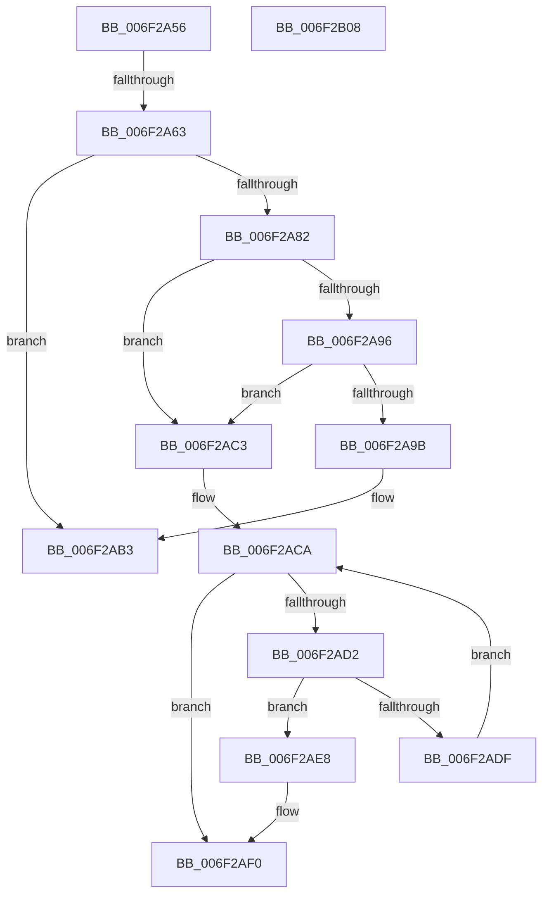

# sub_006F2A56

- RVA: `0x006F2A56`–`0x006F2B30` (길이 `218` bytes)
- VA: `0x00000001406F2A56`
- 실행 섹션: `.text`
- PDB 이름 있음: `아니요`; PDB Function 태그: `아니요`
- unwind 정보 RVA: `0x000AA6CC`
- 디코드: `56`개 명령, `218/218` bytes 표시
- 미해석 바이트: `0` (있으면 어셈블리에 `.byte`로 보존)

> 이 문서는 커널 이미지의 기계어와 PDB 기호를 분석해 생성했습니다. 4번과 5번은 함수 원형과 자료형을 바이너리 사용 방식에서 추정한 C 해석이며 원본 소스 복구 결과는 아닙니다.

## 1. Dependencies

- 직접 호출 지점: **5**; 고유 호출 대상: **4**
- 직접 호출자로 확인된 함수: **0**
- RIP 상대 이미지 참조: **0**

### Outgoing calls
- `0x006F2A6F` → [KeAcquireInStackQueuedSpinLockAtDpcLevel](../27/KeAcquireInStackQueuedSpinLockAtDpcLevel_function_00275740.md) (function, `0x00275740`)
- `0x006F2AB8` → [KeReleaseInStackQueuedSpinLockFromDpcLevel](../21/KeReleaseInStackQueuedSpinLockFromDpcLevel_function_002171B0.md) (function, `0x002171B0`)
- `0x006F2AFD` → [KeReleaseInStackQueuedSpinLock](../34/KeReleaseInStackQueuedSpinLock_function_00342CE0.md) (function, `0x00342CE0`)
- `0x006F2B0D` → [KeReleaseInStackQueuedSpinLock](../34/KeReleaseInStackQueuedSpinLock_function_00342CE0.md) (function, `0x00342CE0`)
- `0x006F2B25` → [KeWaitForSingleObject](../20/KeWaitForSingleObject_function_0020E6B0.md) (function, `0x0020E6B0`)

### Direct callers
- 이 함수 시작 RVA로 연결되는 직접 call은 확인되지 않았습니다. 간접 호출은 완전히 역산할 수 없습니다.

### Static image references
- 디코드된 RIP-relative 메모리 참조가 없습니다.

## 2. Other-region calls and transfers

- 다른 실행 섹션으로 향하는 call: **0**
- call이 아닌 외부 분기/꼬리 이동: **4**
  - `0x006F2A5D` → [CcWaitForUninitializeCacheMap + 0x104](../46/CcWaitForUninitializeCacheMap_function_004633F0.md) (`tail-transfer`)
  - `0x006F2ABE` → [CcWaitForUninitializeCacheMap + 0x104](../46/CcWaitForUninitializeCacheMap_function_004633F0.md) (`tail-transfer`)
  - `0x006F2B03` → [CcWaitForUninitializeCacheMap + 0x6F](../46/CcWaitForUninitializeCacheMap_function_004633F0.md) (`tail-transfer`)
  - `0x006F2B2B` → [CcWaitForUninitializeCacheMap + 0x6F](../46/CcWaitForUninitializeCacheMap_function_004633F0.md) (`tail-transfer`)

## 3. Assembly (complete function range)

```asm
006F2A56  48 39 BB F8 01 00 00            cmp qword ptr [rbx + 0x1f8], rdi
006F2A5D  0F 84 91 0A D7 FF               je 0x1404634f4
006F2A63  49 8D 8F 40 03 00 00            lea rcx, [r15 + 0x340]
006F2A6A  48 8D 54 24 78                  lea rdx, [rsp + 0x78]
006F2A6F  E8 CC 2C B8 FF                  call 0x140275740
006F2A74  48 8B 83 F8 01 00 00            mov rax, qword ptr [rbx + 0x1f8]
006F2A7B  33 D2                           xor edx, edx
006F2A7D  48 85 C0                        test rax, rax
006F2A80  74 31                           je 0x1406f2ab3
006F2A82  48 8B F8                        mov rdi, rax
006F2A85  48 83 E7 FE                     and rdi, 0xfffffffffffffffe
006F2A89  48 8B 0F                        mov rcx, qword ptr [rdi]
006F2A8C  48 8B 47 08                     mov rax, qword ptr [rdi + 8]
006F2A90  48 39 79 08                     cmp qword ptr [rcx + 8], rdi
006F2A94  75 2D                           jne 0x1406f2ac3
006F2A96  48 39 38                        cmp qword ptr [rax], rdi
006F2A99  75 28                           jne 0x1406f2ac3
006F2A9B  48 89 08                        mov qword ptr [rax], rcx
006F2A9E  48 89 41 08                     mov qword ptr [rcx + 8], rax
006F2AA2  48 89 57 08                     mov qword ptr [rdi + 8], rdx
006F2AA6  48 89 17                        mov qword ptr [rdi], rdx
006F2AA9  48 89 93 F8 01 00 00            mov qword ptr [rbx + 0x1f8], rdx
006F2AB0  44 8A F6                        mov r14b, sil
006F2AB3  48 8D 4C 24 78                  lea rcx, [rsp + 0x78]
006F2AB8  E8 F3 46 B2 FF                  call 0x1402171b0
006F2ABD  90                              nop
006F2ABE  E9 31 0A D7 FF                  jmp 0x1404634f4
006F2AC3  B9 03 00 00 00                  mov ecx, 3
006F2AC8  CD 29                           int 0x29
006F2ACA  4C 8B 01                        mov r8, qword ptr [rcx]
006F2ACD  4D 85 C0                        test r8, r8
006F2AD0  74 1E                           je 0x1406f2af0
006F2AD2  48 8D 44 24 30                  lea rax, [rsp + 0x30]
006F2AD7  48 0B C6                        or rax, rsi
006F2ADA  4C 3B C0                        cmp r8, rax
006F2ADD  74 09                           je 0x1406f2ae8
006F2ADF  49 8B C8                        mov rcx, r8
006F2AE2  48 83 E1 FE                     and rcx, 0xfffffffffffffffe
006F2AE6  EB E2                           jmp 0x1406f2aca
006F2AE8  48 8B 44 24 30                  mov rax, qword ptr [rsp + 0x30]
006F2AED  48 89 01                        mov qword ptr [rcx], rax
006F2AF0  0F BA B2 98 00 00 00 10         btr dword ptr [rdx + 0x98], 0x10
006F2AF8  48 8D 4C 24 50                  lea rcx, [rsp + 0x50]
006F2AFD  E8 DE 01 C5 FF                  call 0x140342ce0
006F2B02  90                              nop
006F2B03  E9 57 09 D7 FF                  jmp 0x14046345f
006F2B08  48 8D 4C 24 50                  lea rcx, [rsp + 0x50]
006F2B0D  E8 CE 01 C5 FF                  call 0x140342ce0
006F2B12  48 83 64 24 20 00               and qword ptr [rsp + 0x20], 0
006F2B18  45 33 C9                        xor r9d, r9d
006F2B1B  45 33 C0                        xor r8d, r8d
006F2B1E  33 D2                           xor edx, edx
006F2B20  48 8D 4C 24 38                  lea rcx, [rsp + 0x38]
006F2B25  E8 86 BB B1 FF                  call 0x14020e6b0
006F2B2A  90                              nop
006F2B2B  E9 2F 09 D7 FF                  jmp 0x14046345f
```

## 4. C-style interpretation (structured pseudocode)

```c
__int64 __fastcall sub_006F2A56(__int64 a1, __int64 a2, __int64 a3, int a4, __int64 a5, __int64 a6, __int64 a7, __int64 a8, __int64 a9, __int64 a10, __int64 a11, __int64 a12, __int64 a13, __int64 a14, __int64 a15)
{
    __int64 result;
    __int64 v_rdi;
    unsigned __int64 v_stack_p20;
    unsigned __int64 v_stack_p38;
    unsigned __int64 v_stack_p50;

    result = KeAcquireInStackQueuedSpinLockAtDpcLevel(v_r15 + 832, a15, a3, a4);
    a2 = 0;
    if (*(unsigned __int64 *)(v_rbx + 504) == 0) goto loc_006F2AB3;
    v_rdi = (*(unsigned __int64 *)(v_rbx + 504)) & (-2);
    if ((*(unsigned __int64 *)(*(unsigned __int64 *)(v_rdi) + 8)) != v_rdi) goto loc_006F2AC3;
    if ((*(unsigned __int64 *)(*(unsigned __int64 *)(v_rdi + 8))) != v_rdi) goto loc_006F2AC3;
    *(unsigned __int64 *)(*(unsigned __int64 *)(v_rdi + 8)) = *(unsigned __int64 *)(v_rdi);
    *(unsigned __int64 *)(*(unsigned __int64 *)(v_rdi) + 8) = *(unsigned __int64 *)(v_rdi + 8);
    *(unsigned __int64 *)(v_rdi + 8) = 0;
    *(unsigned __int64 *)(v_rdi) = 0;
    *(unsigned __int64 *)(v_rbx + 504) = 0;
loc_006F2AB3:
    result = KeReleaseInStackQueuedSpinLockFromDpcLevel(a15, a2, a3, a4);
loc_006F2AC3:
loc_006F2ACA:
    if (*(unsigned __int64 *)(3) == 0) goto loc_006F2AF0;
    result = (a6) | (v_rsi);
    if ((*(unsigned __int64 *)(3)) == result) goto loc_006F2AE8;
    a1 = (*(unsigned __int64 *)(3)) & (-2);
    goto loc_006F2ACA;
loc_006F2AE8:
    *(unsigned __int64 *)(a1) = a6;
loc_006F2AF0:
    result = KeReleaseInStackQueuedSpinLock(a10, a2, *(unsigned __int64 *)(3), a4);
}
```

## 5. (Beta) C Style

```c
int64_t sub_006F2A56(int64_t Arg1, int64_t Arg2, int64_t Arg3, int32_t Arg4, uint64_t Arg5, int64_t Arg6, uint64_t Arg7, uint64_t Arg8, uint64_t Arg9, int64_t Arg10, uint64_t Arg11, uint64_t Arg12, uint64_t Arg13, uint64_t Arg14, int64_t Arg15)
{
    int64_t result;
    int64_t local_rdi;
    uint64_t v_stack_p20;
    uint64_t v_stack_p38;
    uint64_t v_stack_p50;

    result = KeAcquireInStackQueuedSpinLockAtDpcLevel(local_r15 + 832, Arg15, Arg3, Arg4);
    Arg2 = 0;
    if (*(uint64_t *)(local_rbx + 0x1F8) == 0) goto loc_006F2AB3;
    local_rdi = (*(uint64_t *)(local_rbx + 0x1F8)) & (-2);
    if ((*(uint64_t *)(*(uint64_t *)(local_rdi) + 0x8)) != local_rdi) goto loc_006F2AC3;
    if ((*(uint64_t *)(*(uint64_t *)(local_rdi + 0x8))) != local_rdi) goto loc_006F2AC3;
    *(uint64_t *)(*(uint64_t *)(local_rdi + 0x8)) = *(uint64_t *)(local_rdi);
    *(uint64_t *)(*(uint64_t *)(local_rdi) + 0x8) = *(uint64_t *)(local_rdi + 0x8);
    *(uint64_t *)(local_rdi + 0x8) = 0;
    *(uint64_t *)(local_rdi) = 0;
    *(uint64_t *)(local_rbx + 0x1F8) = 0;
loc_006F2AB3:
    result = KeReleaseInStackQueuedSpinLockFromDpcLevel(Arg15, Arg2, Arg3, Arg4);
loc_006F2AC3:
loc_006F2ACA:
    if (*(uint64_t *)(3) == 0) goto loc_006F2AF0;
    result = (Arg6) | (local_rsi);
    if ((*(uint64_t *)(3)) == result) goto loc_006F2AE8;
    Arg1 = (*(uint64_t *)(3)) & (-2);
    goto loc_006F2ACA;
loc_006F2AE8:
    *(uint64_t *)(Arg1) = Arg6;
loc_006F2AF0:
    result = KeReleaseInStackQueuedSpinLock(Arg10, Arg2, *(uint64_t *)(3), Arg4);
}
```

## 6. Execution-region graph

[열기: 2D/3D 그래프와 함수 탐색 컨트롤 패널](../../../control-panel.html?section=text&rva=0x006F2A56&view=graph)

- 2D 그래프는 위에서 아래로 흐르고, 3D 그래프는 빈 공간을 드래그해 회전합니다. Shift+드래그는 이동, 휠은 확대·축소, 함수 노드 선택은 대상 보고서 이동입니다.

### Static fallback


