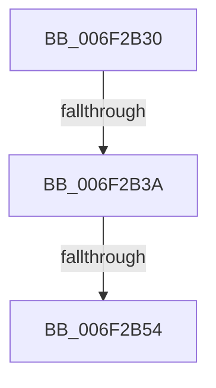

# sub_006F2B30

- RVA: `0x006F2B30`–`0x006F2BB9` (길이 `137` bytes)
- VA: `0x00000001406F2B30`
- 실행 섹션: `.text`
- PDB 이름 있음: `아니요`; PDB Function 태그: `아니요`
- unwind 정보 RVA: `0x000AA70C`
- 디코드: `27`개 명령, `137/137` bytes 표시
- 미해석 바이트: `0` (있으면 어셈블리에 `.byte`로 보존)

> 이 문서는 커널 이미지의 기계어와 PDB 기호를 분석해 생성했습니다. 4번과 5번은 함수 원형과 자료형을 바이너리 사용 방식에서 추정한 C 해석이며 원본 소스 복구 결과는 아닙니다.

## 1. Dependencies

- 직접 호출 지점: **2**; 고유 호출 대상: **2**
- 직접 호출자로 확인된 함수: **0**
- RIP 상대 이미지 참조: **1**

### Outgoing calls
- `0x006F2B47` → [tlgKeywordOn](../42/tlgKeywordOn_function_0042EAA0.md) (function, `0x0042EAA0`)
- `0x006F2BAE` → [tlgWriteEx_EtwWriteEx](../4A/tlgWriteEx_EtwWriteEx_function_004AA348.md) (function, `0x004AA348`)

### Direct callers
- 이 함수 시작 RVA로 연결되는 직접 call은 확인되지 않았습니다. 간접 호출은 완전히 역산할 수 없습니다.

### Static image references
- `0x006F2B66` → RVA `0x00059B61` (`.rdata`; read)

## 2. Other-region calls and transfers

- 다른 실행 섹션으로 향하는 call: **0**
- call이 아닌 외부 분기/꼬리 이동: **3**
  - `0x006F2B34` → [MiStoreLogNotCandidate + 0x37](../46/MiStoreLogNotCandidate_function_00463678.md) (`tail-transfer`)
  - `0x006F2B4E` → [MiStoreLogNotCandidate + 0x37](../46/MiStoreLogNotCandidate_function_00463678.md) (`tail-transfer`)
  - `0x006F2BB4` → [MiStoreLogNotCandidate + 0x37](../46/MiStoreLogNotCandidate_function_00463678.md) (`tail-transfer`)

## 3. Assembly (complete function range)

```asm
006F2B30  41 83 38 05                     cmp dword ptr [r8], 5
006F2B34  0F 86 75 0B D7 FF               jbe 0x1404636af
006F2B3A  48 BA 02 00 00 00 00 40 00 00   movabs rdx, 0x400000000002
006F2B44  49 8B C8                        mov rcx, r8
006F2B47  E8 54 BF D3 FF                  call 0x14042eaa0
006F2B4C  84 C0                           test al, al
006F2B4E  0F 84 5B 0B D7 FF               je 0x1404636af
006F2B54  83 64 24 7C 00                  and dword ptr [rsp + 0x7c], 0
006F2B59  48 8D 44 24 40                  lea rax, [rsp + 0x40]
006F2B5E  83 A4 24 8C 00 00 00 00         and dword ptr [rsp + 0x8c], 0
006F2B66  48 8D 15 F4 6F 96 FF            lea rdx, [rip - 0x69900c]
006F2B6D  B9 04 00 00 00                  mov ecx, 4
006F2B72  48 89 44 24 70                  mov qword ptr [rsp + 0x70], rax
006F2B77  48 8D 44 24 44                  lea rax, [rsp + 0x44]
006F2B7C  44 89 4C 24 40                  mov dword ptr [rsp + 0x40], r9d
006F2B81  48 89 84 24 80 00 00 00         mov qword ptr [rsp + 0x80], rax
006F2B89  48 8D 44 24 50                  lea rax, [rsp + 0x50]
006F2B8E  48 89 44 24 38                  mov qword ptr [rsp + 0x38], rax
006F2B93  89 4C 24 30                     mov dword ptr [rsp + 0x30], ecx
006F2B97  44 8D 49 FD                     lea r9d, [rcx - 3]
006F2B9B  89 4C 24 78                     mov dword ptr [rsp + 0x78], ecx
006F2B9F  89 8C 24 88 00 00 00            mov dword ptr [rsp + 0x88], ecx
006F2BA6  49 8B C8                        mov rcx, r8
006F2BA9  44 89 54 24 44                  mov dword ptr [rsp + 0x44], r10d
006F2BAE  E8 95 77 DB FF                  call 0x1404aa348
006F2BB3  90                              nop
006F2BB4  E9 F6 0A D7 FF                  jmp 0x1404636af
```

## 4. C-style interpretation (structured pseudocode)

```c
__int64 __fastcall sub_006F2B30(__int64 a1, __int64 a2, __int64 a3, int a4, __int64 a5, __int64 a6, __int64 a7, __int64 a8, __int64 a9, __int64 a10)
{
    __int64 result;
    unsigned int v_stack_p30;
    unsigned __int64 v_stack_p38;
    unsigned int v_stack_p40;
    unsigned __int64 v_stack_p44;
    unsigned __int64 v_stack_p70;
    unsigned int v_stack_p78;
    unsigned int v_stack_p7C;
    unsigned __int64 v_stack_p80;
    unsigned int v_stack_p88;
    unsigned int v_stack_p8C;

    result = tlgKeywordOn(a3, a2, a3, a4);
    v_stack_p70 = a8;
    v_stack_p40 = a4;
    v_stack_p80 = v_stack_p44;
    v_stack_p38 = a10;
    v_stack_p30 = 4;
    v_stack_p78 = 4;
    v_stack_p88 = 4;
    v_stack_p44 = (unsigned int)(v_r10);
    result = tlgWriteEx_EtwWriteEx(a3, v_rip - 6918156, a3, 4 - 3);
}
```

## 5. (Beta) C Style

```c
int64_t sub_006F2B30(int64_t Arg1, int64_t Arg2, void *Arg3, int32_t Arg4, uint64_t Arg5, uint64_t Arg6, uint64_t Arg7, int64_t Arg8, uint64_t Arg9, int64_t Arg10)
{
    uint8_t *arg3 = (uint8_t *)Arg3;

    int64_t result;
    uint32_t v_stack_p30;
    uint64_t v_stack_p38;
    uint32_t v_stack_p40;
    uint64_t v_stack_p44;
    uint64_t v_stack_p70;
    uint32_t v_stack_p78;
    uint32_t v_stack_p7C;
    uint64_t v_stack_p80;
    uint32_t v_stack_p88;
    uint32_t v_stack_p8C;

    result = tlgKeywordOn(Arg3, Arg2, Arg3, Arg4);
    v_stack_p70 = Arg8;
    v_stack_p40 = Arg4;
    v_stack_p80 = v_stack_p44;
    v_stack_p38 = Arg10;
    v_stack_p30 = 4;
    v_stack_p78 = 4;
    v_stack_p88 = 4;
    v_stack_p44 = (uint32_t)(local_r10);
    result = tlgWriteEx_EtwWriteEx(Arg3, v_rip - 6918156, Arg3, 4 - 3);
}
```

### 관측된 메모리 오프셋

구조체 형식이 확인되지 않은 접근은 인자 기준의 오프셋으로만 기록했습니다.

| 기준 인자 | 오프셋 표현 | 폭 (bit) | 접근 |
|---|---:|---:|---|
| `Arg3` | `+ 0x0` | `32` | `R` |

## 6. Execution-region graph

[열기: 2D/3D 그래프와 함수 탐색 컨트롤 패널](../../../control-panel.html?section=text&rva=0x006F2B30&view=graph)

- 2D 그래프는 위에서 아래로 흐르고, 3D 그래프는 빈 공간을 드래그해 회전합니다. Shift+드래그는 이동, 휠은 확대·축소, 함수 노드 선택은 대상 보고서 이동입니다.

### Static fallback


