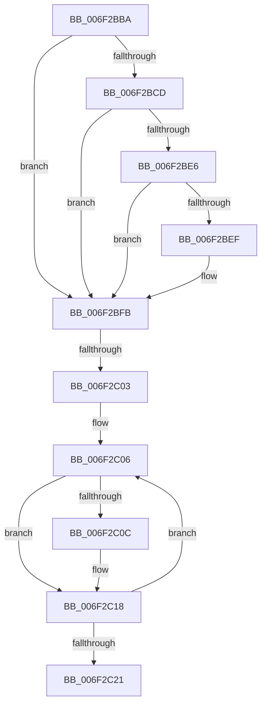

# sub_006F2BBA

- RVA: `0x006F2BBA`–`0x006F2C26` (길이 `108` bytes)
- VA: `0x00000001406F2BBA`
- 실행 섹션: `.text`
- PDB 이름 있음: `아니요`; PDB Function 태그: `아니요`
- unwind 정보 RVA: `0x000AA75C`
- 디코드: `28`개 명령, `108/108` bytes 표시
- 미해석 바이트: `0` (있으면 어셈블리에 `.byte`로 보존)

> 이 문서는 커널 이미지의 기계어와 PDB 기호를 분석해 생성했습니다. 4번과 5번은 함수 원형과 자료형을 바이너리 사용 방식에서 추정한 C 해석이며 원본 소스 복구 결과는 아닙니다.

## 1. Dependencies

- 직접 호출 지점: **3**; 고유 호출 대상: **3**
- 직접 호출자로 확인된 함수: **0**
- RIP 상대 이미지 참조: **2**

### Outgoing calls
- `0x006F2BBF` → [MmUnmapReservedMapping](../3E/MmUnmapReservedMapping_function_003E7BE0.md) (function, `0x003E7BE0`)
- `0x006F2BD1` → [KeReleaseInStackQueuedSpinLockFromDpcLevel](../21/KeReleaseInStackQueuedSpinLockFromDpcLevel_function_002171B0.md) (function, `0x002171B0`)
- `0x006F2BF6` → [ExpInterlockedPushEntrySList](../6B/ExpInterlockedPushEntrySList_function_006BA5B0.md) (function, `0x006BA5B0`)

### Direct callers
- 이 함수 시작 RVA로 연결되는 직접 call은 확인되지 않았습니다. 간접 호출은 완전히 역산할 수 없습니다.

### Static image references
- `0x006F2BC4` → RVA `0x00E3EC38` (`.data`; read)
- `0x006F2BEF` → RVA `0x00E3EC40` (`.data`; read)

## 2. Other-region calls and transfers

- 다른 실행 섹션으로 향하는 call: **0**
- call이 아닌 외부 분기/꼬리 이동: **2**
  - `0x006F2BFD` → [HalpDmaReleaseBufferMappings + 0x25](../46/HalpDmaReleaseBufferMappings_function_004637A0.md) (`tail-transfer`)
  - `0x006F2C21` → [HalpDmaReleaseBufferMappings + 0x25](../46/HalpDmaReleaseBufferMappings_function_004637A0.md) (`tail-transfer`)

## 3. Assembly (complete function range)

```asm
006F2BBA  BA 48 61 6C 44                  mov edx, 0x446c6148
006F2BBF  E8 1C 50 CF FF                  call 0x1403e7be0
006F2BC4  80 3D 6D C0 74 00 00            cmp byte ptr [rip + 0x74c06d], 0
006F2BCB  75 2E                           jne 0x1406f2bfb
006F2BCD  48 8D 4F 18                     lea rcx, [rdi + 0x18]
006F2BD1  E8 DA 45 B2 FF                  call 0x1402171b0
006F2BD6  48 8B 57 10                     mov rdx, qword ptr [rdi + 0x10]
006F2BDA  83 C8 FF                        or eax, 0xffffffff
006F2BDD  F0 0F C1 42 18                  lock xadd dword ptr [rdx + 0x18], eax
006F2BE2  3B C5                           cmp eax, ebp
006F2BE4  75 15                           jne 0x1406f2bfb
006F2BE6  33 C0                           xor eax, eax
006F2BE8  F0 0F B1 6A 1C                  lock cmpxchg dword ptr [rdx + 0x1c], ebp
006F2BED  75 0C                           jne 0x1406f2bfb
006F2BEF  48 8D 0D 4A C0 74 00            lea rcx, [rip + 0x74c04a]
006F2BF6  E8 B5 79 FC FF                  call 0x1406ba5b0
006F2BFB  85 F6                           test esi, esi
006F2BFD  0F 84 C2 0B D7 FF               je 0x1404637c5
006F2C03  48 8B CE                        mov rcx, rsi
006F2C06  F6 43 30 10                     test byte ptr [rbx + 0x30], 0x10
006F2C0A  74 0C                           je 0x1406f2c18
006F2C0C  8B 43 30                        mov eax, dword ptr [rbx + 0x30]
006F2C0F  25 EF 0F 00 00                  and eax, 0xfef
006F2C14  48 89 43 30                     mov qword ptr [rbx + 0x30], rax
006F2C18  48 8B 5B 08                     mov rbx, qword ptr [rbx + 8]
006F2C1C  48 2B CD                        sub rcx, rbp
006F2C1F  75 E5                           jne 0x1406f2c06
006F2C21  E9 9F 0B D7 FF                  jmp 0x1404637c5
```

## 4. C-style interpretation (structured pseudocode)

```c
__int64 __fastcall sub_006F2BBA(void)
{
    __int64 result;

    result = MmUnmapReservedMapping(a1, (unsigned int)(0x446C6148ULL), a3, a4);
    if ((*(unsigned __int8 *)(v_rip + 7651437)) != 0) goto loc_006F2BFB;
    result = KeReleaseInStackQueuedSpinLockFromDpcLevel(v_rdi + 24, (unsigned int)(0x446C6148ULL), a3, a4);
    result = (unsigned int)((result) | (0xFFFFFFFFULL));
    if (((unsigned int)(result)) != ((unsigned int)(v_rbp))) goto loc_006F2BFB;
    result = 0;
    if (!(condition_is_not_equal)) {
        a1 = v_rip + 7651402;
        result = ExpInterlockedPushEntrySList(a1, *(unsigned __int64 *)(v_rdi + 16), a3, a4);
    }
loc_006F2C06:
    if (((*(unsigned __int8 *)(v_rbx + 48)) & (16)) != 0) {
        result = *(unsigned int *)(v_rbx + 48);
        result = (unsigned int)((result) & (0xFEFULL));
        *(unsigned __int64 *)(v_rbx + 48) = result;
    }
    a1 = (v_rsi) - (v_rbp);
    if (condition_is_not_equal) goto loc_006F2C06;
}
```

## 5. (Beta) C Style

```c
void sub_006F2BBA(void)
{
    int64_t result;

    result = MmUnmapReservedMapping(a1, (uint32_t)(0x446C6148ULL), a3, a4);
    if ((*(uint8_t *)(v_rip + 0x74C06D)) != 0) goto loc_006F2BFB;
    result = KeReleaseInStackQueuedSpinLockFromDpcLevel(local_rdi + 24, (uint32_t)(0x446C6148ULL), a3, a4);
    result = (uint32_t)((result) | (0xFFFFFFFFULL));
    if (((uint32_t)(result)) != ((uint32_t)(local_rbp))) goto loc_006F2BFB;
    result = 0;
    if (!(condition_is_not_equal)) {
        a1 = v_rip + 7651402;
        result = ExpInterlockedPushEntrySList(a1, *(uint64_t *)(local_rdi + 0x10), a3, a4);
    }
loc_006F2C06:
    if (((*(uint8_t *)(local_rbx + 0x30)) & (16)) != 0) {
        result = *(uint32_t *)(local_rbx + 0x30);
        result = (uint32_t)((result) & (0xFEFULL));
        *(uint64_t *)(local_rbx + 0x30) = result;
    }
    a1 = (local_rsi) - (local_rbp);
    if (condition_is_not_equal) goto loc_006F2C06;
}
```

## 6. Execution-region graph

[열기: 2D/3D 그래프와 함수 탐색 컨트롤 패널](../../../control-panel.html?section=text&rva=0x006F2BBA&view=graph)

- 2D 그래프는 위에서 아래로 흐르고, 3D 그래프는 빈 공간을 드래그해 회전합니다. Shift+드래그는 이동, 휠은 확대·축소, 함수 노드 선택은 대상 보고서 이동입니다.

### Static fallback


