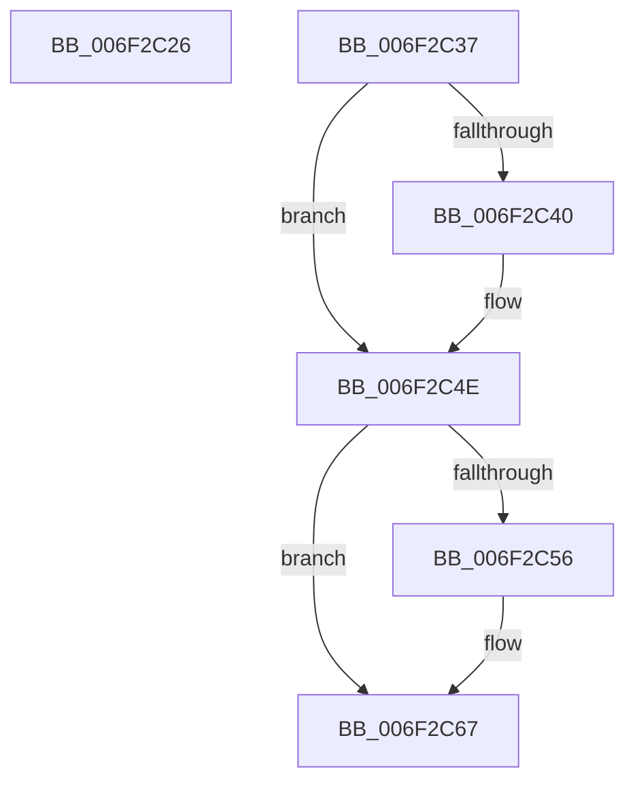

# sub_006F2C26

- RVA: `0x006F2C26`–`0x006F2C92` (길이 `108` bytes)
- VA: `0x00000001406F2C26`
- 실행 섹션: `.text`
- PDB 이름 있음: `아니요`; PDB Function 태그: `아니요`
- unwind 정보 RVA: `0x000AA7C8`
- 디코드: `28`개 명령, `108/108` bytes 표시
- 미해석 바이트: `0` (있으면 어셈블리에 `.byte`로 보존)

> 이 문서는 커널 이미지의 기계어와 PDB 기호를 분석해 생성했습니다. 4번과 5번은 함수 원형과 자료형을 바이너리 사용 방식에서 추정한 C 해석이며 원본 소스 복구 결과는 아닙니다.

## 1. Dependencies

- 직접 호출 지점: **2**; 고유 호출 대상: **1**
- 직접 호출자로 확인된 함수: **0**
- RIP 상대 이미지 참조: **0**

### Outgoing calls
- `0x006F2C2C` → [VmpProcessInvalidateList](../42/VmpProcessInvalidateList_function_00428A54.md) (function, `0x00428A54`)
- `0x006F2C46` → [VmpProcessInvalidateList](../42/VmpProcessInvalidateList_function_00428A54.md) (function, `0x00428A54`)

### Direct callers
- 이 함수 시작 RVA로 연결되는 직접 call은 확인되지 않았습니다. 간접 호출은 완전히 역산할 수 없습니다.

### Static image references
- 디코드된 RIP-relative 메모리 참조가 없습니다.

## 2. Other-region calls and transfers

- 다른 실행 섹션으로 향하는 call: **0**
- call이 아닌 외부 분기/꼬리 이동: **2**
  - `0x006F2C32` → [VmpInsertInvalidateListRange + 0x6E](../46/VmpInsertInvalidateListRange_function_00463B64.md) (`tail-transfer`)
  - `0x006F2C8D` → [VmpInsertInvalidateListRange + 0x101](../46/VmpInsertInvalidateListRange_function_00463B64.md) (`tail-transfer`)

## 3. Assembly (complete function range)

```asm
006F2C26  48 8B D3                        mov rdx, rbx
006F2C29  49 8B CD                        mov rcx, r13
006F2C2C  E8 23 5E D3 FF                  call 0x140428a54
006F2C31  90                              nop
006F2C32  E9 9B 0F D7 FF                  jmp 0x140463bd2
006F2C37  4C 8B E6                        mov r12, rsi
006F2C3A  48 83 3F 00                     cmp qword ptr [rdi], 0
006F2C3E  74 0E                           je 0x1406f2c4e
006F2C40  48 8B D3                        mov rdx, rbx
006F2C43  49 8B CD                        mov rcx, r13
006F2C46  E8 09 5E D3 FF                  call 0x140428a54
006F2C4B  49 8B F4                        mov rsi, r12
006F2C4E  48 8B 0F                        mov rcx, qword ptr [rdi]
006F2C51  48 85 C9                        test rcx, rcx
006F2C54  75 11                           jne 0x1406f2c67
006F2C56  8B 06                           mov eax, dword ptr [rsi]
006F2C58  25 FF 0F 00 00                  and eax, 0xfff
006F2C5D  48 C1 E5 0C                     shl rbp, 0xc
006F2C61  48 0B C5                        or rax, rbp
006F2C64  48 89 06                        mov qword ptr [rsi], rax
006F2C67  48 81 26 00 F0 FF FF            and qword ptr [rsi], 0xfffffffffffff000
006F2C6E  4A 8D 04 39                     lea rax, [rcx + r15]
006F2C72  49 89 06                        mov qword ptr [r14], rax
006F2C75  8B 84 24 88 00 00 00            mov eax, dword ptr [rsp + 0x88]
006F2C7C  C7 43 04 03 00 00 00            mov dword ptr [rbx + 4], 3
006F2C83  66 89 43 06                     mov word ptr [rbx + 6], ax
006F2C87  C7 03 01 00 00 00               mov dword ptr [rbx], 1
006F2C8D  E9 D3 0F D7 FF                  jmp 0x140463c65
```

## 4. C-style interpretation (structured pseudocode)

```c
__int64 __fastcall sub_006F2C26(void)
{
    __int64 result;
    unsigned int v_stack_p88;

    result = VmpProcessInvalidateList(v_r13, v_rbx, a3, a4);
}
```

## 5. (Beta) C Style

```c
void sub_006F2C26(void)
{
    int64_t result;
    uint32_t v_stack_p88;

    result = VmpProcessInvalidateList(local_r13, local_rbx, a3, a4);
}
```

## 6. Execution-region graph

[열기: 2D/3D 그래프와 함수 탐색 컨트롤 패널](../../../control-panel.html?section=text&rva=0x006F2C26&view=graph)

- 2D 그래프는 위에서 아래로 흐르고, 3D 그래프는 빈 공간을 드래그해 회전합니다. Shift+드래그는 이동, 휠은 확대·축소, 함수 노드 선택은 대상 보고서 이동입니다.

### Static fallback


