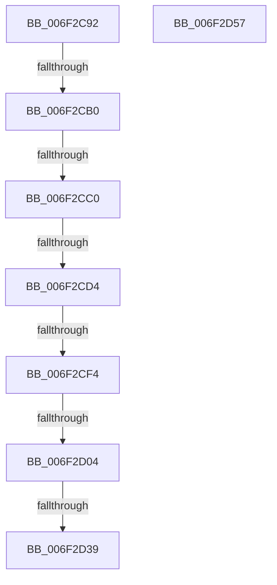

# sub_006F2C92

- RVA: `0x006F2C92`–`0x006F2D5F` (길이 `205` bytes)
- VA: `0x00000001406F2C92`
- 실행 섹션: `.text`
- PDB 이름 있음: `아니요`; PDB Function 태그: `아니요`
- unwind 정보 RVA: `0x000AA9B0`
- 디코드: `42`개 명령, `205/205` bytes 표시
- 미해석 바이트: `0` (있으면 어셈블리에 `.byte`로 보존)

> 이 문서는 커널 이미지의 기계어와 PDB 기호를 분석해 생성했습니다. 4번과 5번은 함수 원형과 자료형을 바이너리 사용 방식에서 추정한 C 해석이며 원본 소스 복구 결과는 아닙니다.

## 1. Dependencies

- 직접 호출 지점: **2**; 고유 호출 대상: **1**
- 직접 호출자로 확인된 함수: **0**
- RIP 상대 이미지 참조: **7**

### Outgoing calls
- `0x006F2CC7` → [MiShouldTrimUnusedSegments](../49/MiShouldTrimUnusedSegments_function_0049D7AC.md) (function, `0x0049D7AC`)
- `0x006F2CF7` → [MiShouldTrimUnusedSegments](../49/MiShouldTrimUnusedSegments_function_0049D7AC.md) (function, `0x0049D7AC`)

### Direct callers
- 이 함수 시작 RVA로 연결되는 직접 call은 확인되지 않았습니다. 간접 호출은 완전히 역산할 수 없습니다.

### Static image references
- `0x006F2C92` → RVA `0x00E3D840` (`.data`; read)
- `0x006F2C99` → RVA `0x00E3D998` (`.data`; read)
- `0x006F2CA0` → RVA `0x00E3CEE0` (`.data`; read)
- `0x006F2CB0` → RVA `0x00E3CEC8` (`.data`; read)
- `0x006F2CC0` → RVA `0x00E38D00` (`.data`; read)
- `0x006F2CE1` → RVA `0x00E3D550` (`.data`; read)
- `0x006F2D04` → RVA `0x00E2CD18` (`.data`; read)

## 2. Other-region calls and transfers

- 다른 실행 섹션으로 향하는 call: **0**
- call이 아닌 외부 분기/꼬리 이동: **8**
  - `0x006F2CAA` → [MiComputeUnusedSegmentReduction + 0x94](../46/MiComputeUnusedSegmentReduction_function_00464E58.md) (`tail-transfer`)
  - `0x006F2CBA` → [MiComputeUnusedSegmentReduction + 0x94](../46/MiComputeUnusedSegmentReduction_function_00464E58.md) (`tail-transfer`)
  - `0x006F2CCE` → [MiComputeUnusedSegmentReduction + 0x94](../46/MiComputeUnusedSegmentReduction_function_00464E58.md) (`tail-transfer`)
  - `0x006F2CEE` → [MiComputeUnusedSegmentReduction + 0x94](../46/MiComputeUnusedSegmentReduction_function_00464E58.md) (`tail-transfer`)
  - `0x006F2CFE` → [MiComputeUnusedSegmentReduction + 0x94](../46/MiComputeUnusedSegmentReduction_function_00464E58.md) (`tail-transfer`)
  - `0x006F2D33` → [MiComputeUnusedSegmentReduction + 0x94](../46/MiComputeUnusedSegmentReduction_function_00464E58.md) (`tail-transfer`)
  - `0x006F2D52` → [MiComputeUnusedSegmentReduction + 0x94](../46/MiComputeUnusedSegmentReduction_function_00464E58.md) (`tail-transfer`)
  - `0x006F2D5A` → [MiComputeUnusedSegmentReduction + 0x94](../46/MiComputeUnusedSegmentReduction_function_00464E58.md) (`tail-transfer`)

## 3. Assembly (complete function range)

```asm
006F2C92  48 8B 0D A7 AB 74 00            mov rcx, qword ptr [rip + 0x74aba7]
006F2C99  48 8B 15 F8 AC 74 00            mov rdx, qword ptr [rip + 0x74acf8]
006F2CA0  48 8B 05 39 A2 74 00            mov rax, qword ptr [rip + 0x74a239]
006F2CA7  48 3B C8                        cmp rcx, rax
006F2CAA  0F 86 3C 22 D7 FF               jbe 0x140464eec
006F2CB0  48 8B 05 11 A2 74 00            mov rax, qword ptr [rip + 0x74a211]
006F2CB7  48 3B D0                        cmp rdx, rax
006F2CBA  0F 85 2C 22 D7 FF               jne 0x140464eec
006F2CC0  48 8D 0D 39 60 74 00            lea rcx, [rip + 0x746039]
006F2CC7  E8 E0 AA DA FF                  call 0x14049d7ac
006F2CCC  85 C0                           test eax, eax
006F2CCE  0F 84 18 22 D7 FF               je 0x140464eec
006F2CD4  48 69 85 50 48 00 00 E8 03 00 00  imul rax, qword ptr [rbp + 0x4850], 0x3e8
006F2CDF  33 D2                           xor edx, edx
006F2CE1  48 F7 35 68 A8 74 00            div qword ptr [rip + 0x74a868]
006F2CE8  4C 8B D0                        mov r10, rax
006F2CEB  48 85 C0                        test rax, rax
006F2CEE  0F 84 F8 21 D7 FF               je 0x140464eec
006F2CF4  48 8B CD                        mov rcx, rbp
006F2CF7  E8 B0 AA DA FF                  call 0x14049d7ac
006F2CFC  85 C0                           test eax, eax
006F2CFE  0F 84 E8 21 D7 FF               je 0x140464eec
006F2D04  48 8B 0D 0D A0 73 00            mov rcx, qword ptr [rip + 0x73a00d]
006F2D0B  48 B8 77 BE 9F 1A 2F DD 24 06   movabs rax, 0x624dd2f1a9fbe77
006F2D15  48 F7 E1                        mul rcx
006F2D18  48 2B CA                        sub rcx, rdx
006F2D1B  48 D1 E9                        shr rcx, 1
006F2D1E  48 03 CA                        add rcx, rdx
006F2D21  48 8B 95 38 08 00 00            mov rdx, qword ptr [rbp + 0x838]
006F2D28  48 C1 E9 09                     shr rcx, 9
006F2D2C  49 0F AF CA                     imul rcx, r10
006F2D30  49 3B D3                        cmp rdx, r11
006F2D33  0F 86 B3 21 D7 FF               jbe 0x140464eec
006F2D39  48 8D 82 00 00 F0 FF            lea rax, [rdx - 0x100000]
006F2D40  48 3B C8                        cmp rcx, rax
006F2D43  48 0F 46 C1                     cmovbe rax, rcx
006F2D47  48 2B D0                        sub rdx, rax
006F2D4A  48 C1 EA 0C                     shr rdx, 0xc
006F2D4E  49 89 56 08                     mov qword ptr [r14 + 8], rdx
006F2D52  E9 95 21 D7 FF                  jmp 0x140464eec
006F2D57  49 89 1E                        mov qword ptr [r14], rbx
006F2D5A  E9 8D 21 D7 FF                  jmp 0x140464eec
```

## 4. C-style interpretation (structured pseudocode)

```c
__int64 __fastcall sub_006F2C92(void)
{
    __int64 result;

    result = MiShouldTrimUnusedSegments(v_rip + 7626809, *(unsigned __int64 *)(v_rip + 7646456), a3, a4);
    result = (result) * (*(unsigned __int64 *)(v_rbp + 18512));
    a2 = 0;
    result = MiShouldTrimUnusedSegments(v_rbp, a2, a3, a4);
    a1 = (*(unsigned __int64 *)(v_rip + 7577613)) - (0);
    a1 = (a1) >> (1);
    a1 = (a1) + (0);
    a1 = (a1) >> (9);
    a1 = (a1) * (result);
    result = *(unsigned __int64 *)(v_rbp + 2104) - 1048576;
    if (a1 <= (*(unsigned __int64 *)(v_rbp + 2104) - 1048576)) { result = a1; }
    a2 = (*(unsigned __int64 *)(v_rbp + 2104)) - (result);
    a2 = (a2) >> (12);
    *(unsigned __int64 *)(v_r14 + 8) = a2;
}
```

## 5. (Beta) C Style

```c
void sub_006F2C92(void)
{
    int64_t result;

    result = MiShouldTrimUnusedSegments(v_rip + 7626809, *(uint64_t *)(v_rip + 0x74ACF8), a3, a4);
    result = (result) * (*(uint64_t *)(local_rbp + 0x4850));
    a2 = 0;
    result = MiShouldTrimUnusedSegments(local_rbp, a2, a3, a4);
    a1 = (*(uint64_t *)(v_rip + 0x73A00D)) - (0);
    a1 = (a1) >> (1);
    a1 = (a1) + (0);
    a1 = (a1) >> (9);
    a1 = (a1) * (result);
    result = *(uint64_t *)(local_rbp + 0x838) - 1048576;
    if (a1 <= (*(uint64_t *)(local_rbp + 0x838) - 1048576)) { result = a1; }
    a2 = (*(uint64_t *)(local_rbp + 0x838)) - (result);
    a2 = (a2) >> (12);
    *(uint64_t *)(local_r14 + 0x8) = a2;
}
```

## 6. Execution-region graph

[열기: 2D/3D 그래프와 함수 탐색 컨트롤 패널](../../../control-panel.html?section=text&rva=0x006F2C92&view=graph)

- 2D 그래프는 위에서 아래로 흐르고, 3D 그래프는 빈 공간을 드래그해 회전합니다. Shift+드래그는 이동, 휠은 확대·축소, 함수 노드 선택은 대상 보고서 이동입니다.

### Static fallback


