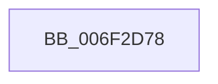

# sub_006F2D78

- RVA: `0x006F2D78`–`0x006F2DE2` (길이 `106` bytes)
- VA: `0x00000001406F2D78`
- 실행 섹션: `.text`
- PDB 이름 있음: `아니요`; PDB Function 태그: `아니요`
- unwind 정보 RVA: `0x000AAA20`
- 디코드: `28`개 명령, `106/106` bytes 표시
- 미해석 바이트: `0` (있으면 어셈블리에 `.byte`로 보존)

> 이 문서는 커널 이미지의 기계어와 PDB 기호를 분석해 생성했습니다. 4번과 5번은 함수 원형과 자료형을 바이너리 사용 방식에서 추정한 C 해석이며 원본 소스 복구 결과는 아닙니다.

## 1. Dependencies

- 직접 호출 지점: **5**; 고유 호출 대상: **5**
- 직접 호출자로 확인된 함수: **0**
- RIP 상대 이미지 참조: **0**

### Outgoing calls
- `0x006F2D7D` → [MiLockVadCore](../29/MiLockVadCore_function_00297170.md) (function, `0x00297170`)
- `0x006F2D8A` → [MiLocateLockedVadEvent](../2A/MiLocateLockedVadEvent_function_002A7A0C.md) (function, `0x002A7A0C`)
- `0x006F2DAB` → [MiGetVadMandatoryPageSize](../2A/MiGetVadMandatoryPageSize_function_002A85F0.md) (function, `0x002A85F0`)
- `0x006F2DB7` → [ExAcquireSpinLockExclusiveAtDpcLevel](../24/ExAcquireSpinLockExclusiveAtDpcLevel_function_00248E80.md) (function, `0x00248E80`)
- `0x006F2DD7` → [ExReleaseSpinLockExclusiveFromDpcLevel](../24/ExReleaseSpinLockExclusiveFromDpcLevel_function_002497E0.md) (function, `0x002497E0`)

### Direct callers
- 이 함수 시작 RVA로 연결되는 직접 call은 확인되지 않았습니다. 간접 호출은 완전히 역산할 수 없습니다.

### Static image references
- 디코드된 RIP-relative 메모리 참조가 없습니다.

## 2. Other-region calls and transfers

- 다른 실행 섹션으로 향하는 call: **0**
- call이 아닌 외부 분기/꼬리 이동: **1**
  - `0x006F2DDD` → [MiCaptureWriteWatchDirtyBit + 0x65](../46/MiCaptureWriteWatchDirtyBit_function_00465224.md) (`tail-transfer`)

## 3. Assembly (complete function range)

```asm
006F2D78  8B D7                           mov edx, edi
006F2D7A  48 8B CB                        mov rcx, rbx
006F2D7D  E8 EE 43 BA FF                  call 0x140297170
006F2D82  BA 04 00 00 00                  mov edx, 4
006F2D87  48 8B CB                        mov rcx, rbx
006F2D8A  E8 7D 4C BB FF                  call 0x1402a7a0c
006F2D8F  48 8B E8                        mov rbp, rax
006F2D92  F0 81 63 30 FC FF FF 7F         lock and dword ptr [rbx + 0x30], 0x7ffffffc
006F2D9A  8B 4B 18                        mov ecx, dword ptr [rbx + 0x18]
006F2D9D  0F B6 7B 20                     movzx edi, byte ptr [rbx + 0x20]
006F2DA1  48 C1 E7 20                     shl rdi, 0x20
006F2DA5  48 0B F9                        or rdi, rcx
006F2DA8  48 8B CB                        mov rcx, rbx
006F2DAB  E8 40 58 BB FF                  call 0x1402a85f0
006F2DB0  48 8D 4D 08                     lea rcx, [rbp + 8]
006F2DB4  48 8B D8                        mov rbx, rax
006F2DB7  E8 C4 60 B5 FF                  call 0x140248e80
006F2DBC  33 D2                           xor edx, edx
006F2DBE  49 C1 EE 0C                     shr r14, 0xc
006F2DC2  4C 2B F7                        sub r14, rdi
006F2DC5  48 8D 4D 08                     lea rcx, [rbp + 8]
006F2DC9  49 8B C6                        mov rax, r14
006F2DCC  48 F7 F3                        div rbx
006F2DCF  48 8B 55 18                     mov rdx, qword ptr [rbp + 0x18]
006F2DD3  48 0F AB 02                     bts qword ptr [rdx], rax
006F2DD7  E8 04 6A B5 FF                  call 0x1402497e0
006F2DDC  90                              nop
006F2DDD  E9 A7 24 D7 FF                  jmp 0x140465289
```

## 4. C-style interpretation (structured pseudocode)

```c
__int64 __fastcall sub_006F2D78(void)
{
    __int64 result;
    __int64 v_r14;
    __int64 v_rdi;

    result = MiLockVadCore(v_rbx, (unsigned int)((unsigned int)(v_rdi)), a3, a4);
    result = MiLocateLockedVadEvent(v_rbx, 4, a3, a4);
    v_rdi = (*(unsigned __int8 *)(v_rbx + 32)) << (32);
    v_rdi = (v_rdi) | ((unsigned int)(*(unsigned int *)(v_rbx + 24)));
    result = MiGetVadMandatoryPageSize(v_rbx, 4, a3, a4);
    result = ExAcquireSpinLockExclusiveAtDpcLevel(result + 8, 4, a3, a4);
    a2 = 0;
    v_r14 = (v_r14) >> (12);
    v_r14 = (v_r14) - (v_rdi);
    result = ExReleaseSpinLockExclusiveFromDpcLevel(result + 8, *(unsigned __int64 *)(result + 24), a3, a4);
}
```

## 5. (Beta) C Style

```c
void sub_006F2D78(void)
{
    int64_t result;
    int64_t local_r14;
    int64_t local_rdi;

    result = MiLockVadCore(local_rbx, (uint32_t)((uint32_t)(local_rdi)), a3, a4);
    result = MiLocateLockedVadEvent(local_rbx, 4, a3, a4);
    local_rdi = (*(uint8_t *)(local_rbx + 0x20)) << (32);
    local_rdi = (local_rdi) | ((uint32_t)(*(uint32_t *)(local_rbx + 0x18)));
    result = MiGetVadMandatoryPageSize(local_rbx, 4, a3, a4);
    result = ExAcquireSpinLockExclusiveAtDpcLevel(result + 8, 4, a3, a4);
    a2 = 0;
    local_r14 = (local_r14) >> (12);
    local_r14 = (local_r14) - (local_rdi);
    result = ExReleaseSpinLockExclusiveFromDpcLevel(result + 8, *(uint64_t *)(result + 0x18), a3, a4);
}
```

## 6. Execution-region graph

[열기: 2D/3D 그래프와 함수 탐색 컨트롤 패널](../../../control-panel.html?section=text&rva=0x006F2D78&view=graph)

- 2D 그래프는 위에서 아래로 흐르고, 3D 그래프는 빈 공간을 드래그해 회전합니다. Shift+드래그는 이동, 휠은 확대·축소, 함수 노드 선택은 대상 보고서 이동입니다.

### Static fallback


