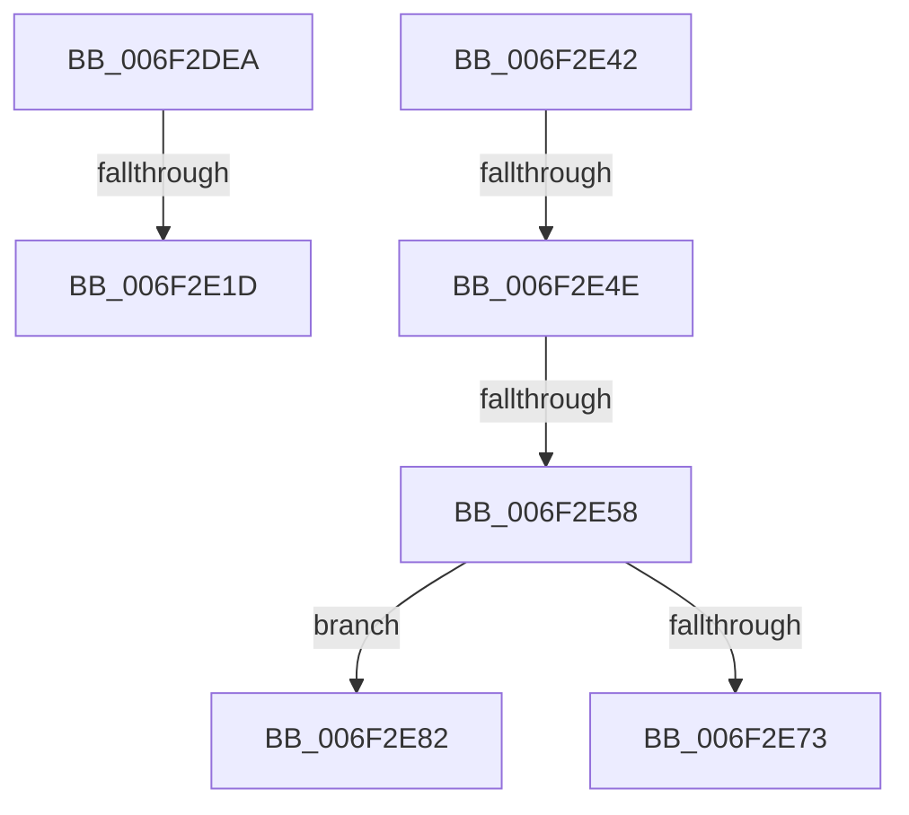

# sub_006F2DEA

- RVA: `0x006F2DEA`–`0x006F2E8E` (길이 `164` bytes)
- VA: `0x00000001406F2DEA`
- 실행 섹션: `.text`
- PDB 이름 있음: `아니요`; PDB Function 태그: `아니요`
- unwind 정보 RVA: `0x000AB054`
- 디코드: `40`개 명령, `164/164` bytes 표시
- 미해석 바이트: `0` (있으면 어셈블리에 `.byte`로 보존)

> 이 문서는 커널 이미지의 기계어와 PDB 기호를 분석해 생성했습니다. 4번과 5번은 함수 원형과 자료형을 바이너리 사용 방식에서 추정한 C 해석이며 원본 소스 복구 결과는 아닙니다.

## 1. Dependencies

- 직접 호출 지점: **3**; 고유 호출 대상: **3**
- 직접 호출자로 확인된 함수: **0**
- RIP 상대 이미지 참조: **0**

### Outgoing calls
- `0x006F2E0E` → [guard_dispatch_icall](../6B/guard_dispatch_icall_function_006BAAD0.md) (function, `0x006BAAD0`)
- `0x006F2E6A` → [HalpDmaUseEmergencyLogicalAddressResources](../53/HalpDmaUseEmergencyLogicalAddressResources_function_0053E5C4.md) (function, `0x0053E5C4`)
- `0x006F2E76` → [HalpConstructScatterGatherListDmarThin](../46/HalpConstructScatterGatherListDmarThin_function_00467D30.md) (function, `0x00467D30`)

### Direct callers
- 이 함수 시작 RVA로 연결되는 직접 call은 확인되지 않았습니다. 간접 호출은 완전히 역산할 수 없습니다.

### Static image references
- 디코드된 RIP-relative 메모리 참조가 없습니다.

## 2. Other-region calls and transfers

- 다른 실행 섹션으로 향하는 call: **0**
- call이 아닌 외부 분기/꼬리 이동: **6**
  - `0x006F2E17` → [HalpConstructScatterGatherListDmarThin + 0x199](../46/HalpConstructScatterGatherListDmarThin_function_00467D30.md) (`tail-transfer`)
  - `0x006F2E3D` → [HalpConstructScatterGatherListDmarThin + 0x16F](../46/HalpConstructScatterGatherListDmarThin_function_00467D30.md) (`tail-transfer`)
  - `0x006F2E48` → [HalpConstructScatterGatherListDmarThin + 0x1CF](../46/HalpConstructScatterGatherListDmarThin_function_00467D30.md) (`tail-transfer`)
  - `0x006F2E52` → [HalpConstructScatterGatherListDmarThin + 0x1CF](../46/HalpConstructScatterGatherListDmarThin_function_00467D30.md) (`tail-transfer`)
  - `0x006F2E7D` → [HalpConstructScatterGatherListDmarThin + 0x1CF](../46/HalpConstructScatterGatherListDmarThin_function_00467D30.md) (`tail-transfer`)
  - `0x006F2E89` → [HalpConstructScatterGatherListDmarThin + 0x1CF](../46/HalpConstructScatterGatherListDmarThin_function_00467D30.md) (`tail-transfer`)

## 3. Assembly (complete function range)

```asm
006F2DEA  48 8B 80 90 00 00 00            mov rax, qword ptr [rax + 0x90]
006F2DF1  48 8D 4D F7                     lea rcx, [rbp - 9]
006F2DF5  48 89 4C 24 20                  mov qword ptr [rsp + 0x20], rcx
006F2DFA  4C 8D 4D BF                     lea r9, [rbp - 0x41]
006F2DFE  49 8B 8B 30 02 00 00            mov rcx, qword ptr [r11 + 0x230]
006F2E05  41 B8 03 00 00 00               mov r8d, 3
006F2E0B  49 8B D2                        mov rdx, r10
006F2E0E  E8 BD 7C FC FF                  call 0x1406baad0
006F2E13  8B F8                           mov edi, eax
006F2E15  85 C0                           test eax, eax
006F2E17  0F 88 AC 50 D7 FF               js 0x140467ec9
006F2E1D  4C 8B 55 7F                     mov r10, qword ptr [rbp + 0x7f]
006F2E21  4C 8B 5D B7                     mov r11, qword ptr [rbp - 0x49]
006F2E25  49 8B 83 30 02 00 00            mov rax, qword ptr [r11 + 0x230]
006F2E2C  48 8B 00                        mov rax, qword ptr [rax]
006F2E2F  49 03 C2                        add rax, r10
006F2E32  4D 03 D5                        add r10, r13
006F2E35  48 89 45 77                     mov qword ptr [rbp + 0x77], rax
006F2E39  4C 89 55 7F                     mov qword ptr [rbp + 0x7f], r10
006F2E3D  E9 5D 50 D7 FF                  jmp 0x140467e9f
006F2E42  81 FF 20 01 00 C0               cmp edi, 0xc0000120
006F2E48  0F 84 B1 50 D7 FF               je 0x140467eff
006F2E4E  80 7B 62 00                     cmp byte ptr [rbx + 0x62], 0
006F2E52  0F 85 A7 50 D7 FF               jne 0x140467eff
006F2E58  48 8B 4D B7                     mov rcx, qword ptr [rbp - 0x49]
006F2E5C  45 84 ED                        test r13b, r13b
006F2E5F  48 8B D3                        mov rdx, rbx
006F2E62  C6 43 62 01                     mov byte ptr [rbx + 0x62], 1
006F2E66  41 0F 94 C0                     sete r8b
006F2E6A  E8 55 B7 E4 FF                  call 0x14053e5c4
006F2E6F  84 C0                           test al, al
006F2E71  74 0F                           je 0x1406f2e82
006F2E73  48 8B CB                        mov rcx, rbx
006F2E76  E8 B5 4E D7 FF                  call 0x140467d30
006F2E7B  8B F8                           mov edi, eax
006F2E7D  E9 7D 50 D7 FF                  jmp 0x140467eff
006F2E82  41 F6 DD                        neg r13b
006F2E85  1B C0                           sbb eax, eax
006F2E87  23 F8                           and edi, eax
006F2E89  E9 71 50 D7 FF                  jmp 0x140467eff
```

## 4. C-style interpretation (structured pseudocode)

```c
__int64 __fastcall sub_006F2DEA(void)
{
    __int64 result;
    __int64 v_r10;
    unsigned __int64 v_stack_p20;

    v_stack_p20 = v_rbp - 9;
    result = guard_dispatch_icall(*(unsigned __int64 *)(v_r11 + 560), v_r10, 3, v_rbp - 65);
    result = (*(unsigned __int64 *)(*(unsigned __int64 *)(*(unsigned __int64 *)(v_rbp - 73) + 560))) + (*(unsigned __int64 *)(v_rbp + 127));
    v_r10 = (*(unsigned __int64 *)(v_rbp + 127)) + (v_r13);
    *(unsigned __int64 *)(v_rbp + 119) = result;
    *(unsigned __int64 *)(v_rbp + 127) = v_r10;
}
```

## 5. (Beta) C Style

```c
void sub_006F2DEA(void)
{
    int64_t result;
    int64_t local_r10;
    uint64_t v_stack_p20;

    v_stack_p20 = local_rbp - 9;
    result = guard_dispatch_icall(*(uint64_t *)(local_r11 + 0x230), local_r10, 3, local_rbp - 65);
    result = (*(uint64_t *)(*(uint64_t *)(*(uint64_t *)(local_rbp - 0x49) + 0x230))) + (*(uint64_t *)(local_rbp + 0x7F));
    local_r10 = (*(uint64_t *)(local_rbp + 0x7F)) + (local_r13);
    *(uint64_t *)(local_rbp + 0x77) = result;
    *(uint64_t *)(local_rbp + 0x7F) = local_r10;
}
```

## 6. Execution-region graph

[열기: 2D/3D 그래프와 함수 탐색 컨트롤 패널](../../../control-panel.html?section=text&rva=0x006F2DEA&view=graph)

- 2D 그래프는 위에서 아래로 흐르고, 3D 그래프는 빈 공간을 드래그해 회전합니다. Shift+드래그는 이동, 휠은 확대·축소, 함수 노드 선택은 대상 보고서 이동입니다.

### Static fallback


