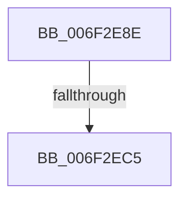

# sub_006F2E8E

- RVA: `0x006F2E8E`–`0x006F2EEA` (길이 `92` bytes)
- VA: `0x00000001406F2E8E`
- 실행 섹션: `.text`
- PDB 이름 있음: `아니요`; PDB Function 태그: `아니요`
- unwind 정보 RVA: `0x000AB118`
- 디코드: `21`개 명령, `92/92` bytes 표시
- 미해석 바이트: `0` (있으면 어셈블리에 `.byte`로 보존)

> 이 문서는 커널 이미지의 기계어와 PDB 기호를 분석해 생성했습니다. 4번과 5번은 함수 원형과 자료형을 바이너리 사용 방식에서 추정한 C 해석이며 원본 소스 복구 결과는 아닙니다.

## 1. Dependencies

- 직접 호출 지점: **0**; 고유 호출 대상: **0**
- 직접 호출자로 확인된 함수: **0**
- RIP 상대 이미지 참조: **0**

### Outgoing calls
- 직접 디코드된 call 명령이 없습니다.

### Direct callers
- 이 함수 시작 RVA로 연결되는 직접 call은 확인되지 않았습니다. 간접 호출은 완전히 역산할 수 없습니다.

### Static image references
- 디코드된 RIP-relative 메모리 참조가 없습니다.

## 2. Other-region calls and transfers

- 다른 실행 섹션으로 향하는 call: **0**
- call이 아닌 외부 분기/꼬리 이동: **2**
  - `0x006F2EBF` → [KiDispatchCallout + 0xFE](../46/KiDispatchCallout_function_00468CE0.md) (`tail-transfer`)
  - `0x006F2EE5` → [KiDispatchCallout + 0xFE](../46/KiDispatchCallout_function_00468CE0.md) (`tail-transfer`)

## 3. Assembly (complete function range)

```asm
006F2E8E  48 B8 29 26 02 29 26 0A C1 05   movabs rax, 0x5c10a2629022629
006F2E98  48 89 44 24 40                  mov qword ptr [rsp + 0x40], rax
006F2E9D  48 8B 4C 24 40                  mov rcx, qword ptr [rsp + 0x40]
006F2EA2  48 8B 44 24 40                  mov rax, qword ptr [rsp + 0x40]
006F2EA7  48 C1 E0 0B                     shl rax, 0xb
006F2EAB  48 C1 E9 35                     shr rcx, 0x35
006F2EAF  48 0B C1                        or rax, rcx
006F2EB2  48 89 44 24 40                  mov qword ptr [rsp + 0x40], rax
006F2EB7  48 8B 44 24 40                  mov rax, qword ptr [rsp + 0x40]
006F2EBC  49 3B 02                        cmp rax, qword ptr [r10]
006F2EBF  0F 84 19 5F D7 FF               je 0x140468dde
006F2EC5  48 8B 44 24 40                  mov rax, qword ptr [rsp + 0x40]
006F2ECA  49 33 01                        xor rax, qword ptr [r9]
006F2ECD  49 33 02                        xor rax, qword ptr [r10]
006F2ED0  49 89 01                        mov qword ptr [r9], rax
006F2ED3  48 8B 44 24 40                  mov rax, qword ptr [rsp + 0x40]
006F2ED8  49 33 01                        xor rax, qword ptr [r9]
006F2EDB  41 03 59 04                     add ebx, dword ptr [r9 + 4]
006F2EDF  49 33 02                        xor rax, qword ptr [r10]
006F2EE2  49 89 01                        mov qword ptr [r9], rax
006F2EE5  E9 F4 5E D7 FF                  jmp 0x140468dde
```

## 4. C-style interpretation (structured pseudocode)

```c
__int64 __fastcall sub_006F2E8E(__int64 a1, __int64 a2, __int64 a3, __int64 a4, __int64 a5, __int64 a6, __int64 a7, __int64 a8)
{
    __int64 result;
    __int64 v_rbx;
    unsigned __int64 v_stack_p40;

    v_stack_p40 = result;
    result = (a8) << (11);
    a1 = (a8) >> (53);
    result = (result) | (a1);
    v_stack_p40 = result;
    result = (a8) ^ (*(unsigned __int64 *)(a4));
    result = (result) ^ (*(unsigned __int64 *)(v_r10));
    *(unsigned __int64 *)(a4) = result;
    result = (a8) ^ (*(unsigned __int64 *)(a4));
    v_rbx = (unsigned int)((v_rbx) + (*(unsigned int *)(a4 + 4)));
    result = (result) ^ (*(unsigned __int64 *)(v_r10));
    *(unsigned __int64 *)(a4) = result;
}
```

## 5. (Beta) C Style

```c
int64_t sub_006F2E8E(int64_t Arg1, int64_t Arg2, int64_t Arg3, void *Arg4, uint64_t Arg5, uint64_t Arg6, uint64_t Arg7, int64_t Arg8)
{
    uint8_t *arg4 = (uint8_t *)Arg4;

    int64_t result;
    int64_t local_rbx;
    uint64_t v_stack_p40;

    v_stack_p40 = result;
    result = (Arg8) << (11);
    Arg1 = (Arg8) >> (53);
    result = (result) | (Arg1);
    v_stack_p40 = result;
    result = (Arg8) ^ (*(uint64_t *)(arg4));
    result = (result) ^ (*(uint64_t *)(local_r10));
    *(uint64_t *)(arg4) = result;
    result = (Arg8) ^ (*(uint64_t *)(arg4));
    local_rbx = (uint32_t)((local_rbx) + (*(uint32_t *)(arg4 + 0x4)));
    result = (result) ^ (*(uint64_t *)(local_r10));
    *(uint64_t *)(arg4) = result;
}
```

### 관측된 메모리 오프셋

구조체 형식이 확인되지 않은 접근은 인자 기준의 오프셋으로만 기록했습니다.

| 기준 인자 | 오프셋 표현 | 폭 (bit) | 접근 |
|---|---:|---:|---|
| `Arg4` | `+ 0x0` | `64` | `R` |
| `Arg4` | `+ 0x0` | `64` | `W` |
| `Arg4` | `+ 0x4` | `32` | `R` |

## 6. Execution-region graph

[열기: 2D/3D 그래프와 함수 탐색 컨트롤 패널](../../../control-panel.html?section=text&rva=0x006F2E8E&view=graph)

- 2D 그래프는 위에서 아래로 흐르고, 3D 그래프는 빈 공간을 드래그해 회전합니다. Shift+드래그는 이동, 휠은 확대·축소, 함수 노드 선택은 대상 보고서 이동입니다.

### Static fallback


