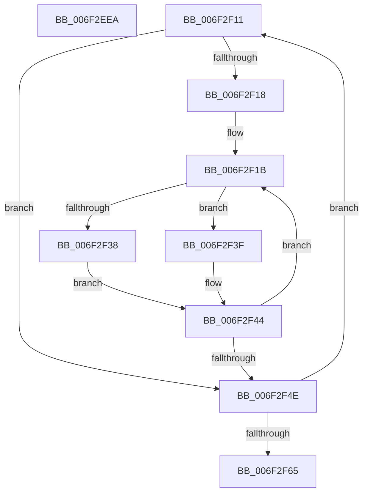

# sub_006F2EEA

- RVA: `0x006F2EEA`–`0x006F2F7A` (길이 `144` bytes)
- VA: `0x00000001406F2EEA`
- 실행 섹션: `.text`
- PDB 이름 있음: `아니요`; PDB Function 태그: `아니요`
- unwind 정보 RVA: `0x000AB18C`
- 디코드: `41`개 명령, `144/144` bytes 표시
- 미해석 바이트: `0` (있으면 어셈블리에 `.byte`로 보존)

> 이 문서는 커널 이미지의 기계어와 PDB 기호를 분석해 생성했습니다. 4번과 5번은 함수 원형과 자료형을 바이너리 사용 방식에서 추정한 C 해석이며 원본 소스 복구 결과는 아닙니다.

## 1. Dependencies

- 직접 호출 지점: **1**; 고유 호출 대상: **1**
- 직접 호출자로 확인된 함수: **0**
- RIP 상대 이미지 참조: **0**

### Outgoing calls
- `0x006F2F26` → [GxpMatchPaletteColor](../69/GxpMatchPaletteColor_function_0069F2C8.md) (function, `0x0069F2C8`)

### Direct callers
- 이 함수 시작 RVA로 연결되는 직접 call은 확인되지 않았습니다. 간접 호출은 완전히 역산할 수 없습니다.

### Static image references
- 디코드된 RIP-relative 메모리 참조가 없습니다.

## 2. Other-region calls and transfers

- 다른 실행 섹션으로 향하는 call: **0**
- call이 아닌 외부 분기/꼬리 이동: **2**
  - `0x006F2F0C` → [BgpGxConvertRectangleEx + 0x7E](../46/BgpGxConvertRectangleEx_function_004696D4.md) (`tail-transfer`)
  - `0x006F2F75` → [BgpGxConvertRectangleEx + 0xD8](../46/BgpGxConvertRectangleEx_function_004696D4.md) (`tail-transfer`)

## 3. Assembly (complete function range)

```asm
006F2EEA  8B 01                           mov eax, dword ptr [rcx]
006F2EEC  49 8B 38                        mov rdi, qword ptr [r8]
006F2EEF  89 07                           mov dword ptr [rdi], eax
006F2EF1  8B 41 04                        mov eax, dword ptr [rcx + 4]
006F2EF4  89 47 04                        mov dword ptr [rdi + 4], eax
006F2EF7  89 6F 08                        mov dword ptr [rdi + 8], ebp
006F2EFA  83 67 10 00                     and dword ptr [rdi + 0x10], 0
006F2EFE  8B 41 0C                        mov eax, dword ptr [rcx + 0xc]
006F2F01  89 47 0C                        mov dword ptr [rdi + 0xc], eax
006F2F04  48 8B 41 18                     mov rax, qword ptr [rcx + 0x18]
006F2F08  48 89 47 18                     mov qword ptr [rdi + 0x18], rax
006F2F0C  E9 41 68 D7 FF                  jmp 0x140469752
006F2F11  33 ED                           xor ebp, ebp
006F2F13  39 6F 04                        cmp dword ptr [rdi + 4], ebp
006F2F16  76 36                           jbe 0x1406f2f4e
006F2F18  41 8B F5                        mov esi, r13d
006F2F1B  41 8B 0E                        mov ecx, dword ptr [r14]
006F2F1E  48 8D 94 24 98 00 00 00         lea rdx, [rsp + 0x98]
006F2F26  E8 9D C3 FA FF                  call 0x14069f2c8
006F2F2B  8A 84 24 98 00 00 00            mov al, byte ptr [rsp + 0x98]
006F2F32  40 F6 C5 01                     test bpl, 1
006F2F36  75 07                           jne 0x1406f2f3f
006F2F38  C0 E0 04                        shl al, 4
006F2F3B  88 03                           mov byte ptr [rbx], al
006F2F3D  EB 05                           jmp 0x1406f2f44
006F2F3F  08 03                           or byte ptr [rbx], al
006F2F41  48 FF C3                        inc rbx
006F2F44  4C 03 F6                        add r14, rsi
006F2F47  FF C5                           inc ebp
006F2F49  3B 6F 04                        cmp ebp, dword ptr [rdi + 4]
006F2F4C  72 CD                           jb 0x1406f2f1b
006F2F4E  41 FF C4                        inc r12d
006F2F51  48 8D 43 01                     lea rax, [rbx + 1]
006F2F55  40 F6 C5 01                     test bpl, 1
006F2F59  48 0F 44 C3                     cmove rax, rbx
006F2F5D  48 8B D8                        mov rbx, rax
006F2F60  44 3B 27                        cmp r12d, dword ptr [rdi]
006F2F63  72 AC                           jb 0x1406f2f11
006F2F65  48 8B B4 24 80 00 00 00         mov rsi, qword ptr [rsp + 0x80]
006F2F6D  4C 8B A4 24 90 00 00 00         mov r12, qword ptr [rsp + 0x90]
006F2F75  E9 32 68 D7 FF                  jmp 0x1404697ac
```

## 4. C-style interpretation (structured pseudocode)

```c
__int64 __fastcall sub_006F2EEA(__int64 a1, __int64 a2, __int64 a3)
{
    unsigned __int64 v_stack_p80;
    unsigned __int64 v_stack_p90;
    unsigned __int64 v_stack_p98;

    *(unsigned int *)(*(unsigned __int64 *)(a3)) = (unsigned int)((unsigned int)(*(unsigned int *)(a1)));
    *(unsigned int *)(*(unsigned __int64 *)(a3) + 4) = (unsigned int)((unsigned int)(*(unsigned int *)(a1 + 4)));
    *(unsigned int *)(*(unsigned __int64 *)(a3) + 8) = (unsigned int)(v_rbp);
    *(unsigned int *)(*(unsigned __int64 *)(a3) + 12) = (unsigned int)((unsigned int)(*(unsigned int *)(a1 + 12)));
    *(unsigned __int64 *)(*(unsigned __int64 *)(a3) + 24) = *(unsigned __int64 *)(a1 + 24);
}
```

## 5. (Beta) C Style

```c
int64_t sub_006F2EEA(void *Arg1, int64_t Arg2, void *Arg3)
{
    uint8_t *arg1 = (uint8_t *)Arg1;
    uint8_t *arg3 = (uint8_t *)Arg3;

    uint64_t v_stack_p80;
    uint64_t v_stack_p90;
    uint64_t v_stack_p98;

    *(uint32_t *)(*(uint64_t *)(arg3)) = (uint32_t)((uint32_t)(*(uint32_t *)(arg1)));
    *(uint32_t *)(*(uint64_t *)(arg3) + 0x4) = (uint32_t)((uint32_t)(*(uint32_t *)(arg1 + 0x4)));
    *(uint32_t *)(*(uint64_t *)(arg3) + 0x8) = (uint32_t)(local_rbp);
    *(uint32_t *)(*(uint64_t *)(arg3) + 0xC) = (uint32_t)((uint32_t)(*(uint32_t *)(arg1 + 0xC)));
    *(uint64_t *)(*(uint64_t *)(arg3) + 0x18) = *(uint64_t *)(arg1 + 0x18);
}
```

### 관측된 메모리 오프셋

구조체 형식이 확인되지 않은 접근은 인자 기준의 오프셋으로만 기록했습니다.

| 기준 인자 | 오프셋 표현 | 폭 (bit) | 접근 |
|---|---:|---:|---|
| `Arg1` | `+ 0x0` | `32` | `R` |
| `Arg1` | `+ 0x4` | `32` | `R` |
| `Arg1` | `+ 0xC` | `32` | `R` |
| `Arg1` | `+ 0x18` | `64` | `R` |
| `Arg3` | `+ 0x0` | `64` | `R` |

## 6. Execution-region graph

[열기: 2D/3D 그래프와 함수 탐색 컨트롤 패널](../../../control-panel.html?section=text&rva=0x006F2EEA&view=graph)

- 2D 그래프는 위에서 아래로 흐르고, 3D 그래프는 빈 공간을 드래그해 회전합니다. Shift+드래그는 이동, 휠은 확대·축소, 함수 노드 선택은 대상 보고서 이동입니다.

### Static fallback


