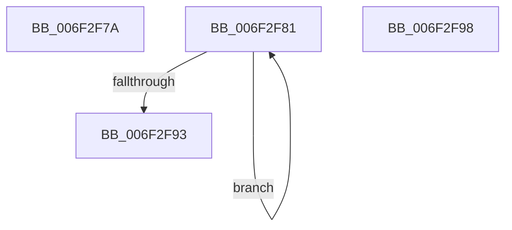

# sub_006F2F7A

- RVA: `0x006F2F7A`–`0x006F2FA4` (길이 `42` bytes)
- VA: `0x00000001406F2F7A`
- 실행 섹션: `.text`
- PDB 이름 있음: `아니요`; PDB Function 태그: `아니요`
- unwind 정보 RVA: `0x000AB334`
- 디코드: `11`개 명령, `42/42` bytes 표시
- 미해석 바이트: `0` (있으면 어셈블리에 `.byte`로 보존)

> 이 문서는 커널 이미지의 기계어와 PDB 기호를 분석해 생성했습니다. 4번과 5번은 함수 원형과 자료형을 바이너리 사용 방식에서 추정한 C 해석이며 원본 소스 복구 결과는 아닙니다.

## 1. Dependencies

- 직접 호출 지점: **0**; 고유 호출 대상: **0**
- 직접 호출자로 확인된 함수: **0**
- RIP 상대 이미지 참조: **0**

### Outgoing calls
- 직접 디코드된 call 명령이 없습니다.

### Direct callers
- 이 함수 시작 RVA로 연결되는 직접 call은 확인되지 않았습니다. 간접 호출은 완전히 역산할 수 없습니다.

### Static image references
- 디코드된 RIP-relative 메모리 참조가 없습니다.

## 2. Other-region calls and transfers

- 다른 실행 섹션으로 향하는 call: **0**
- call이 아닌 외부 분기/꼬리 이동: **3**
  - `0x006F2F7C` → [IvtIommuSendCommand + 0x9A](../46/IvtIommuSendCommand_function_0046A6E4.md) (`tail-transfer`)
  - `0x006F2F93` → [IvtIommuSendCommand + 0x104](../46/IvtIommuSendCommand_function_0046A6E4.md) (`tail-transfer`)
  - `0x006F2F9F` → [IvtIommuSendCommand + 0x104](../46/IvtIommuSendCommand_function_0046A6E4.md) (`tail-transfer`)

## 3. Assembly (complete function range)

```asm
006F2F7A  F3 90                           pause
006F2F7C  E9 FD 77 D7 FF                  jmp 0x14046a77e
006F2F81  4A 8B 04 02                     mov rax, qword ptr [rdx + r8]
006F2F85  48 89 04 0A                     mov qword ptr [rdx + rcx], rax
006F2F89  48 83 C2 08                     add rdx, 8
006F2F8D  48 83 FA 20                     cmp rdx, 0x20
006F2F91  7C EE                           jl 0x1406f2f81
006F2F93  E9 50 78 D7 FF                  jmp 0x14046a7e8
006F2F98  0F 57 C0                        xorps xmm0, xmm0
006F2F9B  0F 11 41 10                     movups xmmword ptr [rcx + 0x10], xmm0
006F2F9F  E9 44 78 D7 FF                  jmp 0x14046a7e8
```

## 4. C-style interpretation (structured pseudocode)

```c
__int64 __fastcall sub_006F2F7A(__int64 a1, __int64 a2, __int64 a3)
{
}
```

## 5. (Beta) C Style

```c
int64_t sub_006F2F7A(int64_t Arg1, int64_t Arg2, int64_t Arg3)
{
}
```

## 6. Execution-region graph

[열기: 2D/3D 그래프와 함수 탐색 컨트롤 패널](../../../control-panel.html?section=text&rva=0x006F2F7A&view=graph)

- 2D 그래프는 위에서 아래로 흐르고, 3D 그래프는 빈 공간을 드래그해 회전합니다. Shift+드래그는 이동, 휠은 확대·축소, 함수 노드 선택은 대상 보고서 이동입니다.

### Static fallback


