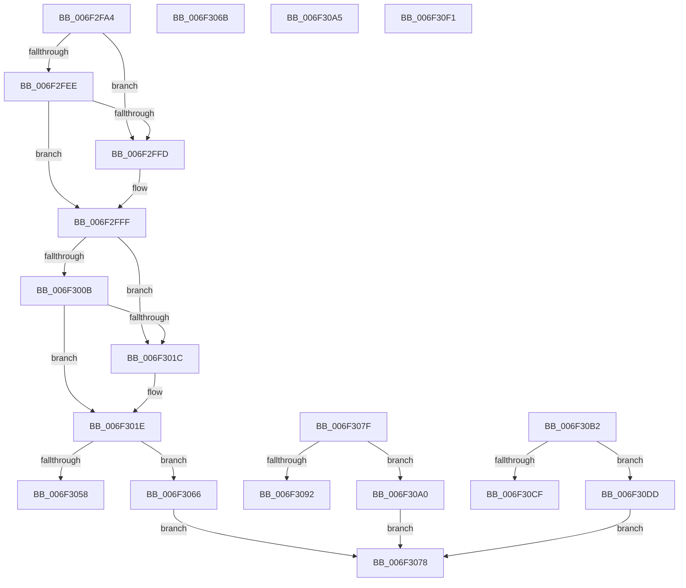

# sub_006F2FA4

- RVA: `0x006F2FA4`–`0x006F30FE` (길이 `346` bytes)
- VA: `0x00000001406F2FA4`
- 실행 섹션: `.text`
- PDB 이름 있음: `아니요`; PDB Function 태그: `아니요`
- unwind 정보 RVA: `0x000AB3AC`
- 디코드: `87`개 명령, `346/346` bytes 표시
- 미해석 바이트: `0` (있으면 어셈블리에 `.byte`로 보존)

> 이 문서는 커널 이미지의 기계어와 PDB 기호를 분석해 생성했습니다. 4번과 5번은 함수 원형과 자료형을 바이너리 사용 방식에서 추정한 C 해석이며 원본 소스 복구 결과는 아닙니다.

## 1. Dependencies

- 직접 호출 지점: **4**; 고유 호출 대상: **3**
- 직접 호출자로 확인된 함수: **0**
- RIP 상대 이미지 참조: **1**

### Outgoing calls
- `0x006F2FC2` → [SeCaptureSubjectContextEx](../../page/8C/SeCaptureSubjectContextEx_function_008C4C90.md) (function, `0x008C4C90`)
- `0x006F2FCF` → [KCBNeedsVirtualImage](../4B/KCBNeedsVirtualImage_function_004B88FC.md) (function, `0x004B88FC`)
- `0x006F2FE5` → [KCBNeedsVirtualImage](../4B/KCBNeedsVirtualImage_function_004B88FC.md) (function, `0x004B88FC`)
- `0x006F3041` → [SeReleaseSubjectContext](../../page/86/SeReleaseSubjectContext_function_0086B710.md) (function, `0x0086B710`)

### Direct callers
- 이 함수 시작 RVA로 연결되는 직접 call은 확인되지 않았습니다. 간접 호출은 완전히 역산할 수 없습니다.

### Static image references
- `0x006F3002` → RVA `0x00E0ECA0` (`.data`; read)

## 2. Other-region calls and transfers

- 다른 실행 섹션으로 향하는 call: **2**
  - `0x006F2FC2` → [SeCaptureSubjectContextEx](../../page/8C/SeCaptureSubjectContextEx_function_008C4C90.md) (`.text` → `PAGE`)
  - `0x006F3041` → [SeReleaseSubjectContext](../../page/86/SeReleaseSubjectContext_function_0086B710.md) (`.text` → `PAGE`)
- call이 아닌 외부 분기/꼬리 이동: **7**
  - `0x006F3061` → [CmQueryLayeredKey + 0x17A](../46/CmQueryLayeredKey_function_0046A930.md) (`tail-transfer`)
  - `0x006F3073` → [CmQueryLayeredKey + 0x17A](../46/CmQueryLayeredKey_function_0046A930.md) (`tail-transfer`)
  - `0x006F307A` → [CmQueryLayeredKey + 0x17A](../46/CmQueryLayeredKey_function_0046A930.md) (`tail-transfer`)
  - `0x006F309B` → [CmQueryLayeredKey + 0x17A](../46/CmQueryLayeredKey_function_0046A930.md) (`tail-transfer`)
  - `0x006F30AD` → [CmQueryLayeredKey + 0x17A](../46/CmQueryLayeredKey_function_0046A930.md) (`tail-transfer`)
  - `0x006F30D8` → [CmQueryLayeredKey + 0x17A](../46/CmQueryLayeredKey_function_0046A930.md) (`tail-transfer`)
  - `0x006F30F9` → [CmQueryLayeredKey + 0x17A](../46/CmQueryLayeredKey_function_0046A930.md) (`tail-transfer`)

## 3. Assembly (complete function range)

```asm
006F2FA4  65 48 8B 04 25 88 01 00 00      mov rax, qword ptr gs:[0x188]
006F2FAD  48 8B 90 20 02 00 00            mov rdx, qword ptr [rax + 0x220]
006F2FB4  65 48 8B 0C 25 88 01 00 00      mov rcx, qword ptr gs:[0x188]
006F2FBD  4C 8D 44 24 68                  lea r8, [rsp + 0x68]
006F2FC2  E8 C9 1C 1D 00                  call 0x1408c4c90
006F2FC7  48 8D 54 24 68                  lea rdx, [rsp + 0x68]
006F2FCC  48 8B CE                        mov rcx, rsi
006F2FCF  E8 28 59 DC FF                  call 0x1404b88fc
006F2FD4  44 8B E7                        mov r12d, edi
006F2FD7  84 C0                           test al, al
006F2FD9  41 0F 95 C4                     setne r12b
006F2FDD  48 8D 54 24 68                  lea rdx, [rsp + 0x68]
006F2FE2  48 8B CE                        mov rcx, rsi
006F2FE5  E8 12 59 DC FF                  call 0x1404b88fc
006F2FEA  84 C0                           test al, al
006F2FEC  74 0F                           je 0x1406f2ffd
006F2FEE  8B 86 B8 00 00 00               mov eax, dword ptr [rsi + 0xb8]
006F2FF4  A8 20                           test al, 0x20
006F2FF6  B8 02 00 00 00                  mov eax, 2
006F2FFB  74 02                           je 0x1406f2fff
006F2FFD  8B C7                           mov eax, edi
006F2FFF  44 0B E0                        or r12d, eax
006F3002  40 38 3D 97 BC 71 00            cmp byte ptr [rip + 0x71bc97], dil
006F3009  74 11                           je 0x1406f301c
006F300B  F7 86 B8 00 00 00 00 00 00 01   test dword ptr [rsi + 0xb8], 0x1000000
006F3015  B9 04 00 00 00                  mov ecx, 4
006F301A  75 02                           jne 0x1406f301e
006F301C  8B CF                           mov ecx, edi
006F301E  0F B7 86 BA 00 00 00            movzx eax, word ptr [rsi + 0xba]
006F3025  8B D8                           mov ebx, eax
006F3027  C1 EB 03                        shr ebx, 3
006F302A  83 E3 40                        and ebx, 0x40
006F302D  25 80 00 00 00                  and eax, 0x80
006F3032  0B D8                           or ebx, eax
006F3034  C1 EB 03                        shr ebx, 3
006F3037  41 0B DC                        or ebx, r12d
006F303A  0B D9                           or ebx, ecx
006F303C  48 8D 4C 24 68                  lea rcx, [rsp + 0x68]
006F3041  E8 CA 86 17 00                  call 0x14086b710
006F3046  90                              nop
006F3047  48 8B 4C 24 38                  mov rcx, qword ptr [rsp + 0x38]
006F304C  C7 01 04 00 00 00               mov dword ptr [rcx], 4
006F3052  41 83 FE 04                     cmp r14d, 4
006F3056  73 0E                           jae 0x1406f3066
006F3058  BB 23 00 00 C0                  mov ebx, 0xc0000023
006F305D  89 5C 24 34                     mov dword ptr [rsp + 0x34], ebx
006F3061  E9 44 7A D7 FF                  jmp 0x14046aaaa
006F3066  41 89 1F                        mov dword ptr [r15], ebx
006F3069  EB 0D                           jmp 0x1406f3078
006F306B  8B D8                           mov ebx, eax
006F306D  89 44 24 34                     mov dword ptr [rsp + 0x34], eax
006F3071  33 FF                           xor edi, edi
006F3073  E9 32 7A D7 FF                  jmp 0x14046aaaa
006F3078  8B DF                           mov ebx, edi
006F307A  E9 2B 7A D7 FF                  jmp 0x14046aaaa
006F307F  0B C2                           or eax, edx
006F3081  48 8B 4C 24 38                  mov rcx, qword ptr [rsp + 0x38]
006F3086  C7 01 04 00 00 00               mov dword ptr [rcx], 4
006F308C  41 83 FE 04                     cmp r14d, 4
006F3090  73 0E                           jae 0x1406f30a0
006F3092  BB 23 00 00 C0                  mov ebx, 0xc0000023
006F3097  89 5C 24 34                     mov dword ptr [rsp + 0x34], ebx
006F309B  E9 0A 7A D7 FF                  jmp 0x14046aaaa
006F30A0  41 89 07                        mov dword ptr [r15], eax
006F30A3  EB D3                           jmp 0x1406f3078
006F30A5  8B D8                           mov ebx, eax
006F30A7  89 44 24 34                     mov dword ptr [rsp + 0x34], eax
006F30AB  33 FF                           xor edi, edi
006F30AD  E9 F8 79 D7 FF                  jmp 0x14046aaaa
006F30B2  8B 83 B8 00 00 00               mov eax, dword ptr [rbx + 0xb8]
006F30B8  C1 E8 04                        shr eax, 4
006F30BB  83 E0 0F                        and eax, 0xf
006F30BE  48 8B 4C 24 38                  mov rcx, qword ptr [rsp + 0x38]
006F30C3  C7 01 0C 00 00 00               mov dword ptr [rcx], 0xc
006F30C9  41 83 FE 0C                     cmp r14d, 0xc
006F30CD  73 0E                           jae 0x1406f30dd
006F30CF  BB 23 00 00 C0                  mov ebx, 0xc0000023
006F30D4  89 5C 24 34                     mov dword ptr [rsp + 0x34], ebx
006F30D8  E9 CD 79 D7 FF                  jmp 0x14046aaaa
006F30DD  F2 0F 10 84 24 88 00 00 00      movsd xmm0, qword ptr [rsp + 0x88]
006F30E6  F2 41 0F 11 07                  movsd qword ptr [r15], xmm0
006F30EB  41 89 47 08                     mov dword ptr [r15 + 8], eax
006F30EF  EB 87                           jmp 0x1406f3078
006F30F1  8B D8                           mov ebx, eax
006F30F3  89 44 24 34                     mov dword ptr [rsp + 0x34], eax
006F30F7  33 FF                           xor edi, edi
006F30F9  E9 AC 79 D7 FF                  jmp 0x14046aaaa
```

## 4. C-style interpretation (structured pseudocode)

```c
__int64 __fastcall sub_006F2FA4(__int64 a1, __int64 a2, __int64 a3, __int64 a4, __int64 a5, __int64 a6, __int64 a7, __int64 a8, __int64 a9, __int64 a10, __int64 a11, __int64 a12, __int64 a13)
{
    __int64 result;
    __int64 v_r12;
    __int64 v_rbx;
    unsigned int v_stack_p34;
    unsigned __int64 v_stack_p38;
    unsigned __int64 v_stack_p88;

    result = SeCaptureSubjectContextEx(*(unsigned __int64 *)(gs_base + (0 + 392)), *(unsigned __int64 *)(*(unsigned __int64 *)(gs_base + (0 + 392)) + 544), a13, a4);
    result = KCBNeedsVirtualImage(v_rsi, a13, a13, a4);
    v_r12 = ((unsigned __int8)(result) != 0) ? 1 : 0;
    result = KCBNeedsVirtualImage(v_rsi, a13, a13, a4);
    if ((unsigned __int8)(result) == 0) goto loc_006F2FFD;
    result = 2;
    if ((((unsigned __int8)((unsigned int)(*(unsigned int *)(v_rsi + 184)))) & (32)) != 0) {
        result = (unsigned int)(v_rdi);
    }
    v_r12 = (unsigned int)((v_r12) | ((unsigned int)(result)));
    if ((*(unsigned __int8 *)(v_rip + 7453847)) == ((unsigned __int8)(v_rdi))) goto loc_006F301C;
    if (((*(unsigned int *)(v_rsi + 184)) & (0x1000000ULL)) == 0) {
        a1 = (unsigned int)(v_rdi);
    }
    v_rbx = (unsigned int)(((unsigned int)((unsigned int)(*(unsigned __int16 *)(v_rsi + 186)))) >> (3));
    v_rbx = (unsigned int)((v_rbx) & (64));
    result = (unsigned int)((*(unsigned __int16 *)(v_rsi + 186)) & (128));
    v_rbx = (unsigned int)((v_rbx) | ((unsigned int)(result)));
    v_rbx = (unsigned int)((v_rbx) >> (3));
    v_rbx = (unsigned int)((v_rbx) | ((unsigned int)(v_r12)));
    v_rbx = (unsigned int)((v_rbx) | ((unsigned int)(a1)));
    result = SeReleaseSubjectContext(a13, a13, a13, a4);
    *(unsigned int *)(a7) = 4;
    if (((unsigned int)(v_r14)) >= 4) goto loc_006F3066;
    v_stack_p34 = (unsigned int)((unsigned int)(0xC0000023ULL));
loc_006F3066:
    *(unsigned int *)(v_r15) = (unsigned int)((unsigned int)(0xC0000023ULL));
    goto loc_006F3078;
loc_006F3078:
}
```

## 5. (Beta) C Style

```c
int64_t sub_006F2FA4(int64_t Arg1, int64_t Arg2, int64_t Arg3, int64_t Arg4, uint64_t Arg5, uint64_t Arg6, void *Arg7, uint64_t Arg8, uint64_t Arg9, uint64_t Arg10, uint64_t Arg11, uint64_t Arg12, int64_t Arg13)
{
    uint8_t *arg7 = (uint8_t *)Arg7;

    int64_t result;
    int64_t local_r12;
    int64_t local_rbx;
    uint32_t v_stack_p34;
    uint64_t v_stack_p38;
    uint64_t v_stack_p88;

    result = SeCaptureSubjectContextEx(*(uint64_t *)(gs_base + (0 + 0x188)), *(uint64_t *)(*(uint64_t *)(gs_base + (0 + 0x188)) + 0x220), Arg13, Arg4);
    result = KCBNeedsVirtualImage(local_rsi, Arg13, Arg13, Arg4);
    local_r12 = ((uint8_t)(result) != 0) ? 1 : 0;
    result = KCBNeedsVirtualImage(local_rsi, Arg13, Arg13, Arg4);
    if ((uint8_t)(result) == 0) goto loc_006F2FFD;
    result = 2;
    if ((((uint8_t)((uint32_t)(*(uint32_t *)(local_rsi + 0xB8)))) & (32)) != 0) {
        result = (uint32_t)(local_rdi);
    }
    local_r12 = (uint32_t)((local_r12) | ((uint32_t)(result)));
    if ((*(uint8_t *)(v_rip + 0x71BC97)) == ((uint8_t)(local_rdi))) goto loc_006F301C;
    if (((*(uint32_t *)(local_rsi + 0xB8)) & (0x1000000ULL)) == 0) {
        Arg1 = (uint32_t)(local_rdi);
    }
    local_rbx = (uint32_t)(((uint32_t)((uint32_t)(*(uint16_t *)(local_rsi + 0xBA)))) >> (3));
    local_rbx = (uint32_t)((local_rbx) & (64));
    result = (uint32_t)((*(uint16_t *)(local_rsi + 0xBA)) & (128));
    local_rbx = (uint32_t)((local_rbx) | ((uint32_t)(result)));
    local_rbx = (uint32_t)((local_rbx) >> (3));
    local_rbx = (uint32_t)((local_rbx) | ((uint32_t)(local_r12)));
    local_rbx = (uint32_t)((local_rbx) | ((uint32_t)(Arg1)));
    result = SeReleaseSubjectContext(Arg13, Arg13, Arg13, Arg4);
    *(uint32_t *)(arg7) = 4;
    if (((uint32_t)(local_r14)) >= 4) goto loc_006F3066;
    v_stack_p34 = (uint32_t)((uint32_t)(0xC0000023ULL));
loc_006F3066:
    *(uint32_t *)(local_r15) = (uint32_t)((uint32_t)(0xC0000023ULL));
    goto loc_006F3078;
loc_006F3078:
}
```

### 관측된 메모리 오프셋

구조체 형식이 확인되지 않은 접근은 인자 기준의 오프셋으로만 기록했습니다.

| 기준 인자 | 오프셋 표현 | 폭 (bit) | 접근 |
|---|---:|---:|---|
| `Arg7` | `+ 0x0` | `32` | `W` |

## 6. Execution-region graph

[열기: 2D/3D 그래프와 함수 탐색 컨트롤 패널](../../../control-panel.html?section=text&rva=0x006F2FA4&view=graph)

- 2D 그래프는 위에서 아래로 흐르고, 3D 그래프는 빈 공간을 드래그해 회전합니다. Shift+드래그는 이동, 휠은 확대·축소, 함수 노드 선택은 대상 보고서 이동입니다.

### Static fallback


