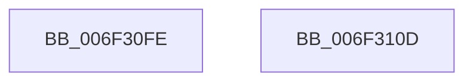

# sub_006F30FE

- RVA: `0x006F30FE`–`0x006F3118` (길이 `26` bytes)
- VA: `0x00000001406F30FE`
- 실행 섹션: `.text`
- PDB 이름 있음: `아니요`; PDB Function 태그: `아니요`
- unwind 정보 RVA: `0x000AB420`
- 디코드: `6`개 명령, `26/26` bytes 표시
- 미해석 바이트: `0` (있으면 어셈블리에 `.byte`로 보존)

> 이 문서는 커널 이미지의 기계어와 PDB 기호를 분석해 생성했습니다. 4번과 5번은 함수 원형과 자료형을 바이너리 사용 방식에서 추정한 C 해석이며 원본 소스 복구 결과는 아닙니다.

## 1. Dependencies

- 직접 호출 지점: **2**; 고유 호출 대상: **2**
- 직접 호출자로 확인된 함수: **0**
- RIP 상대 이미지 참조: **0**

### Outgoing calls
- `0x006F30FE` → [HvpGetCellPaged](../../page/85/HvpGetCellPaged_function_00854CB0.md) (function, `0x00854CB0`)
- `0x006F310D` → [HvpReleaseCellPaged](../../page/85/HvpReleaseCellPaged_function_00855F40.md) (function, `0x00855F40`)

### Direct callers
- 이 함수 시작 RVA로 연결되는 직접 call은 확인되지 않았습니다. 간접 호출은 완전히 역산할 수 없습니다.

### Static image references
- 디코드된 RIP-relative 메모리 참조가 없습니다.

## 2. Other-region calls and transfers

- 다른 실행 섹션으로 향하는 call: **2**
  - `0x006F30FE` → [HvpGetCellPaged](../../page/85/HvpGetCellPaged_function_00854CB0.md) (`.text` → `PAGE`)
  - `0x006F310D` → [HvpReleaseCellPaged](../../page/85/HvpReleaseCellPaged_function_00855F40.md) (`.text` → `PAGE`)
- call이 아닌 외부 분기/꼬리 이동: **2**
  - `0x006F3108` → [CmpQueryKeyDataFromKeyNodeStack + 0x115](../46/CmpQueryKeyDataFromKeyNodeStack_function_0046AC40.md) (`tail-transfer`)
  - `0x006F3113` → [CmpQueryKeyDataFromKeyNodeStack + 0x220](../46/CmpQueryKeyDataFromKeyNodeStack_function_0046AC40.md) (`tail-transfer`)

## 3. Assembly (complete function range)

```asm
006F30FE  E8 AD 1B 16 00                  call 0x140854cb0
006F3103  48 89 44 24 50                  mov qword ptr [rsp + 0x50], rax
006F3108  E9 48 7C D7 FF                  jmp 0x14046ad55
006F310D  E8 2E 2E 16 00                  call 0x140855f40
006F3112  90                              nop
006F3113  E9 48 7D D7 FF                  jmp 0x14046ae60
```

## 4. C-style interpretation (structured pseudocode)

```c
__int64 __fastcall sub_006F30FE(void)
{
    __int64 result;
    unsigned __int64 v_stack_p50;

    result = HvpGetCellPaged(a1, a2, a3, a4);
    v_stack_p50 = result;
}
```

## 5. (Beta) C Style

```c
void sub_006F30FE(void)
{
    int64_t result;
    uint64_t v_stack_p50;

    result = HvpGetCellPaged(a1, a2, a3, a4);
    v_stack_p50 = result;
}
```

## 6. Execution-region graph

[열기: 2D/3D 그래프와 함수 탐색 컨트롤 패널](../../../control-panel.html?section=text&rva=0x006F30FE&view=graph)

- 2D 그래프는 위에서 아래로 흐르고, 3D 그래프는 빈 공간을 드래그해 회전합니다. Shift+드래그는 이동, 휠은 확대·축소, 함수 노드 선택은 대상 보고서 이동입니다.

### Static fallback


