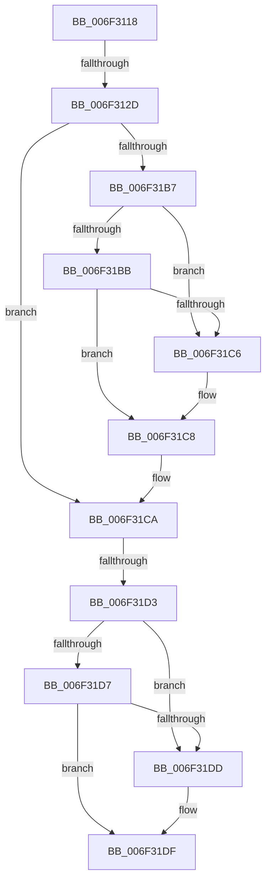

# sub_006F3118

- RVA: `0x006F3118`–`0x006F31E6` (길이 `206` bytes)
- VA: `0x00000001406F3118`
- 실행 섹션: `.text`
- PDB 이름 있음: `아니요`; PDB Function 태그: `아니요`
- unwind 정보 RVA: `0x000AB4C0`
- 디코드: `46`개 명령, `206/206` bytes 표시
- 미해석 바이트: `0` (있으면 어셈블리에 `.byte`로 보존)

> 이 문서는 커널 이미지의 기계어와 PDB 기호를 분석해 생성했습니다. 4번과 5번은 함수 원형과 자료형을 바이너리 사용 방식에서 추정한 C 해석이며 원본 소스 복구 결과는 아닙니다.

## 1. Dependencies

- 직접 호출 지점: **1**; 고유 호출 대상: **1**
- 직접 호출자로 확인된 함수: **0**
- RIP 상대 이미지 참조: **0**

### Outgoing calls
- `0x006F31AD` → [SepExamineSaclEx](../../page/A2/SepExamineSaclEx_function_00A2F39C.md) (function, `0x00A2F39C`)

### Direct callers
- 이 함수 시작 RVA로 연결되는 직접 call은 확인되지 않았습니다. 간접 호출은 완전히 역산할 수 없습니다.

### Static image references
- 디코드된 RIP-relative 메모리 참조가 없습니다.

## 2. Other-region calls and transfers

- 다른 실행 섹션으로 향하는 call: **1**
  - `0x006F31AD` → [SepExamineSaclEx](../../page/A2/SepExamineSaclEx_function_00A2F39C.md) (`.text` → `PAGE`)
- call이 아닌 외부 분기/꼬리 이동: **3**
  - `0x006F3127` → [SepExamineGlobalSaclEx + 0x71](../46/SepExamineGlobalSaclEx_function_0046B550.md) (`tail-transfer`)
  - `0x006F31CD` → [SepExamineGlobalSaclEx + 0x71](../46/SepExamineGlobalSaclEx_function_0046B550.md) (`tail-transfer`)
  - `0x006F31E1` → [SepExamineGlobalSaclEx + 0x71](../46/SepExamineGlobalSaclEx_function_0046B550.md) (`tail-transfer`)

## 3. Assembly (complete function range)

```asm
006F3118  48 8B 84 24 F8 00 00 00         mov rax, qword ptr [rsp + 0xf8]
006F3120  48 8B 48 18                     mov rcx, qword ptr [rax + 0x18]
006F3124  48 85 C9                        test rcx, rcx
006F3127  0F 84 94 84 D7 FF               je 0x14046b5c1
006F312D  48 8D 44 24 70                  lea rax, [rsp + 0x70]
006F3132  88 9C 24 F8 00 00 00            mov byte ptr [rsp + 0xf8], bl
006F3139  48 89 44 24 60                  mov qword ptr [rsp + 0x60], rax
006F313E  45 8B CE                        mov r9d, r14d
006F3141  48 8D 84 24 F8 00 00 00         lea rax, [rsp + 0xf8]
006F3149  88 5C 24 70                     mov byte ptr [rsp + 0x70], bl
006F314D  48 89 44 24 58                  mov qword ptr [rsp + 0x58], rax
006F3152  4D 8B C7                        mov r8, r15
006F3155  8A 84 24 F0 00 00 00            mov al, byte ptr [rsp + 0xf0]
006F315C  49 8B D4                        mov rdx, r12
006F315F  88 44 24 50                     mov byte ptr [rsp + 0x50], al
006F3163  48 8B 84 24 E8 00 00 00         mov rax, qword ptr [rsp + 0xe8]
006F316B  48 89 44 24 48                  mov qword ptr [rsp + 0x48], rax
006F3170  48 8B 84 24 E0 00 00 00         mov rax, qword ptr [rsp + 0xe0]
006F3178  48 89 44 24 40                  mov qword ptr [rsp + 0x40], rax
006F317D  48 8B 84 24 D8 00 00 00         mov rax, qword ptr [rsp + 0xd8]
006F3185  48 89 44 24 38                  mov qword ptr [rsp + 0x38], rax
006F318A  8A 84 24 D0 00 00 00            mov al, byte ptr [rsp + 0xd0]
006F3191  88 44 24 30                     mov byte ptr [rsp + 0x30], al
006F3195  8B 84 24 C8 00 00 00            mov eax, dword ptr [rsp + 0xc8]
006F319C  89 44 24 28                     mov dword ptr [rsp + 0x28], eax
006F31A0  48 8B 84 24 C0 00 00 00         mov rax, qword ptr [rsp + 0xc0]
006F31A8  48 89 44 24 20                  mov qword ptr [rsp + 0x20], rax
006F31AD  E8 EA C1 33 00                  call 0x140a2f39c
006F31B2  48 85 F6                        test rsi, rsi
006F31B5  74 13                           je 0x1406f31ca
006F31B7  38 1E                           cmp byte ptr [rsi], bl
006F31B9  75 0B                           jne 0x1406f31c6
006F31BB  8A C3                           mov al, bl
006F31BD  38 9C 24 F8 00 00 00            cmp byte ptr [rsp + 0xf8], bl
006F31C4  74 02                           je 0x1406f31c8
006F31C6  B0 01                           mov al, 1
006F31C8  88 06                           mov byte ptr [rsi], al
006F31CA  48 85 FF                        test rdi, rdi
006F31CD  0F 84 EE 83 D7 FF               je 0x14046b5c1
006F31D3  38 1F                           cmp byte ptr [rdi], bl
006F31D5  75 06                           jne 0x1406f31dd
006F31D7  38 5C 24 70                     cmp byte ptr [rsp + 0x70], bl
006F31DB  74 02                           je 0x1406f31df
006F31DD  B3 01                           mov bl, 1
006F31DF  88 1F                           mov byte ptr [rdi], bl
006F31E1  E9 DB 83 D7 FF                  jmp 0x14046b5c1
```

## 4. C-style interpretation (structured pseudocode)

```c
__int64 __fastcall sub_006F3118(__int64 a1, __int64 a2, __int64 a3, __int64 a4, __int64 a5, __int64 a6, __int64 a7, __int64 a8, __int64 a9, __int64 a10, __int64 a11, __int64 a12, __int64 a13, unsigned __int8 a14, __int64 a15, __int64 a16, __int64 a17, __int64 a18, __int64 a19, __int64 a20, __int64 a21, __int64 a22, __int64 a23, __int64 a24, unsigned int a25, unsigned __int8 a26, __int64 a27, __int64 a28, __int64 a29, unsigned __int8 a30, unsigned __int8 a31)
{
    __int64 result;
    __int64 v_rbx;
    unsigned __int64 v_stack_p20;
    unsigned int v_stack_p28;
    unsigned __int8 v_stack_p30;
    unsigned __int64 v_stack_p38;
    unsigned __int64 v_stack_p40;
    unsigned __int64 v_stack_p48;
    unsigned __int8 v_stack_p50;
    unsigned __int64 v_stack_p58;
    unsigned __int64 v_stack_p60;
    unsigned __int8 v_stack_p70;
    unsigned __int8 v_stack_pF8;

    v_stack_pF8 = (unsigned __int8)(v_rbx);
    v_stack_p60 = a14;
    v_stack_p70 = (unsigned __int8)(v_rbx);
    v_stack_p58 = a31;
    v_stack_p50 = a30;
    v_stack_p48 = a29;
    v_stack_p40 = a28;
    v_stack_p38 = a27;
    v_stack_p30 = a26;
    v_stack_p28 = (unsigned int)((unsigned int)(a25));
    v_stack_p20 = a24;
    result = SepExamineSaclEx(*(unsigned __int64 *)(a31 + 24), v_r12, v_r15, (unsigned int)((unsigned int)(v_r14)));
    if (v_rsi == 0) goto loc_006F31CA;
    if ((*(unsigned __int8 *)(v_rsi)) != ((unsigned __int8)(v_rbx))) goto loc_006F31C6;
    result = (unsigned __int8)(v_rbx);
    if (a31 != ((unsigned __int8)(v_rbx))) {
        result = 1;
    }
    *(unsigned __int8 *)(v_rsi) = (unsigned __int8)(result);
loc_006F31CA:
    if ((*(unsigned __int8 *)(v_rdi)) != ((unsigned __int8)(v_rbx))) goto loc_006F31DD;
    if (a14 != ((unsigned __int8)(v_rbx))) {
        v_rbx = 1;
    }
    *(unsigned __int8 *)(v_rdi) = (unsigned __int8)(v_rbx);
}
```

## 5. (Beta) C Style

```c
int64_t sub_006F3118(int64_t Arg1, int64_t Arg2, int64_t Arg3, int64_t Arg4, uint64_t Arg5, uint64_t Arg6, uint64_t Arg7, uint64_t Arg8, uint64_t Arg9, uint64_t Arg10, uint64_t Arg11, uint64_t Arg12, uint64_t Arg13, uint8_t Arg14, uint64_t Arg15, uint64_t Arg16, uint64_t Arg17, uint64_t Arg18, uint64_t Arg19, uint64_t Arg20, uint64_t Arg21, uint64_t Arg22, uint64_t Arg23, int64_t Arg24, uint32_t Arg25, uint8_t Arg26, int64_t Arg27, int64_t Arg28, int64_t Arg29, uint8_t Arg30, void *Arg31)
{
    uint8_t *arg31 = (uint8_t *)Arg31;

    int64_t result;
    int64_t local_rbx;
    uint64_t v_stack_p20;
    uint32_t v_stack_p28;
    uint8_t v_stack_p30;
    uint64_t v_stack_p38;
    uint64_t v_stack_p40;
    uint64_t v_stack_p48;
    uint8_t v_stack_p50;
    uint64_t v_stack_p58;
    uint64_t v_stack_p60;
    uint8_t v_stack_p70;
    uint8_t v_stack_pF8;

    v_stack_pF8 = (uint8_t)(local_rbx);
    v_stack_p60 = Arg14;
    v_stack_p70 = (uint8_t)(local_rbx);
    v_stack_p58 = Arg31;
    v_stack_p50 = Arg30;
    v_stack_p48 = Arg29;
    v_stack_p40 = Arg28;
    v_stack_p38 = Arg27;
    v_stack_p30 = Arg26;
    v_stack_p28 = (uint32_t)((uint32_t)(Arg25));
    v_stack_p20 = Arg24;
    result = SepExamineSaclEx(*(uint64_t *)(arg31 + 0x18), local_r12, local_r15, (uint32_t)((uint32_t)(local_r14)));
    if (local_rsi == 0) goto loc_006F31CA;
    if ((*(uint8_t *)(local_rsi)) != ((uint8_t)(local_rbx))) goto loc_006F31C6;
    result = (uint8_t)(local_rbx);
    if (Arg31 != ((uint8_t)(local_rbx))) {
        result = 1;
    }
    *(uint8_t *)(local_rsi) = (uint8_t)(result);
loc_006F31CA:
    if ((*(uint8_t *)(local_rdi)) != ((uint8_t)(local_rbx))) goto loc_006F31DD;
    if (Arg14 != ((uint8_t)(local_rbx))) {
        local_rbx = 1;
    }
    *(uint8_t *)(local_rdi) = (uint8_t)(local_rbx);
}
```

### 관측된 메모리 오프셋

구조체 형식이 확인되지 않은 접근은 인자 기준의 오프셋으로만 기록했습니다.

| 기준 인자 | 오프셋 표현 | 폭 (bit) | 접근 |
|---|---:|---:|---|
| `Arg31` | `+ 0x18` | `64` | `R` |

## 6. Execution-region graph

[열기: 2D/3D 그래프와 함수 탐색 컨트롤 패널](../../../control-panel.html?section=text&rva=0x006F3118&view=graph)

- 2D 그래프는 위에서 아래로 흐르고, 3D 그래프는 빈 공간을 드래그해 회전합니다. Shift+드래그는 이동, 휠은 확대·축소, 함수 노드 선택은 대상 보고서 이동입니다.

### Static fallback


